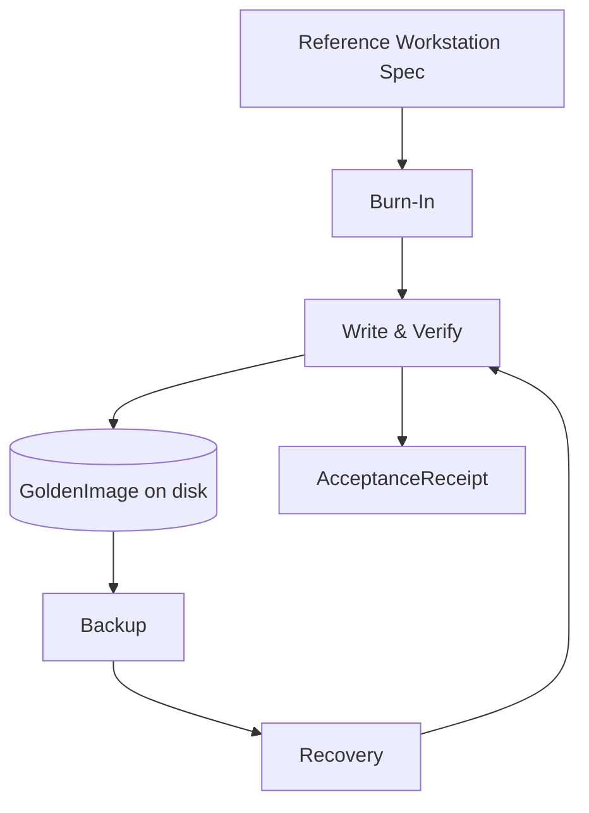

# Hardware & Golden Image

## What This Module Owns

This feature owns the per-unit lifecycle that turns certified hardware plus a signed Golden Image into a verified, recoverable Golden Quill appliance: reference-workstation acceptance, per-unit burn-in, repeatable signed-image write+verify, and customer-owned backup/recovery. It does not assemble the image (that is `tilth-runtime-build` via `GAP-TRB-GOLDEN-IMAGE-HANDOFF`) and it never reads `orgs/` client data — per-unit verification operates on the image and the appliance only (Law 3). The Sovereignty Promise is structural here: every backup/export/recovery procedure keeps custody local-by-default and exportable on customer-held keys.

## Module Map

## Capabilities

| Capability                     | What                                                              | Key Aspects                                                              | Detail               |
| ------------------------------ | ----------------------------------------------------------------- | ------------------------------------------------------------------------ | -------------------- |
| ReferenceWorkstationAcceptance | Decide whether a SKU counts as a Golden Quill unit (128GB floor)  | [AcceptReferenceSpec](operations.md#acceptreferencespec) + memory-floor + approved-alternative rules | 1 op, 3 rules        |
| BurnIn                         | Per-unit four-axis acceptance before imaging                      | [RunBurnIn](operations.md#runburnin) + [BurnInState](states.md#burninstate) | 1 op, 1 state machine |
| WriteAndVerify                 | Repeatable signed-image write with per-unit verification evidence | [WriteAndVerifyImage](operations.md#writeandverifyimage) + [VerificationState](states.md#verificationstate) | 1 op, 1 state machine |
| BackupAndRecovery              | Local backup, customer-owned export, sovereign recovery           | [RunBackup](operations.md#runbackup) + [RecoverNode](operations.md#recovernode) | 2 ops                |

### ReferenceWorkstationAcceptance (inline)

Turns the named reference SKUs into a testable spec with a mechanical 128GB memory floor and a four-condition approved-alternative rule.

| Aspect      | Concept                                                          | Summary                                       |
| ----------- | --------------------------------------------------------------- | --------------------------------------------- |
| Operation   | [AcceptReferenceSpec](operations.md#acceptreferencespec)        | Validates a SKU spec into certified/approved/rejected |
| Rule        | [MemoryFloorRule](operations.md#acceptreferencespec)            | unified_memory_gb >= 128                      |
| State/Event | [ReferenceSpecAccepted](events.md#referencespecaccepted)        | SKU admitted as a Golden Quill unit           |

### BurnIn (inline)

Per-unit thermal/memory/storage/inference soak emitting a pass/fail acceptance receipt that gates imaging. Numeric thresholds are operator-input ([EXT-HGI-2]).

| Aspect      | Concept                                            | Summary                                |
| ----------- | -------------------------------------------------- | -------------------------------------- |
| Operation   | [RunBurnIn](operations.md#runburnin)               | Runs four axes, emits AcceptanceReceipt |
| State/Event | [BurnInState](states.md#burninstate)               | Per-unit burn-in lifecycle             |
| State/Event | [BurnInCompleted](events.md#burnincompleted)       | Unit cleared (or blocked) for imaging  |

### WriteAndVerify (inline)

Deterministic flash of the signed image with pre-write signature verify, post-write digest compare, and boot-manifest check, emitting a per-unit verification receipt on success or failure.

| Aspect      | Concept                                                      | Summary                            |
| ----------- | ------------------------------------------------------------ | ---------------------------------- |
| Operation   | [WriteAndVerifyImage](operations.md#writeandverifyimage)     | Write + three-stage verify         |
| State/Event | [VerificationState](states.md#verificationstate)            | Write/verify lifecycle             |
| State/Event | [ImageVerified](events.md#imageverified)                     | Per-unit image proven faithful     |

### BackupAndRecovery (inline)

Encrypted local snapshot of mutable customer state, one-command customer-owned export under customer-held keys, and a recovery path that re-writes the image then restores state — with no vendor call-home.

| Aspect      | Concept                                          | Summary                              |
| ----------- | ------------------------------------------------ | ------------------------------------ |
| Operation   | [RunBackup](operations.md#runbackup)             | Encrypted snapshot of mutable state  |
| Operation   | [RecoverNode](operations.md#recovernode)         | Image re-write + state restore       |
| State/Event | [BackupCompleted](events.md#backupcompleted)     | Backup set produced + receipted      |

## Domain Concepts

| Concept                                                            | Type         | Key Constraints                                            |
| ------------------------------------------------------------------ | ------------ | ---------------------------------------------------------- |
| [GoldenImage](domain.md#goldenimage)                               | Entity       | Immutable; re-derivable from signed artifact; versioned    |
| [SignedArtifact](domain.md#signedartifact)                         | Entity       | Carries Ed25519 signature over the manifest                |
| [ImageManifest](domain.md#imagemanifest)                           | Value Object | Per-file SHA-256 set + total digest + version              |
| [AcceptanceReceipt](domain.md#acceptancereceipt)                   | Entity       | Emitted on PASS and FAIL; gates imaging                    |
| [VerificationReceipt](domain.md#verificationreceipt)               | Entity       | Per-unit; emitted on PASS and FAIL                         |
| [BackupSet](domain.md#backupset)                                   | Entity       | Mutable-state only; encrypted with customer-held keys      |
| [ReferenceWorkstationSpec](domain.md#referenceworkstationspec)     | Entity       | unified_memory_gb >= 128 floor                             |
| [UnitSerial](domain.md#unitserial)                                 | Value Object | Stable per-unit identifier                                 |
| [Digest](domain.md#digest)                                         | Value Object | SHA-256 hex; equality by value                             |
| [BurnInThresholds](domain.md#burninthresholds)                     | Value Object | Config input; values [OPERATOR-INPUT] (EXT-HGI-2)          |
| [SpecStatus](domain.md#specstatus)                                 | Enum         | certified / approved-alternative / candidate / rejected    |
| [ReceiptResult](domain.md#receiptresult)                           | Enum         | PASS / FAIL                                                 |
| [VerificationStage](domain.md#verificationstage)                   | Enum         | prewrite / postwrite / boot-manifest                       |

## Concept Registry

| Concept                                                                        | ID                                                  | Type          |
| ------------------------------------------------------------------------------ | --------------------------------------------------- | ------------- |
| [GoldenImage](domain.md#goldenimage)                                           | hardware-golden-image.GoldenImage                   | Entity        |
| [SignedArtifact](domain.md#signedartifact)                                     | hardware-golden-image.SignedArtifact                | Entity        |
| [AcceptanceReceipt](domain.md#acceptancereceipt)                               | hardware-golden-image.AcceptanceReceipt             | Entity        |
| [VerificationReceipt](domain.md#verificationreceipt)                           | hardware-golden-image.VerificationReceipt           | Entity        |
| [BackupSet](domain.md#backupset)                                               | hardware-golden-image.BackupSet                     | Entity        |
| [ReferenceWorkstationSpec](domain.md#referenceworkstationspec)                 | hardware-golden-image.ReferenceWorkstationSpec      | Entity        |
| [ImageManifest](domain.md#imagemanifest)                                       | hardware-golden-image.ImageManifest                 | Value Object  |
| [UnitSerial](domain.md#unitserial)                                             | hardware-golden-image.UnitSerial                    | Value Object  |
| [Digest](domain.md#digest)                                                     | hardware-golden-image.Digest                        | Value Object  |
| [BurnInThresholds](domain.md#burninthresholds)                                 | hardware-golden-image.BurnInThresholds              | Value Object  |
| [SpecStatus](domain.md#specstatus)                                             | hardware-golden-image.SpecStatus                    | Enum          |
| [ReceiptResult](domain.md#receiptresult)                                       | hardware-golden-image.ReceiptResult                 | Enum          |
| [VerificationStage](domain.md#verificationstage)                               | hardware-golden-image.VerificationStage             | Enum          |
| [AcceptReferenceSpec](operations.md#acceptreferencespec)                       | hardware-golden-image.AcceptReferenceSpec           | Operation     |
| [RunBurnIn](operations.md#runburnin)                                           | hardware-golden-image.RunBurnIn                     | Operation     |
| [WriteAndVerifyImage](operations.md#writeandverifyimage)                       | hardware-golden-image.WriteAndVerifyImage           | Operation     |
| [RunBackup](operations.md#runbackup)                                           | hardware-golden-image.RunBackup                     | Operation     |
| [ExportVault](operations.md#exportvault)                                       | hardware-golden-image.ExportVault                   | Operation     |
| [RecoverNode](operations.md#recovernode)                                       | hardware-golden-image.RecoverNode                   | Operation     |
| [MemoryFloorRule](operations.md#acceptreferencespec)                           | hardware-golden-image.MemoryFloorRule               | Rule          |
| [ApprovedAlternativeRule](operations.md#acceptreferencespec)                   | hardware-golden-image.ApprovedAlternativeRule       | Rule          |
| [ManifestSignatureRule](operations.md#writeandverifyimage)                     | hardware-golden-image.ManifestSignatureRule         | Rule          |
| [PostWriteDigestRule](operations.md#writeandverifyimage)                       | hardware-golden-image.PostWriteDigestRule           | Rule          |
| [SovereignExportRule](operations.md#exportvault)                               | hardware-golden-image.SovereignExportRule           | Rule          |
| [SingleOrgScopeRule](operations.md#exportvault)                                | hardware-golden-image.SingleOrgScopeRule            | Rule          |
| [RoundTripDigestRule](operations.md#recovernode)                               | hardware-golden-image.RoundTripDigestRule           | Rule          |
| [BurnInThresholdRule](operations.md#runburnin)                                 | hardware-golden-image.BurnInThresholdRule           | Rule          |
| [AcceptanceVerdictCalc](operations.md#runburnin)                               | hardware-golden-image.AcceptanceVerdictCalc         | Calculation   |
| [VolumeDigestCalc](operations.md#writeandverifyimage)                          | hardware-golden-image.VolumeDigestCalc              | Calculation   |
| [VerificationProcedure](workflows.md#verificationprocedure)                    | hardware-golden-image.VerificationProcedure         | Workflow      |
| [RecoveryProcedure](workflows.md#recoveryprocedure)                            | hardware-golden-image.RecoveryProcedure             | Workflow      |
| [BurnInState](states.md#burninstate)                                           | hardware-golden-image.BurnInState                   | State Machine |
| [VerificationState](states.md#verificationstate)                               | hardware-golden-image.VerificationState             | State Machine |
| [ReferenceSpecAccepted](events.md#referencespecaccepted)                       | hardware-golden-image.ReferenceSpecAccepted         | Event         |
| [BurnInCompleted](events.md#burnincompleted)                                   | hardware-golden-image.BurnInCompleted               | Event         |
| [ImageVerified](events.md#imageverified)                                       | hardware-golden-image.ImageVerified                 | Event         |
| [BackupCompleted](events.md#backupcompleted)                                   | hardware-golden-image.BackupCompleted               | Event         |
| [NodeRecovered](events.md#noderecovered)                                       | hardware-golden-image.NodeRecovered                 | Event         |
| [GoldenImageHandoff](interfaces.md#goldenimagehandoff)                         | hardware-golden-image.GoldenImageHandoff            | Interface     |
| [UnitReceiptStore](interfaces.md#unitreceiptstore)                             | hardware-golden-image.UnitReceiptStore              | Interface     |
| [ManifestToImage](mappings.md#manifesttoimage)                                 | hardware-golden-image.ManifestToImage               | Mapping       |
| [VaultToExportArchive](mappings.md#vaulttoexportarchive)                       | hardware-golden-image.VaultToExportArchive          | Mapping       |
| [GetUnitReceipt](queries.md#getunitreceipt)                                    | hardware-golden-image.GetUnitReceipt                | Query         |
| [GetReferenceSpec](queries.md#getreferencespec)                                | hardware-golden-image.GetReferenceSpec              | Query         |

## Feature Concept Graph

| From                                            | Edge         | To                                              | Evidence                                  | Notes                                      |
| ----------------------------------------------- | ------------ | ----------------------------------------------- | ----------------------------------------- | ------------------------------------------ |
| hardware-golden-image.GoldenImage               | performs     | hardware-golden-image.WriteAndVerifyImage       | operations.md#writeandverifyimage         | Image is written and verified onto a unit  |
| hardware-golden-image.ReferenceWorkstationSpec  | performs     | hardware-golden-image.AcceptReferenceSpec       | operations.md#acceptreferencespec         | SKU spec accepted                          |
| hardware-golden-image.BackupSet                 | performs     | hardware-golden-image.RunBackup                 | operations.md#runbackup                   | Mutable state snapshotted                  |
| hardware-golden-image.GoldenImage               | performs     | hardware-golden-image.RunBurnIn                 | operations.md#runburnin                   | Unit burn-in pre/post image                |
| hardware-golden-image.BackupSet                 | performs     | hardware-golden-image.RecoverNode               | operations.md#recovernode                 | State restored from backup                 |
| hardware-golden-image.BackupSet                 | performs     | hardware-golden-image.ExportVault               | operations.md#exportvault                 | Customer-owned export                      |
| hardware-golden-image.MemoryFloorRule           | enforces     | hardware-golden-image.AcceptReferenceSpec       | operations.md#acceptreferencespec         | 128GB floor                                |
| hardware-golden-image.ApprovedAlternativeRule   | enforces     | hardware-golden-image.AcceptReferenceSpec       | operations.md#acceptreferencespec         | four-condition rule                        |
| hardware-golden-image.ManifestSignatureRule     | enforces     | hardware-golden-image.WriteAndVerifyImage       | operations.md#writeandverifyimage         | Ed25519 pre-write gate                     |
| hardware-golden-image.PostWriteDigestRule       | enforces     | hardware-golden-image.WriteAndVerifyImage       | operations.md#writeandverifyimage         | post-write digest match                    |
| hardware-golden-image.SovereignExportRule       | enforces     | hardware-golden-image.ExportVault               | operations.md#exportvault                 | customer-key custody                       |
| hardware-golden-image.SingleOrgScopeRule        | enforces     | hardware-golden-image.ExportVault               | operations.md#exportvault                 | Law 3 single-org export                    |
| hardware-golden-image.RoundTripDigestRule       | enforces     | hardware-golden-image.RecoverNode               | operations.md#recovernode                 | round-trip digest match                    |
| hardware-golden-image.BurnInThresholdRule       | enforces     | hardware-golden-image.RunBurnIn                 | operations.md#runburnin                   | thresholds config-driven                   |
| hardware-golden-image.AcceptanceVerdictCalc     | calculates   | hardware-golden-image.RunBurnIn                 | operations.md#runburnin                   | mechanical verdict from thresholds         |
| hardware-golden-image.VolumeDigestCalc          | calculates   | hardware-golden-image.WriteAndVerifyImage       | operations.md#writeandverifyimage         | re-hash written volume                     |
| hardware-golden-image.AcceptReferenceSpec       | produces     | hardware-golden-image.ReferenceSpecAccepted     | operations.md#acceptreferencespec         | SKU admitted                               |
| hardware-golden-image.RunBurnIn                 | produces     | hardware-golden-image.BurnInCompleted           | operations.md#runburnin                   | unit cleared/blocked                       |
| hardware-golden-image.WriteAndVerifyImage       | produces     | hardware-golden-image.ImageVerified             | operations.md#writeandverifyimage         | image proven faithful                      |
| hardware-golden-image.RunBackup                 | produces     | hardware-golden-image.BackupCompleted           | operations.md#runbackup                   | backup receipted                           |
| hardware-golden-image.RecoverNode               | produces     | hardware-golden-image.NodeRecovered             | operations.md#recovernode                 | node restored                              |
| hardware-golden-image.BurnInCompleted           | transitions  | hardware-golden-image.BurnInState               | states.md#burninstate                     | drives burn-in lifecycle                   |
| hardware-golden-image.ImageVerified             | transitions  | hardware-golden-image.VerificationState         | states.md#verificationstate               | drives verify lifecycle                    |
| hardware-golden-image.VerificationProcedure     | orchestrates | hardware-golden-image.WriteAndVerifyImage       | workflows.md#verificationprocedure        | write+verify steps                         |
| hardware-golden-image.VerificationProcedure     | orchestrates | hardware-golden-image.RunBurnIn                 | workflows.md#verificationprocedure        | burn-in gate before imaging                |
| hardware-golden-image.RecoveryProcedure         | orchestrates | hardware-golden-image.WriteAndVerifyImage       | workflows.md#recoveryprocedure            | image re-write half                        |
| hardware-golden-image.RecoveryProcedure         | orchestrates | hardware-golden-image.RecoverNode               | workflows.md#recoveryprocedure            | state restore half                         |
| hardware-golden-image.GoldenImageHandoff        | exposes      | hardware-golden-image.WriteAndVerifyImage       | interfaces.md#goldenimagehandoff          | consumes tilth-runtime-build artifact      |
| hardware-golden-image.UnitReceiptStore          | exposes      | hardware-golden-image.GetUnitReceipt            | interfaces.md#unitreceiptstore            | receipt persistence boundary               |
| hardware-golden-image.ManifestToImage           | maps         | hardware-golden-image.GoldenImage               | mappings.md#manifesttoimage               | manifest → on-disk image set               |
| hardware-golden-image.VaultToExportArchive      | maps         | hardware-golden-image.BackupSet                 | mappings.md#vaulttoexportarchive          | mutable state → portable archive           |
| hardware-golden-image.GetUnitReceipt            | queries      | hardware-golden-image.VerificationReceipt       | queries.md#getunitreceipt                 | reads per-unit receipts                    |
| hardware-golden-image.GetReferenceSpec          | queries      | hardware-golden-image.ReferenceWorkstationSpec  | queries.md#getreferencespec               | reads SKU spec                             |
| hardware-golden-image.GoldenImage               | contains     | hardware-golden-image.ImageManifest             | domain.md#goldenimage                     | embedded manifest                          |
| hardware-golden-image.AcceptanceReceipt         | contains     | hardware-golden-image.UnitSerial                | domain.md#acceptancereceipt               | identifies the unit                        |
| hardware-golden-image.GoldenImage               | emits        | hardware-golden-image.ImageVerified             | domain.md#goldenimage                     | image announces verification               |
| hardware-golden-image.BackupSet                 | emits        | hardware-golden-image.BackupCompleted           | domain.md#backupset                       | backup announces completion                |

## Aspect Docs

| Aspect                      | Contains                                       | Key Concepts                                       |
| --------------------------- | ---------------------------------------------- | -------------------------------------------------- |
| [Domain](domain.md)         | Entities, value objects, enums                 | GoldenImage, SignedArtifact, ImageManifest, BackupSet |
| [Operations](operations.md) | Mutations, rules, calculations                 | WriteAndVerifyImage, RunBurnIn, RecoverNode        |
| [States](states.md)         | State machines and transitions                 | BurnInState, VerificationState                     |
| [Events](events.md)         | Domain events and consumers                    | ImageVerified, BackupCompleted, NodeRecovered      |
| [Queries](queries.md)       | Read models                                    | GetUnitReceipt, GetReferenceSpec                   |
| [Interfaces](interfaces.md) | External/internal contracts                    | GoldenImageHandoff, UnitReceiptStore               |
| [Mappings](mappings.md)     | Data transformations                           | ManifestToImage, VaultToExportArchive              |
| [Workflows](workflows.md)   | Multi-step orchestrations                      | VerificationProcedure, RecoveryProcedure           |

## Cross-Feature Dependencies

| Capability     | Depends On                                                                 | Via       | Why                                                          |
| -------------- | -------------------------------------------------------------------------- | --------- | ------------------------------------------------------------ |
| WriteAndVerify | tilth-runtime-build.GoldenImageAssembly (`../tilth-runtime-build/SPEC.md`) | Interface | Consumes signed, versioned installable artifact + manifest   |
| BackupAndRecovery | tilth-runtime-build.VaultLayout (`../tilth-runtime-build/SPEC.md`)       | Interface | Mutable-state file set must agree with vault/classification paths |

## Produces For

| Consumer                       | Consumes Capability            | Via                                  | What                                  |
| ------------------------------ | ------------------------------ | ------------------------------------ | ------------------------------------- |
| node-on-desk-readiness         | WriteAndVerify                 | Event: hardware-golden-image.ImageVerified | Per-unit verification evidence for white-glove |
| node-on-desk-readiness         | ReferenceWorkstationAcceptance | Query: hardware-golden-image.GetReferenceSpec | Certified-unit definition for procurement gate |
| Admin-risk ledger              | WriteAndVerify                 | Event (FAIL path)                    | HIGH-severity entry on signature/digest failure |

## Decision-Gated / Operator-Input

These values are NOT invented by this spec. The shape is authored; the numbers are gated.

| Gate      | Concept                                                            | What is deferred                                                       |
| --------- | ----------------------------------------------------------------- | --------------------------------------------------------------------- |
| EXT-HGI-1 | [ReferenceWorkstationSpec](domain.md#referenceworkstationspec)    | SKU datasheet values (memory, compute, thermal, ports, availability)  |
| EXT-HGI-2 | [BurnInThresholds](domain.md#burninthresholds)                    | Burn-in numeric pass/fail thresholds (thermal/memory/storage/inference) |

## Known Residue (audit-acknowledged)

Per `.domainspec/scripts/audit_richness.py`, two findings are intentional and documented here so L2 compilation does not have to infer them from prose:

- **Rule collision cluster (Check 1) + rule M6 clusters (Check 4).** The eight guard-rules are distinct business constraints but are inline-attached to their operations (matching the dialect of `.domainspec/examples/order-management`, where `MinimumOrderValueRule ≡ BackorderEligibilityRule` collapses identically). Paired rules that guard the same operation (e.g. `MemoryFloorRule` + `ApprovedAlternativeRule` on `AcceptReferenceSpec`; `ManifestSignatureRule` + `PostWriteDigestRule` on `WriteAndVerifyImage`; `SovereignExportRule` + `SingleOrgScopeRule` on `ExportVault`) are *deliberately co-guarding* one operation. This convergence is intentional, not residue-bait. `WriteAndVerifyImage ←[orchestrates] {VerificationProcedure, RecoveryProcedure}` is likewise intentional — both workflows genuinely re-use the same write+verify operation.
- **Interface fullness (Check 3).** `GoldenImageHandoff` and `UnitReceiptStore` show 0 tests because the audit's interface-coverage heuristic keys off literal `T-IF-` concept tokens; the actual interface tests exist (`T-IF-GoldenImageHandoff-*`, `T-IF-UnitReceiptStore-*` in TEST-SPEC.md). Parser-token mismatch, not missing coverage.

## Stories

See [User Stories](STORIES.md) for acceptance scenarios (BUILD-SPEC AC1–AC5 per gap).

## References

- Source contract: `BUILD-SPEC.md` (GAP-HGI-IMAGE-VERIFY, BACKUP-RECOVERY, BURN-IN, REFERENCE-SPEC)
- Canon: `router.yaml` lines 17–48 (Ed25519 signing/verify trust mechanism); `CLAUDE.md` Hardware + Sovereignty Promise
