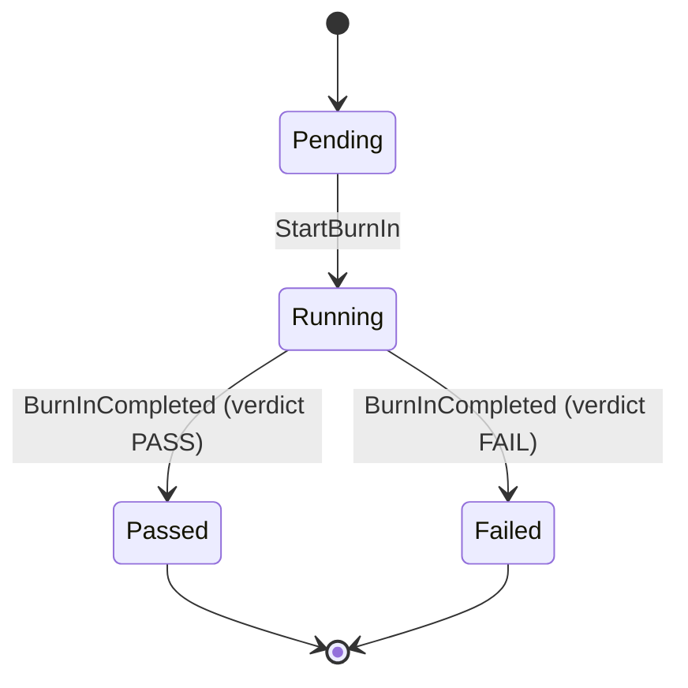
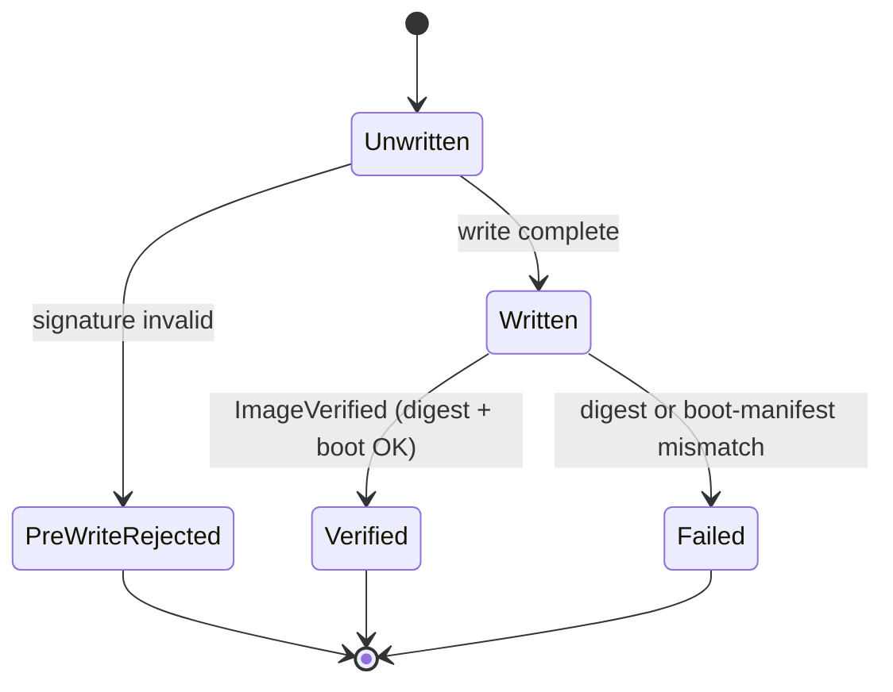

# State Machines: Hardware & Golden Image

## BurnInState

Per-unit burn-in lifecycle. A `failed` unit is blocked from imaging. Driven by [BurnInCompleted](events.md#burnincompleted) from [RunBurnIn](operations.md#runburnin).

### States

| State   | Terminal | Description                                    |
| ------- | -------- | ---------------------------------------------- |
| Pending | no       | Unit registered, burn-in not started           |
| Running | no       | Four axes executing; metrics being captured    |
| Passed  | yes      | All axes met thresholds; cleared for imaging    |
| Failed  | yes      | At least one axis failed; blocked from imaging  |

### Transition Table

| From    | Event            | To     | Guard                          | Effect                                      |
| ------- | ---------------- | ------ | ------------------------------ | ------------------------------------------- |
| Pending | StartBurnIn      | Running | thresholds config present     | begin axis capture                          |
| Running | BurnInCompleted  | Passed | verdict == PASS                | emit [AcceptanceReceipt](domain.md#acceptancereceipt) PASS |
| Running | BurnInCompleted  | Failed | verdict == FAIL                | emit [AcceptanceReceipt](domain.md#acceptancereceipt) FAIL; block imaging |

### Invariants

| ID         | Invariant                                              | Formal |
| ---------- | ------------------------------------------------------ | ------ |
| HGI-INV-1  | A receipt is emitted on entry to any terminal state    | `terminal(state) -> receipt_emitted` |
| HGI-INV-2  | Every axis captures metrics even when the unit fails   | `state == Failed -> all_axes_captured` |

---

## VerificationState

Write+verify lifecycle for a [GoldenImage](domain.md#goldenimage) on one unit. Driven by [ImageVerified](events.md#imageverified) from [WriteAndVerifyImage](operations.md#writeandverifyimage).

### States

| State            | Terminal | Description                                            |
| ---------------- | -------- | ------------------------------------------------------ |
| Unwritten        | no       | Awaiting pre-write signature verification              |
| PreWriteRejected | yes      | Manifest signature invalid; fail-closed, no write      |
| Written          | no       | Image flashed; awaiting post-write + boot verification  |
| Verified         | yes      | Digest match + boot-manifest pass; image proven faithful |
| Failed           | yes      | Post-write digest or boot-manifest mismatch            |

### Transition Table

| From      | Event          | To               | Guard                          | Effect                                |
| --------- | -------------- | ---------------- | ------------------------------ | ------------------------------------- |
| Unwritten | VerifySignature | PreWriteRejected | signature invalid             | HIGH admin-risk ledger entry; no write |
| Unwritten | VerifySignature | Written          | signature valid               | deterministic flash to target disk    |
| Written   | ImageVerified  | Verified         | digest match && boot OK        | emit [VerificationReceipt](domain.md#verificationreceipt) PASS |
| Written   | ImageVerified  | Failed           | digest or boot mismatch        | emit [VerificationReceipt](domain.md#verificationreceipt) FAIL |

### Invariants

| ID        | Invariant                                                  | Formal |
| --------- | ---------------------------------------------------------- | ------ |
| HGI-INV-3 | No write occurs unless the manifest signature is valid     | `state in {Written,Verified,Failed} -> signature_valid` |
| HGI-INV-4 | A [VerificationReceipt](domain.md#verificationreceipt) is emitted on entry to any terminal state | `terminal(state) -> receipt_emitted` |
