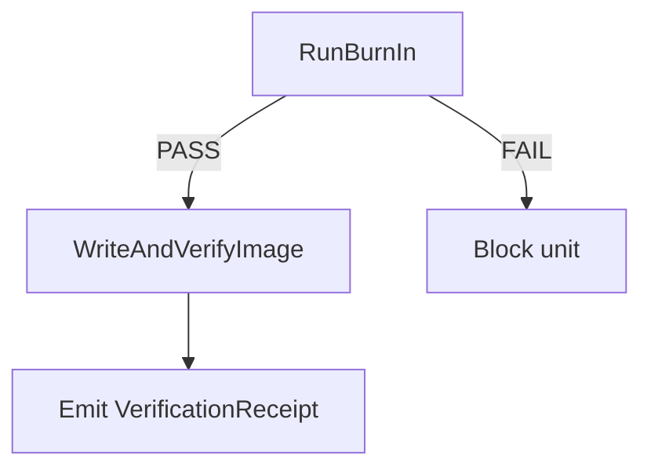
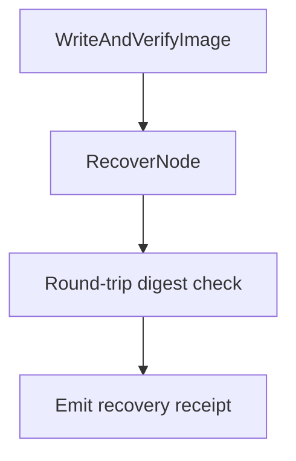

# Workflows: Hardware & Golden Image

Multi-step orchestrations for per-unit verification and node recovery. Both save state on success and failure (Autonomy Rule 1).

## VerificationProcedure

Orchestrates the path from a burn-in-passed unit to a verified Golden Image: burn-in gate, then signed write + three-stage verify.

### Steps

| Step | Operation | On Success | On Failure |
| ---- | --------- | ---------- | ---------- |
| 1 | [RunBurnIn](operations.md#runburnin) | proceed to write | block unit, receipt FAIL |
| 2 | [WriteAndVerifyImage](operations.md#writeandverifyimage) | image Verified | receipt FAIL, halt |

### Invariants

| ID        | Invariant                                                | Formal |
| --------- | -------------------------------------------------------- | ------ |
| HGI-INV-5 | No image write proceeds on a burn-in-failed unit         | `burnin == FAIL -> not written` |

---

## RecoveryProcedure

Orchestrates sovereign node recovery: re-write the Golden Image, then restore mutable state and re-verify. No publisher-side service is contacted.

### Steps

| Step | Operation | On Success | On Failure |
| ---- | --------- | ---------- | ---------- |
| 1 | [WriteAndVerifyImage](operations.md#writeandverifyimage) | image re-written + verified | receipt FAIL, halt |
| 2 | [RecoverNode](operations.md#recovernode) | state restored, digest match | receipt FAIL |

### Compensation

| If step fails | Compensation |
| ------------- | ------------ |
| step 2 digest mismatch | Retain prior backup intact; surface FAIL; do not mark node recovered |

### Invariants

| ID        | Invariant                                              | Formal |
| --------- | ------------------------------------------------------ | ------ |
| HGI-INV-6 | Recovery completes with no vendor service reachable    | `recovery_path ∩ vendor_endpoints == ∅` |
| HGI-INV-7 | Recovered state digest equals the backup state digest  | `restored_digest == backup.state_digest` |
