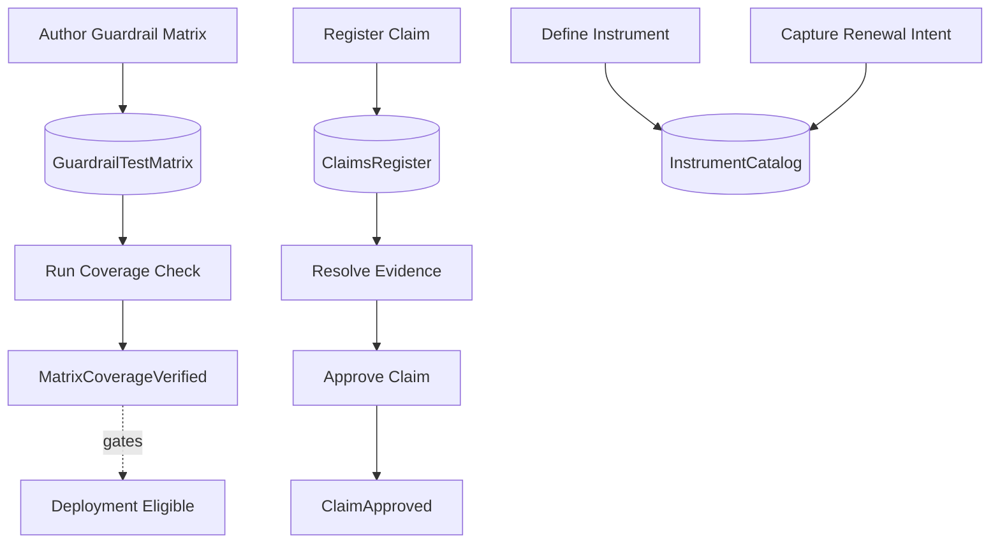

# Quality, Security & Proof

## What This Module Owns

This module owns the **proof layer** for first-customer-node readiness: the guardrail-test matrix that turns every locked fail-closed gate into an executable acceptance test, the claims register that binds every customer-facing claim to a resolvable evidence handle, and the instrument definitions that capture support-load, usage, and renewal-intent measurements. It does not redefine the F-CLASS-* or F-WPFA-* gate primitives (those live in `CLAUDE.md`); it references them and proves they fire. Design intent: a deployment is not customer-eligible until the matrix is green, no claim ships without traced evidence, and every measurement is captured under A12 Decimal discipline.

## Module Map

## Capabilities

| Capability        | What                                                                  | Key Aspects                                                            | Detail                          |
| ----------------- | --------------------------------------------------------------------- | --------------------------------------------------------------------- | ------------------------------- |
| GuardrailTesting  | Every locked fail-closed gate has an executable fail-closed test      | AuthorGuardrailTest, VerifyMatrixCoverage; CoverageRule, FailClosedRule | 4 axes, 28 gate codes cross-walked |
| ClaimsEvidence    | Every customer-facing claim binds to a resolvable evidence handle     | RegisterClaim, ResolveEvidence, ApproveClaim; EvidenceResolvableRule    | 8-category closed evidence set  |
| Instrumentation   | Support, usage, renewal measurements defined under A12 discipline     | DefineInstrument, CaptureRenewalIntent; DecimalDisciplineRule           | 6 canonical instruments         |

### GuardrailTesting (inline)

Turns each named gate in the canonical rosters into a `(gate → prohibited fixture → assert fail-closed)` acceptance test and proves matrix completeness.

| Aspect      | Concept                                                                  | Summary                                       |
| ----------- | ------------------------------------------------------------------------ | --------------------------------------------- |
| Operation   | [AuthorGuardrailTest](operations.md#authorguardrailtest)                 | Adds a typed test row for one gate            |
| Operation   | [VerifyMatrixCoverage](operations.md#verifymatrixcoverage)               | Asserts every gate code has ≥1 test           |
| Query       | [GetUncoveredGates](operations.md#getuncoveredgates)                     | Lists gate codes with no test row             |
| State/Event | [MatrixCoverageVerified](operations.md#matrixcoverageverified)           | Marks the matrix deployment-eligible          |

### ClaimsEvidence (inline)

Binds each external claim to an `evidence_category → evidence_handle → provenance_ref` chain, modeled on the WPFA buyer-facing claim chain.

| Aspect      | Concept                                                          | Summary                                       |
| ----------- | --------------------------------------------------------------- | --------------------------------------------- |
| Operation   | [RegisterClaim](operations.md#registerclaim)                    | Records a verbatim claim and its surface      |
| Operation   | [ResolveEvidence](operations.md#resolveevidence)                | Binds a claim to an evidence handle           |
| Operation   | [ApproveClaim](operations.md#approveclaim)                      | Records Josh approval for a sales-touch claim |
| State/Event | [ClaimApproved](operations.md#claimapproved)                    | Permits downstream sales use of the claim     |

### Instrumentation (inline)

Defines the measurement instruments and the Day-60 renewal-intent capture, sourcing CycleReceipt fields without inventing new ones.

| Aspect    | Concept                                                            | Summary                                          |
| --------- | ----------------------------------------------------------------- | ------------------------------------------------ |
| Operation | [DefineInstrument](operations.md#defineinstrument)                | Registers one typed instrument definition        |
| Operation | [CaptureRenewalIntent](operations.md#capturerenewalintent)        | Records a Day-60 renewal-intent reading          |
| Query     | [GetInstrumentsForConsumer](operations.md#getinstrumentsforconsumer) | Lists instruments routed to a named consumer  |

## Domain Concepts

| Concept                                                          | Type        | Key Constraints                                                       |
| --------------------------------------------------------------- | ----------- | -------------------------------------------------------------------- |
| [GuardrailTestMatrix](domain.md#guardrailtestmatrix)            | Entity      | One per deployment; canonical YAML; every gate code present          |
| [GuardrailTest](domain.md#guardrailtest)                        | Entity      | Stable `T-QSP-*` id; asserts fail-closed, not merely raised          |
| [ClaimsRegister](domain.md#claimsregister)                      | Entity      | One per node; append-only audit of claims                            |
| [Claim](domain.md#claim)                                        | Entity      | `CLM-QSP-*` id; cannot ship without resolved evidence handle         |
| [InstrumentCatalog](domain.md#instrumentcatalog)               | Entity      | One per node; no float units (A12)                                   |
| [InstrumentDefinition](domain.md#instrumentdefinition)          | Entity      | `INS-QSP-*` id; CycleReceipt fields must already exist               |
| [RenewalIntentCapture](domain.md#renewalintentcapture)         | Entity      | One per node per Day-60 reading; enum signal + note                  |
| [FailClosedGate](domain.md#failclosedgate)                      | Value Object | References a `CLAUDE.md` gate code; never redefines it               |
| [EvidenceHandle](domain.md#evidencehandle)                      | Value Object | Resolvable artifact path / test id / coefficient+cycle+trace         |
| [EnforcementAxis](domain.md#enforcementaxis)                    | Enum        | posture / classification / audit / fail-closed-meta                  |
| [EvidenceCategory](domain.md#evidencecategory)                  | Enum        | 8-category closed set                                                |
| [ClaimStatus](domain.md#claimstatus)                            | Enum        | draft / evidenced / approved / shipped                               |
| [RenewalIntentSignal](domain.md#renewalintentsignal)           | Enum        | strong / neutral / at-risk                                           |
| [CaptureCadence](domain.md#capturecadence)                      | Enum        | per-cycle / per-node / per-quarter / ongoing                         |

## Concept Registry

| Concept                                                                | ID                                                  | Type         |
| ---------------------------------------------------------------------- | --------------------------------------------------- | ------------ |
| [GuardrailTestMatrix](domain.md#guardrailtestmatrix)                   | quality-security-proof.GuardrailTestMatrix          | Entity       |
| [GuardrailTest](domain.md#guardrailtest)                               | quality-security-proof.GuardrailTest                | Entity       |
| [ClaimsRegister](domain.md#claimsregister)                             | quality-security-proof.ClaimsRegister               | Entity       |
| [Claim](domain.md#claim)                                               | quality-security-proof.Claim                        | Entity       |
| [InstrumentCatalog](domain.md#instrumentcatalog)                       | quality-security-proof.InstrumentCatalog            | Entity       |
| [InstrumentDefinition](domain.md#instrumentdefinition)                 | quality-security-proof.InstrumentDefinition         | Entity       |
| [RenewalIntentCapture](domain.md#renewalintentcapture)                 | quality-security-proof.RenewalIntentCapture         | Entity       |
| [FailClosedGate](domain.md#failclosedgate)                             | quality-security-proof.FailClosedGate               | Value Object |
| [EvidenceHandle](domain.md#evidencehandle)                             | quality-security-proof.EvidenceHandle               | Value Object |
| [EnforcementAxis](domain.md#enforcementaxis)                           | quality-security-proof.EnforcementAxis              | Enum         |
| [EvidenceCategory](domain.md#evidencecategory)                         | quality-security-proof.EvidenceCategory             | Enum         |
| [ClaimStatus](domain.md#claimstatus)                                   | quality-security-proof.ClaimStatus                  | Enum         |
| [RenewalIntentSignal](domain.md#renewalintentsignal)                   | quality-security-proof.RenewalIntentSignal          | Enum         |
| [CaptureCadence](domain.md#capturecadence)                             | quality-security-proof.CaptureCadence               | Enum         |
| [AuthorGuardrailTest](operations.md#authorguardrailtest)               | quality-security-proof.AuthorGuardrailTest          | Operation    |
| [VerifyMatrixCoverage](operations.md#verifymatrixcoverage)             | quality-security-proof.VerifyMatrixCoverage         | Operation    |
| [RegisterClaim](operations.md#registerclaim)                           | quality-security-proof.RegisterClaim                | Operation    |
| [ResolveEvidence](operations.md#resolveevidence)                       | quality-security-proof.ResolveEvidence              | Operation    |
| [ApproveClaim](operations.md#approveclaim)                             | quality-security-proof.ApproveClaim                 | Operation    |
| [DefineInstrument](operations.md#defineinstrument)                     | quality-security-proof.DefineInstrument             | Operation    |
| [CaptureRenewalIntent](operations.md#capturerenewalintent)             | quality-security-proof.CaptureRenewalIntent         | Operation    |
| [CoverageRule](operations.md#coveragerule)                             | quality-security-proof.CoverageRule                 | Rule         |
| [FailClosedAssertionRule](operations.md#failclosedassertionrule)       | quality-security-proof.FailClosedAssertionRule      | Rule         |
| [Law3FixtureRule](operations.md#law3fixturerule)                       | quality-security-proof.Law3FixtureRule              | Rule         |
| [EvidenceResolvableRule](operations.md#evidenceresolvablerule)         | quality-security-proof.EvidenceResolvableRule       | Rule         |
| [SalesTouchApprovalRule](operations.md#salestouchapprovalrule)         | quality-security-proof.SalesTouchApprovalRule       | Rule         |
| [ClassificationCheckRule](operations.md#classificationcheckrule)       | quality-security-proof.ClassificationCheckRule      | Rule         |
| [DecimalDisciplineRule](operations.md#decimaldisciplinerule)           | quality-security-proof.DecimalDisciplineRule        | Rule         |
| [ReceiptFieldExistsRule](operations.md#receiptfieldexistsrule)         | quality-security-proof.ReceiptFieldExistsRule       | Rule         |
| [CoverageRatioCalculation](operations.md#coverageratiocalculation)     | quality-security-proof.CoverageRatioCalculation     | Calculation  |
| [GetUncoveredGates](operations.md#getuncoveredgates)                   | quality-security-proof.GetUncoveredGates            | Query        |
| [GetApprovedClaims](operations.md#getapprovedclaims)                   | quality-security-proof.GetApprovedClaims            | Query        |
| [GetInstrumentsForConsumer](operations.md#getinstrumentsforconsumer)   | quality-security-proof.GetInstrumentsForConsumer    | Query        |
| [MatrixCoverageVerified](operations.md#matrixcoverageverified)         | quality-security-proof.MatrixCoverageVerified       | Event        |
| [ClaimApproved](operations.md#claimapproved)                           | quality-security-proof.ClaimApproved                | Event        |

## Feature Concept Graph

| From                                            | Edge       | To                                                | Evidence                              | Notes                                  |
| ----------------------------------------------- | ---------- | ------------------------------------------------- | ------------------------------------- | -------------------------------------- |
| quality-security-proof.GuardrailTestMatrix      | performs   | quality-security-proof.AuthorGuardrailTest        | operations.md#authorguardrailtest     | matrix is the actor that grows         |
| quality-security-proof.GuardrailTestMatrix      | performs   | quality-security-proof.VerifyMatrixCoverage       | operations.md#verifymatrixcoverage    |                                        |
| quality-security-proof.GuardrailTestMatrix      | contains   | quality-security-proof.FailClosedGate             | domain.md#failclosedgate              | references CLAUDE.md codes             |
| quality-security-proof.CoverageRule             | enforces   | quality-security-proof.VerifyMatrixCoverage       | operations.md#coveragerule            | META completeness                      |
| quality-security-proof.FailClosedAssertionRule  | enforces   | quality-security-proof.AuthorGuardrailTest        | operations.md#failclosedassertionrule | asserts fail-closed not just raised    |
| quality-security-proof.Law3FixtureRule          | enforces   | quality-security-proof.AuthorGuardrailTest        | operations.md#law3fixturerule         | synthetic orgs only                    |
| quality-security-proof.CoverageRatioCalculation | calculates | quality-security-proof.VerifyMatrixCoverage       | operations.md#coverageratiocalculation |                                       |
| quality-security-proof.VerifyMatrixCoverage     | produces   | quality-security-proof.MatrixCoverageVerified     | operations.md#verifymatrixcoverage    |                                        |
| quality-security-proof.GetUncoveredGates        | queries    | quality-security-proof.GuardrailTestMatrix        | operations.md#getuncoveredgates       |                                        |
| quality-security-proof.ClaimsRegister           | performs   | quality-security-proof.RegisterClaim              | operations.md#registerclaim           |                                        |
| quality-security-proof.ClaimsRegister           | performs   | quality-security-proof.ResolveEvidence            | operations.md#resolveevidence         |                                        |
| quality-security-proof.ClaimsRegister           | performs   | quality-security-proof.ApproveClaim               | operations.md#approveclaim            |                                        |
| quality-security-proof.Claim                    | contains   | quality-security-proof.EvidenceHandle             | domain.md#evidencehandle              |                                        |
| quality-security-proof.EvidenceResolvableRule   | enforces   | quality-security-proof.ResolveEvidence            | operations.md#evidenceresolvablerule  |                                        |
| quality-security-proof.ClassificationCheckRule  | enforces   | quality-security-proof.ResolveEvidence            | operations.md#classificationcheckrule | mirrors F-WPFA-PDF-CONFIDENTIAL-LEAK   |
| quality-security-proof.SalesTouchApprovalRule   | enforces   | quality-security-proof.ApproveClaim               | operations.md#salestouchapprovalrule  | Josh approval                          |
| quality-security-proof.ApproveClaim             | produces   | quality-security-proof.ClaimApproved              | operations.md#approveclaim            |                                        |
| quality-security-proof.GetApprovedClaims        | queries    | quality-security-proof.ClaimsRegister             | operations.md#getapprovedclaims       |                                        |
| quality-security-proof.InstrumentCatalog        | performs   | quality-security-proof.DefineInstrument           | operations.md#defineinstrument        |                                        |
| quality-security-proof.RenewalIntentCapture     | performs   | quality-security-proof.CaptureRenewalIntent       | operations.md#capturerenewalintent    |                                        |
| quality-security-proof.DecimalDisciplineRule    | enforces   | quality-security-proof.DefineInstrument           | operations.md#decimaldisciplinerule   | A12 no-float                           |
| quality-security-proof.ReceiptFieldExistsRule   | enforces   | quality-security-proof.DefineInstrument           | operations.md#receiptfieldexistsrule  | no invented CycleReceipt fields        |
| quality-security-proof.GetInstrumentsForConsumer | queries   | quality-security-proof.InstrumentCatalog          | operations.md#getinstrumentsforconsumer |                                      |

## Aspect Docs

| Aspect                      | Contains                                        | Key Concepts                                          |
| --------------------------- | ----------------------------------------------- | ----------------------------------------------------- |
| [Domain](domain.md)         | Entities, value objects, enums                  | GuardrailTestMatrix, Claim, InstrumentDefinition      |
| [Operations](operations.md) | Operations, rules, calculations, queries, events | VerifyMatrixCoverage, ResolveEvidence, DefineInstrument |

## Cross-Feature Dependencies

| Capability       | Depends On                                                                              | Via       | Why                                                                       |
| ---------------- | --------------------------------------------------------------------------------------- | --------- | ------------------------------------------------------------------------- |
| ClaimsEvidence   | `tilth-runtime-build`.FailClosedGates (`../tilth-runtime-build/SPEC.md`)                 | Interface | Gate codes (F-CLASS-*/F-WPFA-*) are owned upstream; QSP references them    |
| Instrumentation  | `tilth-runtime-build`.WPFACycleReceipt (`../tilth-runtime-build/SPEC.md`)                | Query     | Instrument source fields must already exist on the CycleReceipt sub-kind   |

## Produces For

<!-- Cross-feature outputs. Modeled as dependencies in the consumer's SPEC, not duplicated here. -->

| Consumer                                                                  | Consumes Capability | Via       | What                                                              |
| ------------------------------------------------------------------------- | ------------------- | --------- | ---------------------------------------------------------------- |
| `sales-contracting-legal` (`../sales-contracting-legal/SPEC.md`)          | ClaimsEvidence      | Query     | `claims-register.yaml` — sales copy may cite only `approved` claims |
| `company-operations-finance` (`../company-operations-finance/SPEC.md`)    | Instrumentation     | Query     | `INS-QSP-*` `data-room` metrics for the validation packet (row 80) |
| `white-glove-delivery-node-care` (`../white-glove-delivery-node-care/SPEC.md`) | Instrumentation | Query     | `INS-QSP-*` `day-60` metrics + renewal-intent form (row 76)       |
| `hardware-golden-image`, `tilth-runtime-build`                            | GuardrailTesting    | Query     | `guardrail-test-matrix.yaml` — build is eligible only when green  |

## Stories

User stories and acceptance scenarios are authored in `BUILD-SPEC.md` §1–§3 acceptance criteria; this slice does not yet author a standalone STORIES.md.

## References

- Build spec / source obligations: `BUILD-SPEC.md`
- Gate code rosters (referenced, never redefined): `CLAUDE.md` (16 F-CLASS-* primitives; 12 F-WPFA-* codes; Five Operating Laws)
