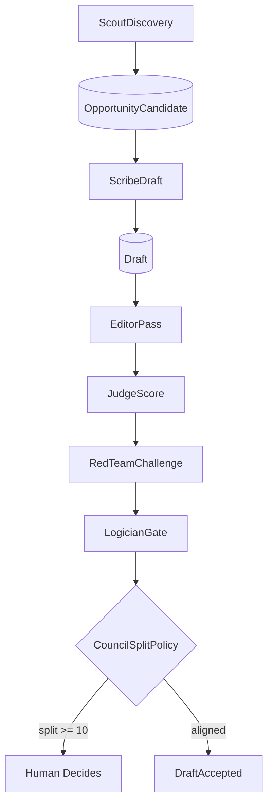

# Tilth Runtime Build — Grant-Cycle Council Pipeline

## What This Module Owns

This feature owns the **grant-cycle council pipeline**: the bounded slice of the Tilth runtime where a verified opportunity is drafted, reviewed, scored, adversarially challenged, and gated through the six-seat council (Scout → Scribe → Editor → Judge → Red Team → Logician) under the Four Autonomy Rules. It owns the `Draft` and `GrantCycle` entities, their lifecycles, the council-split decision rule, and the deterministic Logician gates that fail-closed on every transition. It does **not** own inference serving, the vault, routing, ingestion, or Golden Image assembly — those are sibling work packs (WP-1/2/3/4/14) referenced as dependencies.

Scope boundary: this spec models the council pipeline domain only (BUILD-SPEC §1 work packs WP-5 Scout, WP-6 Mapper, WP-7 Drafting, WP-8 Review). It is deliberately bounded and does not attempt the whole runtime.

## Module Map

## Capabilities

| Capability | What | Key Aspects | Detail |
| ---------- | ---- | ----------- | ------ |
| Discovery (inline) | Surface and verify funding opportunities | ScoutDiscovery operation, OpportunityCandidate entity, DISCOVER/VERIFY/REVIEW states | 1 op, 1 entity, 1 state machine |
| Drafting (inline) | Compose and refine a proposal section by section | ScribeDraft + EditorPass operations, Draft entity, DraftLifecycle | 2 ops, 1 entity |
| Review (inline) | Score, challenge, and gate a draft | JudgeScore + RedTeamChallenge + LogicianGate operations, CouncilSplitPolicy | 3 ops, 1 policy, 1 calc |
| Orchestration (inline) | Coordinate the council seats across a cycle | GrantCyclePipeline workflow, GrantCycle entity, GrantCycleStatus | 1 workflow, 1 entity, 1 state machine |

### Discovery (inline)

Scout runs two-stage discovery (DISCOVER union of six channel families → VERIFY live-synopsis → REVIEW human gate) and elevates verified opportunities into the cycle.

| Aspect | Concept | Summary |
| ------ | ------- | ------- |
| Operation | [ScoutDiscovery](operations.md#scoutdiscovery) | Surfaces + verifies opportunities, never auto-files |
| State/Event | [OpportunityState](states.md#opportunitystate) | DISCOVERED → VERIFIED → REVIEWED |

### Drafting (inline)

Scribe drafts section by section with KGIE preflight; Editor reads through different eyes and offers 2–3 replacement options per flag.

| Aspect | Concept | Summary |
| ------ | ------- | ------- |
| Operation | [ScribeDraft](operations.md#scribedraft) | Composes a proposal draft section by section |
| Operation | [EditorPass](operations.md#editorpass) | Clarity pass with replacement options |
| State/Event | [DraftLifecycle](states.md#draftlifecycle) | Drafted → Edited → Scored → Accepted/Revising |

### Review (inline)

Judge scores against the funder rubric; Red Team fires adversarially on every draft; Logician runs deterministic Cedar/Python gates fail-closed.

| Aspect | Concept | Summary |
| ------ | ------- | ------- |
| Operation | [JudgeScore](operations.md#judgescore) | Scores draft against funder rubric |
| Operation | [RedTeamChallenge](operations.md#redteamchallenge) | Adversarial challenge, cross-family |
| Operation | [LogicianGate](operations.md#logiciangate) | Deterministic fail-closed Five-Laws gate |

## Domain Concepts

| Concept | Type | Key Constraints |
| ------- | ---- | --------------- |
| [GrantCycle](domain.md#grantcycle) | Entity | One PROJECT_CONTEXT per cycle (Law 3); single org slug |
| [Draft](domain.md#draft) | Entity | Carries section set + provenance; every claim traces to RFA/PROJECT_CONTEXT (Law 1) |
| [OpportunityCandidate](domain.md#opportunitycandidate) | Entity | Cannot reach CRITICAL-fit without a passed VERIFY |
| [CouncilSeat](domain.md#councilseat) | Enum | scout / scribe / editor / judge / red_team / logician |
| [OperatingGear](domain.md#operatinggear) | Enum | sparring_partner / co_pilot (default) / synthesizer |
| [VerificationVerdict](domain.md#verificationverdict) | Enum | VERIFIED_FIT / VERIFIED_NOT_FIT / UNVERIFIED / VERIFICATION_FAILED |
| [RubricScore](domain.md#rubricscore) | Value Object | Per-dimension score with evidence string present in draft |
| [SectionProvenance](domain.md#sectionprovenance) | Value Object | Source ref (RFA or PROJECT_CONTEXT) per section claim |

## Concept Registry

| Concept | ID | Type |
| ------- | -- | ---- |
| [GrantCycle](domain.md#grantcycle) | tilth-runtime-build.GrantCycle | Entity |
| [Draft](domain.md#draft) | tilth-runtime-build.Draft | Entity |
| [OpportunityCandidate](domain.md#opportunitycandidate) | tilth-runtime-build.OpportunityCandidate | Entity |
| [RubricScore](domain.md#rubricscore) | tilth-runtime-build.RubricScore | ValueObject |
| [SectionProvenance](domain.md#sectionprovenance) | tilth-runtime-build.SectionProvenance | ValueObject |
| [CouncilSeat](domain.md#councilseat) | tilth-runtime-build.CouncilSeat | Enum |
| [OperatingGear](domain.md#operatinggear) | tilth-runtime-build.OperatingGear | Enum |
| [VerificationVerdict](domain.md#verificationverdict) | tilth-runtime-build.VerificationVerdict | Enum |
| [ScoutDiscovery](operations.md#scoutdiscovery) | tilth-runtime-build.ScoutDiscovery | Operation |
| [ScribeDraft](operations.md#scribedraft) | tilth-runtime-build.ScribeDraft | Operation |
| [EditorPass](operations.md#editorpass) | tilth-runtime-build.EditorPass | Operation |
| [JudgeScore](operations.md#judgescore) | tilth-runtime-build.JudgeScore | Operation |
| [RedTeamChallenge](operations.md#redteamchallenge) | tilth-runtime-build.RedTeamChallenge | Operation |
| [LogicianGate](operations.md#logiciangate) | tilth-runtime-build.LogicianGate | Operation |
| [CouncilSplitDelta](operations.md#councilsplitdelta) | tilth-runtime-build.CouncilSplitDelta | Calculation |
| [Law1TraceabilityRule](operations.md#law1traceabilityrule) | tilth-runtime-build.Law1TraceabilityRule | Rule |
| [CrossFamilyRule](operations.md#crossfamilyrule) | tilth-runtime-build.CrossFamilyRule | Rule |
| [MagicStepValidationRule](operations.md#magicstepvalidationrule) | tilth-runtime-build.MagicStepValidationRule | Rule |
| [VerifyBeforeCriticalRule](operations.md#verifybeforecriticalrule) | tilth-runtime-build.VerifyBeforeCriticalRule | Rule |
| [CouncilSplitPolicy](workflows.md#councilsplitpolicy) | tilth-runtime-build.CouncilSplitPolicy | Policy |
| [GearModePolicy](workflows.md#gearmodepolicy) | tilth-runtime-build.GearModePolicy | Policy |
| [GrantCyclePipeline](workflows.md#grantcyclepipeline) | tilth-runtime-build.GrantCyclePipeline | Workflow |
| [DraftLifecycle](states.md#draftlifecycle) | tilth-runtime-build.DraftLifecycle | StateMachine |
| [GrantCycleStatus](states.md#grantcyclestatus) | tilth-runtime-build.GrantCycleStatus | StateMachine |
| [OpportunityState](states.md#opportunitystate) | tilth-runtime-build.OpportunityState | StateMachine |
| [DraftScored](events.md#draftscored) | tilth-runtime-build.DraftScored | Event |
| [CouncilSplitRaised](events.md#councilsplitraised) | tilth-runtime-build.CouncilSplitRaised | Event |
| [DraftRevisionRequested](events.md#draftrevisionrequested) | tilth-runtime-build.DraftRevisionRequested | Event |
| [OpportunityVerified](events.md#opportunityverified) | tilth-runtime-build.OpportunityVerified | Event |

## Feature Concept Graph

| From | Edge | To | Evidence | Notes |
| ---- | ---- | -- | -------- | ----- |
| tilth-runtime-build.OpportunityCandidate | performs | tilth-runtime-build.ScoutDiscovery | operations.md#scoutdiscovery | Scout acts on candidate |
| tilth-runtime-build.Draft | performs | tilth-runtime-build.ScribeDraft | operations.md#scribedraft | Scribe composes draft |
| tilth-runtime-build.Draft | performs | tilth-runtime-build.EditorPass | operations.md#editorpass | Editor refines draft |
| tilth-runtime-build.Draft | performs | tilth-runtime-build.JudgeScore | operations.md#judgescore | Judge scores draft |
| tilth-runtime-build.Draft | performs | tilth-runtime-build.RedTeamChallenge | operations.md#redteamchallenge | Red Team challenges draft |
| tilth-runtime-build.GrantCycle | performs | tilth-runtime-build.LogicianGate | operations.md#logiciangate | Logician gates the cycle |
| tilth-runtime-build.ScoutDiscovery | produces | tilth-runtime-build.OpportunityVerified | operations.md#scoutdiscovery | VERIFY emits verdict |
| tilth-runtime-build.JudgeScore | produces | tilth-runtime-build.DraftScored | operations.md#judgescore | Score completed |
| tilth-runtime-build.RedTeamChallenge | produces | tilth-runtime-build.CouncilSplitRaised | operations.md#redteamchallenge | Split detected |
| tilth-runtime-build.LogicianGate | produces | tilth-runtime-build.DraftRevisionRequested | operations.md#logiciangate | Sole producer; gate fail-close → revise |
| tilth-runtime-build.VerifyBeforeCriticalRule | enforces | tilth-runtime-build.ScoutDiscovery | operations.md#scoutdiscovery | No CRITICAL without VERIFY |
| tilth-runtime-build.Law1TraceabilityRule | enforces | tilth-runtime-build.ScribeDraft | operations.md#scribedraft | Every claim traces |
| tilth-runtime-build.CrossFamilyRule | enforces | tilth-runtime-build.JudgeScore | operations.md#judgescore | Judge ≠ Scribe family |
| tilth-runtime-build.CrossFamilyRule | enforces | tilth-runtime-build.RedTeamChallenge | operations.md#redteamchallenge | Red Team ≠ Scribe/Judge family |
| tilth-runtime-build.MagicStepValidationRule | enforces | tilth-runtime-build.LogicianGate | operations.md#logiciangate | Rule 2 validate-before-complete |
| tilth-runtime-build.CouncilSplitDelta | calculates | tilth-runtime-build.JudgeScore | operations.md#judgescore | Judge/Red-Team delta |
| tilth-runtime-build.CouncilSplitPolicy | applies | tilth-runtime-build.LogicianGate | operations.md#logiciangate | ≥10 → human gate |
| tilth-runtime-build.GearModePolicy | applies | tilth-runtime-build.ScribeDraft | operations.md#scribedraft | Sparring/Co-Pilot/Synthesizer |
| tilth-runtime-build.GrantCyclePipeline | orchestrates | tilth-runtime-build.ScribeDraft | workflows.md#grantcyclepipeline | Pipeline step |
| tilth-runtime-build.GrantCyclePipeline | orchestrates | tilth-runtime-build.EditorPass | workflows.md#grantcyclepipeline | Pipeline step |
| tilth-runtime-build.GrantCyclePipeline | orchestrates | tilth-runtime-build.JudgeScore | workflows.md#grantcyclepipeline | Pipeline step |
| tilth-runtime-build.GrantCyclePipeline | orchestrates | tilth-runtime-build.RedTeamChallenge | workflows.md#grantcyclepipeline | Pipeline step |
| tilth-runtime-build.GrantCyclePipeline | orchestrates | tilth-runtime-build.LogicianGate | workflows.md#grantcyclepipeline | Pipeline step |
| tilth-runtime-build.OpportunityVerified | transitions | tilth-runtime-build.OpportunityState | states.md#opportunitystate | DISCOVERED → VERIFIED |
| tilth-runtime-build.DraftScored | transitions | tilth-runtime-build.DraftLifecycle | states.md#draftlifecycle | Edited → Scored |
| tilth-runtime-build.DraftRevisionRequested | transitions | tilth-runtime-build.DraftLifecycle | states.md#draftlifecycle | Scored → Revising |
| tilth-runtime-build.Draft | contains | tilth-runtime-build.SectionProvenance | domain.md#draft | Provenance per section |
| tilth-runtime-build.Draft | contains | tilth-runtime-build.RubricScore | domain.md#draft | Scores embedded |
| tilth-runtime-build.Draft | emits | tilth-runtime-build.DraftScored | domain.md#draft | Draft is event source |

## Aspect Docs

| Aspect | Contains | Key Concepts |
| ------ | -------- | ------------ |
| [Domain](domain.md) | Entities, value objects, enums | GrantCycle, Draft, OpportunityCandidate |
| [Operations](operations.md) | Council-seat operations, rules, calculations | Scribe/Judge/RedTeam/Logician seats |
| [States](states.md) | Draft / cycle / opportunity lifecycles | DraftLifecycle, GrantCycleStatus |
| [Workflows](workflows.md) | Council pipeline + split/gear policies | GrantCyclePipeline, CouncilSplitPolicy |
| [Events](events.md) | Council pipeline events | DraftScored, CouncilSplitRaised |

## Cross-Feature Dependencies

| Capability | Depends On | Via | Why |
| ---------- | ---------- | --- | --- |
| Drafting | WP-2 Multi-model routing (`BUILD-SPEC.md` §1) | Interface | Per-call posture-driven routing decision |
| Drafting | WP-3 Vault (`BUILD-SPEC.md` §1) | Query | Classification-aware substance assembly |
| Discovery | WP-1 Inference (`BUILD-SPEC.md` §1) | Interface | Scout primary local model + embeddings |
| Orchestration | WP-11 Audit log (`BUILD-SPEC.md` §1) | Event | Every invocation written to hash-chained log |

## Produces For

| Consumer | Consumes Capability | Via | What |
| -------- | ------------------- | --- | ---- |
| WP-13 Evidence/Report | Review | Event: DraftScored | Accepted draft feeds evidence capture |
| WP-11 Audit log | Orchestration | Event: CouncilSplitRaised | Council-split recorded with payload class |
| WP-14 Golden Image | Review | Interface | Logician gate modules packaged into image |

## Decision-Gated Concepts (NOT resolved here)

The following are annotated as decision-gated per BUILD-SPEC §3/§4. They are referenced as deferred and are **not** modelled as live concepts in this spec.

| Concept | Gate | Status | Rationale |
| ------- | ---- | ------ | --------- |
| PostureEnforcement (WP-9 routing-enforcement hook) | `DEC-BC-POSTURE-VOCAB` | block | Three-posture canon (Frontier-Eligible / Split-Context Hybrid / Local-Only-Sovereign); build execution blocked until Josh resolves vocabulary. NEVER revive "Sanitized" / 4-posture. |
| SplitContextComposition (WP-10) | `DEC-BC-POSTURE-VOCAB` | block | Substance/structure split via closed-set allow-list + applicant-fact PRE-scan; no `[SLOT_*]`, no opaque-slot round-trip. |
| OperatorConsoleProjection (WP-12) | `DEC-BC-UI-BOUNDARY` | flag (PENDING) | v0.1 is HEADLESS-ONLY (locked). Read-only projection / deferred phase only — never an interactive v0.1 UI. Excluded from v0.1 Golden Image until ungated. |

Routing in the live concepts above (CouncilSplitPolicy, JudgeScore cross-family) references the posture decision only through the `BUILD-SPEC.md` WP-2 dependency seam; this spec does not author posture enforcement.

## Audit Residue (known, accepted)

Richness audit (`audit_richness.py`) verdict: MODERATELY UNDER-SPECIFIED, severity 8. Substantive checks pass — Check 2 (faithfulness) clean, Check 3 (fullness) clean, Check 5 (cardinality) 85.8% ≥ 0.8 threshold. Residue is confined to two parser-dialect artifacts:

1. **Check 1 collisions (3 clusters):** GrantCycle ≡ OpportunityCandidate (entities); the three Law-rules; the four pipeline events. The audit parser attributes structure only to concepts whose slug matches an H2 header and harvests fields/formal-rows from those H2 sections. Entities, value objects, standalone rules, and events are authored as H3 under grouping H2 headers (`## Entities`, `## Business Rules (standalone)`), so their distinguishing fields and rule formal/violation rows are invisible to the audit — the concepts collapse on identical cross-file edge topology even though their domain content differs. This is a parser-visibility limitation, not a real concept collapse; each concept is individually distinct in domain.md / operations.md / events.md.
2. **Check 4/6 (1 M6 cluster):** DraftLifecycle receives three `transitions` edges. This is the canonical single-entity lifecycle pattern (a state machine naturally has multiple transition events), annotated as intentional in states.md. Not residue-bait.

No residue affects the live council-pipeline contract. Decision-gated concepts (posture, console) are intentionally excluded, not under-specified.

## Stories

Deferred — STORIES.md not authored in this first slice. TEST-SPEC.md authored (97 rows) for cardinality/fullness coverage.

## References

- Build plan + work packs: `BUILD-SPEC.md`
- Substrate + canon authority: `CLAUDE.md`, `pipeline/architecture/v0.1/architecture_v7_0_10_amendment.md`
- Decision gates: `DEC-BC-POSTURE-VOCAB`, `DEC-BC-UI-BOUNDARY` (boundary-and-canon ledger)
