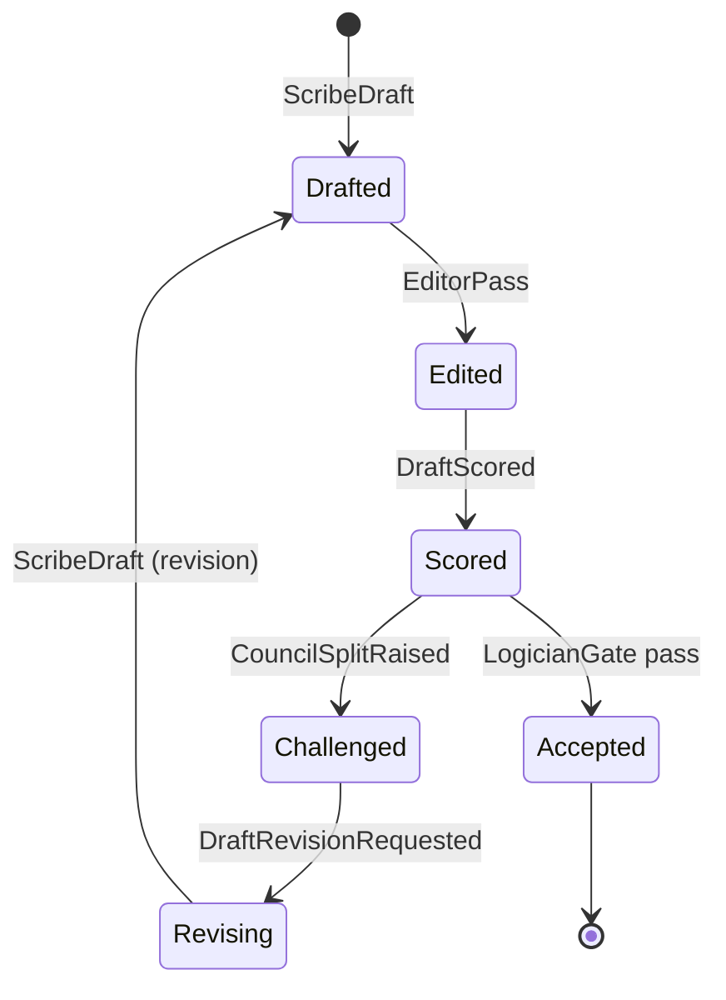
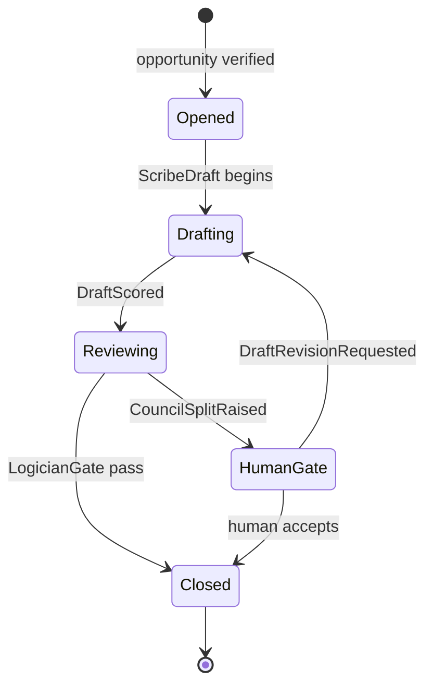
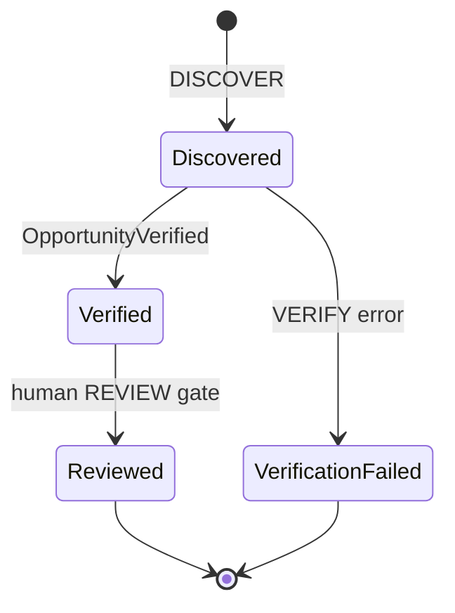

# State Machines: Tilth Runtime Build — Grant-Cycle Council Pipeline

## DraftLifecycle

The lifecycle of a [Draft](domain.md#draft) as it moves through the council seats.

> Intentional convergence (audit M6 note): [DraftScored](events.md#draftscored), [CouncilSplitRaised](events.md#councilsplitraised), and [DraftRevisionRequested](events.md#draftrevisionrequested) all transition this one state machine. This is the canonical single-entity lifecycle pattern — the three events are sequenced steps of [GrantCyclePipeline](workflows.md#grantcyclepipeline), not unrelated sources. The convergence is by design, not residue-bait.

### States

| State | Terminal | Description |
| ----- | -------- | ----------- |
| Drafted | no | Scribe composed sections; not yet edited |
| Edited | no | Editor pass complete with clarity flags |
| Scored | no | Judge wrote rubric scores |
| Challenged | no | Red Team raised a council split |
| Revising | no | Logician fail-close → back to Scribe |
| Accepted | yes | Logician gate passed; draft cleared |

### Transition Table

| From | Event | To | Guard | Effect |
| ---- | ----- | -- | ----- | ------ |
| [new] | ScribeDraft | Drafted | R4 traceability passes | Store sections + provenance |
| Drafted | EditorPass | Edited | — | Attach clarity flags |
| Edited | DraftScored | Scored | All dimensions scored, evidence present | Write RubricScores |
| Scored | CouncilSplitRaised | Challenged | `CouncilSplitDelta ≥ 10` | Route to human gate |
| Scored | LogicianGate | Accepted | All Five-Laws gates pass | Clear draft |
| Challenged | DraftRevisionRequested | Revising | Human directs revision | Open revision loop |
| Revising | ScribeDraft | Drafted | Within two-audit cycle (L-005) | Recompose flagged sections |

### Invalid Transitions (must be rejected)

| From | Attempted Event | Why Invalid |
| ---- | --------------- | ----------- |
| Drafted | DraftScored | Must pass EditorPass first |
| Edited | LogicianGate | Must be scored before gating |
| Accepted | any | Terminal state |
| Scored | ScribeDraft | Cannot redraft without a revision request |

### Invariants

| ID | Invariant | Formal |
| -- | --------- | ------ |
| DL-INV-1 | Accepted drafts have every dimension scored | `status == Accepted → ∀ d : d ∈ scores` |
| DL-INV-2 | Every scored dimension's evidence appears in the draft | `∀ s ∈ scores : s.evidenceString ⊑ sections` |
| DL-INV-3 | Revision loops never exceed the two-audit cycle | `revisionCount ≤ 2` (L-005 escalate beyond) |
| DL-INV-4 | Every section claim carries provenance | `∀ claim : claim ∈ provenance` |

---

## GrantCycleStatus

The lifecycle of a [GrantCycle](domain.md#grantcycle) from opportunity intake through cycle close.

### States

| State | Terminal | Description |
| ----- | -------- | ----------- |
| Opened | no | Verified opportunity bound to a cycle |
| Drafting | no | Scribe/Editor active |
| Reviewing | no | Judge/Red Team/Logician active |
| HumanGate | no | Council split — human decides |
| Closed | yes | Cycle complete; receipt emitted |

### Transition Table

| From | Event | To | Guard | Effect |
| ---- | ----- | -- | ----- | ------ |
| [new] | OpportunityVerified | Opened | `verdict == VERIFIED_FIT` | Bind opportunity to cycle |
| Opened | ScribeDraft | Drafting | Section plan exists | Begin drafting |
| Drafting | DraftScored | Reviewing | Draft Edited | Enter review |
| Reviewing | CouncilSplitRaised | HumanGate | `delta ≥ 10` | Escalate to human |
| Reviewing | LogicianGate | Closed | All gates pass | Close cycle |
| HumanGate | DraftRevisionRequested | Drafting | Human directs revision | Reopen drafting |
| HumanGate | LogicianGate | Closed | Human accepts | Close cycle |

### Invalid Transitions (must be rejected)

| From | Attempted Event | Why Invalid |
| ---- | --------------- | ----------- |
| Opened | DraftScored | No draft to score yet |
| Closed | any | Terminal state |
| Drafting | LogicianGate | Must score before gating |

### Invariants

| ID | Invariant | Formal |
| -- | --------- | ------ |
| GC-INV-1 | A cycle never references a second org | `∀ read : read.orgSlug == cycle.orgSlug` (Law 3) |
| GC-INV-2 | Closed cycles always passed the Logician gate | `status == Closed → logicianPassed` |
| GC-INV-3 | orgSlug never changes after open | `∀ transitions : orgSlug' == orgSlug` |

---

## OpportunityState

The two-stage discovery lifecycle of an [OpportunityCandidate](domain.md#opportunitycandidate).

### States

| State | Terminal | Description |
| ----- | -------- | ----------- |
| Discovered | no | Surfaced from a channel family; not yet verified |
| Verified | no | Live synopsis fetched; verdict assigned |
| Reviewed | yes | Passed the human REVIEW gate |
| VerificationFailed | yes | VERIFY errored or no endpoint |

### Transition Table

| From | Event | To | Guard | Effect |
| ---- | ----- | -- | ----- | ------ |
| [new] | DISCOVER | Discovered | Channel returned a candidate | Record source channel |
| Discovered | OpportunityVerified | Verified | Live synopsis fetched | Assign VerificationVerdict |
| Discovered | VERIFY error | VerificationFailed | Fetch errored / no endpoint | Set VERIFICATION_FAILED / UNVERIFIED |
| Verified | REVIEW | Reviewed | Human approves at gate | Elevate to a cycle |

### Invalid Transitions (must be rejected)

| From | Attempted Event | Why Invalid |
| ---- | --------------- | ----------- |
| Discovered | REVIEW | Cannot review before VERIFY (Law 1) |
| Reviewed | any | Terminal state |
| VerificationFailed | any | Terminal state |

### Invariants

| ID | Invariant | Formal |
| -- | --------- | ------ |
| OP-INV-1 | CRITICAL-fit implies a passed VERIFY | `criticalFit → verdict == VERIFIED_FIT` |
| OP-INV-2 | Scout never auto-files past REVIEW | `Reviewed only via human gate` |
