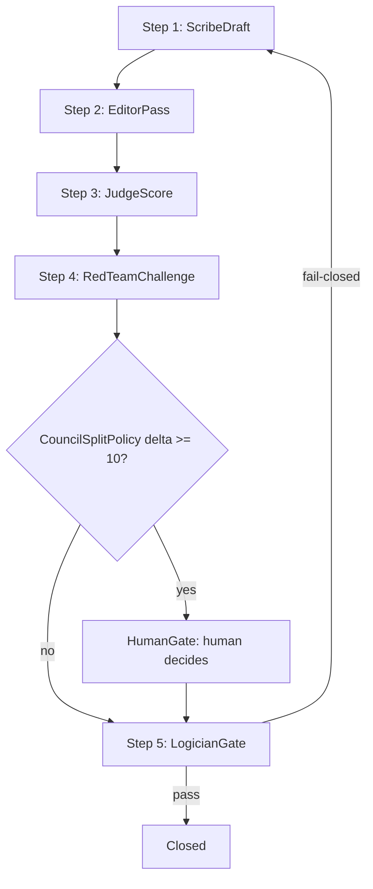

# Workflows: Tilth Runtime Build — Grant-Cycle Council Pipeline

## GrantCyclePipeline

Coordinates the six council seats across a single grant cycle: a verified opportunity is drafted (Scribe), refined (Editor), scored (Judge), challenged (Red Team), and gated (Logician). On a council split the human decides; on a fail-closed gate the cycle re-enters the revision loop within the two-audit cycle.

**Source:** `tilth-runtime-build.GrantCyclePipeline`
**Type:** Workflow
**Orchestrates:** [ScribeDraft](operations.md#scribedraft), [EditorPass](operations.md#editorpass), [JudgeScore](operations.md#judgescore), [RedTeamChallenge](operations.md#redteamchallenge), [LogicianGate](operations.md#logiciangate)
**Compensation Strategy:** notify-only — no destructive rollback; a fail-closed gate routes back to Drafting (revision loop), bounded by the two-audit cycle (L-005)
**Idempotency:** conditional — steps are guarded by DraftLifecycle status; replaying a completed step returns current state

### Trigger

`OpportunityVerified` (verdict VERIFIED_FIT, human-approved at REVIEW) opens a cycle.

### Steps



### Step Table

| # | Step | Actor | Operation | On Success | On Failure | Compensation |
| - | ---- | ----- | --------- | ---------- | ---------- | ------------ |
| 1 | Draft | Scribe | [ScribeDraft](operations.md#scribedraft) | Go to step 2 | UNTRACEABLE_CLAIM → reject section | — |
| 2 | Edit | Editor | [EditorPass](operations.md#editorpass) | Go to step 3 | MISSING_OPTIONS → re-run | — |
| 3 | Score | Judge | [JudgeScore](operations.md#judgescore) | Go to step 4 | EVIDENCE_NOT_IN_DRAFT → step 1 | — |
| 4 | Challenge | Red Team | [RedTeamChallenge](operations.md#redteamchallenge) | Apply [CouncilSplitPolicy](#councilsplitpolicy) | SAME_FAMILY → re-bind | — |
| 5 | Gate | Logician | [LogicianGate](operations.md#logiciangate) | Close cycle | GATE_FAIL_CLOSED → step 1 | notify-only revision loop |

### Invariants

| ID | Invariant | Formal |
| -- | --------- | ------ |
| GP-INV-1 | Red Team fires on every draft before the gate | `step5 reached → step4 executed` |
| GP-INV-2 | LogicianGate is the last step before Closed | `Closed → logicianPassed` |
| GP-INV-3 | A ≥10 split always reaches the human before close | `delta ≥ 10 → humanGate visited` |
| GP-INV-4 | Post-substance review seats route LOCAL | `Editor/RedTeam/routineJudge on Confidential-bearing draft → LOCAL` |

---

## CouncilSplitPolicy

Decides whether a scored draft proceeds straight to the Logician gate or detours through the human gate, based on the Judge/Red-Team disagreement.

**Source:** `tilth-runtime-build.CouncilSplitPolicy`
**Type:** Policy
**Applies To:** [LogicianGate](operations.md#logiciangate) — evaluated after RedTeamChallenge (step 4)

### Trigger Conditions

Applied once per scored draft, after Red Team computes [CouncilSplitDelta](operations.md#councilsplitdelta).

### Decision Table

| Condition | Selected Behavior | Notes |
| --------- | ----------------- | ----- |
| `delta < 10` | Proceed to LogicianGate; no human detour | Council aligned |
| `delta >= 10` | Route to HumanGate; the human decides | Law 4 tie-breaker; boundary inclusive at threshold (§10.6) |
| `delta >= 10 ∧ human accepts` | Close after human acceptance | Human override of council |
| `delta >= 10 ∧ human revises` | Emit DraftRevisionRequested → Drafting | Bounded by two-audit cycle |

### Formula

```
split = abs(judgeTotal - redTeamTotal) >= 10
```

### Configuration Parameters

| Parameter | Type | Default | Description |
| --------- | ---- | ------- | ----------- |
| splitThreshold | int | 10 | Inclusive threshold for a council split |
| maxRevisionLoops | int | 2 | Two-audit cycle ceiling (L-005) |

---

## GearModePolicy

Selects the autonomy level a seat operates under for the cycle. Set by the applicant; the seat respects the gear when executing.

**Source:** `tilth-runtime-build.GearModePolicy`
**Type:** Policy
**Applies To:** [ScribeDraft](operations.md#scribedraft) (and every other seat operation)

### Trigger Conditions

Read at the start of each seat operation; the applicant may change it between cycles.

### Decision Table

| Condition | Selected Behavior | Notes |
| --------- | ----------------- | ----- |
| `gear == sparring_partner` | Seat generates options; human decides each | Maximum human control |
| `gear == co_pilot` | Human directs; seat executes and refines | DEFAULT |
| `gear == synthesizer` | Full delegation; human reviews final output only | Maximum delegation |

### Configuration Parameters

| Parameter | Type | Default | Description |
| --------- | ---- | ------- | ----------- |
| defaultGear | OperatingGear | co_pilot | Default seat gear |
