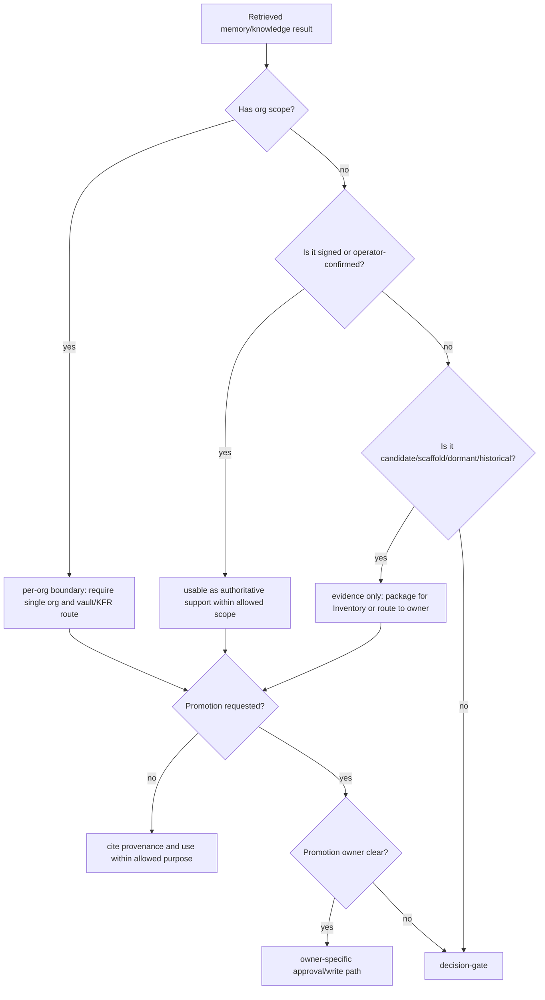

# Invoke Design

## Context View

GoldenQuill needs a production memory/knowledge layer, but the repository already contains many pieces of that layer. The design target is a Memory/Knowledge Mesh that coordinates these pieces without collapsing ownership.

This design is Arcanum-compatible:

- Arcanum Inventory packages evidence and retrieval handoffs.
- Arcanum Ontology governs meaning, branch context, and concept roles.
- Arcanum Invoke authors design/plan artifacts.
- GoldenQuill Vault owns persisted state access.
- GoldenQuill Logician owns enforcement and promotion gates.
- Reflection Packet becomes the future cross-cycle learning producer once activated.

## High-Level Structure View

| Component | Purpose | Existing Anchor |
| --- | --- | --- |
| Memory Surface Registry | Lists memory/knowledge surfaces and authority labels | `MEMORY.md`, `pipeline/memory/unified_query.py` |
| Retrieval Gateway | Local-only query across registers with provenance | `pipeline/cli/tilth_memory_query.py` |
| Authority Classifier | Labels each result as workspace, per-org, signed, candidate, dormant, historical, or external | new design component |
| Evidence Packet Adapter | Exports retrieval results to Arcanum Inventory-style evidence cards without promotion | new adapter |
| Promotion Gate | Routes candidate memory/knowledge to operator approval, Logician, or owning artifact | Logician + lessons/Reflection Packet |
| Knowledge Consumers | Scribe/cards/knowledge packs/vault readers consume only through declared contracts | existing consumers |
| Reflection Producer | Converts outcomes into proposed lessons/memory after approval | §16 Reflection Packet future activation |

## Low-Level Components View

### `MemoryKnowledgeLayerIndex`

Docs artifact that maps each memory/knowledge surface by scope, authority, mutability, maturity, read path, write path, owner, and Arcanum equivalent.

### `RetrievalGateway`

Wrapper around `tilth_memory_query` and `Registry.query`. It preserves local-only posture, single-org scoping, register filters, result provenance, and deterministic ranking.

### `AuthorityClassifier`

Pure classifier that attaches authority metadata to each retrieval result:

- `workspace_shared`
- `per_org`
- `signed_asset`
- `operator_confirmed`
- `candidate`
- `dormant`
- `historical`
- `external_context`

It does not change the result. It only tells downstream agents what they are allowed to do with it.

### `MemoryEvidencePacket`

Arcanum-compatible packet for retrieved evidence:

```json
{
  "schema_version": "goldenquill.memory_evidence_packet.v0",
  "packet_id": "string",
  "query": "string",
  "org_scope": "string|null",
  "results": [
    {
      "register": "string",
      "source_path": "string",
      "locator": "string",
      "snippet": "string",
      "authority_class": "string",
      "allowed_uses": ["string"],
      "promotion_owner": "string",
      "arcanum_handoff": "inventory|ontology|definitions|decision-gate|none"
    }
  ],
  "residue": ["string"]
}
```

The packet is evidence, not canonical promotion.

### `PromotionGate`

Decision layer:

- operator-confirmed lesson -> `lessons.md` / `lessons.json`,
- per-org fact -> KFR or org vault route,
- reusable shareable knowledge -> card/knowledge-pack route,
- meaning/role model -> Ontology route,
- evidence/index packet -> Inventory route,
- unclear ownership -> decision-gate.

### `ReflectionPacketAdapter`

Future producer that turns outcome evidence into proposed memory deltas after operator approval. It should not write live memory directly.

## Workflow Process View

1. Query local memory/knowledge through `RetrievalGateway`.
2. Preserve provenance for every result.
3. Attach authority class and allowed uses.
4. Package selected results as `MemoryEvidencePacket`.
5. Route to the correct owner:
   - Inventory for evidence packaging,
   - Ontology for meaning governance,
   - Definitions for canonical term drift,
   - Logician/decision-gate for promotion ambiguity,
   - Task Session for bounded implementation.
6. If a run produces new learning, Reflection Packet proposes a memory delta.
7. Operator approves or rejects the delta.
8. Approved deltas update the owning memory/knowledge surface.

## Decision Flow View



## Dependency Interface View

| Dependency | Interface | Consumer | Failure Behavior |
| --- | --- | --- | --- |
| `pipeline.memory.Registry` | read-only query/list/inspect | RetrievalGateway | block on Law 3 violation or unknown register |
| `tilth_memory_query` CLI | operator-facing retrieval | agents/operators | flag if observability missing; block if query fails |
| `MEMORY.md` | index and wake-up memory map | wake-up/context-builder | trigger consolidation if over threshold |
| `lessons.md` / `lessons.json` | operator-confirmed lessons | Logician/agents | no write without approval |
| Vault query skills | gated read with identity tuple | seats and tools | fail closed on denied FD |
| Cards | signed shareable knowledge | Scout/Scribe/Judge/future runtime | evidence only until runtime injection lands |
| Knowledge packs | sector terminology | Scribe context assembly | fail closed on parse/schema/duplicate IDs |
| Reflection Packet | proposed cross-cycle learning | future Archivist/lessons memory | dormant until activation |
| Arcanum Inventory | evidence cards and evidence sets | design/plan/task handoff | cannot become GoldenQuill authority by itself |
| Arcanum Ontology | meaning and role governance | semantic design | cannot write storage/retrieval records |

## Glossary Consistency

| Term | Meaning In This Design |
| --- | --- |
| Memory | Operational residue from sessions, lessons, outcomes, and stateful learning |
| Knowledge | Reusable domain/product content with scope and provenance |
| Evidence | Cited source fragment that supports a claim but does not become canonical automatically |
| Authority | The right to determine whether a claim can guide production behavior |
| Promotion | Governed transition from candidate evidence to canonical memory/knowledge |
| Inventory | Arcanum evidence packaging and retrieval support |
| Ontology | Arcanum meaning/role governance |

## Implementation-Layering Seed

| Layer | Goal | Evidence Required |
| --- | --- | --- |
| L0 | Write current-truth layer index | path-cited table over existing surfaces |
| L1 | Repair docs/tests around 15-register retrieval | passing parity test and doc refresh |
| L2 | Add `MemoryEvidencePacket` adapter | fixture showing query -> packet -> Inventory handoff |
| L3 | Plan Reflection Packet activation | decision-gate approval and promotion rules |

## Decisions

- Reuse `tilth_memory_query` as the retrieval gateway.
- Do not build vector retrieval first.
- Do not promote Arcanum Inventory into GoldenQuill authority.
- Do not activate Reflection Packet as part of design mode.
- Make the first safe task a docs/index artifact.

## Unresolved Gaps

- The front-door status/maturity docs need refresh against current memory CLI reality.
- `logfire` is absent in this environment, so memory CLI observability is degraded.
- Per-org memory behavior was not tested because no org was named.
- Reflection Packet activation remains an architectural/operator decision.

## Next Route

Recommended: `invoke plan` for this design, then `task-session` for L0 (`docs/MEMORY_KNOWLEDGE_LAYER_INDEX.md`).

