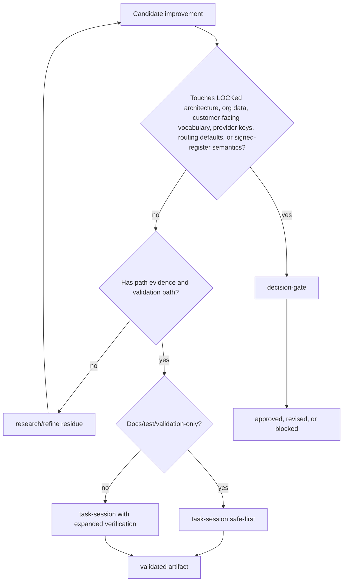

# Invoke Design

## Context View

GoldenQuill/Tilth is a governed product substrate, not a single app. The 2026-05-29 repository research package found substantial runtime, policy, product, test, and governance surfaces, but the strongest production blocker is current-truth and maturity ambiguity.

The design target is a production-readiness spine: a small set of artifacts and proof paths that make later production work safe to choose and execute.

This design is non-mutating. It does not read org contexts, edit LOCKed architecture, or implement a feature.

## High-Level Structure View

| Spine | Purpose | Primary Artifact |
| --- | --- | --- |
| Truth spine | Align front-door docs with current lock/key/card state | Current-truth refresh pack |
| Surface spine | Classify product/UI/doc surfaces by role and maturity | `docs/PRODUCT_SURFACE_INDEX.md` |
| Maturity spine | Connect visible features to commands, modules, tests, blockers | `docs/IMPLEMENTATION_STATUS_MATRIX.md` |
| Verification spine | Make local and CI proof paths discoverable | `scripts/verify_all.sh` or equivalent spec |
| Sovereignty spine | Prove provider-boundary and signed-register production assumptions | Security/provisioning wiring check |
| Decision spine | Route candidates to task-session or decision-gate | Production-readiness decision ledger |
| Experiment spine | Turn readiness claims into measurable hypotheses | `docs/strategy/goldenquill_production_readiness_experiments_2026-05-31.md` |

## Low-Level Components View

### `CurrentTruthRefreshPack`

Inputs: `pipeline/engineering/lock_history.v1.jsonl`, `vault_shared/cards/publisher_pubkey.signed.yaml`, current front-door docs.

Output: updated or proposed deltas for `PROJECT_STATUS.md`, `RUNTIME_MATURITY_MATRIX.md`, and `pipeline/blueprint/v0.1/ACTIVE_BLUEPRINT_INDEX.md`.

Validation: every row/key/card claim either matches current evidence or is marked stale/deferred.

### `ProductSurfaceIndex`

Inputs: `docs/FRONTEND_BOUNDARY.md`, `apps/`, `landing/`, `docs/whitepapers/`, product docs.

Output: a table classifying each surface as target, prototype, archive, demo, generated, draft, customer-facing, or internal.

Validation: no surface lacks status, owner, and allowed use.

### `ImplementationStatusMatrix`

Inputs: `skills/`, `pipeline/cli/`, `pipeline/`, `golden_quill_substrate/`, `tests/`, maturity docs.

Output: a crosswalk from capability to command/module/test/maturity/blocker.

Validation: sampled entries have path evidence and at least one proof path or explicit blocker.

### `VerificationParityHarness`

Inputs: `scripts/`, `.github/workflows/`, test/lint/signature docs.

Output: a unified local verification entry point or wrapper spec.

Validation: local command inventory matches CI intent or explicitly names gaps.

### `SecurityProvisioningCheck`

Inputs: provider-boundary code, signed-register loader, classification register provisioning docs.

Output: proof that production cloud/provider routes cannot skip signed-register context silently.

Validation: test/lint proof fails closed for missing or invalid signed register.

### `ProductionDecisionLedger`

Inputs: improvement candidates, residuality spec, experiments.

Output: candidate routing: task-session, decision-gate, backlog, or blocked.

Validation: decision-gated categories cannot be accidentally promoted to ordinary implementation.

## Workflow Process View

1. Freeze source frame: cite research package, workspace laws, router, and user constraints.
2. Build current-truth delta: compare front-door docs against lock/key/card evidence.
3. Build surface index: classify product, UI, landing, and whitepaper surfaces.
4. Build implementation matrix: map skills, CLIs, modules, tests, maturity, and blockers.
5. Build verification parity: document or implement unified local proof path.
6. Build security/provisioning proof: verify signed-register/provider-boundary production assumptions.
7. Run experiments: measure whether the artifacts reduce stale claims, ambiguity, and proof gaps.
8. Select first implementation task: route to task-session only when gate conditions are clear.

## Decision Flow View

## Dependency Interface View

| Dependency | Interface Need | Downstream Consumer | Failure Behavior |
| --- | --- | --- | --- |
| `pipeline/engineering/lock_history.v1.jsonl` | Latest authoritative row/key/card chronology | Current-truth refresh | Block production claims on stale mismatch |
| `vault_shared/cards/publisher_pubkey.signed.yaml` | Current publisher key evidence | Current-truth refresh | Mark stale or gate key-related edits |
| `docs/FRONTEND_BOUNDARY.md` | UI target/prototype/archive distinction | Product surface index | Block UI production claims |
| `skills/` and `.codex/commands/` | Capability and command surfaces | Implementation-status matrix | Mark scaffold/spec if proof missing |
| `pipeline/cli/`, `pipeline/`, `tests/` | Runtime and proof evidence | Implementation-status matrix | Downgrade maturity claim |
| `.github/workflows/` and `scripts/` | CI/local proof contract | Verification parity | Name skipped checks explicitly |
| `pipeline/orchestrator/provider_boundary.py` | Provider call boundary | Security provisioning check | Fail closed if signed register absent |
| `pipeline/vault/classification/` | Signed register loading/provisioning | Security provisioning check | Decision-gate if semantics change |
| `SOUL.md`, `USER.md`, `router.yaml` | Laws, locked decisions, routing vocabulary | Decision spine | Block contradiction |

## Experiment Integration

The experiment ledger is the measurement layer for this design:

- H1 proves the truth spine.
- H2 proves the surface spine.
- H3 proves the maturity spine.
- H4 and H5 prove packaging and verification spines.
- H6 proves the sovereignty spine.
- H7 and H8 prevent documentation/product drift.

## Production Readiness Definition

GoldenQuill is ready for production implementation work when:

- H1, H2, and H3 pass.
- The selected candidate has a path-cited validation route.
- Decision-gated categories are not bypassed.
- Runtime claims distinguish command resolution, deterministic validation, and model-backed execution.
- Org isolation remains intact.

## Next Design-To-Execution Handoff

Recommended next task-session:

Create the current-truth refresh pack.

Do not start with UI buildout, feature expansion, or production security default mutation. Those may become valid later, but the design says the first production-readiness move is to repair the truth spine.
