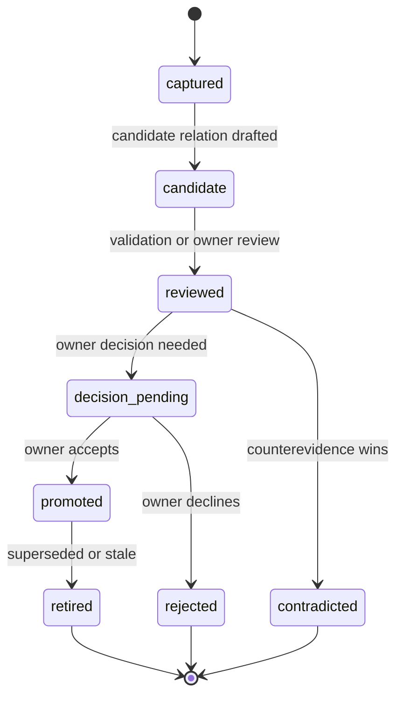

# GoldenQuill Promotion Mechanism Invoke Design

## Design Intent

Design a promotion mechanism that lets GoldenQuill turn grant-run evidence,
review signals, and reusable learning into governed artifacts without silently
mutating memory, ontology, cards, definitions, or org-vault state.

## Design Principle

Promotion is an owner-routed decision record over evidence, not a side effect of
retrieval, drafting, review, scoring, or reflection.

## Core Objects

### MemoryEvidencePacket

Role: source-bound evidence reference.

Keep this narrow. It should answer:

- where did the evidence come from;
- what authority class does the source have;
- what org scope applies;
- what retrieval surface exposed it;
- what mutation permission applies.

It should not decide promotion.

### PromotionCandidate

Role: bridge object between evidence and lifecycle owner.

It answers:

- what is proposed for promotion;
- which evidence packets support it;
- which target owner must decide;
- which artifact would change if accepted;
- which uses are allowed before and after decision;
- what validation gate or review is required;
- what contradiction path can defeat it.

### PromotionRecord

Role: owner-owned decision artifact.

It should be compatible with Ontology Vault's candidate `promotion_record`
rules, especially target relations, evidence pointers, review gates, and
contradiction paths.

### PromotionLedger

Role: append-only audit projection.

It records state transitions without replacing owner artifacts. It is a read
model, not the canonical source of promoted truth.

### GrantOutcomeEvent

Role: real-world outcome evidence.

It records what happened after a grant moved into the world: submission,
validation, agency retrieval, review, rejection, award, post-award reporting, or
closeout.

Minimum fields:

```json
{
  "event_id": "goe-YYYY-MM-DD-slug",
  "application_id": "stable application id",
  "event_kind": "submitted | portal_validated | agency_retrieved | agency_tracking_assigned | under_review | feedback_received | award_recommended | awarded | declined | withdrawn | report_accepted | closed_out",
  "event_date": "YYYY-MM-DD",
  "source_ref": "path, URL, portal export, email archive, or agency notice",
  "portal_status": null,
  "agency_status": null,
  "amount_requested": null,
  "amount_awarded": null,
  "feedback_refs": [],
  "post_award_obligations": [],
  "org_scope": "single_org | workspace_global | no_org_loaded | cross_org_forbidden"
}
```

### ApplicationLifecycleState

Role: stage-depth projection over outcome events.

It answers "how far did the grant get?" without pretending that stage depth is a
win.

```json
{
  "application_id": "stable application id",
  "current_stage": "prospect | eligible_match | go_no_go_approved | loi_submitted | invited_full | application_started | application_submitted | portal_validated | agency_retrieved | agency_tracking_assigned | under_review | review_feedback_received | award_recommended | awarded | declined | withdrawn | post_award_active | reporting_current | closed_out",
  "stage_depth_score": 0,
  "source_event_id": "goe-YYYY-MM-DD-slug",
  "last_verified_utc": "2026-06-01T00:00:00Z"
}
```

### GrantKpiObservation

Role: dashboard/read-model metric observation.

It is never promotion authority by itself. It stores denominator semantics so
GoldenQuill does not compare incompatible rates.

```json
{
  "metric_id": "gko-YYYY-MM-DD-slug",
  "metric_kind": "win_rate_by_count | win_rate_by_dollars | stage_depth | review_reached_rate | resubmission_success_rate | compliance_pass_rate | evidence_gap_resolution_rate | relationship_touchpoints | grant_retention_rate",
  "numerator": 0,
  "denominator": 0,
  "denominator_definition": "final decisions, submitted applications, reviewed applications, awards, or another explicit set",
  "value": null,
  "segment": {
    "funder": null,
    "program": null,
    "new_vs_repeat_funder": null,
    "grant_family": null,
    "org_scope": null
  },
  "source_events": [],
  "interpretation_limits": []
}
```

## State Machine



## Data Shape

```json
{
  "schema_version": "goldenquill.promotion_candidate.v0",
  "candidate_id": "pc-YYYY-MM-DD-slug",
  "candidate_kind": "claim | relation | card_delta | lesson | ontology_entry | org_memory | definition | gate_rule",
  "created_utc": "2026-06-01T00:00:00Z",
  "created_by": "seat | validator | operator | reflection",
  "source_packets": [],
  "source_edges": [],
  "target_owner": "ontology_vault | inventory | definitions | card_ceremony | org_vault | lessons_memory | logician | operator",
  "target_artifact": null,
  "proposed_relation": "promotes_to | supersedes | retires | constrains | validates",
  "allowed_uses": [],
  "current_state": "captured | candidate | reviewed | decision_pending | promoted | rejected | retired | contradicted",
  "review_gate": null,
  "promotion_blockers": [],
  "contradiction_path": null,
  "decision_record": null,
  "real_world_evidence": {
    "stage_depth": null,
    "latest_outcome_event": null,
    "kpi_observations": []
  },
  "residue": []
}
```

## Validation Rules

1. `source_packets` must resolve to valid evidence packets when present.
2. `target_owner` must be one of the known lifecycle owners.
3. `promoted` requires `decision_record`, no blockers, and a target artifact.
4. `candidate_kind: org_memory` requires `org_scope: single_org`.
5. Workspace-global promotion cannot consume cross-org-forbidden evidence.
6. `contradicted` requires a contradiction path or counterevidence pointer.
7. `card_delta` cannot treat working YAML as signed authority.
8. `ontology_entry` promotion must be expressible as or linked to a
   `PromotionRecord`.
9. `gate_rule` promotion requires deterministic fixture evidence.
10. The ledger may append transitions, but cannot change the promoted artifact
    directly.
11. Real-world outcome events require a source reference before they can feed a
    KPI.
12. KPI observations require explicit denominator semantics.
13. A rejection, win, or stage-depth score may create a learning candidate, but
    cannot promote that learning without the target owner decision.
14. Funder feedback remains org-scoped unless a redaction or generalization
    gate creates a workspace-safe learning.

## Integration Points

| Surface | Integration |
| --- | --- |
| Scout | emits evidence and opportunity candidates, not promotion decisions |
| Scribe | consumes allowed-use evidence and creates proposal claims |
| Editor | creates clarity/review signals |
| Judge | creates scoring/reviewer-risk signals |
| Logician | creates hard gate results and possible gate-rule candidates |
| Reflection Packet | proposes learning candidates after a run |
| Outcome tracking | records submission, review, award, decline, reporting, and closeout events |
| KPI projection | creates dashboard/read-model observations with denominator definitions |
| Inventory | captures evidence cards and candidate sets with non-authority notices |
| Ontology Vault | owns promotion records for ontology relations |
| Card governance | owns card deltas and signed-card promotion |
| Org vault | owns private org memory promotion |

## Initial Slice

Implement no production mutation first. The first executable slice should be a
toy validator under a development or test path:

```text
projects/goldenquill/pipeline/grant_dag/promotion_candidate.py
projects/goldenquill/tests/grant_dag/test_promotion_candidate.py
projects/goldenquill/tests/grant_dag/fixtures/promotion_candidate/
```

Positive fixture:

- valid evidence packet;
- candidate relation;
- target owner `ontology_vault`;
- review gate present;
- contradiction path present;
- state `decision_pending`.

Negative fixtures:

- promoted without decision record;
- org-memory promotion with workspace-global scope;
- card delta using working YAML as signed authority;
- ontology entry without PromotionRecord compatibility;
- contradicted candidate without counterevidence;
- candidate with missing evidence packet.
- win-rate KPI without denominator definition;
- rejection learning promoted without reviewer/source evidence;
- funder feedback generalized across orgs without redaction gate;
- stage-depth score treated as a win.

## Handoff To Refine

Refine should stress this design around:

- whether `PromotionCandidate` is the smallest coherent unit;
- whether the state machine is too broad;
- whether `PromotionRecord` should be reused directly instead of bridged;
- whether `allowed_uses` belongs on evidence, candidate, or owner decision;
- whether the first implementation should live in `grant_dag`, memory mesh, or
  Ontology Vault fixtures.
- whether `GrantOutcomeEvent`, `ApplicationLifecycleState`, and
  `GrantKpiObservation` should be first-class objects or projections over the
  grant DAG.
- whether GoldenQuill's stage/outcome/validation split is enough to prevent
  dashboard metrics from becoming false promotion authority.
