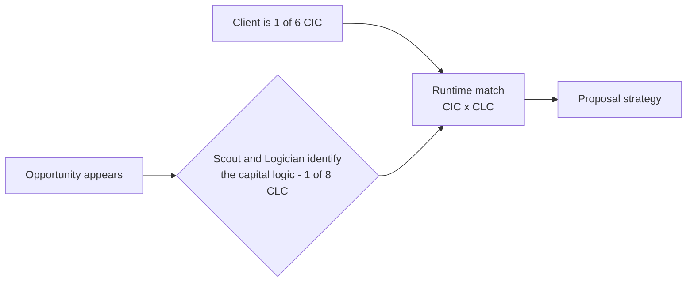
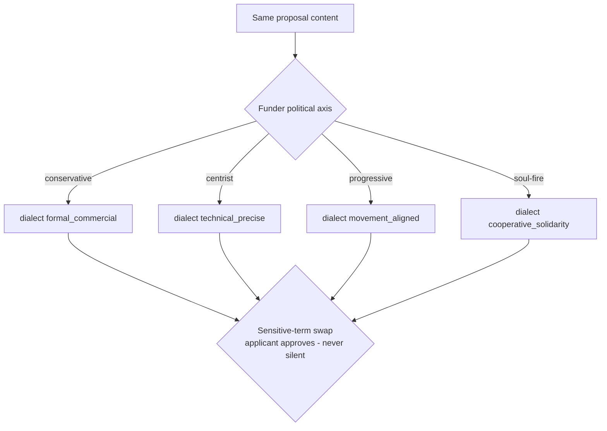
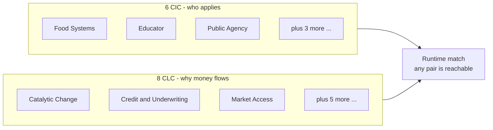
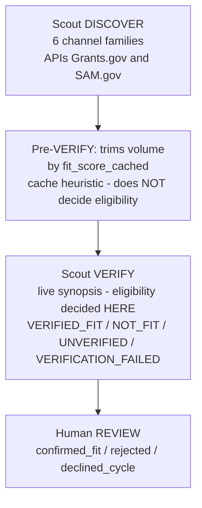
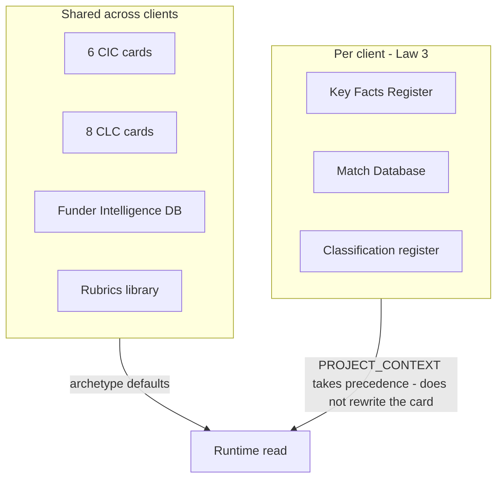
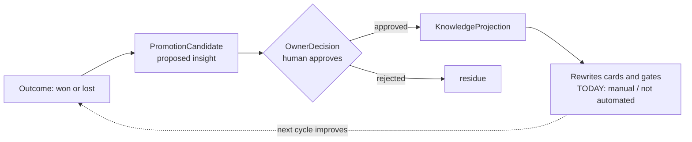

# Discovery — Golden Quill / Tilth explained from scratch

> Orientation document for Victor. Plain language, lots of context, lean.
> Every factual claim points to the file it came from. Where something is **designed
> but not built**, it is marked ⚠️.

## Objective

Explain, for someone outside the domain, what Golden Quill does, how it decides whether a
client is eligible for a grant, what in it is **given** (you obey) versus what is
**optimized** (you improve over time), and where the gaps are between what is designed and
what actually runs.

---

## 1. Business context

**What it is.** Golden Quill is the physical product (a 128 GB desktop the client buys).
**Tilth** is the software intelligence that runs inside it. Tilth writes, reviews, and
scores *grant* proposals — money from governments and foundations the client does not have
to pay back. Source: [README.md](../README.md).

**Why it exists.** Grant writing is specialist work: you have to find the right
solicitation, speak the language that funder expects, assemble the evidence it requires,
and argue in the way that kind of money rewards. The founder has already won grants in 2026
doing this by hand. Tilth **productizes** that work. (⚠️ Internal sources disagree on the
number: [README.md](../README.md) says "six competitive grants"; [CLAUDE.md](../CLAUDE.md)
says "three" in two places — worth reconciling before using in external material.) Source:
[README.md](../README.md), [CLAUDE.md](../CLAUDE.md).

**What does NOT change (the task is fixed).** The task is always the same: *write a winning
proposal for a type-X company against a type-Y funding source*. That never changes. What
changes — and what gives the product its value — is the **knowledge** that enters the
agents' context window, which gets smarter every cycle. The product does **not** train new
models; it improves what it hands to the models. Source: [CLAUDE.md](../CLAUDE.md) (substrate
LOCKED; refinement via cards, not via weights).

---

## 2. The problem, concretely

**The problem.** Organizations that deserved funding lose grants because grant writing is
specialist work: finding the right solicitation, speaking the funder's language, assembling
the required evidence, and arguing in the logic that money rewards. Most orgs don't have a
grant writer. Tilth automates that specialist. Source: [CLAUDE.md](../CLAUDE.md).

**The 6 client types (CIC) — who applies.** The *world* of the applicant comes in six
flavors (Source: [CLAUDE.md](../CLAUDE.md), "Six Customer Identity Categories"):

1. **Food Systems** — farms, producers, processors, food hubs; seasonal, weather-dependent
   world.
2. **Educator** — schools, school systems, education nonprofits; compliance- and
   oversight-dense world.
3. **Public Agency** — local governments and public authorities; procurement, public
   budgets, accountability.
4. **Arts & Culture** — cultural organizations and artists; judged on artistic merit +
   organizational sustainability.
5. **Cooperative** — worker/producer cooperatives; democratic governance, member ownership.
6. **Ecosystem Intermediary** — accelerators, fiscal sponsors, CDFIs, capital connectors;
   operate at portfolio scale, supporting others.

**The 8 funder types (CLC) — why the money flows.** The *logic* of whoever pays comes in
eight flavors — each wants something, and you justify it in a particular way (Source:
[CLAUDE.md](../CLAUDE.md), "The paired taxonomy"):

1. **Public Purpose & Works** — government; fulfilling a public mandate and eligibility.
2. **Catalytic Change** — foundations; innovation, transition, systems change.
3. **Operating Capacity** — strengthening the org itself (staff, systems, equipment).
4. **Research & Evidence** — investigate, pilot, prove whether something works.
5. **Market Access** — reach buyers, commercialize, build demand.
6. **Credit & Underwriting** — a loan; expects repayment (you prove you can pay it back).
7. **Sponsorship & Corporate Support** — brand-aligned corporate sponsorship.
8. **Shared Assets** — shared infrastructure / collective commons.

**What changes by funder type.** The same project, pitched to different logics, must be
argued in different ways. Example: a solar installation pitched to a bank — "here is the ROI
and repayment schedule" (Credit & Underwriting) — versus pitched to a climate foundation —
"here is how this demonstrates a replicable model for rural decarbonization" (Catalytic
Change). Same project, completely different argument. What also changes: the **evidence that
convinces** and the **example sources**.

*The client is 1 of 6 CIC; the opportunity carries 1 of 8 CLC; the match becomes the strategy.*

**Political position of funder/client (Law 4).** The same proposal must be rewritten
according to the political axis of whoever reads it. Law 4 defines four **dialects**:
conservative, centrist, progressive, soul-fire — each with a different tone. On top of that,
there are sensitive ("admin-risk") terms: words like "regenerative agriculture", "climate
justice", and "land back" are read very differently by different panels. The system flags
those terms, offers substitutes with a rationale for each, and — importantly — **the
applicant approves each substitution; it never rewrites silently**. (Source:
`dialect_routing_table` and `admin_risk_term_register` in
[food_systems.yaml](../pipeline/cards/CIC/food_systems.yaml); Law 4 in
[CLAUDE.md](../CLAUDE.md).) This is why *language register* is one of the knobs you tune.

*Same content, different political axis → different dialect. The sensitive-term swap goes through applicant approval — never silent.*

In short: the problem has **two independent axes** — who applies and why the money flows.
The next section formalizes those two axes as the system's ontology.

---

## 3. Core concepts

### The Council (6 agent seats)

Tilth is a council of 6 agents, none outranking another:
**Scout** (finds opportunities), **Scribe** (writes), **Editor** (clarity),
**Judge** (scores against the funder's rubric), **Red Team** (attacks the proposal), and
**Logician** (deterministic Python rules, zero token cost, fail-closed).
Source: [CLAUDE.md](../CLAUDE.md) §"The Council".

### The two axes (the ontology)

The design secret: to write a grant you must understand **two independent things** that
people constantly conflate:

- **Who applies (CIC — Customer Identity Card).** The client's *world*. A farm lives by
  seasons; a school lives by compliance. There are **6 types**: Food Systems, Educator,
  Public Agency, Arts & Culture, Cooperative, Ecosystem Intermediary.
- **Why the money flows (CLC — Capital Logic Card).** The funder's *reasoning*.
  A bank lends ("will you pay it back?"); a foundation funds innovation ("is this new?").
  There are **8 types**: Public Purpose & Works, Catalytic Change, Operating Capacity,
  Research & Evidence, Market Access, Credit & Underwriting, Sponsorship & Corporate
  Support, Shared Assets.

**Why kept separate:** any (CIC × CLC) combination is valid — a farm can take a bank loan
*or* an innovation grant. If you hardcoded "farm → only these kinds of money", you'd block
valid opportunities (a category error the project made and corrected, now enforced by a
fail-closed guard: `F-CIC-CLC-COUPLING-VIOLATION`). The match happens **at runtime, per
opportunity**, never fixed at design time. Source:
[CLAUDE.md](../CLAUDE.md) §"The paired taxonomy".

*Two independent lists; any pair is reachable — the opportunity decides.*

### Cards ≠ the whole context

The **cards** are only the two ontology axes. What enters the agent's window is bigger —
see the table in section 6.

### The learning loop (the heart — and the biggest gap)

The idea is that each grant result (won/lost) becomes an *insight* that improves the cards
for the next cycle. ⚠️ This loop is **designed, not built** — today the operator edits the
cards by hand. See section 7.

---

## 4. How you see whether a client is eligible for a grant

Yes, there is an API — and the flow is a ladder of filters, cheapest to most expensive:

*Funnel: discover cheap → trim volume → verify live (decided here) → human decision.*

1. **Scout DISCOVER.** Hits 6 channel families in parallel. Family A is the **federal APIs**:
   Grants.gov (`search2`, `fetchOpportunity`), SAM.gov, USASpending. The search uses the
   card's *search vocabulary* (the terms the funder uses). Source:
   [CLAUDE.md](../CLAUDE.md) §"Scout".
2. **Pre-VERIFY (trims volume, does NOT decide).** The only gate that actually runs before
   VERIFY in the real pipeline is `fit_score_cached` — a cache heuristic that merely truncates
   the number of candidates (`SCOUT_CANDIDATE_VERIFY_CAP`), explicitly *"NOT a VERIFY
   decision"*. Source: [section_03_scout.md](../pipeline/blueprint/v0.1/section_03_scout.md).
   ⚠️ There is a separate module `eligibility_filter.py` (a zero-token hard-disqualifier
   filter, e.g. "501(c)(3) only", "tribal governments only"), **but it is not wired into the
   current Scout pipeline** — it is only referenced by itself, and was internally flagged as a
   possible "stale shim". Source:
   [logician/filters/eligibility_filter.py](../logician/filters/eligibility_filter.py).
3. **Scout VERIFY — this is where eligibility is actually decided.** Fetches the **live**
   synopsis and tags one of four states: `VERIFIED_FIT` / `VERIFIED_NOT_FIT` / `UNVERIFIED`
   (no live endpoint) / `VERIFICATION_FAILED`. (Lesson L-001: cache never decides eligibility
   — only the live synopsis.) Source: [CLAUDE.md](../CLAUDE.md) §"Scout" +
   [section_03_scout.md](../pipeline/blueprint/v0.1/section_03_scout.md); L-001 in
   [lessons.md](../lessons.md).
4. **REVIEW (you).** The operator reviews the `VERIFIED_FIT` list and decides
   `confirmed_fit | rejected | declined_cycle`. Source:
   [architecture_v7_0_5_amendment.md](../pipeline/architecture/v0.1/architecture_v7_0_5_amendment.md).

⚠️ `eligibility_filter.py` (if/when it gets wired in) is **hardcoded to one client**
(MycoSymbiotics). To become a product, that eligibility profile must move out of code and
become per-client data (the `PROJECT_CONTEXT` + the Key Facts Register).

---

## 5. What is GIVEN vs. what is OPTIMIZED (the distinction that matters)

This is the easiest confusion to fall into. Three layers:

| Layer | Examples | Given or optimized? |
|---|---|---|
| **The task** | "grant for company X, funding Y" | **Given, fixed forever.** |
| **The funder's rules** | scoring rubric, eligibility rules, reporting rhythm | **Given by the funder. You obey, you don't optimize.** You only optimize your ability to *detect* and *satisfy* those rules. |
| **The cards (knowledge)** | search vocabulary, evidence schema, language register, how to argue each logic | **Optimized** — they start expert-authored, and the loop refines them over the cycles. |
| **The execution parameters** | temperature per seat, variants, model team, delegation mode | **Optimized** (⚠️ the "calibration discipline" is missing — not even properly designed). |

**Rule of thumb:** if it comes from the funder, it's a **constraint** (obey it); if it's your
knowledge about how to win, it's a **lever** (optimize it).

And a fourth phenomenon that isn't optimization but still makes the system better:
**corpus accumulation** — the KFR (client facts), the Funder Intelligence Database, and the
Match Database grow over time. After years, this becomes the competitive "moat". Source:
[architecture_v7_0_5_amendment.md](../pipeline/architecture/v0.1/architecture_v7_0_5_amendment.md).

---

## 6. The context layers (understanding the cards better)

The cards are **per-archetype and shared** — not per client. A client is *classified* into a
CIC ("this one is Food Systems") and inherits that card; it doesn't get its own card. What is
per-client lives in a separate layer:

*Shared-across-clients layer vs. per-client layer (Law 3).*

| Layer | Scope | Shared? | What it is |
|---|---|---|---|
| **CIC cards** (6) | per **company type** | yes | the ontology: who applies |
| **CLC cards** (8) | per **capital logic** | yes | the ontology: why the money flows |
| **Key Facts Register (KFR)** | per **client** | no | the org's facts (revenue, certifications, partnerships) |
| **Funder Intelligence DB** | per **funder** | yes (cross-org) | the funder's documents |
| **Match Database** | per **(client × funder)** | no (Law 3) | history: what was proposed, your action, the outcome |
| **Classification register** | per **client** | no | what may leave the machine (cloud vs local) |
| **Rubrics library** | per **funder** | yes | the scoring rubrics |

The card is the **archetype default**; the client's `PROJECT_CONTEXT` **overrides** where
needed (`match_overrides take precedence`). Sources:
[food_systems.yaml](../pipeline/cards/CIC/food_systems.yaml), [CLAUDE.md](../CLAUDE.md).

**Business consequence (answering "do I optimize per client?"):** you optimize the **whole
system** almost always. A lesson learned from client A's grant (Food Systems) improves the
Food Systems card for **all** Food Systems clients. Per-client is just a thin override. It's
this compounding effect — one client pays for the learning, all the others reap it — that is
the product's value thesis.

---

## 7. The three things that "change from client to client" and the evidence × capital-logic relationship

### Search vocabulary — where do the terms come from?

From the **funder side**, not the client: they are the terms from official solicitations and
statutes, each with a cited source (e.g. "agricultural producer" → `USDA VAPG 7 CFR 4284`).
The logic: Scout searches using the funder's language, not the client's, or it won't match.
Expert-authored today. Source: [food_systems.yaml](../pipeline/cards/CIC/food_systems.yaml).

### Evidence schema — who decides the evidence?

In layers, **not a free choice**: the **solicitation rules first** (Law 1: the RFA is the
source of truth); the **card fills the silence** with the default per fact type (e.g. revenue
→ Schedule F or audited P&L). Hierarchy: **solicitation > card**. Source:
[food_systems.yaml](../pipeline/cards/CIC/food_systems.yaml) (`provenance_requirements`).

### The evidence schema × capital logic relationship (you spotted it correctly)

There is a relationship, but it's a **runtime** one, not a fixed coupling. The **capital
logic decides which evidence convinces**: Credit & Underwriting → financial/repayment
evidence; Research & Evidence → pilot data; Market Access → buyer letters (LOIs). The **CIC's
evidence schema** says *what proves each client fact* (provenance). At runtime, the active
CLC decides *which* of the client's proven facts to foreground. They meet at (CIC × CLC) —
and that is exactly why they sit on separate axes: hardcoding "this evidence for this logic"
would recreate the coupling error.

### Post-award data capture — does it change per client?

Yes. After winning, the **Data Collector** gathers beneficiary performance data
(email/SMS/voice) and the **Report Generator** assembles the report in the format/rhythm that
funder requires. Different programs ask for different metrics → per-client/per-grant capture.
⚠️ Both are **v0.2 horizon**: they already have partial code on disk (e.g.
`data_collector/email_channel.py`, `report_generator/composers/narrative.py`, §13/§14 "v1
LOCKED 2026-05-10"), but **are not active in v0.1** — today this is manual operator work.
Source: [CLAUDE.md](../CLAUDE.md) §"Support Agents" +
`pipeline/orchestrator/seats/{data_collector,report_generator}/`.

---

## 8. Open questions (with a recommendation)

*The learning loop, with the gap marked — ⚠️ DESIGN, does not run today. Closing the loop (rewriting the cards) is done by hand by the operator; there is no automatic validator.*

⚠️ This loop is **designed but not built today** — there is no `grant_dag/validate.py` nor
the 11 `GQ-PR-L0-*` rules in code.

1. **The learning loop is not built.** The promotion validator (the 11 `GQ-PR-L0-*` rules)
   and the `grant_dag/validate.py` cited in the ontologize docs **do not exist in code** —
   they live in design documents. Today the operator edits the cards by hand.
   **Recommendation:** treat "Josh edits cards by hand → the loop rewrites cards with his
   approval" as the first big deliverable; it's what separates "a product that learns" from
   "a static template".

2. **Eligibility is stuck to one client.** [eligibility_filter.py](../logician/filters/eligibility_filter.py)
   is hardcoded to MycoSymbiotics. **Recommendation:** generalize to a per-client profile
   (PROJECT_CONTEXT + KFR) before any second client.

3. **Execution-parameter optimization has no calibration discipline.** Temperature, variants,
   and model team are listed as deferred ideas, but the method for *how Tilth learns* the
   right tuning for a new funder is missing. **Recommendation:** make explicit that this is
   backlog, not current capability — don't promise it to clients.

4. **The premise "every business has two axes" is a hypothesis.** Proven only for grants. ⚠️
   **Recommendation:** the first non-grant pilot should test exactly this, and treat it as
   risk reduction (n=1), not proof of generality.

---

## Connections

- Primary source: [projects/goldenquill/](../) (README, CLAUDE.md, cards, eligibility_filter, lessons).
- Product generalization: [projects/ontologize/PRODUCT.md](../../ontologize/PRODUCT.md),
  [DAG-AND-METRICS.md](../../ontologize/DAG-AND-METRICS.md).
