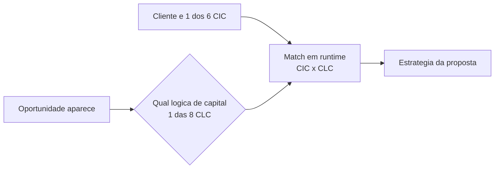
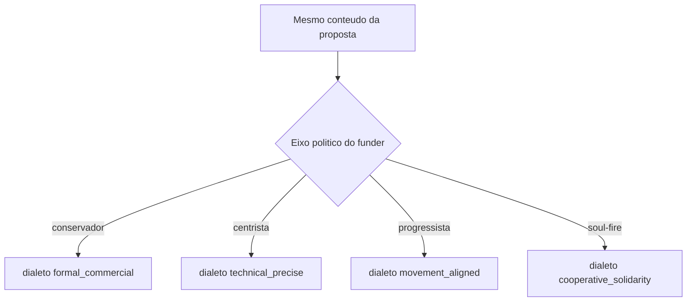
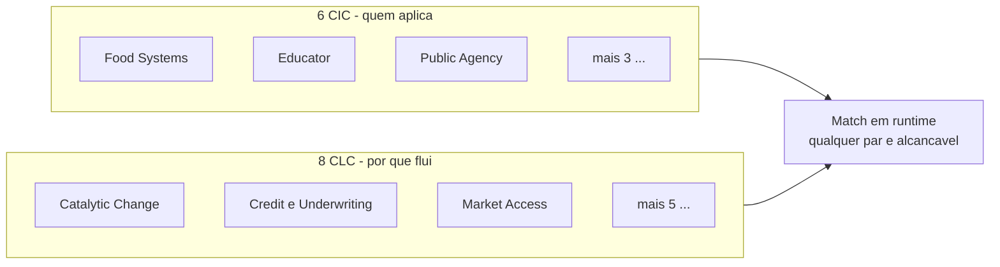
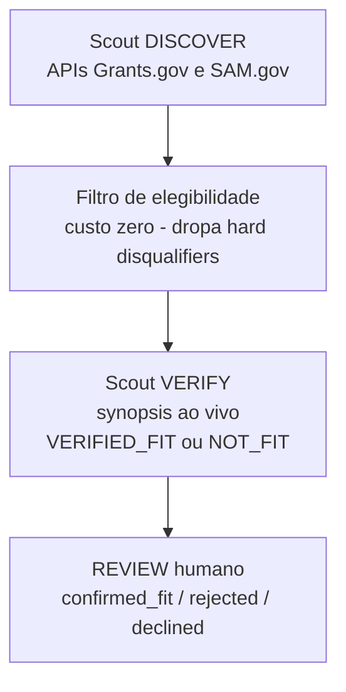
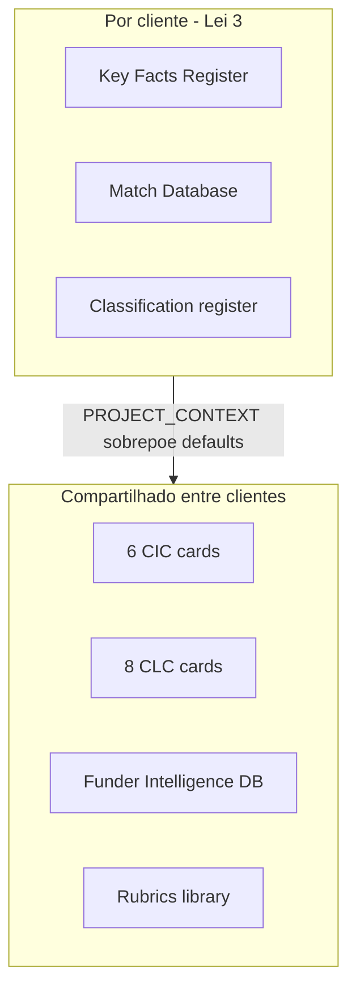
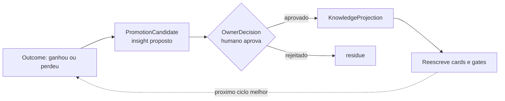

# Discovery — Golden Quill / Tilth explicado do zero

> Documento de orientação para o Victor. Linguagem leiga, muito contexto, enxuto.
> Toda afirmação de fato aponta o arquivo de onde veio. Onde algo é **desenhado mas
> não construído**, está marcado ⚠️.

## Objetivo

Explicar, para quem não é do domínio, o que o Golden Quill faz, como ele decide se um
cliente é elegível a um grant, o que nele é **dado** (você obedece) versus o que é
**otimizado** (você melhora com o tempo), e onde estão os buracos entre o que está
desenhado e o que de fato roda.

---

## 1. Contexto de negócio

**O que é.** O Golden Quill é o produto físico (um desktop de 128 GB que o cliente
compra). O **Tilth** é a inteligência de software que roda dentro dele. O Tilth escreve,
revisa e pontua propostas de *grant* — dinheiro de governos e fundações que o cliente
não precisa devolver. Fonte: [README.md](../README.md).

**Por que existe.** Escrever grant é um trabalho de especialista: você precisa achar o
edital certo, falar a língua que aquele financiador espera, juntar a evidência que ele
exige, e argumentar do jeito que aquele tipo de dinheiro premia. O fundador ganhou seis
grants em 2026 fazendo isso à mão. O Tilth **produtiza** esse trabalho. Fonte:
[README.md](../README.md).

**O que NÃO muda (a tarefa é fixa).** A tarefa é sempre a mesma: *escrever uma proposta
vencedora para uma empresa do tipo X contra um financiamento do tipo Y*. Isso nunca muda.
O que muda — e o que dá valor ao produto — é o **conhecimento** que entra na janela de
contexto dos agentes, que fica mais esperto a cada ciclo. O produto **não** treina modelos
novos; ele melhora o que entrega aos modelos. Fonte: [CLAUDE.md](../CLAUDE.md) (substrato
LOCKED; refinamento via cards, não via pesos).

---

## 2. O problema, em concreto

**O problema.** Organizações que mereciam financiamento perdem grants porque escrever
grant é trabalho de especialista: achar o edital certo, falar a língua do financiador,
juntar a evidência exigida, e argumentar na lógica que aquele dinheiro premia. A maioria
das orgs não tem um escritor de grants. O Tilth automatiza esse especialista. Fonte:
[CLAUDE.md](../CLAUDE.md).

**Os 6 tipos de cliente (CIC) — quem aplica.** O *mundo* de quem aplica vem em seis sabores
(Fonte: [CLAUDE.md](../CLAUDE.md), "Six Customer Identity Categories"):

1. **Food Systems** — fazendas, produtores, processadores, food hubs; mundo sazonal,
   dependente de clima.
2. **Educator** — escolas, redes de ensino, ONGs de educação; mundo denso de compliance e
   fiscalização.
3. **Public Agency** — governos locais e autarquias; licitação, orçamento público,
   prestação de contas.
4. **Arts & Culture** — organizações culturais e artistas; julgados por mérito artístico +
   sustentabilidade da organização.
5. **Cooperative** — cooperativas de trabalhadores/produtores; governança democrática,
   propriedade dos membros.
6. **Ecosystem Intermediary** — aceleradoras, patrocinadores fiscais, CDFIs, conectores de
   capital; atuam em escala de portfólio, apoiando outros.

**Os 8 tipos de financiador (CLC) — por que o dinheiro flui.** A *lógica* de quem paga vem
em oito sabores — cada um quer uma coisa, e você justifica de um jeito (Fonte:
[CLAUDE.md](../CLAUDE.md), "The paired taxonomy"):

1. **Public Purpose & Works** — governo; cumprir mandato público e elegibilidade.
2. **Catalytic Change** — fundações; inovação, transição, mudança de sistema.
3. **Operating Capacity** — fortalecer a própria org (equipe, sistemas, equipamento).
4. **Research & Evidence** — investigar, pilotar, provar se algo funciona.
5. **Market Access** — chegar a compradores, comercializar, criar demanda.
6. **Credit & Underwriting** — empréstimo; espera retorno (você prova que paga de volta).
7. **Sponsorship & Corporate Support** — patrocínio corporativo alinhado a marca.
8. **Shared Assets** — infraestrutura compartilhada / bens comuns coletivos.

**O que muda conforme o tipo de financiador.** O mesmo projeto, apresentado a lógicas
diferentes, precisa ser argumentado de formas diferentes. Exemplo: uma instalação solar
pitchada a um banco — "aqui está o ROI e o cronograma de pagamento" (Credit & Underwriting)
— versus pitchada a uma fundação de clima — "aqui está como isso demonstra um modelo
replicável de descarbonização rural" (Catalytic Change). Mesmo projeto, argumento totalmente
diferente. Muda também a **evidência que convence** e as **fontes de exemplo**.

*O cliente é 1 dos 6 CIC; a oportunidade carrega 1 das 8 CLC; o casamento vira a estratégia.*

**Posição política do financiador/cliente (Lei 4).** A mesma proposta precisa ser reescrita
conforme o eixo político de quem lê. A Lei 4 define quatro **dialetos**: conservador,
centrista, progressista, soul-fire — cada um com um tom diferente. Além disso, há termos
sensíveis ("admin-risk"): palavras como "regenerative agriculture", "climate justice" e
"land back" são lidas de forma muito diferente por painéis diferentes. O sistema marca esses
termos, oferece substitutos com a justificativa de cada um, e — importante — **o aplicante
aprova cada substituição; nunca reescreve em silêncio**. (Fonte: `dialect_routing_table` e
`admin_risk_term_register` em [food_systems.yaml](../pipeline/cards/CIC/food_systems.yaml);
Lei 4 em [CLAUDE.md](../CLAUDE.md).) É por isso que *language register* é um dos botões que
se afina.

*Mesmo conteúdo, eixo político diferente → dialeto diferente.*

Em resumo: o problema tem **dois eixos independentes** — quem aplica e por que o dinheiro
flui. A próxima seção formaliza esses dois eixos como a ontologia do sistema.

---

## 3. Conceitos centrais

### O Conselho (6 cadeiras de agente)

O Tilth é um conselho de 6 agentes, nenhum manda no outro:
**Scout** (acha oportunidades), **Scribe** (escreve), **Editor** (clareza),
**Judge** (pontua contra a rubrica do funder), **Red Team** (ataca a proposta), e
**Logician** (regras determinísticas em Python, custo zero de token, falha-fechado).
Fonte: [CLAUDE.md](../CLAUDE.md) §"The Council".

### Os dois eixos (a ontologia)

O segredo de design: para escrever um grant você precisa entender **duas coisas
independentes**, que as pessoas vivem confundindo:

- **Quem aplica (CIC — Customer Identity Card).** O *mundo* do cliente. Uma fazenda vive
  de estações; uma escola vive de compliance. São **6 tipos**: Food Systems, Educator,
  Public Agency, Arts & Culture, Cooperative, Ecosystem Intermediary.
- **Por que o dinheiro flui (CLC — Capital Logic Card).** O *raciocínio* do financiador.
  Um banco empresta ("você paga de volta?"); uma fundação financia inovação ("isso é
  novo?"). São **8 tipos**: Public Purpose & Works, Catalytic Change, Operating Capacity,
  Research & Evidence, Market Access, Credit & Underwriting, Sponsorship & Corporate
  Support, Shared Assets.

**Por que separados:** qualquer combinação (CIC × CLC) é válida — uma fazenda pode pegar
empréstimo de banco *ou* grant de inovação. Se você amarrasse "fazenda → só esses tipos
de dinheiro", bloquearia oportunidades válidas (erro de categoria que o projeto cometeu e
corrigiu, hoje com um guard que falha-fechado: `F-CIC-CLC-COUPLING-VIOLATION`). O
casamento acontece **em runtime, por oportunidade**, nunca fixado no design. Fonte:
[CLAUDE.md](../CLAUDE.md) §"The paired taxonomy".

*Duas listas independentes; qualquer par é alcançável — quem decide é a oportunidade.*

### Cards ≠ todo o contexto

Os **cards** são só os dois eixos da ontologia. O que entra na janela do agente é maior —
ver a tabela na seção 6.

### O loop de aprendizado (o coração — e o maior buraco)

A ideia é que cada resultado de grant (ganhou/perdeu) vire um *insight* que melhora os
cards para o próximo ciclo. ⚠️ Esse loop está **desenhado, não construído** — hoje o
operador edita os cards à mão. Ver seção 7.

---

## 4. Como você vê se um cliente é elegível a um grant

Sim, existe API — e o fluxo é uma escada de filtros, do mais barato ao mais caro:

*Funil: descobrir barato, verificar ao vivo, decisão humana no fim.*

1. **Scout DISCOVER.** Bate em 6 famílias de canais em paralelo. A família A são **APIs
   federais**: Grants.gov (`search2`, `fetchOpportunity`), SAM.gov, USASpending. A busca
   usa o *search vocabulary* do card (os termos que o funder usa). Fonte:
   [CLAUDE.md](../CLAUDE.md) §"Scout".
2. **Filtro de elegibilidade (custo zero).** Antes de gastar qualquer token, um filtro
   determinístico dropa o que não serve (ex.: "501(c)(3) only", "tribal governments only")
   e pontua sinais positivos. Fonte:
   [logician/filters/eligibility_filter.py](../logician/filters/eligibility_filter.py).
3. **Scout VERIFY.** Para os que sobraram, busca o synopsis **ao vivo** e marca
   `VERIFIED_FIT` / `VERIFIED_NOT_FIT` / `UNVERIFIED`. (Lição L-001: cache nunca decide
   elegibilidade — só o synopsis ao vivo.) Fonte: [lessons.md](../lessons.md).
4. **REVIEW (você).** O operador revê a lista de `VERIFIED_FIT` e decide
   `confirmed_fit | rejected | declined_cycle`. Fonte:
   [architecture_v7_0_5_amendment.md](../pipeline/architecture/v0.1/architecture_v7_0_5_amendment.md).

⚠️ Hoje o `eligibility_filter.py` está **hardcoded para um cliente** (MycoSymbiotics).
Para virar produto, esse perfil precisa sair do código e virar dado por-cliente
(o `PROJECT_CONTEXT` + a Key Facts Register).

---

## 5. O que é DADO vs. o que se OTIMIZA (a distinção que importa)

Esta é a confusão mais fácil de cometer. Três camadas:

| Camada | Exemplos | É dado ou otimizado? |
|---|---|---|
| **A tarefa** | "grant para empresa X, financiamento Y" | **Dado, fixo para sempre.** |
| **As regras do funder** | rubrica de pontuação, regras de elegibilidade, ritmo de relatório | **Dado pelo funder. Você obedece, não otimiza.** Você só otimiza sua capacidade de *detectar* e *cumprir* essas regras. |
| **Os cards (conhecimento)** | search vocabulary, evidence schema, language register, como argumentar cada lógica | **Otimizado** — começam autorados por especialista, e o loop os refina ao longo dos ciclos. |
| **Os parâmetros de execução** | temperatura por cadeira, variantes, time de modelos, modo de delegação | **Otimizado** (⚠️ falta a "disciplina de calibração" — nem desenhada direito). |

**Regra de bolso:** se vem do funder, é uma **restrição** (obedeça); se é conhecimento
seu sobre como ganhar, é uma **alavanca** (otimize).

E um quarto fenômeno, que não é otimização mas faz o sistema melhorar: **acúmulo de
corpus** — o KFR (fatos do cliente), a Funder Intelligence Database e o Match Database
engordam com o tempo. Depois de anos, isso vira o "moat" competitivo. Fonte:
[architecture_v7_0_5_amendment.md](../pipeline/architecture/v0.1/architecture_v7_0_5_amendment.md).

---

## 6. As camadas de contexto (entendendo os cards melhor)

Os cards são por **arquétipo e compartilhados** — não por cliente. Um cliente é
*classificado* num CIC ("esse é Food Systems") e herda aquele card; ele não ganha um card
próprio. O que é por-cliente vive numa camada separada:

*Camada compartilhada entre clientes vs. camada por-cliente (Lei 3).*

| Camada | Escopo | Compartilhado? | O que é |
|---|---|---|---|
| **CIC cards** (6) | por **tipo de empresa** | sim | a ontologia: quem aplica |
| **CLC cards** (8) | por **lógica de capital** | sim | a ontologia: por que o dinheiro flui |
| **Key Facts Register (KFR)** | por **cliente** | não | os fatos da org (receita, certificações, parcerias) |
| **Funder Intelligence DB** | por **funder** | sim (cross-org) | documentos do financiador |
| **Match Database** | por **(cliente × funder)** | não (Lei 3) | histórico: o que propôs, sua ação, o outcome |
| **Classification register** | por **cliente** | não | o que pode sair da máquina (cloud vs local) |
| **Rubrics library** | por **funder** | sim | as rubricas de pontuação |

O card é o **default do arquétipo**; o `PROJECT_CONTEXT` do cliente **sobrepõe** onde
precisa (`match_overrides take precedence`). Fontes:
[food_systems.yaml](../pipeline/cards/CIC/food_systems.yaml), [CLAUDE.md](../CLAUDE.md).

**Consequência para o negócio (resposta à pergunta "otimizo por cliente?"):** você
otimiza o **sistema inteiro** quase sempre. Uma lição aprendida com o grant do cliente A
(Food Systems) melhora o card de Food Systems para **todos** os clientes Food Systems.
Por-cliente é só override fino. É esse efeito-composto — um cliente paga o aprendizado,
todos os outros colhem — que é a tese de valor do produto.

---

## 7. As três coisas que "muda de cliente para cliente" e a relação evidence × capital logic

### Search vocabulary — de onde vêm os termos?

Vêm do **lado do funder**, não do cliente: são os termos dos editais e estatutos oficiais,
cada um com fonte citada (ex.: "agricultural producer" → `USDA VAPG 7 CFR 4284`). A lógica:
o Scout busca usando a língua do funder, não a do cliente, senão não casa. Autorados por
especialista hoje. Fonte: [food_systems.yaml](../pipeline/cards/CIC/food_systems.yaml).

### Evidence schema — quem decide a evidência?

Em camadas, **não é escolha livre**: o **edital manda primeiro** (Lei 1: RFA é a fonte da
verdade); o **card preenche o silêncio** com o default por tipo de fato (ex.: receita →
Schedule F ou P&L auditado). Hierarquia: **edital > card**. Fonte:
[food_systems.yaml](../pipeline/cards/CIC/food_systems.yaml) (`provenance_requirements`).

### A relação evidence schema × capital logic (você notou certo)

Há relação, mas é de **runtime**, não acoplamento fixo. A **capital logic decide qual
evidência convence**: Credit & Underwriting → evidência financeira/de pagamento; Research
& Evidence → dados de piloto; Market Access → cartas de comprador (LOIs). O **evidence
schema do CIC** diz *o que comprova cada fato do cliente* (proveniência). No runtime, a
CLC ativa decide *quais* dos fatos comprovados do cliente colocar na frente. Eles se
encontram em (CIC × CLC) — e é exatamente por isso que ficam em eixos separados: amarrar
"essa evidência para essa lógica" recriaria o erro de acoplamento.

### Captura de dados pós-prêmio — muda por cliente?

Sim. Depois de ganhar, o **Data Collector** coleta dados de desempenho dos beneficiários
(email/SMS/voz) e o **Report Generator** monta o relatório no formato/ritmo que aquele
funder exige. Diferentes programas pedem métricas diferentes → captura por-cliente/por-grant.
⚠️ Ambos são **v0.2** (desenhados, não construídos); no v0.1 isso é trabalho manual do
operador. Fonte: [CLAUDE.md](../CLAUDE.md) §"Support Agents".

---

## 8. Perguntas em aberto (com recomendação)

*O loop de aprendizado, com a lacuna marcada — desenhado, não construído hoje.*

⚠️ Esse loop está **desenhado mas não construído hoje**.

1. **O loop de aprendizado não está construído.** O validador de promoção (as 11 regras
   `GQ-PR-L0-*`) e o `grant_dag/validate.py` citados nos docs do ontologize **não existem
   em código** — vivem em documentos de design. Hoje o operador edita os cards à mão.
   **Recomendação:** tratar "Josh edita cards à mão → loop reescreve cards com aprovação
   dele" como o primeiro grande entregável; é o que separa "produto que aprende" de
   "template estático".

2. **A elegibilidade está presa a um cliente.** [eligibility_filter.py](../logician/filters/eligibility_filter.py)
   é hardcoded para a MycoSymbiotics. **Recomendação:** generalizar para um perfil
   per-cliente (PROJECT_CONTEXT + KFR) antes de qualquer segundo cliente.

3. **A otimização de parâmetros de execução não tem disciplina de calibração.** Temperatura,
   variantes e time de modelos estão listados como ideias deferidas, mas falta o método de
   *como o Tilth aprende* o ajuste certo para um funder novo. **Recomendação:** deixar
   explícito que isso é backlog, não capacidade atual — não prometer a clientes.

4. **A premissa "todo negócio tem dois eixos" é hipótese.** Provada só para grants. ⚠️
   **Recomendação:** o primeiro piloto não-grant deve testar exatamente isso, e tratar como
   redução de risco (n=1), não prova de generalidade.

---

## Conexões

- Fonte primária: [projects/goldenquill/](../) (README, CLAUDE.md, cards, eligibility_filter, lessons).
- Generalização do produto: [projects/ontologize/PRODUCT.md](../../ontologize/PRODUCT.md),
  [DAG-AND-METRICS.md](../../ontologize/DAG-AND-METRICS.md).
