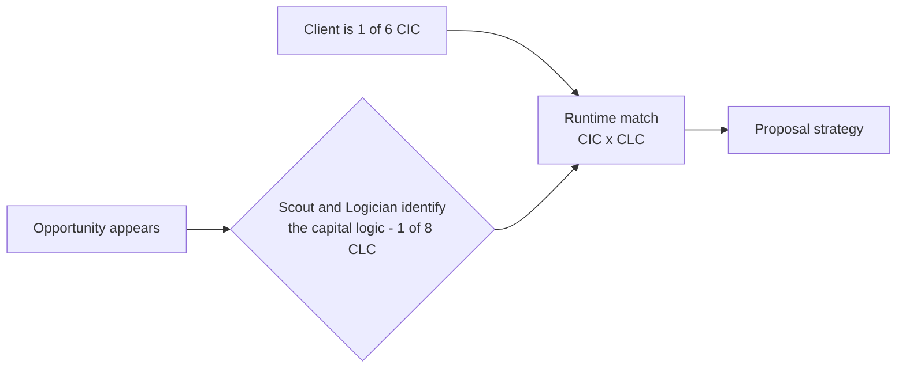
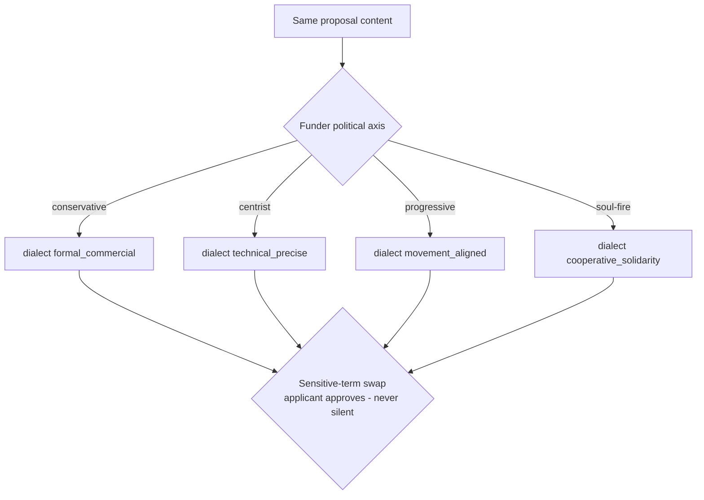
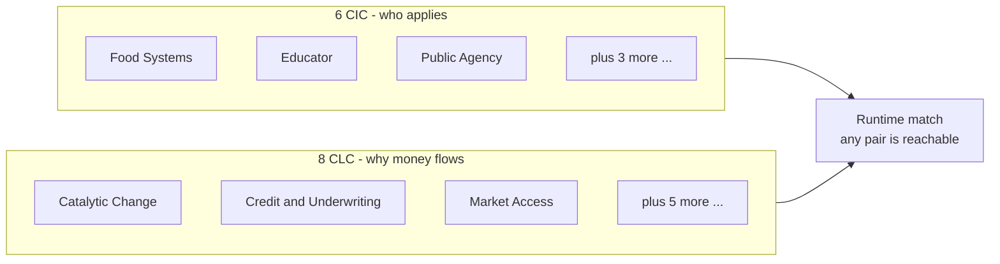
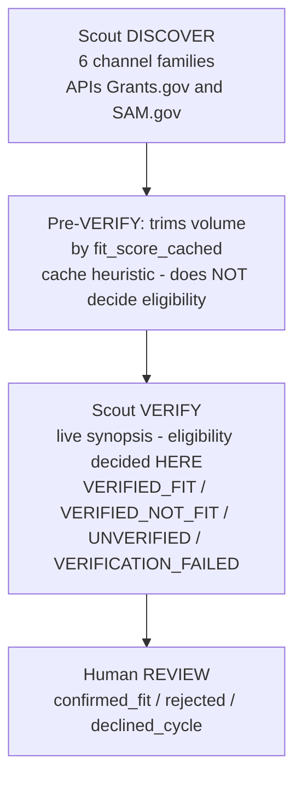
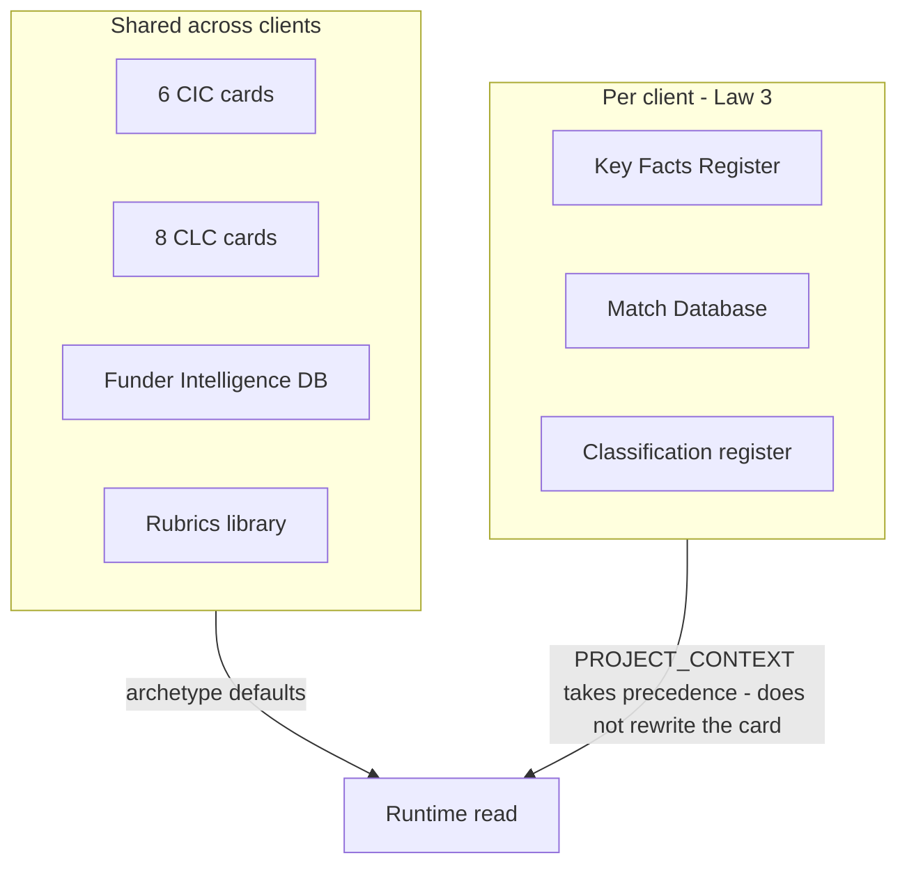
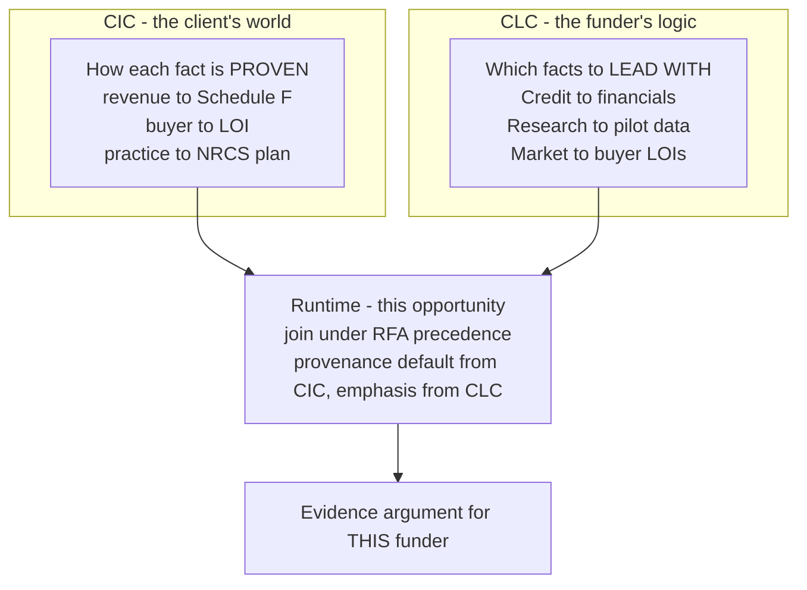
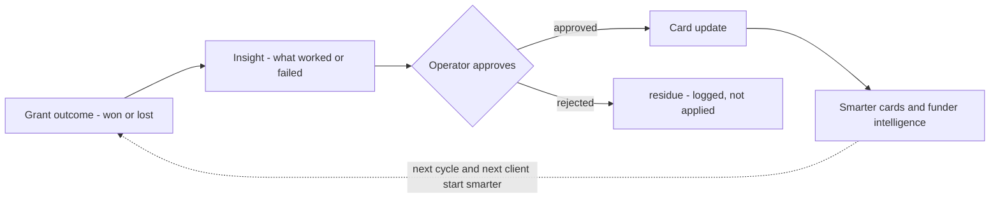

# Discovery — Golden Quill / Tilth explained from scratch

> Orientation document for Victor. Plain language, lots of context, lean.
> Every factual claim points to the file it came from. Where something is **designed
> but not built**, it is marked ⚠️.

## Objective

Explain, for someone outside the domain, what Golden Quill does, how it decides whether a
client is eligible for a grant, what in it is **given** (you obey) versus what is
**optimized** (you improve over time), and where the gaps are between what is designed and
what actually runs.

---

## 1. Business context

**What it is.** Golden Quill is the physical product (a 128 GB desktop the client buys).
**Tilth** is the software intelligence that runs inside it. **Cultivator** is the phone app
each employee uses to feed facts in by voice, photo, or text. (A fourth name, **Sovereign
Node**, is the future cooperative-owned shared layer — Stage-5, out of scope today.) Tilth
writes, reviews, and scores *grant* proposals — money from governments and foundations the
client does not have to pay back. Source: [README.md](../README.md), [CLAUDE.md](../CLAUDE.md).

**The sovereignty promise (the actual differentiator).** The client owns the hardware, the
API keys, and all the data. If the vendor vanished tomorrow, the client keeps everything and
the product keeps running — nothing is held hostage. This is why the product exists as a box
you own rather than a website you log into, and it drives the privacy model below. Source:
[CLAUDE.md](../CLAUDE.md) §"Sovereignty Promise".

**Three privacy postures (how confidential data is protected).** The customer picks one of
three modes, and a per-field *classification register* enforces it on every model call:
- **Frontier-Eligible** — approved, non-sensitive fields may go to powerful cloud models;
  confidential fields stay local.
- **Split-Context Hybrid** — cloud models help with *structure and framing only*; your
  confidential facts (names, financials, evidence) never leave the machine.
- **Local-Only / Sovereign** — nothing leaves at all (slower, still under validation).

Source: [CLAUDE.md](../CLAUDE.md) §"Beta Model Strategy".

**Why it exists.** Grant writing is specialist work: you have to find the right
solicitation, speak the language that funder expects, assemble the evidence it requires,
and argue in the way that kind of money rewards. The founder has already won grants in 2026
doing this by hand — at least three competitive grants. Tilth **productizes** that work.
(⚠️ Sources disagree on the exact count: [README.md](../README.md) says "six";
[CLAUDE.md](../CLAUDE.md) says "three" in three places — reconcile before any external use;
the body uses the conservative number.) Source:
[README.md](../README.md), [CLAUDE.md](../CLAUDE.md).

**What does NOT change (the task signature is fixed).** Within the grant-drafting work of
v0.1, the task is always the same shape: *write a winning proposal for a type-X company
against a type-Y funding source*. That signature never changes. (Post-award reporting — the
v0.2 Data Collector / Report Generator work in section 7 — is a *second* fixed-shape task
layered on top; "the task is fixed" means each task has a stable signature, not that the
system only ever does one thing.) What changes — and what gives the product its value — is
the **knowledge** that enters the agents' context window, which gets smarter every cycle. The
product does **not** train new models; it improves what it hands to the models. Source:
[CLAUDE.md](../CLAUDE.md) (substrate LOCKED; refinement via cards, not via weights).

---

## 2. The problem, concretely

**The problem.** Organizations that deserved funding lose grants because grant writing is
specialist work: finding the right solicitation, speaking the funder's language, assembling
the required evidence, and arguing in the logic that money rewards. Most orgs don't have a
grant writer. Tilth automates that specialist. Source: [CLAUDE.md](../CLAUDE.md).

**The 6 client types (CIC) — who applies.** The *world* of the applicant comes in six
flavors (Source: [CLAUDE.md](../CLAUDE.md), "Six Customer Identity Categories"):

1. **Food Systems** — farms, producers, processors, food hubs; seasonal, weather-dependent
   world.
2. **Educator** — schools, school systems, education nonprofits; compliance- and
   oversight-dense world.
3. **Public Agency** — local governments and public authorities; procurement, public
   budgets, accountability.
4. **Arts & Culture** — cultural organizations and artists; judged on artistic merit +
   organizational sustainability.
5. **Cooperative** — worker/producer cooperatives; democratic governance, member ownership.
6. **Ecosystem Intermediary** — accelerators, fiscal sponsors, CDFIs, capital connectors;
   operate at portfolio scale, supporting others.

**The 8 funder types (CLC) — why the money flows.** The *logic* of whoever pays comes in
eight flavors — each wants something, and you justify it in a particular way (Source:
[CLAUDE.md](../CLAUDE.md), "The paired taxonomy"):

1. **Public Purpose & Works** — government; fulfilling a public mandate and eligibility.
2. **Catalytic Change** — foundations; innovation, transition, systems change.
3. **Operating Capacity** — strengthening the org itself (staff, systems, equipment).
4. **Research & Evidence** — investigate, pilot, prove whether something works.
5. **Market Access** — reach buyers, commercialize, build demand.
6. **Credit & Underwriting** — a loan; expects repayment (you prove you can pay it back).
7. **Sponsorship & Corporate Support** — brand-aligned corporate sponsorship.
8. **Shared Assets** — shared infrastructure / collective commons.

**What changes by funder type.** The same project, pitched to different logics, must be
argued in different ways. Example: a solar installation pitched to a bank — "here is the ROI
and repayment schedule" (Credit & Underwriting) — versus pitched to a climate foundation —
"here is how this demonstrates a replicable model for rural decarbonization" (Catalytic
Change). Same project, completely different argument. What also changes: the **evidence that
convinces** and the **example sources**.

*The client is 1 of 6 CIC; the opportunity carries 1 of 8 CLC; the match becomes the strategy.*

**Political position of funder/client (Law 4).** The same proposal must be rewritten
according to the political axis of whoever reads it. Law 4 defines four **dialects**:
conservative, centrist, progressive, soul-fire — each with a different tone. On top of that,
there are sensitive ("admin-risk") terms: words like "regenerative agriculture", "climate
justice", and "land back" are read very differently by different panels. The system flags
those terms, offers substitutes with a rationale for each, and — importantly — **the
applicant approves each substitution; it never rewrites silently**. (Source:
`dialect_routing_table` and `admin_risk_term_register` in
[food_systems.yaml](../pipeline/cards/CIC/food_systems.yaml); Law 4 in
[CLAUDE.md](../CLAUDE.md).) This is why *language register* is one of the knobs you tune.

*Same content, different political axis → different dialect. The sensitive-term swap goes through applicant approval — never silent.*

In short: the problem has **two separately-authored axes** — who applies and why the money
flows — with no hardcoded coupling between them. (They are not *statistically* independent:
some client-world/funder-logic pairs are common, some rare. The point is that none is
*forbidden* at design time — see section 3.) The next section formalizes those two axes as
the system's ontology.

---

## 3. Core concepts

### The Council (6 agent seats)

Tilth is a council of 6 agents, none outranking another:
**Scout** (finds opportunities), **Scribe** (writes), **Editor** (clarity),
**Judge** (scores against the funder's rubric), **Red Team** (attacks the proposal), and
**Logician** (deterministic Python rules, zero token cost, *fail-closed* — when unsure it
refuses rather than guessing). Source: [CLAUDE.md](../CLAUDE.md) §"The Council".

**How automated is it? (the gears.)** Each seat runs in one of three modes the applicant
sets: **Sparring** (the seat proposes options, you decide), **Co-Pilot** (you steer, the
seat executes — the default), or **Synthesizer** (full delegation, you review the final
output only). This is the dial that controls how much the human stays in the loop. Source:
[CLAUDE.md](../CLAUDE.md) §"Operational Gears".

### The Five Operating Laws (non-negotiable)

Five rules no prompt or model can override. Two recur throughout this doc (Laws 3 and 4);
all five matter:

1. **RFA is the source of truth** — every claim traces to the actual funding announcement.
2. **No boundary drift** — stay inside the announcement's scope; don't silently expand it.
3. **Org isolation** — one client's data never bleeds into another's work.
4. **Apolitical language + admin-risk scanning** — match the funder's dialect; flag sensitive
   terms; never rewrite silently (the applicant approves each change).
5. **Applicant brings the substance** — the system *never fabricates* credentials, data, or
   partnerships; it only shapes real material into funder-ready form.

Source: [CLAUDE.md](../CLAUDE.md) §"The Five Operating Laws".

### The two axes (the ontology)

The design secret: to write a grant you must keep apart **two things** that people constantly
conflate (they are separately authored and combined only at runtime — not independent in
frequency, but never coupled at design time):

- **Who applies (CIC — Customer Identity Card).** The client's *world*. A farm lives by
  seasons; a school lives by compliance. There are **6 types**: Food Systems, Educator,
  Public Agency, Arts & Culture, Cooperative, Ecosystem Intermediary.
- **Why the money flows (CLC — Capital Logic Card).** The funder's *reasoning*.
  A bank lends ("will you pay it back?"); a foundation funds innovation ("is this new?").
  There are **8 types**: Public Purpose & Works, Catalytic Change, Operating Capacity,
  Research & Evidence, Market Access, Credit & Underwriting, Sponsorship & Corporate
  Support, Shared Assets.

**Why kept separate:** any (CIC × CLC) pair must stay *reachable* — a farm can take a bank
loan *or* an innovation grant. If you hardcoded "farm → only these kinds of money", you'd
block valid opportunities (a category error the project made and corrected, now enforced by a
guard that refuses such couplings: `F-CIC-CLC-COUPLING-VIOLATION`). But the deeper reason to
keep two lists (6 + 8 = 14 authored units) instead of one 48-cell table is the same reason you
normalize a database: independent evolution, no update anomalies, and linear — not
multiplicative — authoring cost. The match is computed **at runtime, per opportunity**, by
*joining* the two axes (and reconciling against the funder's announcement), never by baking
the join into the source cards. Source: [CLAUDE.md](../CLAUDE.md) §"The paired taxonomy".

*Two separately-authored lists; any pair is reachable — the opportunity decides.*

### Cards ≠ the whole context

The **cards** are only the two ontology axes. What enters the agent's window is bigger —
see the table in section 6.

### The learning loop (the heart — and the single biggest gap)

The idea: each grant result (won/lost) becomes an *insight* that improves the cards for the
next cycle, so the product compounds. **⚠️ Today, nothing learns automatically.** The "gets
smarter every cycle" story is *designed, not built* — a human currently edits the cards by
hand after each grant. This is the largest gap between the vision and what runs, and section 8
treats the loop as the (still-hypothetical) value engine.

---

## 4. How you see whether a client is eligible for a grant

Eligibility is decided by a ladder of filters, cheapest to most expensive. Scout queries
*external government* APIs (Grants.gov, SAM.gov) to find opportunities — but note the
dedicated eligibility filter is **designed, not yet wired in** (⚠️ see step 2 below), so this
ladder is partly aspirational today:

*Funnel: discover cheap → trim volume → verify live (decided here) → human decision.*

1. **Scout DISCOVER.** Hits 6 channel families in parallel. Family A is the **federal APIs**:
   Grants.gov (`search2`, `fetchOpportunity`), SAM.gov, USASpending. The search uses the
   card's *search vocabulary* (the terms the funder uses). Source:
   [CLAUDE.md](../CLAUDE.md) §"Scout".
2. **Pre-VERIFY (trims volume, does NOT decide).** The only gate that actually runs before
   VERIFY in the real pipeline is `fit_score_cached` — a cache heuristic that merely truncates
   the number of candidates (`SCOUT_CANDIDATE_VERIFY_CAP`), explicitly *"NOT a VERIFY
   decision"*. Source: [section_03_scout.md](../pipeline/blueprint/v0.1/section_03_scout.md).
   ⚠️ There is a separate module `eligibility_filter.py` (a zero-token hard-disqualifier
   filter, e.g. "501(c)(3) only", "tribal governments only"), **but it is not wired into the
   current Scout pipeline** — it has no import or call site anywhere in Scout (verified: zero
   callers), and the root-level `logician/` copy was internally flagged as a possible "stale
   shim" duplicating `pipeline/logician/`. Source:
   [logician/filters/eligibility_filter.py](../logician/filters/eligibility_filter.py).
3. **Scout VERIFY — this is where eligibility is actually decided.** Fetches the **live**
   synopsis and tags one of four states: `VERIFIED_FIT` / `VERIFIED_NOT_FIT` / `UNVERIFIED`
   (no live endpoint) / `VERIFICATION_FAILED`. (Lesson L-001: cache never decides eligibility
   — only the live synopsis.) Source: [CLAUDE.md](../CLAUDE.md) §"Scout" +
   [section_03_scout.md](../pipeline/blueprint/v0.1/section_03_scout.md); L-001 in
   [lessons.md](../lessons.md).
4. **REVIEW (you).** The operator reviews the `VERIFIED_FIT` list and decides
   `confirmed_fit | rejected | declined_cycle`. Source:
   [architecture_v7_0_5_amendment.md](../pipeline/architecture/v0.1/architecture_v7_0_5_amendment.md).

⚠️ `eligibility_filter.py` (if/when it gets wired in) is **hardcoded to one client**
(MycoSymbiotics). To become a product, that eligibility profile must move out of code and
become per-client data (the `PROJECT_CONTEXT` + the Key Facts Register).

---

## 5. What is GIVEN vs. what is OPTIMIZED (the distinction that matters)

This is the easiest confusion to fall into. Three layers:

| Layer | Examples | Given or optimized? |
|---|---|---|
| **The task** | "grant for company X, funding Y" | **Given, fixed forever.** |
| **Funder hard constraints** | eligibility rules, format, deadline | **Given by the funder. Binary — you obey, fail-closed.** You only optimize your ability to *detect* and *satisfy* them. |
| **Funder graded objectives** | the scoring rubric, the panel's political read | **Given by the funder — but you *do* optimize your response toward them.** The Judge/Red Team loop maximizes your draft's score against the funder's own rubric. |
| **The cards (knowledge)** | search vocabulary, evidence schema, language register, how to argue each logic | **Optimized** — they start expert-authored, and the loop refines them over the cycles. |
| **The execution parameters** | temperature per seat, variants, model team, delegation mode | **Optimized** (⚠️ the "calibration discipline" is missing — not even properly designed). |

**Rule of thumb:** funder *constraints* you obey (fail-closed); funder *objectives* you
optimize *toward* (the rubric is given, but your response surface over it is the whole game);
your *craft knowledge* (the cards) is the lever you accumulate over time.

And a fourth phenomenon that isn't optimization but still makes the system better:
**corpus accumulation** — the KFR (client facts), the Funder Intelligence Database, and the
Match Database grow over time. ⚠️ It is tempting to call this the competitive "moat", but the
sovereignty promise cuts the other way: the client owns and can walk away with all of it, and
the per-client corpora (KFR, Match DB) are Law-3-isolated, so they neither lock a client in
nor transfer to other clients. The only cross-client asset is the Funder Intelligence DB — and
it is the *least* defensible (Grants.gov, SAM.gov, and rubrics are largely public). The honest
version: there is **no lock-in moat by design**; the defensible thing is the *rate* of
intelligence improvement, not the static corpus (see section 8, Q3). Source:
[architecture_v7_0_5_amendment.md](../pipeline/architecture/v0.1/architecture_v7_0_5_amendment.md).

---

## 6. The context layers (understanding the cards better)

The cards are **per-archetype and shared** — not per client. A client is *classified* into a
CIC ("this one is Food Systems") and inherits that card; it doesn't get its own card. What is
per-client lives in a separate layer:

*Shared-across-clients layer vs. per-client layer (Law 3).*

| Layer | Scope | Shared? | What it is |
|---|---|---|---|
| **CIC cards** (6) | per **company type** | yes | the ontology: who applies |
| **CLC cards** (8) | per **capital logic** | yes | the ontology: why the money flows |
| **Key Facts Register (KFR)** | per **client** | no | the org's facts (revenue, certifications, partnerships) |
| **Funder Intelligence DB** | per **funder** | yes (cross-org) | the funder's documents |
| **Match Database** | per **(client × funder)** | no (Law 3) | history: what was proposed, your action, the outcome |
| **Classification register** | per **client** | no | what may leave the machine (cloud vs local) |
| **Rubrics library** | per **funder** | yes | the scoring rubrics |

The card is the **archetype default**; the client's `PROJECT_CONTEXT` **overrides** where
needed (`match_overrides take precedence`). Sources:
[food_systems.yaml](../pipeline/cards/CIC/food_systems.yaml), [CLAUDE.md](../CLAUDE.md).

**Business consequence (answering "do I optimize per client?"):** you optimize the **whole
system** almost always. A lesson learned from client A's grant (Food Systems) improves the
Food Systems card for **all** Food Systems clients. Per-client is just a thin override. It's
this compounding effect — one client pays for the learning, all the others reap it — that is
the product's value thesis.

---

## 7. The three things that "change from client to client" and the evidence × capital-logic relationship

### Search vocabulary — where do the terms come from?

From the **funder side**, not the client: they are the terms from official solicitations and
statutes, each with a cited source (e.g. "agricultural producer" → `USDA VAPG 7 CFR 4284`).
The logic: Scout searches using the funder's language, not the client's, or it won't match.
Expert-authored today. Source: [food_systems.yaml](../pipeline/cards/CIC/food_systems.yaml).

### Evidence schema — who decides the evidence?

In layers, **not a free choice**: the **solicitation rules first** (Law 1: the RFA is the
source of truth); the **card fills the silence** with the default per fact type (e.g. revenue
→ Schedule F or audited P&L). Hierarchy: **solicitation > card**. Source:
[food_systems.yaml](../pipeline/cards/CIC/food_systems.yaml) (`provenance_requirements`).

### The evidence schema × capital logic relationship (you spotted it correctly)

This is the part that trips everyone up, so go slowly. There are **two separate jobs**, one
per axis, and they only combine **at runtime** — never in a fixed table.

**Job 1 — the CIC says *how you prove each fact by default* (provenance).** The client's card
lists each fact type and what document counts as proof of it. For a Food Systems client:
revenue is proven by a Schedule F or audited P&L; a buyer relationship is proven by an invoice
or a signed letter of intent (LOI); a conservation practice is proven by an NRCS plan. This
default is fixed by the client's *world* — a farm proves revenue with a Schedule F, a
nonprofit would prove the same fact with audited statements. **But the card only fills the
silence:** if the funder's announcement (RFA) names a specific proof form, the RFA wins (Law 1:
solicitation > card). So provenance is "RFA first, CIC default second" — not purely
client-side. (Source: `provenance_requirements` in
[food_systems.yaml](../pipeline/cards/CIC/food_systems.yaml); the evidence-schema subsection
above.)

**Job 2 — the CLC says *which proven facts to lead with* (emphasis).** The funder's logic sets
the *priority order* of the client's facts. Credit & Underwriting asks "can you repay?" → lead
with financials. Research & Evidence asks "does it work?" → lead with pilot data. Market Access
asks "is there demand?" → lead with buyer LOIs. But the funder can only lead with facts the
client actually holds — so emphasis is the funder's logic applied *to this client's facts*
(funder logic ∩ client KFR), not a pure funder-side projection.

**Worked example — same farm, same facts, two funders.** A farm's Key Facts Register holds
three proven facts: revenue (proven by Schedule F), a signed LOI from a regional grocery
chain, and soil-health trial results.

- Applying for a **CDFI loan** (Credit & Underwriting) → the argument *leads* with revenue and
  repayment capacity; the LOI and trial data are supporting color.
- Applying for a **market-development grant** (Market Access) → the argument *leads* with the
  LOI as proof of real demand; the financials drop to the background.

Same farm, same evidence, same proof-of-each-fact — but *which* evidence carries the argument
flips with the funder's logic.

**Why this lives on two axes and not one table.** It is tempting to write a single lookup —
"Credit logic → use a Schedule F." Resist it for the same reason you normalize a database: one
48-cell table is 48 units to author, sign, and keep consistent, and every new client world or
funder logic multiplies the maintenance; two lists of 6 and 8 evolve independently with no
update anomalies and linear authoring cost. Baking the join into the source cards is exactly
the `F-CIC-CLC-COUPLING-VIOLATION` error the project already made and corrected. So the axes
stay separate and the system computes the answer per opportunity by **joining** them:
provenance defaults from the CIC, emphasis priorities from the CLC — **both reconciled against
the funder's RFA** (Law 1), and emphasis filtered to the facts the client actually holds.
(Note: this is a *join under precedence*, not a clean split — the RFA can override the CIC's
provenance default, and emphasis depends on the client's facts, so neither axis is fully
self-contained. The reason to factor them is authoring economy and independent evolution, not
strict separability.)

*Provenance defaults come from the client's world (overridable by the funder's RFA); emphasis priorities come from the funder's logic (applied to the facts the client holds). They are joined per opportunity under RFA precedence — never frozen into a fixed table.*

### Post-award data capture — does it change per client?

Yes. After winning, the **Data Collector** gathers beneficiary performance data
(email / SMS / voice / Telegram / WhatsApp — 5 channels) and the **Report Generator**
assembles the report in the format/rhythm that
funder requires. Different programs ask for different metrics → per-client/per-grant capture.
⚠️ Both are **v0.2 horizon**: they already have partial code on disk (e.g.
`data_collector/email_channel.py`, `report_generator/composers/narrative.py`, §13/§14 "v1
LOCKED 2026-05-10"), but **are not active in v0.1** — today this is manual operator work.
Source: [CLAUDE.md](../CLAUDE.md) §"v0.1 vs v0.2 boundary" (the canonical 5-channel count;
note §"Support Agents" lists an older "email/text/voice" — the doc uses the newer number) +
`pipeline/orchestrator/seats/{data_collector,report_generator}/`.

---

## 8. Open questions (business & optimization)

These are the open **business** questions — how the product creates value, what we optimize
*toward*, and how it grows. (Development gaps are a separate track: they're marked ⚠️ inline
throughout this doc and are deferred for now — they are *how* we build, not *what makes this a
business*.)

*The compounding-value engine: every grant outcome can become an insight that improves the cards — so the next client in the same CIC starts smarter. This loop is what turns a one-off tool into an asset that appreciates. The open questions below are all about making this engine pay.*

1. **What do we optimize *toward*? (the north-star metric.)** The cards get smarter every
   cycle — but smarter toward *what*? And beware: whatever you pick, the card-refinement loop
   will drive the whole CIC's corpus toward that metric's failure mode at once. Each single
   metric is gamed: **win rate** → cherry-pick easy grants, decline hard ones (the
   `declined_cycle` lever already exists — you win the ratio by shrinking the denominator);
   **dollars won** → chase big long-shots, ignore cost-to-win; **operator hours saved** →
   decoupled from outcomes entirely (draft fast, win nothing). **Recommendation:** don't pick
   one — use a guardrailed composite: primary = *expected dollars won* (award size × calibrated
   win-probability), with hard floors on hours-per-dollar-won and on opportunities-attempted,
   and track each metric's gamed counter-metric explicitly.

2. **Deep or wide — who is the second client?** The value thesis ("one client pays for the
   learning, all the others reap it") only compounds when clients **share a CIC** — and even
   then only on the *funder-shareable* slice (Law 3 keeps client facts private; see Q4), so
   honestly it's "one pays, same-CIC clients reap the shareable part." Two tensions the thesis
   hides: (a) **free-rider / cannibalization** — same-CIC clients often compete for the *same*
   grants, so improving the shared card with client A's winning insight arms client B against A
   next round; and (b) the **early client** pays full price for the dumbest version of the card
   and subsidizes everyone after. **Recommendation:** go *deep* in one CIC for the *first
   cohort* (3–5 clients) to harden white-glove and prove the loop — but treat that as a
   sequencing tactic, not the business shape. Going wide later is what (i) escapes a small,
   grant-dependent, low-ability-to-pay single-CIC TAM, (ii) diversifies the concentration risk
   that one federal budget cut wipes the whole book, and (iii) actually validates the CIC×CLC
   generality the architecture was built for. Design an early-adopter incentive and a
   within-CIC anti-cannibalization policy before stacking clients.

3. **How do we price and capture value without breaking the sovereignty promise?** This is a
   genuine contradiction to resolve, not just a pricing choice. The "moat" (KFR, Funder
   Intelligence DB, Match DB) is something the client owns and can walk away with — so it isn't
   a moat. And the fix below — a *continuously-updating* shared-intelligence subscription — is
   in direct tension with the "nothing is held hostage" promise (if updates stop when you stop
   paying, something *is* held hostage). Sovereignty + BYOK also deliberately demolish the
   lock-in that every vertical-SaaS moat relies on. **Recommendation:** separate "what the
   client owns outright" (their data, their machine, today's snapshot) from "the
   shared-intelligence subscription" (the *stream* of card + funder-DB improvements) — and
   accept that the defensible asset is the *rate of improvement* (out-improving the snapshot a
   client could walk with, faster than it decays), not captivity. Decide explicitly which is
   load-bearing — sovereignty or recurring revenue — before pricing on top of it.

4. **How much intelligence is shareable across clients vs. locked by Law 3?** The network
   effect — and the Stage-5 commons — depends on cross-client sharing, but Law 3 isolates
   client data. Funder-side intelligence (rubrics, funder docs, what wins a given funder) is
   shareable; client-side facts are not. The bigger the shareable layer, the stronger the
   *shared-intelligence advantage* (not a lock-in moat — see Q3; the client can still walk with
   their copy). **Recommendation:** treat the shareable/private boundary as a *business*
   decision (how strong can the network effect get?), not only a privacy one.

5. **Does the two-axis model generalize beyond grants? (the market-size question.)** ⚠️
   *Unproven, and currently circular* — the CIC×CLC model was *derived from* the grant world
   (RFAs as source-of-truth, federal solicitation vocabulary, funder rubrics, political-dialect
   admin-risk), so "it generalizes" leans on n=1 where the 1 was reverse-engineered from the
   domain. Adjacent markets may keep the *structure* but lose the *content* that made it
   valuable — e.g. a loan application's "why money flows" axis collapses to essentially one
   logic (Credit & Underwriting), dissolving the 8-CLC richness. **Recommendation:** treat any
   non-grant TAM as a hypothesis to *kill or confirm* with one cheap pilot — and keep it out of
   any sizing or pitch material until that pilot lands.

6. **What is the real throughput ceiling? (the scaling constraint nobody priced.)** Smarter
   cards don't lift the binding limit: **one operator's approval hours**. Every cycle needs the
   operator to review the verified-fit list, approve each sensitive-term substitution
   individually (Law 4, never silent), and sign the classification + cycle gates. The
   compounding loop makes cards better but does *nothing* for this ceiling — so "stack clients
   in one CIC" (Q2) saturates at max-clients-per-operator, not at a software limit. The only
   lever that raises it is the **Synthesizer** gear (full delegation) — which trades directly
   against the no-silent-rewrite trust promise. Separately, **BYOK-only** forecloses any
   inference markup and turns every client's provider-key lifecycle into per-client support load
   on hardware you can't remote into — a cost that does *not* compound down as the cards
   improve. **Recommendation:** model max-clients-per-operator and the per-client support-cost
   curve *before* costing the deep-CIC growth plan; decide whether white-glove key management
   and higher-delegation gears are paid tiers.

---

## Connections

- Primary source: [projects/goldenquill/](../) (README, CLAUDE.md, cards, eligibility_filter, lessons).
- Product generalization: [projects/ontologize/PRODUCT.md](../../ontologize/PRODUCT.md),
  [DAG-AND-METRICS.md](../../ontologize/DAG-AND-METRICS.md).
