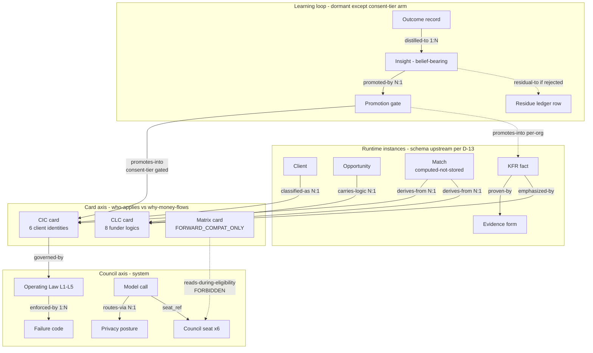
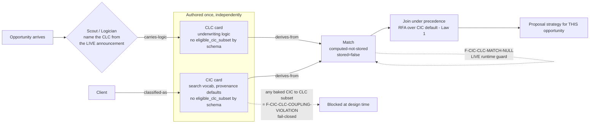

# Ontology-view — GoldenQuill / Tilth

> This is the **ontology-view** — the typed node/edge layer beneath the three sibling
> views. Its companions: [`discovery.md`](discovery.md) is the plain-language orientation
> + open *business* questions; [`system-view.md`](system-view.md) explains the *shape* at
> stakeholder altitude; [`engineer-view.md`](engineer-view.md) owns the contracts, schemas,
> and the full decision inventory (D1–D10).
>
> **What this view owns:** the formalized ontology — every domain concept declared as a
> **typed node** (with `node_type`, GoldenQuill-local `gq_kind`, branch, scope, and — for
> the one belief-bearing type — veracidade/convicção), every relationship declared as a
> **typed edge** (with directionality, cardinality, a rule, and a forward/inverse name
> pair), the **forbidden-edge guard** that keeps the CIC×CLC axes orthogonal, and a
> **residue ledger** where every load-bearing claim is logged.
>
> **What this view points across for:** every *verdict*. No decision is re-decided here.
> Where a stance touches a D-row, this view names it and points to
> `engineer-view.md` §1. Read [`system-view.md`](system-view.md) first for the shape;
> descend here when you want the schema; go to [`engineer-view.md`](engineer-view.md) for
> the verdicts.
>
> **Frontmatter note:** this view carries one field beyond the sibling 5-field house style —
> `governance_status: project-local-overlay`. It is intentional and load-bearing (the overlay
> status is this view's central governance claim, surfaced again in *Governance posture*), not
> schema drift; if the family standardizes on it, retrofit the siblings rather than dropping it.

---

## Objective

Give GoldenQuill / Tilth a machine-checkable ontology: the typed nodes and edges that make
the load-bearing invariants — **the CIC×CLC axes never couple at design time**, **the cache
never decides eligibility**, **no insight reaches a shared card without an operator gate and
a consent-tier check**, **org isolation holds** — *structural* rather than merely asserted.
The discipline is: when a forbidden relationship would be an edge, type the endpoints so the
edge cannot be well-formed.

veracidade/convicção note: per `ontology-conventions.md` §6, confidence is meaningful only
for axiom / premise / audit roles. The sole belief-bearing node here is **Insight** (a
premise). Every other node omits confidence — they are conceptual, constitutional, spec, or
backlog roles, not bets.

---

## Governance posture (load-bearing)

This ontology declares **16 coined edges** (19 edge types total: 16 COINED + 3 canonical
reused verbatim — `derives-from`, `governed-by`, `contradicts`; `isolated-by`/`tier-gated-by`
refine `governed-by`) and a GoldenQuill-local **`gq_kind`** axis.
Verified against the canonical DomainSpec constitution on disk
(`implementation/domainspec/vault/ontology-conventions.md`, v2.1.1, line 8):

- The edge catalog is **closed at 21 forward edges** (line 321) with an explicit
  **"Do not invent edges"** authoring rule (line 619): a non-catalog relationship must be
  proposed through a discovery document, not coined inline.
- New explorer evidence confirms **no ratified "application overlay" or "project-local edge
  vocabulary" tier exists** in DomainSpec governance. The Arcanum BRANCH-AWARE candidate that
  layers *role catalogs* is exploratory/non-canonical (OVS-GATE-001 blocked) and governs
  role vocabularies, **not** edge types.
- Therefore every coined edge is a hard catalog violation **until**
  `vault/discovery/goldenquill-edge-amendments/discovery.md` is written and the GQ-AMD
  amendments are filed. The overlay is honestly flagged, **not** waved through (OQ-13).

**Three genuinely-canonical edges** are reused verbatim and are conformant; a fourth
canonical construct (the `refines` family) is the parent the two refinement edges specialize:

| Canonical edge | Catalog shape (on disk) | Used here for |
|---|---|---|
| `derives-from` | `any → any`, N:M (line 561) | the Match join (tightened to N:1 — a permitted restriction, **not** a widening) |
| `governed-by` | `{discovery,implementation-plan,spec} → {discovery,constitution}`, N:1 (line 575) | constitution binding — **note:** this view's N:M + source-widening is the **non-conformant** part (PROPOSED-UNFILED GQ-AMD-001) |
| `contradicts` | `any → any`, N:M, the catalog's **only** symmetric edge (line 294/563) | claim ⟷ claim disagreement |
| `refines` family | line 574 | the family `isolated-by` specializes |

Every coined edge below carries a **`COINED`** flag and a declared **forward/inverse** pair
so the bidirectionality audit is shape-clean. The two proposed amendments:
**GQ-AMD-001** (governed-by N:1→N:M + source union) and **GQ-AMD-002** (carries-logic,
routes-via, promotes-into + the rest) have **no** discovery or amendment record on disk
(no GQ-AMD files in `vault/amendments/`; constitution still N:1 at v2.1.1). Both are shown
PROPOSED-UNFILED, never asserted in force (OQ-13).

---

## Node types

27 node types across business / system / bridge / mixed branches (Behavior's running/designed
split is one declared type carrying a `role` discriminator, counted once). **Scope axis** values
(`ontology-type` vs `runtime-instance`) are GoldenQuill-local axis values justified by
**D-13** (`scope-and-domain-axes.md`, Status: Settled — the vault is source-of-truth for
both the knowledge-graph and the application-graph **schemas**; runtime instances are derived
from code). D-13 is the correct owner of the schema/instance split; it is a settled discovery
decision, **not** a typing primitive, and **no `AX-GQ-*` axiom exists** to back it.

### The card axis — who-applies vs why-money-flows (the protagonist claim)

| Node | Definition | Schema (load-bearing) | GoldenQuill instances | Precedent |
|---|---|---|---|---|
| **CIC card** *(Customer Identity Card)* | A shared, per-archetype card describing the applicant's world — one of 6 client identities. A client is classified into one and inherits it; it gets **no card of its own**. | `node_type: conceptual; gq_kind: cic-card; branch: business; scope: ontology-type`. **MID-MIGRATION:** on disk `dialect_routing_table.items` STILL declares `funder_political_axis` (enum conservative\|centrist\|progressive\|soul_fire, lines 214-224) and `admin_risk_term_register` is STILL in `required[]` (line 19). The CLC-keyed replacement is specified in `section_18_v1_2_amendment.md` but the CIC card re-sign was **deferred to a Wave-2 ceremony**; migration gated by **F-DIALECT-MIGRATION-INCOMPLETE** (LIVE, order 6.56). Coupling guard ON DISK: `not.anyOf` forbids `common_clc_patterns_observed`, `eligible_clc_subset`, `clc_allowlist`, `clc_denylist`, `preferred_clcs`, `clc_win_rate`, `clc_ranking_preferences`. | 6: Food Systems (TILTH-CIC-01), Educator (02), Public Agency (03), Arts & Culture (04), Cooperative (05), Ecosystem Intermediary (06). All 14 CIC/CLC cards signed + runtime-loadable on disk. | `card_cic.schema.json` required[] (7-22), `funder_political_axis` (214-224); `f_dialect_migration_incomplete.py` (LIVE); arch v7.0.12; CLAUDE.md Six Customer Identity Categories. |
| **CLC card** *(Capital Logic Card)* | A shared, per-logic card describing **why and how** funding may flow — one of 8 funder logics. Named by Scout/Logician from the **live announcement**; carried by the opportunity, never by the archetype. | `node_type: conceptual; gq_kind: clc-card; branch: business; scope: ontology-type`. `card_clc.schema.json` REQUIRED: `card_id ^TILTH-CLC-\d{2}$`, slug enum (8 values), `funding_mechanism_summary`, `tilth_clc_id`, lifecycle. Coupling guard: `not.anyOf` forbids `eligible_cic_subset`, `cic_allowlist`, `cic_denylist`, `preferred_cics`, `cic_win_rate`, `cic_ranking_preferences` at any level. Closed 8-value set held by **F-CIC-CLC-ENUM-DRIFT** (SHA3-512 enum-integrity guard, LIVE). | 8: Public Purpose & Works, Catalytic Change, Operating Capacity, Research & Evidence, Market Access, Credit & Underwriting, Sponsorship & Corporate Support, Shared Assets (TILTH-CLC-01..08). 3 multi-track. | `card_clc.schema.json` + 8 signed instances; `f_cic_clc_enum_drift.py`; CLAUDE.md paired taxonomy. |
| **Matrix card** *(CIC×CLC, FORWARD_COMPAT_ONLY)* | The CIC×CLC intersection schema keyed on `(cic_slug, clc_slug)` — schema ships, content is **populate-forbidden** until the v1.x matrix-phase amendment. The only permitted reader (v1.x) is Archivist, retrospectively. | `node_type: conceptual; gq_kind: matrix-card; branch: bridge; scope: ontology-type`. `card_matrix.schema.json`: `binding_eligibility: const false`, `status: const FORWARD_COMPAT_ONLY`, `allowed_runtime_readers: [archivist]`. **ENFORCEMENT (honest):** only the JSON-schema const-false layer is LIVE; the runtime/AST guard **F-CARDS-COUPLING-VIOLATION-EXTENSION** is PLANNED (`evaluate()` raises NotImplementedError line 78; `FORBIDDEN_FIELD_REGISTRY['MATRIX']=frozenset()`). Registered-dormant (module on disk, not imported), body NotImplementedError → status=planned. | 0 populated (schema-only at v7.0.11 LOCK). | `card_matrix.schema.json`; `_FORWARD_COMPAT_ONLY.md` ("the most coupling-prone surface in the Card System"); `f_cards_coupling_violation_extension.py`; arch v7.0.11. |

### The council axis — seats, laws, and the deterministic gate machinery

| Node | Definition | Schema (load-bearing) | GoldenQuill instances | Precedent |
|---|---|---|---|---|
| **Council seat** | One of 6 agent roles, none outranking another: Scout, Scribe, Editor, Judge, Red Team (5 model-backed) and **Logician** (deterministic Python+Cedar, fail-closed, zero-token). The Logician enforces the orthogonality guard. | `node_type: conceptual; gq_kind: council-seat; branch: system; scope: ontology-type`. `seat_id` enum (6); `gear` enum[sparring,co_pilot,synthesizer] is an **ATTRIBUTE-DOMAIN** (demoted from node — no inbound edge, no on-disk config); `routing` enum[cloud_routable,always_local]; `cross_family_constraint: 'Scribe/Judge/Red Team must not share a provider family'`. Logician: `deterministic=true, routing=always_local`. | 6: Scout, Scribe, Editor, Judge, Red Team, Logician. | CLAUDE.md "The Council (Six Seats)" + "The Five Operating Laws" (Logician kept distinct so the Five Laws hold). **STRUCK:** the prior "domainspec-theorem four-role epistemic separation" citation — no such theorem exists (see residue). |
| **Operating Law** | One of 5 non-negotiable rules no prompt/skill/model can override: RFA-is-source-of-truth (L1), No-boundary-drift (L2), Org-isolation (L3), Apolitical-language+admin-risk (L4), Applicant-brings-substance (L5). | `node_type: constitution; gq_kind: operating-law; branch: business; scope: ontology-type`. `law_id` enum[L1..L5]; `status: evergreen`; `enforced_by: failure-code-ref[]`. A Law is enforced **within** gate surfaces, not as a standalone node. L4 has the dialect-routing surface (MID-MIGRATION) + the workspace Admin-risk register. L3 governs **both** per-client read-isolation **and** shared-store scrub (GoldenQuill-local two-obligation reading, OQ-6). | 5 Operating Laws (L1–L5). | DomainSpec `constitution` node_type; CLAUDE.md The Five Operating Laws. |
| **Failure code** | A deterministic Logician fail-closed predicate — named, zero-token — that operationalizes a Law. The **structural enforcement node**: Laws and gate-invariants are enforced *through* these, not as peer nodes. | `node_type: spec; gq_kind: failure-code; branch: system; scope: ontology-type`. Per-instance: `code_id ^F-[A-Z0-9]+(-[A-Z0-9]+)+$`, `family`, `status: enum[active,planned]`, `verdict: enum[pass,flag,block]`, `enforces_ref: operating-law-ref`. **STATUS DISCIPLINE:** `active` iff the predicate body is LIVE (0 NotImplementedError in its **own** `run()`/`evaluate()` body); `planned` iff the body raises NotImplementedError or no file exists — even if a CONSTANT (e.g. a forbidden-field registry) is live. **NOT exhaustive** — see instances. | **active:** F-CLASS-* (16 primitives per CLAUDE.md v7.0.10 LOCK; 8 `f_class_*.py` gate modules on disk), F-WPFA-* (12 codes / 10 modules per §17 v1; 11 `f_wpfa_*.py` files on disk), F-CIC-CLC-COUPLING-VIOLATION, F-CIC-CLC-ENUM-DRIFT, F-CIC-CLC-MATCH-NULL, F-MATCH-DB-CROSS-ORG, F-WPFA-CROSS-ORG-LEAK (PRE-WRITE), F-MATCH-DB-CONSENT-TIER-VIOLATION (Trigger B), F-CHANNEL-G-CROSS-ORG-LEAK (P0), F-BENCHMARK-CONTAINS-PER-ORG-REF, F-DIALECT-POLITICAL-AXIS-LEAK (order 6.55), F-DIALECT-MIGRATION-INCOMPLETE (order 6.56), F-CLASS-ROUTING-INDETERMINATE, F-PIPE-TRACK-NOT-SHIPPABLE, others. **planned:** F-CARDS-COUPLING-VIOLATION-EXTENSION (registered-dormant), F-CARDS-CROSS-ORG-NAMESPACE-LEAK, F-CARDS-PRIVATE-DATA-IN-CARD, F-CIC-CLC-PATTERN-READ-DURING-ELIGIBILITY, F-LOOP-AUTOPROMOTE-NO-GATE (no file), F-SCOUT-REVIEW-NON-FIT-ELEVATION (no file). **OUT-OF-SCOPE-BUT-ON-DISK** (residue): f_cards_load_in_wrong_namespace, f_cards_schema_invalid, f_cards_signature_invalid, f_cards_unsigned_production_load. | DomainSpec `gate`/`spec` node_type; Blueprint Interface Index §0.5; on-disk verification 2026-06-09. |
| **Admin-risk entry** | A workspace-wide policy primitive recording one administratively-sensitive term with its **per-CLC** acceptability — the structural carrier of Law-4's admin-risk axis. Read deterministically by the Logician POST-gate; centralized workspace-wide per the v7.0.12 target. | `node_type: conceptual; gq_kind: admin-risk-entry; branch: business; scope: ontology-type`. `admin_risk_register.schema.json` v3.0: `term`, `severity` enum[RED,YELLOW,GREEN], `per_clc_register: map[clc_slug → enum[AVOID,OK,EXPECTED,PREFERRED]]` (default AVOID — **this is where the CLC-keyed migration ACTUALLY landed**, in contrast to the CIC card which still carries `funder_political_axis`). Workspace artifact `admin_risk_register.yaml` v2.4, LOCKED 2026-05-16; operator `approval_token` still null. | **151 entries** in `pipeline/institutional_memory/admin_risk_register.yaml` (v2.4, counted on disk 2026-06-09). The CLC-keyed re-audit (~75 terms × 8 CLCs operator decisions, FI-7) is the mandatory pre-ceremony work, gated by F-DIALECT-MIGRATION-INCOMPLETE. | `admin_risk_register.schema.json` v3.0; `.yaml` v2.4; `f_dialect_migration_incomplete.py`; arch v7.0.12 §1.2; Blueprint Interface Index §0.5. |

### The Scout eligibility ladder — verdict, cache, action (type-split to keep the cache out of eligibility)

| Node | Definition | Schema (load-bearing) | GoldenQuill instances | Precedent |
|---|---|---|---|---|
| **VERIFY verdict** | The 4-value eligibility verdict decided **only** at Scout VERIFY against the live announcement. | `node_type: conceptual; gq_kind: verify-verdict; branch: system; scope: ontology-type`. `verdict` enum[VERIFIED_FIT, VERIFIED_NOT_FIT, UNVERIFIED, VERIFICATION_FAILED]; `decided_against: 'live synopsis'`. Only VERIFIED_FIT elevates to REVIEW (enforced on `reviewed-by`). | 4 verdict values. | `section_03_scout.md` L155; DomainSpec status-lifecycle states; Arcanum `validate`-mode / Decision Gate pass\|flag\|block (a SHAPE label, not an Arcanum-named construct). |
| **Volume-trim gate** | The pre-VERIFY truncation mechanism: sort by `fit_score_cached` (0..100), truncate to `SCOUT_CANDIDATE_VERIFY_CAP=1000`. **Explicitly NOT an eligibility decision.** | `node_type: spec; gq_kind: volume-trim-gate; branch: system; scope: ontology-type`. `fit_score_cached: int[0..100]`, `cap: 1000`, `decides_eligibility: false` (structural), `overflow_code: F-SCOUT-V-05`. **NEVER a `verified-by` target by type.** | 1 gate (the cache). | DomainSpec `spec` node_type; `section_03_scout.md` L141/L660/L1408. |
| **Operator action** | The human REVIEW action at the Scout gate: ACCEPT \| REJECT \| HOLD, mapping to Match-DB `confirmed_fit` \| `rejected` \| `declined_cycle`. | `node_type: conceptual; gq_kind: operator-action; branch: system; scope: ontology-type`. `scout_action` enum[ACCEPT,REJECT,HOLD,null]; `matchdb_action` enum[confirmed_fit,rejected,declined_cycle,pending]. **RESIDUE:** dual vocabulary across two source files (OQ-4). | 3 actions + 4-value Match-DB mapping. | Arcanum promotion-rule (authority-ladder); `section_03_scout.md` L212; arch v7.0.5 L143. |

### Routing, learning, and the typed support entities

| Node | Definition | Schema (load-bearing) | GoldenQuill instances | Precedent |
|---|---|---|---|---|
| **Context layer** | A retrieval store the council reads at runtime: KFR (per-client), Funder Intelligence DB (shared), Match DB (per-client, Law-3 isolated), Classification Register (per-client storage; owner of the classification-enum *instantiation*), Rubrics library (shared). | `node_type: conceptual; gq_kind: context-layer; branch: mixed; scope: ontology-type`. `store_scope` enum[per_client,shared]; `read_isolation: bool` (per-client stores block cross-org READS — F-MATCH-DB-CROSS-ORG, LIVE); `shared_store_scrub: bool` (shared stores block per-org refs leaking IN); `owns_classification_enum_instantiation: bool` (TRUE only for classification_register); `classification_enum_values_owner: 'shared-architecture'` (the 4 values public/shareable/confidential/operator_flagged are shared primitives). **Scrub gates LIVE:** F-CHANNEL-G-CROSS-ORG-LEAK (P0), F-BENCHMARK-CONTAINS-PER-ORG-REF; the shared-Cards-namespace scrub arm is **PLANNED** (F-CARDS-CROSS-ORG-NAMESPACE-LEAK + F-CARDS-PRIVATE-DATA-IN-CARD both NotImplementedError, v0.2). | 5: KFR (per_client), Funder Intel DB (shared, scrub LIVE), Match DB (per_client), Classification Register (per_client), Rubrics (shared). | Arcanum inventory + branch-aware scope; `f_channel_g_cross_org_leak.py`, `f_benchmark_*`, `f_cards_*`, `classification_review.py`; arch v7.0.7 §2. |
| **Privacy posture** | One of 3 customer-selected deployment modes governing cloud-vs-local routing per call: Frontier-Eligible, Split-Context Hybrid, Local-Only/Sovereign. Indeterminate class **fails closed to LOCAL**. | `node_type: constitution; gq_kind: privacy-posture; branch: system; scope: ontology-type`. `posture` enum (3); `signature: ed25519_sig`, `signed_by: operator`; `classification_register_ref: context-layer`. Drives `routes-via` via per-field class (a REFERENCE to the Classification Register's shared enum values). | 3 postures. | Arcanum Convention + Decision Gate / `validate`-mode fail-closed; CLAUDE.md Beta Model Strategy (v7.0.10 LOCKED). |
| **Outcome record** | A won/lost grant result — the learning loop's input **evidence**, stored as a Match-DB row with `operator_action` and `consent_tier`. | `node_type: conceptual; gq_kind: outcome-record; branch: bridge; scope: ontology-type`. Match-DB fields incl. `match_reasoning.structured: {sector,funding_world,eligibility,scale,identity,geography: bool}`, `operator_action.action`, `consent_tier` enum[my_eyes_only, matchable_to_opportunities, composable_with_others]. Per-org, Law-3 read-isolated. `consent_tier` is **GATED** (see Consent-tier transition). | Match-DB rows per (client × funder), at `orgs/<slug>/match_database/register.yaml`. | Arcanum Session / Delegated Research (raw evidence separate from synthesis); arch v7.0.5 §2. |
| **Insight** ⚖️ | A candidate lesson extracted from an outcome — a **falsifiable working bet** awaiting an operator-approved promotion gate. **The only belief-bearing GoldenQuill type.** | `node_type: premise; gq_kind: insight; branch: bridge; scope: ontology-type`. **veracidade + convicção REQUIRED** (ontology-conventions.md §6, lines 210-237); `falsification_criterion: str`; `status: draft\|exploratory`; `loop_state: dormant` (designed-not-built, D7); `source_consent_tier:` REFERENCE to the originating Outcome record's `consent_tier`. | Designed; produced by hand today (`loop_state: dormant`). | DomainSpec `premise` + veracidade/convicção model (§6); the premise-review lifecycle (`.claude/skills/ontology-vault/SKILL.md` L146 — carries the `keep` verb). **STRUCK:** the prior "Arcanum Premise five-verb" string. |
| **Promotion gate** | The operator-approved governance checkpoint adjudicating whether an Insight may promote into a shared card or per-org context. **The no-auto-promotion boundary.** | `node_type: spec; gq_kind: promotion-gate; branch: bridge; scope: ontology-type`. `decision` enum[approved,rejected,pending]; `operator_signature: ed25519_sig\|null`; `consent_tier_check: bool` (the gate must verify source `consent_tier` permits the target scope **before** approving a shared-card promotion — operator approval alone is NOT sufficient); `loop_state: dormant`. | Designed, not built (D7 CRITICAL); `loop_state: dormant`. | DomainSpec `gate`/`spec`; Arcanum promotion-rule; `f_match_db_consent_tier_violation.py` (LIVE, Trigger B). **STRUCK:** "theorem closure-mark gate" — no such construct. |
| **Consent-tier transition** | An operator-signed state change moving a Match-DB entry / its derived evidence **up** the consent ladder. The typed boundary operationalizing "cross-Tilth sharing exists only if the client opts in." **No silent upgrade** — not even by operator admin privileges. | `node_type: spec; gq_kind: consent-tier-transition; branch: bridge; scope: ontology-type`. `from_tier`/`to_tier` enum (3); `operator_signature: ed25519_sig` (REQUIRED — F-MATCH-DB-CONSENT-TIER-VIOLATION fail-closes without it); `source_outcome_ref: outcome-record`. **LAW FILING:** the on-disk gate header files this under "sovereignty + Law 4, P1"; the ontology reasons it as a sovereignty / org-isolation (Law-3-adjacent) primitive — the discrepancy is **OQ-11**. Trigger B (per-Match-DB) LIVE v0.1; Trigger A (Stage-5 commons) trivially passes, out of scope. | Per-Match-DB tier changes (LIVE via Trigger B). | `f_match_db_consent_tier_violation.py`; CLAUDE.md consent tiers + "Stage 5 only". |
| **Decision / stance** | A load-bearing product decision whose verdict and status (RESOLVED\|OPEN\|CRITICAL) are owned by the **engineer-view** inventory; here a **pointer node** that defers via `points-to-verdict`. | `node_type: conceptual; gq_kind: decision-stance; branch: bridge; scope: ontology-type`. `points_to: decision-row-ref (D1..D10)`; `verdict: NONE-here`. The v1.x matrix-phase coupling verdict is **UN-ADJUDICATED** by D1–D10 (D1 owns design-time CIC→CLC binding only) — a future **D11** (OQ-9). | D1–D10 (engineer-view §1): D1–D4 RESOLVED, D5a RESOLVED, D5/D6/D8/D9/D10 OPEN, **D7 CRITICAL**. Pending: matrix-phase (D11, OQ-9). | DomainSpec `cites`/reference edges; engineer-view D1–D10 inventory (capped, no D11). |
| **Residue ledger row** | A logged, **preserved (never demoted)** entry recording a rejected/unpromoted lesson or unresolved claim — a ledger row, **NOT** a coined node type. | `node_type: backlog; gq_kind: residue-ledger-row; branch: bridge; scope: ontology-type`. `claim`, `status` enum[open,closed], `surviving_residue`, `citation`. Subset rule: preserved, not demoted. | The §residue-ledger rows + rejected insights logged via `residual-to`. | DomainSpec `backlog` node_type (ontology-conventions.md line 481). **STRUCK:** AX-ONT-5 (real axiom, unrelated meaning); `_meta/ontology.md:75` (no such file on disk — dead anchor removed). |

### The runtime-instance types (application-graph instances, schema upstream per D-13)

| Node | Definition | Schema (load-bearing) | GoldenQuill instances | Precedent |
|---|---|---|---|---|
| **Client** | A grant-seeking applicant org — the runtime subject every grant run is scoped to. Classified into **exactly one** CIC; has its own KFR. | `node_type: conceptual; gq_kind: client; branch: business; scope: runtime-instance`. `org_slug`, `cic_ref: cic-card`, `kfr_ref: context-layer`. Identity is a 3-part composite: Client node + inherited CIC + own KFR. | Per-org folders under `orgs/` (MycoSymbiotics Cooperative, MycoSymbiotics Inc, Mystic Mamas, Run a Muck Farm, FIT Farms LLC). | D-13 (`scope-and-domain-axes.md`, Settled) + schema-of-schemas fibration; CLAUDE.md Client Org Isolation. |
| **Opportunity** | A funder solicitation/RFA the council acts on — the runtime signal that triggers discovery. Carries **exactly one** CLC, named by Scout/Logician from the live announcement. | `node_type: conceptual; gq_kind: opportunity; branch: business; scope: runtime-instance`. `clc_ref: clc-card`, `clc_assigned: 'set by Scout VERIFY at runtime — NOT a stored CIC×CLC pairing'`, `source_channel: enum[A..F]`. | Live solicitations discovered by Scout across six parallel channels (A–F). | D-13; grant-DAG strategy Table 2; `f_cic_clc_match_null.py`. |
| **Candidate** | A discovered opportunity that has entered the eligibility ladder — the subject of VERIFY. May be re-verified after a failure (retry). | `node_type: conceptual; gq_kind: candidate; branch: system; scope: runtime-instance`. `candidate_id: sha3_512`, `current_verify_ref: verify-verdict` (active edge), `verify_history: verify-verdict[]` (append-only). | Candidate records in the Scout ladder. | `section_03_scout.md` (overflow→DEGRADED retry); D-13. |
| **Match** | The reified CIC×CLC join computed per opportunity under RFA precedence — **computed-not-stored**. A **MODELING REIFICATION**, not a domain entity the views name; **no on-disk Match dataclass exists**. | `node_type: conceptual; gq_kind: match; branch: bridge; scope: runtime-instance`. PROPOSED field table (NOT on disk): `match_id`, `cic_ref`, `clc_ref`, `precedence_resolution: 'RFA>card'`, `stored: false`, `derives_from_cic: required 1`, `derives_from_clc: required 1`. On disk the OPERATIONAL CIC×CLC artifact is the Match-DB register; the INTERSECTION schema is `card_matrix.schema.json` (FORWARD_COMPAT_ONLY). | Per-opportunity computed matches (operational Match-DB rows on disk; no reified Match node type yet). | Arcanum bridge edges; Match-DB register (arch v7.0.5 §2); `card_matrix.schema.json`; `f_cic_clc_match_null.py`. |
| **Model call** | A single invocation of a model by a seat, with input class, posture, and route — the runtime decision point `routes-via` attaches to. | `node_type: conceptual; gq_kind: model-call; branch: system; scope: runtime-instance`. `seat_ref: council-seat`, `input_class:` REFERENCE to the Classification Register's shared enum values, `posture_ref: privacy-posture`, `route: enum[cloud,local]`. | Per-call routing decisions. | D-13; grant-DAG strategy "model call"; CLAUDE.md Beta Model Strategy. |
| **KFR fact** | A Key Facts Register entry — a per-client fact with provenance. A sub-entity of the per-client KFR Context layer. | `node_type: conceptual; gq_kind: kfr-fact; branch: business; scope: runtime-instance`. Bound to on-disk `KfrFact` dataclass (`f_logician_fact_drift.py:197-213`): `id`, `who`, `what`, `when`, `where`, `why`, `how`, `value: Decimal\|str`, `unit`, `projection_or_actual`, `validation`, `confidence`, `display_tolerance_pct`, `notes` (the 5W2H provenance lives in the per-field `who/what/when/where/why/how` shape, not a `provenance_ref`; classification is carried by the owning Context layer's register, not a field on the fact). **PROJECTED** (NOT on disk on `KfrFact`): `fact_class`, `signature_status`, an explicit `classification` field. Per-org, Law-3 read-isolated. | Per-client KFR rows. | On-disk `KfrFact` dataclass; field-shape precedent for projected `signature_status`: Cards Lifecycle (`pipeline/cards/models.py:74`); D-13. |
| **Evidence form** | The required proof form for a fact class (e.g. "Schedule F or audited P&L") — the to-endpoint of `proven-by`. CIC sets the default; **the RFA overrides it (Law 1)**. | `node_type: conceptual; gq_kind: evidence-form; branch: bridge; scope: runtime-instance`. `fact_class`, `required_form`, `verbatim_quote_required: bool`, `default_source: enum[cic_card,rfa]`, `precedence: 'RFA>CIC'`. | Per-fact-class proof forms in CIC `provenance_requirements`. | `food_systems.yaml` provenance_requirements; Arcanum tested_by/observed_by; engineer-view §2.4. |
| **Claim** | A testable assertion in a draft or about funder-fit — the endpoint of `contradicts`. | `node_type: conceptual; gq_kind: claim; branch: bridge; scope: runtime-instance`. `claim_kind: enum[proposal_claim, funder_fit_hypothesis, rfa_constraint]`, `evidence_refs`, `rubric_refs`. | Draft claims + RFA constraints. | `pipeline/seats/red_team/types.py` (RiskClaim); grant-DAG strategy; CLAUDE.md Law 2. |
| **Behavior** *(running / designed)* | A pair of role-discriminated runtime entities for the `drifts-from` edge: Running behavior (observed) and Designed behavior (intended/spec). | `node_type: conceptual; gq_kind: behavior; branch: bridge; scope: runtime-instance`. `role: enum[running,designed]`; `org_isolation_drift: bool` (TRUE when per-org content is baked into a shared-scope artifact). `drifts-from` goes running→designed; self-loop forbidden; **governed-by Law 3** when `org_isolation_drift=true`. | D6 unwired+hardcoded eligibility filter (`org_isolation_drift=true`); D7 manual loop. | Arcanum `drifts_from` (governed 7-item bridge catalog); engineer-view D6/D7. |

---

## Edge types

Every coined edge carries a **`COINED`** flag and a declared forward/inverse pair so the
bidirectionality audit is shape-clean; the three canonical edges reuse the catalog inverse.

### The card-axis edges (orthogonal-by-construction)

| Edge | From → To | Dir. | Card. | Rule (load-bearing) | Precedent |
|---|---|---|---|---|---|
| **classified-as** `COINED` | Client → CIC card | directed | N:1 | A client is classified into exactly one CIC and inherits that shared card; per-client specifics live in the KFR, overriding the card default without rewriting it. INVERSE: `classifies`. | DomainSpec subclass-of/instance-of (inherit-from-type). GQ-AMD UNFILED. |
| **carries-logic** `COINED` | Opportunity → CLC card | directed | N:1 | An opportunity carries exactly one CLC, named by Scout/Logician from the LIVE announcement (`opportunity.clc_assigned`, set at runtime) — opportunity-driven, never archetype-driven. INVERSE: `logic-carried-by`. | Arcanum carries/realization; `f_cic_clc_match_null.py`. GQ-AMD-002 UNFILED. |
| **derives-from** *(Match join)* ✓ canonical | Match → CIC card \| CLC card | directed | N:1 | Each edge is cleanly N:1 (a Match derives from a single CIC OR a single CLC). The "exactly one CIC AND one CLC" **degree invariant** lives on the Match **node** as two required fields, not in this edge's cardinality. INVERSE: `derives`. Catalog is `any → any`, N:M (line 561) — N:1 is a **tightening**, not a widening. | DomainSpec `derives-from` (catalog, line 561); Arcanum bridge edges. **In-catalog.** |
| **emphasized-by** `COINED` | KFR fact → CLC card | directed | N:M | The CLC card's logic sets which held facts to **lead with** (funder logic ∩ KFR), at runtime only. INVERSE: `emphasizes`. NOT axis-pure (residue, OQ-1). | Arcanum depends_on; engineer-view §4; discovery §7. |
| **proven-by** `COINED` | KFR fact → Evidence form | directed | 1:N | CIC sets the DEFAULT proof form per fact class, but the **RFA overrides it** (Law 1: solicitation > card). INVERSE: `proves`. NOT axis-pure — `Evidence form.precedence` (OQ-1). | `food_systems.yaml` provenance_requirements; Arcanum tested_by. |

### The constitution-and-enforcement edges

| Edge | From → To | Dir. | Card. | Rule (load-bearing) | Precedent |
|---|---|---|---|---|---|
| **governed-by** ✓ canonical *(N:M widening PROPOSED)* | CIC/CLC/Matrix card, Context layer, Match, Failure code, Council seat, Outcome record, Insight, Behavior, Admin-risk entry → Operating Law | directed | **N:M (PROPOSED — catalog is N:1)** | Acyclic: every governed artifact is bound by the 5 Laws; a Law can never derive-from or be governed-by what it governs (strict partial order). INVERSE: `governs`. **Catalog is `{discovery,implementation-plan,spec} → {discovery,constitution}`, N:1 (line 575).** The N:M + source widening is **PROPOSED-UNFILED GQ-AMD-001** — no record on disk; shown dual-state, never in force. | DomainSpec `governed-by` (line 575) + edge-acyclicity; constitution v2.1.1 (line 8). |
| **enforced-by** `COINED` | Operating Law → Failure code | directed | 1:N | A Law is operationalized by ≥1 deterministic, fail-closed Logician predicate. INVERSE: `enforces`. "Invariant" is **not** a from-endpoint (it is a *property* of the gate). A planned Failure-code endpoint asserts **intended** enforcement, not live coverage. | DomainSpec constitution operationalized-by; Blueprint Interface Index §0.5 (Invariant absent). |
| **isolated-by** `COINED` *(refines governed-by)* | Context layer → Operating Law | directed | N:1 | REFINEMENT of `governed-by`: isolated-by ⟹ governed-by. The specializing constraint: to-instance must be **Law 3** AND from-instance `store_scope=per_client AND read_isolation=true`. Cross-org READS blocked by F-MATCH-DB-CROSS-ORG (LIVE). The shared-store SCRUB obligation is a **different** Law-3 obligation carried by plain `governed-by` + `shared_store_scrub`, NOT by isolated-by (OQ-6). INVERSE: `isolates`. | DomainSpec `refines` family (line 574); `f_match_db_cross_org`; `f_channel_g_cross_org_leak.py` (separate scrub obligation). |
| **tier-gated-by** `COINED` *(refines governed-by)* | Consent-tier transition → Operating Law | directed | N:1 | A consent-tier transition is a Law-governed, operator-signed state change — **no silent upgrade** (F-MATCH-DB-CONSENT-TIER-VIOLATION fail-closes without an operator Ed25519 sig). INVERSE: `tier-gates`. **LAW BINDING contested:** on-disk header says "sovereignty + Law 4, P1"; the ontology reasons sovereignty / Law-3-adjacent — **OQ-11**, not asserted as uncontested fact. | `f_match_db_consent_tier_violation.py` (LIVE); DomainSpec governed-by refinement. |
| **routes-via** `COINED` | Model call → Privacy posture | directed | N:1 | Each call's cloud-vs-local routing is decided by the posture + the per-field classification register; indeterminate class **fails closed to LOCAL** (F-CLASS-ROUTING-INDETERMINATE). INVERSE: `routes`. | Arcanum branch-aware authority + Decision Gate fail-closed; CLAUDE.md Beta Model Strategy. GQ-AMD-002 UNFILED. |

### The eligibility-ladder edges (type-split to keep the cache out of eligibility)

| Edge | From → To | Dir. | Card. | Rule (load-bearing) | Precedent |
|---|---|---|---|---|---|
| **verified-by** `COINED` | Candidate → VERIFY verdict | directed | **1:1 active edge** (append-only history under retries) | Eligibility is decided **only** at VERIFY against the live synopsis; **the cache never decides**. Exactly one CURRENT verdict per candidate; re-verification appends to `verify_history`. The active-edge 1:1 **plus** the type constraint (only target type is VERIFY verdict, never Volume-trim gate) is the cache-forbidden argument. INVERSE: `verifies`. | DomainSpec `validates` edge; `section_03_scout.md`; Arcanum `validate` mode. |
| **reviewed-by** `COINED` | VERIFY verdict → Operator action | directed | 1:1 | **Only the VERIFIED_FIT instance** elevates to the human gate; the operator emits ACCEPT/REJECT/HOLD → Match-DB. The "must be VERIFIED_FIT" restriction lives in this **rule predicate**, not the `from_type` slot. Fail-closeable via F-SCOUT-REVIEW-NON-FIT-ELEVATION (PLANNED — no gate file). INVERSE: `reviews`. | Arcanum promotion-rule; isolated-by "must be Law 3" instance-relocation precedent. |

### The learning-loop edges (designed-not-built — `loop_state: dormant`, except the LIVE consent-tier arm)

| Edge | From → To | Dir. | Card. | Rule (load-bearing) | Precedent |
|---|---|---|---|---|---|
| **distilled-to** `COINED` | Outcome record → Insight | directed | 1:N | Acyclic: an outcome (won/lost) is distilled into ≥1 candidate insights; an insight cannot distill back into its own outcome. The Insight inherits the source `consent_tier` as `source_consent_tier`. **UNVALIDATED at runtime** — D7, `loop_state: dormant`. INVERSE: `distilled-from`. | Arcanum Delegated Research → Synthesis; DomainSpec derives-from. |
| **promoted-by** `COINED` | Insight → Promotion gate | directed | N:1 | An insight passes/fails an OPERATOR-APPROVED gate; **auto-promotion is forbidden**. For a SHARED-card target the gate must ALSO pass `consent_tier_check` (`source_consent_tier==composable_with_others`); per-org targets need no tier check. INVERSE: `promotes-insight`. `loop_state: dormant`. | Arcanum promotion-rule; `f_match_db_consent_tier_violation.py`. **STRUCK:** "theorem closure-mark gate". |
| **promotes-into** `COINED` | Promotion gate → CIC card \| CLC card \| Context layer | directed | 1:N | An approved insight nudges a SHARED card only to a **general guardpost level** (never hill-climbed toward a metric, per D5a), OR deepens the per-org KFR/Match-DB. **CONSENT-TIER PRECONDITION:** promotion into a SHARED card is permitted **only** if `source_consent_tier == composable_with_others`, enforced by F-MATCH-DB-CONSENT-TIER-VIOLATION (LIVE, Trigger B). Per-org promotion needs no tier. RESIDUE: "general guardpost level" has no machine-checkable threshold (OQ-3). INVERSE: `promoted-from`. | DomainSpec `refines`/`codified-as` (NOT "updates"); `f_match_db_consent_tier_violation.py`; engineer-view D8. GQ-AMD-002 UNFILED. |
| **residual-to** `COINED` | Insight (rejected) → Residue ledger row | directed | 1:1 | A rejected lesson is logged as a backlog-typed residue-ledger row, not applied. **Preserved** (subset rule), never demoted. To-endpoint is the declared Residue ledger row (`backlog` node_type), NOT a coined "Residue" node. INVERSE: `residue-of`. | DomainSpec `backlog` (line 481). **STRUCK:** AX-ONT-5; `_meta/ontology.md:75` (no such file on disk). |

### The cross-cutting edges

| Edge | From → To | Dir. | Card. | Rule (load-bearing) | Precedent |
|---|---|---|---|---|---|
| **contradicts** ✓ canonical | Claim → Claim | **undirected (symmetric)** | N:M | SYMMETRIC: two claims disagree; **blocks promotion of either** until resolved. Self-loops forbidden; dedup with endpoint ids sorted. INVERSE: **self** (the catalog's **only** symmetric edge, line 294). | DomainSpec `contradicts` (canonical, line 563; "the only symmetric edge", line 294; "must be resolved before a document moves up a level", line 323); CLAUDE.md Law 2. |
| **drifts-from** `COINED` *(hyphen per DomainSpec)* | Behavior [role=running] → Behavior [role=designed] | directed | N:M | DIRECTED running→designed (NOT bidirectional); BOTH endpoints preserved. PREDICATE: `behavior_id(from) != behavior_id(to) AND role(from)=running AND role(to)=designed`. When `org_isolation_drift=true`, the running Behavior is ALSO `governed-by` Law 3. INVERSE: `drifted-into`. | Arcanum `drifts_from` (governed 7-item bridge catalog — exploratory, cited as SHAPE); engineer-view D6. |
| **points-to-verdict** `COINED` | Decision / stance → Decision row (D1–D10) | directed | N:1 | **Reference edge (no epistemic weight):** a stance defers its verdict to the engineer-view inventory; NO verdict is authored here. The matrix-phase coupling stance has **no** existing D-row — it points to a PENDING future D11 (OQ-9); D1 owns only design-time CIC→CLC binding. INVERSE: `verdict-pointed-from`. | DomainSpec `cites` (canonical reference edge); engineer-view §1 (D1–D10 capped, no D11). |

---

## The schema graph

*The typed node families and the edges that bind them — card axis (business), council axis
(system), and the bridge entities that join evidence to belief; verdicts always point across
to the engineer-view, never decided here. This is a **curated subset**, not an exhaustive
render: ~9 declared nodes (Admin-risk entry, Operator action, VERIFY verdict, Volume-trim
gate, Candidate, Consent-tier transition, Decision/stance, Claim, the Behavior running/designed
pair) and the cross-cutting `contradicts`/`drifts-from`/`points-to-verdict` edges are
intentionally not drawn — see the node/edge tables for full coverage.*

---

## Forbidden edges & guards

The ontology has **no statically-listed forbidden edge type** — the discipline is to make
forbidden relationships *unconstructible by type* and back the few residual runtime paths
with named gates. Three guards carry the load:

1. **The CIC→CLC no-coupling invariant (the protagonist guard).** CIC card and CLC card are
   distinct `gq_kind`s. There is **no** design-time edge type whose endpoints are
   `CIC card → CLC card`. On disk this is reinforced by the `not.anyOf` coupling guard in
   *both* card schemas (forbidding `eligible_*_subset`, `*_allowlist`, `*_denylist`,
   `preferred_*`, `*_win_rate`, `*_ranking_preferences`) and by **F-CIC-CLC-COUPLING-VIOLATION**
   (4-layer, v7.0.8, LIVE). The verdict that this is correct lives in **D1** —
   `engineer-view.md` §1 — not here.

2. **The cache-never-decides invariant.** `verified-by` has **VERIFY verdict** as its only
   target type — never **Volume-trim gate**. The cache (`fit_score_cached`) is typed as its
   own node with `decides_eligibility: false (structural)`, so "cache decides eligibility" is
   not a well-formed edge. Verdict: **D4** — `engineer-view.md` §1.

3. **The matrix re-introduction vector** *(`reads-during-eligibility`, FORBIDDEN family).* A
   seat reading historical CIC×CLC match patterns from a **Matrix card** as a soft
   eligibility/ranking signal during eligibility is forbidden. The only permitted reader
   (v1.x) is **Archivist**, retrospectively. **Honest enforcement status:** only the
   `card_matrix.schema.json` const-false layer is LIVE at validation; **both** the runtime
   guard (F-CIC-CLC-PATTERN-READ-DURING-ELIGIBILITY) and the structural guard
   (F-CARDS-COUPLING-VIOLATION-EXTENSION) are **PLANNED** (NotImplementedError;
   `MATRIX=frozenset()`). The policy verdict — whether populated Matrix cards are ever
   permitted — is **un-owned by D1–D10** (a future D11, OQ-9).

| Forbidden relationship | Why it would corrupt the invariant | How it is made unconstructible / gated |
|---|---|---|
| `CIC card → CLC card` (design-time binding) | Falsely constrains customer eligibility to a CLC subset; biases Scout/Logician away from valid opportunities (the reverted category error) | No such edge type; distinct `gq_kind`s; `not.anyOf` schema guard + F-CIC-CLC-COUPLING-VIOLATION (LIVE) |
| `Candidate → Volume-trim gate` as a `verified-by` target | The cache would decide eligibility instead of the live synopsis | `verified-by.to_type` is VERIFY verdict only; cache node carries `decides_eligibility: false` |
| `Matrix card → Council seat` during eligibility | Re-introduces CIC×CLC coupling as an "observed pattern" soft signal | const-false schema layer LIVE; runtime + structural guards PLANNED; surface populate-forbidden until v1.x (OQ-9) |
| `Insight (my_eyes_only) → shared card` via promotes-into | Org-isolation / lock-in violation — a private outcome's lesson leaks cross-org | Promotion gate `consent_tier_check`; F-MATCH-DB-CONSENT-TIER-VIOLATION (LIVE, Trigger B) |

### The runtime join under precedence (why no baked table is reachable)

*The opportunity names the funder logic at runtime; the applicant's CIC sets the seat
configuration; the answer is a join under RFA precedence — never a stored CIC×CLC pairing,
so the forbidden coupling has no surface to live on.*

---

## Alternative framings we considered

### Framing the card axes

| Framing | Why set aside |
|---|---|
| One 48-cell CIC×CLC **type** (a single node per intersection) | Multiplicative authoring cost; every new client world or funder logic multiplies the type count; update anomalies. The two-list factoring (6 CIC + 8 CLC = 14 authored units) is the normalized design — and it makes the *forbidden* coupling structurally absent rather than merely discouraged. |
| Bake "common capital logics" advisory fields onto each CIC card | This is the category error the project reverted (CLAUDE.md). Even *advisory* framing is design-time coupling; the schema `not.anyOf` guard forbids exactly these field names. |
| Populate the Matrix card now (it already has a schema) | `binding_eligibility: const false` / `FORWARD_COMPAT_ONLY` — content is populate-forbidden until v1.x. The schema ships as *defense-in-depth* (the codebase's named re-introduction vector), not as a live surface. |

### Framing the ontology itself

| Framing | Why set aside |
|---|---|
| Ontology-as-prose (describe the concepts in narrative, like system-view) | The load-bearing invariants (no coupling, cache-never-decides, consent-tier-gated promotion) are only *assertions* in prose. Typing the endpoints makes them *structural* — a forbidden edge cannot be well-formed. The system-view already owns the prose; this view owns the schema. |
| Reuse only the 21 canonical catalog edges, coin nothing | The domain genuinely needs 16 relationships the catalog does not name. Deleting them loses the model; the conformant path is to **flag every coined edge** + declare its forward/inverse pair + route the vocabulary through `goldenquill-edge-amendments/discovery.md` (OQ-13), not to amputate the domain. |
| Promote `gq_kind` straight into the shared DomainSpec vault | Promotion is **blocked** on the label-admission gate (§9 ΔH admission test). `gq_kind` is admissible *locally* because its value is not predictable from `node_type`, but upstream promotion needs the Orthogonality-Principle admission route (OQ-7). It stays GoldenQuill-local at v0.1. |
| Re-decide D1–D10 verdicts here (the ontology "knows" the answers) | Violates the four-view discipline. Decision/stance is a **pointer node** with `verdict: NONE-here`; verdicts live in `engineer-view.md` §1. The matrix-phase coupling verdict has no D-row at all (future D11, OQ-9). |

---

## Open questions

- **OQ-1** — `proven-by`/`emphasized-by` are not axis-pure (RFA overrides CIC provenance; emphasis is filtered to facts the client holds). Field + residue note, or an edge-level `precedence` qualifier?
- **OQ-2** — The learning loop is `loop_state: dormant` (Insight / Promotion gate / distilled-to / promoted-by designed-not-built, D7) EXCEPT the consent-tier arm, which is LIVE via F-MATCH-DB-CONSENT-TIER-VIOLATION Trigger B. Is the dormant-loop / live-consent-arm split a stable v0.1 posture, or does the LIVE consent gate imply the rest of the loop must be wired sooner than D7 implies?
- **OQ-3** — `promotes-into` "general guardpost level" (D5a) has no machine-checkable threshold beyond the gate-existence + tier checks.
- **OQ-4** — Operator-decision vocabulary split across two source files (Scout ACCEPT/REJECT/HOLD vs Match-DB confirmed_fit/...). Mandate one canonical enum before any external surface? (engineer-view §2.1 flags this.)
- **OQ-6** — Promote the Match reification to a real on-disk schema (Match dataclass + degree-invariant F-* gate), or keep it ontology-only? Also tracks the Law-3 two-obligation reading.
- **OQ-7** — Propose `gq_kind` upstream via the label-admission gate, or stay GoldenQuill-local? (Promotion blocked on this.)
- **OQ-9** — The v1.x matrix-phase coupling verdict is un-adjudicated by D1–D10. Open a **D11** placeholder in engineer-view? (Urgency is lower than an early layer implied — both matrix guards are only PLANNED today.)
- **OQ-10** — The CIC card's apolitical-routing target (Law 4) is **not fully met mid-migration**: `funder_political_axis` is still resident on the signed CIC bodies (the CLC-keyed replacement landed only on the Admin-risk register), and the Wave-2 re-sign ceremony has not fired. Does the deferred ceremony stay gated solely by F-DIALECT-MIGRATION-INCOMPLETE, or does the residual CIC-surface political axis need an interim scrub before any external CIC surface ships?
- **OQ-11** — F-MATCH-DB-CONSENT-TIER-VIOLATION is filed "sovereignty + Law 4, P1" on disk, but reasoned here as Law-3-adjacent. No canonical Five-Laws→failure-code map was found in-repo. Which Law owns the consent-tier gate?
- **OQ-12** — Three Cards-coupling Failure codes (F-CARDS-COUPLING-VIOLATION-EXTENSION, F-CARDS-CROSS-ORG-NAMESPACE-LEAK, F-CARDS-PRIVATE-DATA-IN-CARD) are **registered-dormant** — module on disk, `evaluate()` raises NotImplementedError, not imported into the live gate set. Is "registered-dormant" tracked as a first-class lifecycle status (distinct from `planned`/`active`), or does it stay an OQ-only note until the v1.x flip wires the bodies?
- **OQ-13 (BLOCKER)** — The 16 coined edges + `gq_kind` make this a **project-local overlay**, not a promotable vault artifact. GQ-AMD-001/002 are UNFILED. Who owns writing `goldenquill-edge-amendments/discovery.md`?

---

## Residue ledger

Every load-bearing claim maps to a row. `closed` = adjudicated/fixed; `open` = a true domain
residue deliberately preserved, not a defect.

| # | Claim | Status | Surviving residue | Citation |
|---|---|---|---|---|
| R1 | 16 edges coined inline (19 edge types total: 16 COINED + 3 canonical reused) against a closed-by-governance catalog with an explicit "do not invent edges" rule | **closed** (FIXED, blocker) | None deceptive — every coined edge carries a `COINED` flag + forward/inverse pair; reframed as a **project-local overlay** (governance_status + Governance posture). NOT promotable until `goldenquill-edge-amendments/discovery.md` routes the vocabulary through the gate. OQ-13. | ontology-conventions.md line 321 + 619 + 294; no GQ-AMD records; OQ-13 |
| R2 | No proposed edge declared its forward/inverse pair | **closed** (FIXED, blocker) | None — every directed coined edge declares an inverse; catalog-reused edges use the catalog inverse verbatim; `contradicts` is self-symmetric. | each edge `rule` INVERSE; line 294 |
| R3 | `governed-by` redeclared N:M + widened source via an inline "accepted GQ-AMD-001" | **closed** (FIXED, major) | None deceptive — catalog is N:1 (line 575); constitution v2.1.1 (line 8); **no GQ-AMD record exists**. Downgraded to PROPOSED-UNFILED; shown dual-state, never in force. | line 575 + line 8; no GQ-AMD records |
| R4 | Council seat cited a "four-role epistemic separation theorem" | **closed** (FIXED, major) | None — citation **STRUCK**; the only theorem match is a non-canonical four-auditor *working hypothesis* (4 audit roles, separate repo). Council stands on CLAUDE.md + Logician-distinct rationale + documented orchestration experience. | CLAUDE.md The Council; explorer evidence |
| R5 | "Arcanum Validation Gate" / "theorem closure-mark gate" cited as named constructs | **closed** (FIXED, minor) | None — neither exists; the real constructs are the `validate` mode, the Decision Gate sigil (pass\|block), and promotion-rule validation. `closure_mark` is a `/research` output field. Citations normalized. | explorer evidence (Arcanum + /research) |
| R6 | `derives-from` claimed a source/target widening pending governance | **closed** (FIXED, minor) | None — disk truth (line 561): `derives-from` is `any → any`, N:M. Match/CIC/CLC are in-domain; N:1 is a **tightening**, not a widening. Flag removed. | line 561 |
| R7 | AX-ONT-5 cited as backing residue-as-backlog | **closed** (FIXED, minor) | None — AX-ONT-5 is real but means "explicit questions increase information"; **STRUCK**. Backlog anchor corrected to line 481 (not 445/482). The co-cited `_meta/ontology.md:75` is a **dead anchor** (no such file on disk) — removed; only the verified line-481 backlog anchor remains. | line 481 (verified); `_meta/ontology.md:75` removed (no file) |
| R8 | D-13 / AX-GQ-3 presented as typing primitives | **closed** (FIXED, minor) | None — D-13 IS the settled owner of the schema/instance split (a discovery decision, not a typing primitive); **AX-GQ-3 does not exist** and is removed; `scope=runtime-instance` is a GoldenQuill-local axis value. | `scope-and-domain-axes.md` (Settled); AX-GQ-3 absent |
| R9 | Insight cited "Arcanum Premise five-verb" lifecycle | **closed** (FIXED, minor) | None — the `keep` verb lives in `.claude/skills/ontology-vault/SKILL.md:146` + `templates/premise-review.md:25`, NOT Arcanum. Re-cited to its true owner + §6 veracidade/convicção model. | SKILL.md:146; ontology-conventions §6:210-237 |
| R10 | Three Failure codes over-marked active that are NotImplementedError | **closed** (FIXED) | None — F-CARDS-COUPLING-VIOLATION-EXTENSION, F-CARDS-CROSS-ORG-NAMESPACE-LEAK, F-CARDS-PRIVATE-DATA-IN-CARD all → **planned** (body NotImplementedError). "registered" status value dropped; registered-dormant tracked in OQ-12, not a status. | on-disk body verification 2026-06-09; OQ-12 |
| R11 | CIC card mid-migration (political-axis still on disk) | **closed** (CONFIRMED) | None — `funder_political_axis` resident in **all six** signed CIC bodies, though not byte-uniform: five carry 5 occurrences (`arts_culture.yaml:435-447`), `food_systems.yaml` carries 4 (the bare enum-value descriptor rows only, no extra reference line). The mid-migration claim holds on every body; the per-file count varies. Deferred Wave-2 ceremony has not fired; apolitical-routing claim NOT fully met on the CIC surface (OQ-10). | `arts_culture.yaml:435-447` (5 occ); `food_systems.yaml` (4 occ); OQ-10 |
| R12 | Admin-risk magnitude ("~75 terms × 8 CLCs") | **closed** (CORRECTED) | None — that conflated the operator AUDIT-DECISION count (FI-7) with register magnitude. Live register holds **151 entries** (counted on disk 2026-06-09). | admin_risk_register.yaml v2.4 |
| R13 | `contradicts` "only symmetric edge" claim | **closed** (RE-ADJUDICATED) | None — disk truth (line 294) states verbatim "contradicts is the only symmetric edge"; the ontology's original claim was CORRECT. Tightened to exact on-disk wording. | line 294 + 563 + 323 |
| R14 | `0 NotImplementedError` imprecise on live gates | **closed** (FIXED, minor) | None — tightened to "0 NotImplementedError in the gate's **own** run()/evaluate() body"; the F-DIALECT-MIGRATION gate's 5 token hits are docstring + a smoke-probe of OTHER gates. | f_dialect_migration_incomplete.py |
| R15 | proven-by/emphasized-by not axis-pure; Decision/stance must not re-decide; operator-vocab split; gq_kind local; loop_state marker | **open** (DELIBERATELY PRESERVED — true residues) | PRESERVED: (1) neither edge is axis-pure (OQ-1); (2) Decision/stance is a pointer, no verdict here; matrix-phase un-adjudicated (OQ-9); (3) Operator action carries both enums (OQ-4); (4) gq_kind stays local (OQ-7/13); (5) loop_state: dormant on Insight/Promotion gate, EXCEPT the LIVE consent-tier arm (OQ-2). Did NOT edit engineer-view, open D11, or author the upstream discovery — those are the respective owners' calls. | OQ-1/2/4/7/9/10/13; engineer-view §1/§2.1/§2.4 |

---

## Cross-reference map

Every verdict and schema contract this view *points to* (and does not restate). Per the
nothing-decided-twice discipline: the stance is named here; the verdict lives in the owning
view.

| This view's node/edge | Points to (owner) | What is owned there |
|---|---|---|
| Forbidden CIC→CLC coupling guard | `engineer-view.md` §1 row **D1** + §4 | The verdict (no design-time link) + F-CIC-CLC-COUPLING-VIOLATION enforcement + the join-under-precedence mechanics |
| Privacy posture / routes-via / Model call | `engineer-view.md` §1 row **D3** + §2.3 | Three-posture routing + classification register; CLAUDE.md Beta Model Strategy (v7.0.10 LOCKED) |
| VERIFY verdict / Volume-trim gate / verified-by | `engineer-view.md` §1 row **D4** + §2.1 | Live-synopsis-only eligibility; cache as truncation heuristic; `section_03_scout.md` L141/L155/L168 |
| promotes-into "general guardpost" constraint | `engineer-view.md` §1 row **D5a** | No single metric for shared cards; two non-subordinate optimization surfaces |
| Behavior (running/designed) / drifts-from (D6 instance) | `engineer-view.md` §1 row **D6** + §3 | Unwired `eligibility_filter.py`, HARD_DISQUALIFIERS hardcoded to MycoSymbiotics |
| Insight / Promotion gate / distilled-to / promoted-by (`loop_state: dormant`) | `engineer-view.md` §1 row **D7** (CRITICAL) + §5 | The learning loop — designed, not built; the value thesis gate |
| Consent-tier transition / tier-gated-by / promotes-into consent precondition | `engineer-view.md` §1 row **D8** + CLAUDE.md Sovereignty Promise | No-lock-in moat; rate-of-improvement edge in the per-org layer |
| Decision / stance / points-to-verdict | `engineer-view.md` §1 (D1–D10) | The full decision inventory + statuses; the matrix-phase verdict is un-owned (future D11, OQ-9) |
| Operating Law / Failure code / enforced-by | `engineer-view.md` §2.5 + CLAUDE.md Five Laws + Beta fail-closed gates | The failure-code families (F-CLASS, F-WPFA, F-PACKET, ...) + the Logician enforcement contract |
| KFR fact / Evidence form / CIC card schema | `engineer-view.md` §2.4 + `food_systems.yaml` | provenance_requirements; dialect routing; the runtime join under precedence (§4) |
| Match / derives-from / Match-DB | `engineer-view.md` §2.2 + §4 + `architecture_v7_0_5_amendment.md` §2 | Match Database schema + REVIEW action enum + F-MATCH-DB-CROSS-ORG |
| The whole coined-edge vocabulary + `gq_kind` | `ontology-conventions.md` (v2.1.1) + the **unwritten** `goldenquill-edge-amendments/discovery.md` | The catalog (21 edges, closed) + the label-admission gate; promotability is blocked until the discovery is written (OQ-13) |
