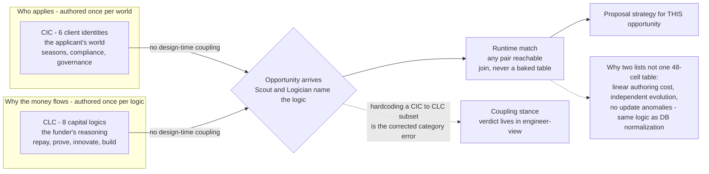
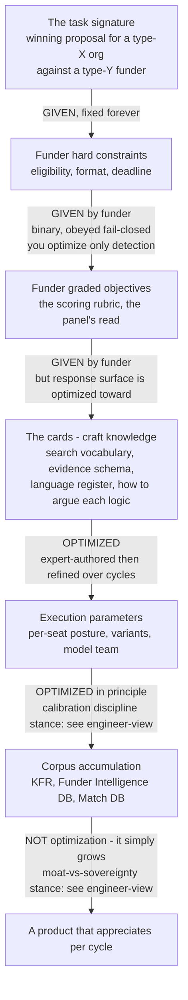
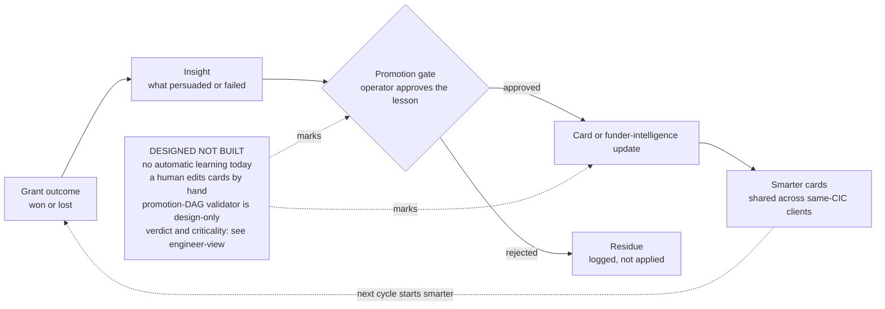

# System-view — GoldenQuill / Tilth

> This is the **system-view** of a two-view pair. It explains the *shape* of the product
> at the altitude a stakeholder needs to judge whether the idea is sound — one conceptual
> layer at a time, no schemas, no code. Its companion, `engineer-view.md`, **refines** this
> view down to the contracts, schemas, and the full decision inventory. Where a decision is
> relevant to both altitudes, the verdict is stated **only** in the engineer-view; here the
> stance is named and pointed across. Read this first; descend when you want the mechanics.

---

## What GoldenQuill / Tilth is

GoldenQuill is a physical product — a desktop computer a client buys and owns outright.
**Tilth** is the software intelligence that runs inside it: an AI council that finds grant
opportunities, writes proposals, reviews and scores them, and (post-award, on the horizon)
helps report on what the money did. A grant is funding from a government or foundation the
client does not pay back; winning one is specialist work — finding the right solicitation,
speaking the funder's language, assembling the evidence it demands, and arguing in the logic
that kind of money rewards. Most organizations that deserve funding lose grants because they
have no grant writer. Tilth is the productization of that specialist.

The differentiator is **sovereignty**: the client owns the hardware, the API keys, and all
the data. If the vendor vanished tomorrow, the client keeps everything and the product keeps
running. That single promise — own the box, not rent the website — drives the privacy model,
the pricing question, and the architecture downstream.

**What never changes.** The task has a fixed *signature*: write a winning proposal for a
type-X organization against a type-Y funder. That shape is permanent. What changes — and what
gives the product its value — is the **knowledge** that enters the AI's context window, which
is meant to get smarter every cycle. The product does **not** train new models; it improves
what it hands to the models it uses.

### Alternative framings we considered

| Framing | Why set aside |
|---|---|
| A website/SaaS you log into | Collapses the sovereignty promise — the client's data would live on someone else's server, held hostage. The box-you-own model exists precisely to refuse that. |
| A model that is fine-tuned per client | The substrate is locked; the product improves the *context*, not the *weights*. Training would put the value inside an artifact the client cannot inspect or own cleanly. |
| One general "grant writer" with no taxonomy | Loses the leverage. Without separating *who applies* from *why money flows*, the system cannot accumulate reusable craft knowledge — every grant starts from zero. |

---

## The protagonist idea: two axes, independently authored, matched at runtime

**This is the single most important claim in the whole design. Everything else is downstream
of it.**

To write a grant you must hold apart two things people constantly conflate:

- **Who applies (CIC — Customer Identity Card — the client's *world*).** A farm lives by
  seasons; a school lives by compliance; a public agency lives by procurement and
  accountability. There are **six** client identities: Food Systems, Educator, Public Agency,
  Arts & Culture, Cooperative, Ecosystem Intermediary.
- **Why the money flows (CLC — Capital Logic Card — the funder's *reasoning*).** A bank lends
  and asks "will you repay?"; a foundation funds innovation and asks "is this new?"; a research
  funder asks "does it work?". There are **eight** capital logics: Public Purpose & Works,
  Catalytic Change, Operating Capacity, Research & Evidence, Market Access, Credit &
  Underwriting, Sponsorship & Corporate Support, Shared Assets.

The load-bearing claim is that **these two axes carry no design-time coupling and are joined
only at runtime — every pair stays reachable.** (They are *not* statistically independent —
some pairings are common, some rare; see the framings table below. The claim is that no pair
is *forbidden*, not that the axes are uncorrelated.) Any client world can, in principle, reach any capital logic:
a farm can take a bank loan *or* an innovation grant; a school can tap a foundation; a
cooperative can win public-works money. The opportunity that arrives — read by Scout and
Logician — names the capital logic, and the match becomes the proposal strategy *for that
opportunity*. The answer is **computed by joining the two lists**, never by looking up a
baked table.

Two reasons this matters. First, hardcoding "this client world → only these kinds of money"
would silently block valid opportunities — a real category error this project made and
corrected, now guarded against. Second, and deeper: keeping two lists (6 + 8 authored units)
instead of one combined table (48 cells) is the same discipline as normalizing a database —
linear authoring cost instead of multiplicative, independent evolution of each axis, and no
update anomalies. To be precise, this is a *join under precedence*, not a clean split: the
funder's announcement can override a client-world default, and what a funder leads with is
filtered to the facts the client actually holds. The reason to factor the axes is authoring
economy and independent evolution — not a claim that they are perfectly separable.

### The two axes meet at runtime — why no design-time coupling

*Who-applies and why-money-flows are two separately-authored lists; the opportunity joins them per-cycle, so every pair stays reachable.*

The **coupling stance** — whether any design-time link between the axes is ever admissible,
and how it is enforced — is a decision relevant to both views. It is named here; the verdict
and its enforcement live in `engineer-view.md`.

### Alternative framings we considered

| Framing | Why set aside |
|---|---|
| One 48-cell client × funder lookup table | Multiplicative authoring and maintenance cost; every new client world or funder logic multiplies the work; update anomalies. The two-list factoring is the corrected design. |
| Treat the axes as statistically independent | Overclaims. Some client/funder pairings are common, some rare — the axes are correlated in *frequency*. The real claim is that no pair is *forbidden at design time*, not that they are independent. |
| Bake "common capital logics" onto each client card | This is exactly the category error the project made and reverted — advisory framing still constitutes design-time coupling and biases the system away from valid opportunities. |

---

## Given vs optimized — the layering that makes it a product

The easiest confusion to fall into is treating everything as tunable. It is not. The system
is built one conceptual layer at a time, and each layer has a different relationship to
control:

- **The task signature is given and fixed forever** — "winning proposal for a type-X org
  against a type-Y funder." You do not optimize the shape of the job.
- **Funder hard constraints are given by the funder and obeyed** — eligibility, format,
  deadline. These are binary; the system fails closed on them. The only thing you optimize is
  your ability to *detect* and *satisfy* them.
- **Funder graded objectives are given, but you optimize your response toward them** — the
  scoring rubric and the panel's read are the funder's, but the draft is shaped to score well
  against that rubric. This is where the review seats earn their keep.
- **The cards are the lever you accumulate** — search vocabulary, evidence schema, language
  register, and how to argue each capital logic. These start expert-authored and are meant to
  be refined over cycles. This is the optimized layer.
- **Execution parameters are optimized in principle** — per-seat posture, draft variants, the
  model team. The discipline for calibrating them is a stance named below, not yet a built
  practice.
- **The corpus simply grows** — the client's facts, the funder intelligence, the match
  history. This is not optimization; it is accumulation. Whether it constitutes a defensible
  moat or is constrained by the sovereignty promise is a stance named below.

### Given vs optimized — the layering that makes it a product

*The task signature is fixed forever, funder constraints are obeyed, funder objectives are optimized toward, the cards are the lever you accumulate, and the corpus simply grows.*

Two stances live in this layering and are named, not decided, here. The **calibration
discipline** for execution parameters is *designed-but-not-built* — there is no proper
practice for tuning per-seat postures, variants, and model assignment against outcomes yet.
The **moat-versus-sovereignty** tension — whether accumulated corpus is a competitive moat
when the client owns and can walk away with it — is a real tension, not a settled answer.
Both verdicts live in `engineer-view.md`.

One nuance worth holding: the cards are the *archetype default*, shared across all clients in
the same world; a client's own context overrides where needed but does not rewrite the card.
That is what makes the optimization compound — a lesson learned on one Food Systems client
improves the Food Systems card for *every* Food Systems client.

### Alternative framings we considered

| Framing | Why set aside |
|---|---|
| "Everything is a knob we tune" | Flattens the layers and invites the system to optimize against funder constraints it must simply obey — a fail-closed violation, not a tuning target. |
| Optimize per-client, not per-archetype | Kills the compounding value thesis. Per-client is a thin override; the shared archetype card is where accumulated craft lives and pays off across clients. |
| Treat corpus growth as the moat outright | Overclaims given the sovereignty promise — the client owns and can leave with the corpus. The defensible thing, if any, is the *rate* of improvement, not the static pile. |

---

## The council — six seats, none outranking another

Tilth is a council of six seats (five model-backed, one deterministic), each with a distinct
job and no seat in charge:

- **Scout** finds opportunities across many channels and verifies them against the live
  announcement.
- **Scribe** writes the proposal, section by section, in the funder's dialect.
- **Editor** reads the draft through different eyes — clears jargon, offers concrete
  replacements.
- **Judge** scores the draft against the funder's own rubric.
- **Red Team** attacks the proposal, looking for what a hostile reviewer would catch.
- **Logician** enforces the rules deterministically in plain code — no AI, zero token cost,
  and crucially *fail-closed*: when it cannot be sure, it refuses rather than guesses.

Two cross-cutting frames govern all six. The **Five Operating Laws** are non-negotiable and
cannot be overridden by any prompt or model: the announcement is the source of truth; no
scope drift; one client's data never touches another's (org isolation); language matches the
funder's dialect with sensitive terms flagged for the applicant to approve — never rewritten
silently; and the applicant brings the substance — the system never fabricates credentials,
data, or partnerships. On top of that, each seat runs in one of three **gears** the
applicant sets — propose-only, steer-and-execute (the default), or full-delegation — which is
the dial for how much the human stays in the loop. (Note: "gears" here is the autonomy dial;
the separate cloud-vs-local *privacy postures* are a different control surface.)

The Logician is where the orthogonality claim is *defended in practice*: it is the seat that
would refuse a design-time coupling of the two axes, and the seat that decides eligibility
only against a live announcement, never a cached guess.

### Alternative framings we considered

| Framing | Why set aside |
|---|---|
| A single end-to-end agent | No internal adversary. Judge-versus-Scribe and Red Team's attack are what raise the draft's quality against the funder's rubric; one agent grading its own work has no independent check. |
| Let the AI enforce the rules | The Five Laws must hold even when a model is wrong or manipulated. Enforcement lives in deterministic, fail-closed code (the Logician), not in a model that can be talked out of a rule. |
| A fixed automation level | Different clients and different grants want different human involvement. The three gears are the control surface; freezing it would mismatch the seat to the stakes. |

---

## The learning loop — the value engine and its honest gap

Here is the idea that turns a one-off tool into an asset that appreciates: each grant outcome
— won or lost — should become an *insight* about what persuaded or failed, that insight
should (after an operator approves it) become a **card improvement**, and the next client in
the same world should therefore start smarter. One client pays for the lesson; every client
in that world reaps it. That compounding is the whole value thesis.

**It is, today, the single biggest gap between the vision and what runs.** Nothing learns
automatically. A human currently edits the cards by hand after each grant. The promotion
discipline that would govern which lessons are safe to apply — a typed graph of outcomes,
candidates, owner decisions, and promoted knowledge, with deterministic gates — is **designed
but not built as running validation here**: it exists as a design, not as an enforced gate in
this product. So the "gets smarter every cycle" story is a designed engine with the loop
currently closed by hand.

### The learning loop — the value engine and its honest gap

*Each grant outcome is meant to become a card improvement so the next same-world client starts smarter; today the loop is closed by a human by hand, not by the system.*

The criticality of this gap — and the verdict on what must be built before the value thesis
holds — is an OPEN decision recorded in `engineer-view.md`.

### Alternative framings we considered

| Framing | Why set aside |
|---|---|
| Auto-promote lessons from outcomes | Dangerous without governance — a single noisy outcome would corrupt a shared card for every client in the world. An operator-approval gate is the deliberate guardrail; nothing promotes itself. |
| Claim the loop already works | Dishonest. The loop is designed; the closing step is manual today. Saying otherwise would overstate what the product does and hide the most important build-gap. |
| Make learning per-client | Defeats the compounding thesis — the shared, same-world card is what lets one client's lesson pay off across the others. |

---

## The sovereignty stance — intelligence in context, not in weights

A thread runs through everything above: the product gets smarter by improving the *context*
it hands to models, not by training new model weights. That is not only a technical choice —
it is what makes sovereignty coherent. The intelligence the client accumulates lives in
inspectable cards and corpora on a machine the client owns, not baked into an opaque artifact
the vendor controls. Confidential data stays local by design; only approved, non-sensitive
content uses approved cloud routes, and the applicant approves sensitive-term substitutions
rather than having them rewritten silently. The recurring honest question every feature must
answer is the same one: *does this preserve the client's ability to walk away with everything
intact?*

Because the client owns the corpus, the usual "data moat" story does not straightforwardly
apply. The defensible asset, if there is one, is the *rate* at which the shared intelligence
improves — which loops straight back to the learning-loop gap above. How that becomes a
business — what is owned outright versus what is a shared-intelligence subscription — is a
stance named here and decided in `engineer-view.md`.

### Alternative framings we considered

| Framing | Why set aside |
|---|---|
| Train per-client models for higher ceiling | Breaks sovereignty and inspectability — the value would live in weights the client cannot own or read. In-context refinement keeps the intelligence portable and auditable. |
| Lock value in a cross-client corpus the vendor holds | Contradicts the promise that the client can leave with everything. The corpus is the client's; the business case must come from the shared improvement rate, not from holding data hostage. |

---

## What this view does not cover

This view deliberately stops at the *shape*. It names stances; it does not state verdicts. For
the mechanics, descend to **`engineer-view.md`**, which refines this view and owns:

- the **decision inventory** — every load-bearing decision with its verdict, including the
  OPEN and CRITICAL rows for the designed-but-not-built items named here: the learning loop /
  promotion-DAG validator, the calibration discipline, the unwired and client-hardcoded
  eligibility filter, and the v0.2 post-award agents;
- the **schemas and contracts** — the card structure, the candidate and verification states,
  the match and funder-intelligence records, the failure-code families;
- the **runtime match mechanics** — exactly how the two axes are joined under announcement
  precedence, and how the coupling guard is enforced;
- the **eligibility ladder** — how discovery, volume-trimming, live verification, and the
  human review gate actually wire together, and where the dedicated eligibility filter sits
  (and why it is not yet wired in).

Each stance named in this document — coupling, calibration discipline, moat-versus-sovereignty,
the learning-loop criticality, and the business model — has its single owning verdict over
there. Nothing is decided twice.
