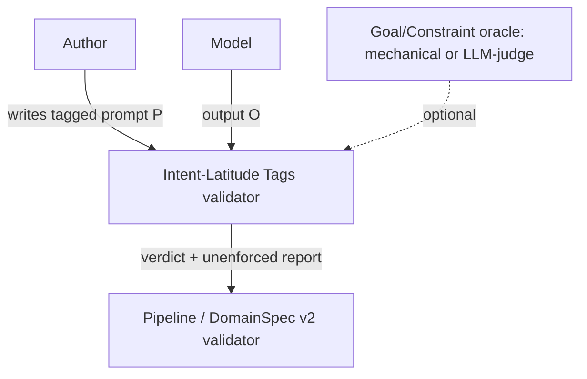
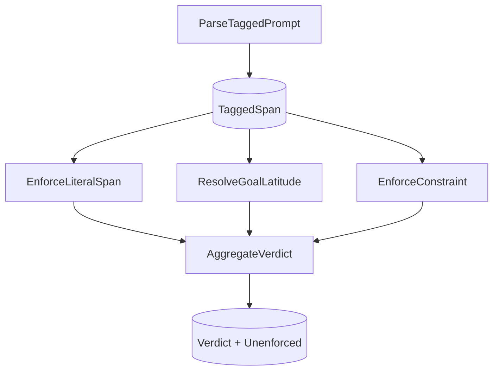

# Architecture Bundle: Intent-Latitude Tags

Design-stage companion to [SPEC.md](SPEC.md). Non-mutating: upstream corrections
become gap entries, not silent edits.

## Design Intent

Make the **validator** the seat of all enforcement: parse latitude tags once, route
each span to a check class by tag, and aggregate an honest verdict. The architecture
must keep the STRONG path (`[literal]` verbatim) fully mechanical and isolate the
WEAK path (`[goal]`/`[constraint]` judges) behind a swappable oracle interface so a
PoC can ship L0 without any model dependency.

## Inputs

- [SPEC.md](SPEC.md) — capabilities + Concept Registry
- [GLOSSARY.md](GLOSSARY.md) — term definitions + naming hazards
- [../SPEC.md](../SPEC.md) — §4 validator contract (source design)
- [../FINDINGS.md](../FINDINGS.md) — the grounding rule and the tautology-kill

## Required View Set

### 1. Context View

### 2. Capability View

Edges are DS-D2 verbs: `produces` (P→S, A→V), `queries` (L/G/C→S).

### 3. Concept/Type View
- `LatitudeTag` (Enum) ──classifies──> `TaggedSpan` (Entity)
- `TaggedSpan` ──checked-by──> `CheckClass` (Enum) ──carries──> `GroundingStrength` (Enum)
- `VerdictFinding` (Entity) ──aggregates-into──> `Verdict` (Enum)
- `UnenforcedSpan` (Entity) ──reported-in──> `VerdictReport` (Query)

### 4. Operation/Flow View (the write/check side)
`AggregateVerdict` flow, per output `O`:
1. inputs: span set `T`, output `O`
2. rules: for each span → dispatch by tag to check class
3. calculation: `verbatim` (substring), `rubric` (oracle), `predicate` (predicate/judge)
4. transition: collect `VerdictFinding`s
5. postcondition: `FAIL` if any FAIL, else `PASS`; `unenforced` list populated
6. events: on FAIL → emit `regenerate` or `surface-to-author` (caller policy)

### 5. State View — span lifecycle
| State | Transition trigger | Next state |
| --- | --- | --- |
| parsed | dispatch by tag | checked-strong / checked-weak / unenforced |
| checked-strong | verbatim match / mismatch | pass-finding / fail-finding |
| checked-weak | oracle verdict | pass / fail / **flag** |
| unenforced | no oracle available | reported-unenforced (never pass) |

One transition row = one downstream test obligation (feeds TEST/fixtures in plan).

### 6. Dependency/Interface View
- **Parser interface:** `parse(P) -> TaggedSpan[] | ParseError` (pure, no model).
- **Literal checker:** `checkLiteral(span, O) -> Finding` (pure).
- **Oracle interface (swappable):** `goalOracle(O, rubric) -> {pass|fail|unknown, rationale}` —
  implementations: `mechanical`, `llm-judge`, `none`. **L0 ships with `none` for goal/constraint.**
- **Verdict aggregator:** `aggregate(Finding[]) -> VerdictReport`.

## Design Decisions

| ID | Decision | Rationale | Status |
| --- | --- | --- | --- |
| D1 | Oracle is a swappable interface, default `none` at L0 | lets L0 ship STRONG-only with zero model dependency | accepted |
| D2 | Parser + literal checker are pure functions | makes the non-tautology proof a unit test | accepted |
| D3 | `unenforced` is a first-class report field, not a silent pass | honesty rule R3 / claim ≤ proof | accepted |
| D4 | `[literal]` scoped to content, not instructions | instruction-following is not mechanically checkable | accepted, revisit (G1) |

## Risks

| ID | Risk | Mitigation |
| --- | --- | --- |
| RK1 | `[goal]`/`[constraint]` judge re-imports drift (G2) | keep them FLAG-grade; require fixture-validation before FAIL authority |
| RK2 | `[literal]` never fires in practice (models already reproduce) → ceremony | L0 fixture explicitly tests the true-positive; kill condition wired in |
| RK3 | Tag's own format sensitivity (FormatSpread) | load is on post-hoc validator, not on model honoring the bracket |

## Glossary Consistency Report

- Terms checked against [GLOSSARY.md](GLOSSARY.md): **all linked or partial**, no conflicts.
- Naming hazards (`Intent Tagging` Gmeiner, `Anthropic XML`) recorded as **disclaim**, not promote.
- Status: **pass** (no term silently redefined vs FINDINGS/SPEC).

## Handoff to Plan

Six views complete → ready for `plan`. Layer seed: L0 = parser + literal checker +
fixtures (pure, no model). Deferred: L1 repeatability, L2 judge-grounding (G2), L3
integration. Source design refs: this file + SPEC.md + ../SPEC.md §4.
