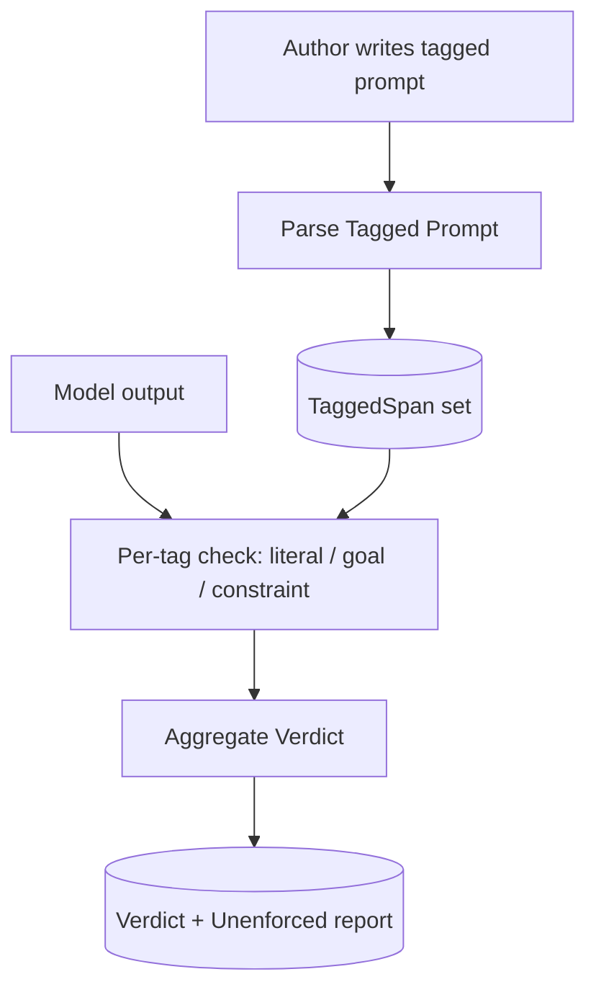

# Intent-Latitude Tags (ILT)

## What This Module Owns

Parsing and **enforcing** interpretation-latitude tags (`[literal]` / `[goal]` /
`[constraint]`) inside a prompt or spec, and producing a validator verdict over a
model's output. It owns the closed tag vocabulary, the parse/validation rules, the
per-tag **check class**, and the verdict report. It does **not** own how the model
is prompted, nor any claim that the model "understands" the tags — all force lives
in the post-hoc validator (the load-bearing rule from [FINDINGS.md](../FINDINGS.md)).

Design source: [../SPEC.md](../SPEC.md) (tag + validator contract). Concept ancestor
to cite, not reinvent: Searle & Vanderveken's IFID (1985) — see GLOSSARY.

## Module Map

## Capabilities

| Capability | What | Key Aspects | Detail |
| --- | --- | --- | --- |
| Parse Tagged Prompt | Turn a tagged prompt into a validated span set | parse, balance/overlap/nesting checks, closed vocab | total function; rejects at author-time |
| Enforce Literal Span | Diff-check a `[literal]` span appears verbatim in output | normalize, contiguous-substring | **STRONG** grounding — no model needed |
| Resolve Goal Latitude | Exclude `[goal]` from verbatim checks; route to a goal oracle | exclusion, oracle ladder | **WEAK** grounding — FLAG-grade unless oracle validated |
| Enforce Constraint | Check output does not violate a `[constraint]` | predicate or constraint-judge | **MEDIUM** grounding |
| Aggregate Verdict | Combine findings into PASS/FAIL + unenforced list | aggregation, honesty rule | unchecked span ≠ passed |

### Parse Tagged Prompt (inline)

Parse `P` into `[{tag, id?, text, start, end}]`. Reject (author-time, before the
model runs) on unbalanced tags, illegal overlap, illegal nesting (only `[literal]`
may nest inside `[goal]`/`[constraint]`), or unknown tag name. Closed vocabulary
makes this total.

### Enforce Literal Span (inline)

For each `literal` span `L`: if `normalize(L.text)` is not a contiguous substring
of `normalize(O)` → `FAIL`. `normalize` is a single declared transform (collapse
internal whitespace, NFC unicode). **This check is the proof of non-tautology**: it
changes what the *system* does independent of how the model read the bracket.

### Resolve Goal Latitude (inline)

For each `goal` span `G`: exclude `G.text` from all verbatim/contains checks
(reliable, mechanical), register `G.text` as an acceptance rubric, then apply the
**grounding ladder** (strongest available): mechanical oracle → validated LLM-judge
(returns FLAG until fixture-validated) → none (recorded **unenforced**, never
silent-pass).

### Enforce Constraint (inline)

For each `constraint` span `C`: declared machine predicate → check predicate(O);
else constraint-judge (FLAG-grade until validated).

### Aggregate Verdict (inline)

`verdict = FAIL if any FAIL else PASS`. Report lists per-span result + a mandatory
`unenforced` list. Honesty rule: a span the validator could not check is reported
`unenforced`, never `passed`.

## Domain Concepts

| Concept | Type | Key Constraints |
| --- | --- | --- |
| LatitudeTag | Enum | closed set: `literal` \| `goal` \| `constraint` |
| TaggedSpan | Entity | has tag, optional id, text, source offsets; non-overlapping |
| NormalizationRule | Value | single declared transform; deterministic |
| CheckClass | Enum | `verbatim` \| `rubric` \| `predicate` |
| GroundingStrength | Enum | `strong` (verbatim) \| `medium` (predicate) \| `weak` (rubric/judge) |
| Verdict | Enum | `PASS` \| `FAIL` \| `FLAG` |
| VerdictFinding | Entity | tag, id, check-class, strength, result, rationale |
| UnenforcedSpan | Entity | a span with no available oracle; must be reported, never passed |

## Concept Registry

| Concept | ID | Type |
| --- | --- | --- |
| LatitudeTag | ILT.LatitudeTag | Entity |
| TaggedSpan | ILT.TaggedSpan | Entity |
| Verdict | ILT.Verdict | Entity |
| ParseTaggedPrompt | ILT.ParseTaggedPrompt | Operation |
| EnforceLiteralSpan | ILT.EnforceLiteralSpan | Operation |
| ResolveGoalLatitude | ILT.ResolveGoalLatitude | Operation |
| EnforceConstraint | ILT.EnforceConstraint | Operation |
| AggregateVerdict | ILT.AggregateVerdict | Operation |
| VerdictReport | ILT.VerdictReport | Query |

## Feature Concept Graph

| From | Edge | To | Evidence | Notes |
| --- | --- | --- | --- | --- |
| ILT.ParseTaggedPrompt | produces | ILT.TaggedSpan | ../SPEC.md#4.0 | total parse |
| ILT.EnforceLiteralSpan | queries | ILT.TaggedSpan | ../SPEC.md#4.1 | STRONG |
| ILT.ResolveGoalLatitude | queries | ILT.TaggedSpan | ../SPEC.md#4.2 | exclusion + oracle |
| ILT.EnforceConstraint | queries | ILT.TaggedSpan | ../SPEC.md#4.3 | predicate/judge |
| ILT.AggregateVerdict | produces | ILT.Verdict | ../SPEC.md#4.4 | + unenforced list |

## Domain Rules

- **R1 (closed vocabulary):** only `literal`/`goal`/`constraint`; unknown tag → parse error.
- **R2 (grounding):** a tag's behavior comes from its check class, never from the model reading the bracketed word. (Kills the naive form — FINDINGS.)
- **R3 (honesty):** a span without an available oracle is `unenforced`, never `PASS`.
- **R4 (strength labelling):** every finding carries its GroundingStrength so weak/judge-based results are visible.

## Cross-Feature Dependencies

| Capability | Depends On | Via | Why |
| --- | --- | --- | --- |
| Resolve Goal Latitude | target-state (`../../../domainspec-v2/research/target-state/SEED.md`) | concept | `[goal]` is the inline form of a buildable target state; vocab must reconcile |
| (future) latitude as edge | spec-ontology-unification (`../../../domainspec-v2/research/spec-ontology-unification/SEED.md`) | edge type | Lane-A candidate: latitude as a graph annotation, not inline text |

## Produces For

| Consumer | Consumes Capability | Via | What |
| --- | --- | --- | --- |
| DomainSpec validator (v2, if promoted) | Aggregate Verdict | check | a span-level latitude verdict on generated output |

## Open Gaps (carried to design/plan)

- G1: is `[literal]` too narrow scoped to content (not instructions)? (SEED residue)
- G2: is a validated LLM-judge acceptable grounding for `[goal]`/`[constraint]`, or does it fail non-tautology? **Central open question.**
- G3: inline tags vs latitude section vs graph edge — placement that reduces author burden.

## References

- Research: [../FINDINGS.md](../FINDINGS.md), [../SPEC.md](../SPEC.md), [../SEED.md](../SEED.md)
- Glossary: [GLOSSARY.md](GLOSSARY.md)
- Design: [ARCHITECTURE.md](ARCHITECTURE.md)
