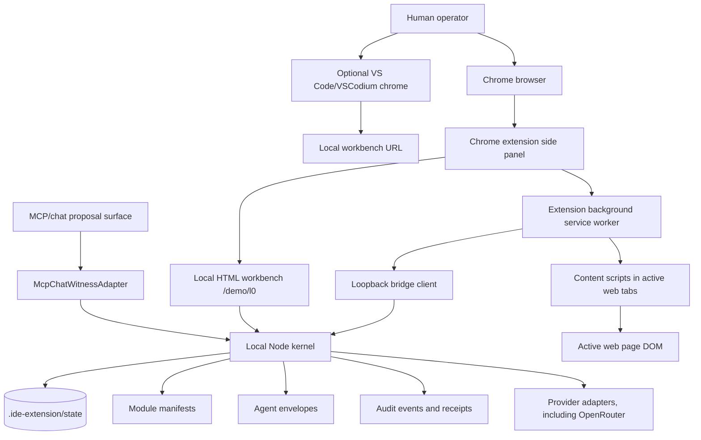

# Architecture Bundle: ide-extension Browser-First Extension Lane

## Design Intent

Add a minimal Chrome Manifest V3 extension lane around the existing
`ide-extension` local HTML workbench so browser-page observation and safe
browser actions can be witnessed without depending on VS Code/VSCodium
Integrated Browser control.

The extension is an adapter: it owns side-panel chrome, active-tab mediation,
content-script DOM snapshots, and typed page actions. The local Node
server/kernel remains the authority for manifests, grants, approvals, provider
mediation, agent envelopes, audit events, and receipts.

Refresh note from MCP/chat findings: this browser-first lane is no longer the
first L0.5 admission proof. The first L0.5 slice is the offline
`McpChatWitnessAdapter` harness with a fake/local stdio MCP server and one
allowlisted `observe` tool. The Chrome MV3 lane follows as a browser adapter
after the adapter-admission boundary is proven.

## Inputs

| Source | Contract Used |
| --- | --- |
| `projects/ide-extension/SPEC.md` | L0 witness boundary, module contract, envelope contract, receipt contract. |
| `projects/ide-extension/ARCHITECTURE.md` | Kernel responsibilities, host strategy, provider strategy, evidence loop. |
| `projects/ide-extension/README.md` | Public project boundary and first witness language. |
| `projects/ide-extension/src/server.mjs` | Existing local API surface and durable-state behavior. |
| `projects/ide-extension/development/founding-research/findings.md` | Approved L0 scope and non-goals. |
| `projects/ide-extension/development/vscode-browser-control-api-research/findings.md` | Rejection of VS Code Integrated Browser control as a stable third-party SDK. |
| `projects/ide-extension/development/mcp-chat-extension-integration-research/findings.md` | MCP/chat adapter-admission harness, offline L0.5 witness, evidence binding, and no-go lanes. |
| `../workspace-resonant/2.0.0-alpha/browser-first/README.md` | Browser-first precedent: MV3 extension plus local Node bridge. |
| `../workspace-resonant/2.0.0-alpha/browser-first/resonantos-side-panel-extension/manifest.json` | Side panel, background service worker, content scripts, permissions, loopback CSP. |
| `../workspace-resonant/2.0.0-alpha/browser-first/resonantos-side-panel-extension/src/background.js` | Background router, bridge rebinding, side-panel handoff, approval-required actions. |
| `../workspace-resonant/2.0.0-alpha/browser-first/resonantos-side-panel-extension/src/lib/browser-page-actions.js` | Active-tab selection, content-script action dispatch, read-only site behavior, script injection fallback. |
| `../workspace-resonant/2.0.0-alpha/browser-first/resonantos-side-panel-extension/src/content.js` | DOM snapshot, control refs, field refs, frame-aware content script witness. |
| `../workspace-resonant/2.0.0-alpha/browser-first/resonantos-side-panel-extension/src/lib/approval-policy.js` | Restricted action and public-submit boundary patterns. |
| `../workspace-resonant/2.0.0-alpha/browser-first/resonantos-side-panel-extension/src/lib/bridge-client.js` | Generated/override/default loopback bridge config and route capability tokens. |

## Constraints

- The existing HTML workbench stays the UI source of truth.
- The Chrome extension must be minimum-overhead: side panel, background router,
  content script, bridge client, approval policy, and small page-action module.
- Provider keys stay server-side.
- Browser actions are typed and mediated; no arbitrary script execution surface
  is exposed to model output.
- Public submit, credentials, wallet/signature, payment, destructive, and
  privileged browser operations remain human-only or blocked.
- VS Code/VSCodium is optional IDE chrome, not the browser-control proof
  substrate.
- Canvas state is never authority; visible browser/control nodes must point to
  source refs, approval ids, run ids, and receipts.
- MCP/chat/browser tools are specimens until admitted by the local kernel. The
  first admission witness is fake/local/offline and cannot depend on Claude,
  Yocoolab, GitHub, Pendo, Chrome, Kernel Cloud, deployment, external network,
  or authenticated browser state.
- `DesignFeedbackContextPacket` is a context/evidence schema. It is not an
  authority-bearing adapter, and source candidates remain hypotheses until
  separately verified.

## 1. Context View

Context rule: the extension touches browser tabs; the kernel owns durable
authorization and receipts.

## 2. High-Level Structure View

| Layer | Component | Role | Authority |
| --- | --- | --- | --- |
| UI | Local HTML workbench at `/demo/l0` | Primary workbench/canvas surface. | No independent effect authority. |
| UI adapter | Chrome side panel | Opens beside real web pages and hosts or frames the local workbench. | No durable state authority. |
| Browser router | MV3 background service worker | Routes messages between side panel, content scripts, and local server. | May request approvals and execute approved browser actions only. |
| Browser witness | Content scripts | Read page snapshots, assign refs, and perform typed page actions. | No provider keys, no durable authority. |
| Adapter witness | `McpChatWitnessAdapter` | Offline stdio witness for MCP/chat admission. | No network, mutation, provider, browser, or receipt authority. |
| Context packet | `DesignFeedbackContextPacket` | Local context/evidence payload inspired by Yocoolab selection/thread grammar. | Hypotheses only; not source authority. |
| Kernel | Local Node server | Registry, grants, approvals, audit, artifacts, provider mediation, envelopes. | Authority for local state and receipts. |
| Provider adapter | OpenRouter adapter | Model transport behind local backend. | Provider access only; no approval authority. |
| Optional IDE chrome | VS Code/VSCodium wrapper | Opens or embeds local URL in owned webview. | Deferred; no browser-act proof. |
| Automation witness | Playwright MCP/direct Playwright | Optional later browser-act test adapter. | Test/evidence lane only. |

## 3. Low-Level Components View

| Component | Owns | May Do | Must Not Do |
| --- | --- | --- | --- |
| `browser-extension/manifest.json` | Extension permissions, side panel, content scripts, loopback CSP. | Request `tabs`, `scripting`, `sidePanel`, `storage`, `webNavigation`, and http/https host permissions. | Include marketplace packaging claims or provider secrets. |
| `src/side-panel.html` | Minimal extension chrome. | Frame `http://127.0.0.1:<port>/demo/l0` when allowed, or render a tiny local shell that fetches `/api/state`. | Fork the workbench into a second authority surface. |
| `src/background.js` | Message router and active-tab coordination. | Open side panel, track controlled tab, send typed content actions, call local bridge with token. | Execute model-produced JavaScript or bypass approval gates. |
| `src/content.js` | DOM snapshot and typed action executor. | Read page text, links, controls, fields, iframes; click by ref/text; type into editable fields; scroll. | Submit public forms, enter credentials, sign wallet requests, process payments, or mutate privileged browser settings. |
| `src/lib/bridge-client.js` | Local bridge URL/token/capability handling. | Resolve generated config, storage override, and loopback default. | Persist provider keys or broad bearer tokens in extension code. |
| `src/lib/approval-policy.js` | Browser-action safety classifier. | Classify safe, public-submit, and hard boundaries before action execution. | Treat model confidence as authorization. |
| `src/lib/page-actions.js` | Active-tab action facade. | Open/search/read/forms/click/type/scroll with site permission checks. | Own audit state; receipts belong to kernel. |
| Existing `src/server.mjs` | Kernel API and state. | Add bridge health/config and browser snapshot/action envelope endpoints. | Become a remote multi-user service in this design stage. |
| Future `adapters/mcp-chat-witness` | Local stdio adapter admission harness. | Register a bounded fake MCP witness and produce local evidence artifacts after approval. | Call real external MCP servers, approve itself, or append receipts. |
| Future `DesignFeedbackContextPacket` schema | Context/evidence fixture. | Carry selected element, URL, screenshot/artifact ref, selection history, source candidates, companion message, and context refs. | Claim source ownership or implementation truth without verification. |

## 4. Workflow Process View

### Boot And UI Mount

1. Human starts the existing local server.
2. Server serves `/demo/l0` and existing `/api/state`.
3. Chrome extension loads unpacked.
4. Side panel opens.
5. Side panel tries to frame the local workbench. If Chrome blocks framing or
   mixed-content behavior in a target environment, the side panel falls back to
   a minimal static shell that fetches the same kernel APIs.
6. Background service worker resolves bridge config in this order:
   generated config, user override, loopback default.

### Page Observation

1. Content script runs on readable http/https pages.
2. It produces a snapshot: title, URL, text, links, controls with refs, fields
   with refs, frame metadata, viewport, and hard-boundary hints.
3. Background stores the latest active-tab snapshot.
4. Side panel or local workbench requests the snapshot through the background
   router or bridge.
5. Kernel may record summarized snapshot evidence by path/ref, not as canvas
   authority.

### MCP/Chat Admission Witness

1. A local `McpChatWitnessAdapter` descriptor is registered with `transport:
   stdio`, bounded command/args, fixture CWD, temp/redacted HOME, explicit env
   allowlist, one `observe` tool, `network: false`, `mutation: false`, and
   `receipt_authority: false`.
2. A `DesignFeedbackContextPacket` fixture supplies selected element, URL,
   screenshot/artifact ref, selection history, source-candidate hypotheses,
   companion message, and context refs.
3. The adapter prepares a proposal envelope.
4. `/api/envelopes/run` rejects before approval and invokes nothing.
5. After one exact approval, the kernel invokes the allowlisted fake observe
   tool and records transcript/context evidence artifacts.
6. The kernel appends the receipt with `evidence_refs`; the adapter never mints
   receipts.

### Browser Action Proposal

1. Model/provider or human proposes a typed action: read, forms, open, search,
   click, type, scroll, or wait.
2. Approval policy sanitizes the step and classifies the boundary.
3. Safe read-only actions may run as observation.
4. Effectful browser actions create or reuse an agent envelope with requested
   grants.
5. Kernel approval queue owns the authorization decision.

### Approved Browser Action

1. Human approves the envelope/action in the local workbench.
2. Background receives an approved run/action token from the local bridge.
3. Background sends typed message to the active tab/frame.
4. Content script performs the action only if the element and action still match
   policy.
5. Background returns result and evidence refs.
6. Kernel appends an audit event and receipt.

### Blocked Boundary

Any action matching credentials, wallet/signature, payment, destructive change,
public submit, privileged browser operation, or restricted text is blocked or
requires the human to perform it directly in the page. The extension may explain
the boundary and preserve a blocked receipt; it may not "approve" the action.

## 5. Decision Flow View

| Decision | Choice | Reason | Consequence |
| --- | --- | --- | --- |
| D-001 browser-control substrate | Use Chrome MV3 extension. | VS Code/VSCodium stable APIs do not expose a third-party integrated-browser page handle. | Real browser-act proof moves to Chrome extension and later Playwright MCP. |
| D-002 UI source of truth | Keep local HTML workbench. | Minimum overhead and current L0 already proves server/state/approval/receipt loop. | Side panel wraps or mirrors; it does not replace. |
| D-003 side-panel rendering | Try loopback iframe first, fallback to tiny fetch shell. | Lowest duplication while preserving a robust extension fallback. | The HTML workbench remains canonical. |
| D-004 bridge authority | Kernel owns bridge tokens, approvals, receipts. | Extension has broad page permissions and must be constrained by local authority. | Add generated config/token before enabling effectful actions. |
| D-005 action vocabulary | Only typed actions. | Typed actions can be sanitized, tested, and receipted. | No arbitrary DOM script from model output. |
| D-006 hard boundaries | Block wallet, credential, payment, destructive, public-submit, and privileged actions. | Browser automation around these classes is too risky for L0.5. | Human performs them directly if needed. |
| D-007 provider access | OpenRouter remains backend adapter. | Secrets and provider policy do not belong in extension pages/content scripts. | Extension calls local kernel only. |
| D-008 IDE integration | Defer VS Code/VSCodium wrapper. | It is chrome, not proof substrate. | Later wrapper opens/embeds same local URL after browser-first proof. |
| D-009 Playwright MCP | Treat as validation/automation lane. | Useful for proof, screenshots, and regression tests. | Not required for the first extension scaffold. |
| D-010 MCP/chat admission | Build offline `McpChatWitnessAdapter` before real external MCP/browser tools. | The new findings require non-bypass proof before external specimens. | Chrome MV3 becomes L0.6 browser adapter; real MCP/Claude/Yocoolab/DevTools stay deferred. |

## 6. Dependency Interface View

### Existing Kernel Interfaces

| Method | Path | Current Role | Extension Design Use |
| --- | --- | --- | --- |
| `GET` | `/demo/l0` | Serve local workbench HTML. | Primary side-panel iframe target. |
| `GET` | `/api/state` | Return workbench state, modules, provider adapters, event count. | Side-panel fallback shell and health display. |
| `POST` | `/api/envelopes/prepare` | Create pending approval for dry-run envelope. | Prepare browser-action envelopes with requested grants. |
| `POST` | `/api/envelopes/run` | Block before approval; report run state. | Preserve approval-before-run invariant. |
| `POST` | `/api/approvals/:id/approve` | Approve envelope and append no-op receipt. | Reuse for browser action approval before content-script execution. |

### Proposed Adapter Admission Interfaces

These are design contracts, not implementation tasks in this Invoke run.

| Method | Path | Producer | Consumer | Purpose |
| --- | --- | --- | --- | --- |
| `POST` | `/api/adapters/register` | Kernel | Workbench/test harness | Validate offline adapter descriptor, custody statement, and tool allowlist. |
| `POST` | `/api/adapters/:adapter_id/prepare` | Workbench/chat surface | Kernel | Prepare proposal envelope from `DesignFeedbackContextPacket`. |
| `POST` | `/api/adapters/:adapter_id/evidence` | Adapter harness | Kernel | Store transcript, context hash, descriptor hash, allowlist hash, and custody artifact refs. |

### Proposed Browser-First Interfaces

These are design contracts, not implementation tasks in this Invoke run.

| Method | Path | Producer | Consumer | Purpose |
| --- | --- | --- | --- | --- |
| `GET` | `/api/bridge/health` | Kernel | Extension background | Prove loopback server and token policy are reachable. |
| `GET` | `/api/bridge/config` or generated file | Kernel startup | Extension background | Provide `bridgeUrl`, per-run bridge token, and optional capability tokens. |
| `POST` | `/api/browser/context` | Extension background | Kernel | Store latest summarized active-tab snapshot as evidence ref. |
| `POST` | `/api/browser/actions/prepare` | Side panel/workbench | Kernel | Prepare typed browser-action envelope. |
| `POST` | `/api/browser/actions/:run_id/result` | Extension background | Kernel | Append action result receipt after approved content-script execution. |

### Message Interfaces

| Channel | Direction | Payload |
| --- | --- | --- |
| `ide-extension.browser_first` | side panel <-> background | open side panel, active tab context, prepare/run action, bridge health. |
| `ide-extension.browser_first.content` | background <-> content script | read page, detect forms, click by ref/text, type by ref/field, scroll, overlay. |
| `kernel HTTP API` | side panel/background <-> local server | state, envelopes, approvals, receipts, bridge health/config. |

## Safety Model

The browser extension has broad host permissions, so every effectful crossing is
treated as protected until proven safe:

- sanitize planner/model actions into a small typed action set;
- classify each step as safe, public-submit, or hard boundary;
- allow read-only observation without mutation;
- require approval for effectful safe actions;
- block public-submit and hard-boundary actions for L0.5;
- append receipts for approved, blocked, failed, and interrupted attempts;
- keep provider keys and long-lived authority in the local kernel only.
- reject self-approval by actor/session separation;
- reject mutation, network, PR, deployment, Pendo, credential, broad-Claude, and
  live-write actions during the offline L0.5 admission witness;
- use `receipt.evidence_refs` and artifact hashes for adapter evidence unless
  the receipt schema is intentionally evolved.

## Distill Design-Unit Check

Smallest coherent unit after the MCP/chat refresh: the local adapter-admission
harness for `ide-extension`, bounded to fake/local stdio MCP, one `observe`
tool, `DesignFeedbackContextPacket`, evidence artifact hashes, approval gate,
and kernel-minted receipt.

Split pressure:

- Chrome MV3 browser-first extension is a separate L0.6 browser adapter lane.
- VS Code/VSCodium wrapper is a separate IDE chrome lane.
- Playwright MCP, Chrome DevTools MCP, and Kernel Cloud are separate
  validation/remote witness lanes.
- OpenRouter/provider routing remains a backend adapter.
- `claude-max-mcp` is deferred provider/process delegation, not `network.call`.
- Craft, Whisper, UI Studio, IDE Ergonomics, OpenClaw, and Hermes remain modules
  or envelopes, not kernel dependencies.

Verdict: `pass` for refreshed design-unit coherence. The design can route to
plan, but the first plan should build the offline adapter-admission harness
before the Chrome extension scaffold.

## Plan-Ready Handoff Notes

The next plan should create the smallest MCP/chat admission harness:

- adapter descriptor schema;
- `DesignFeedbackContextPacket` schema and fixture;
- fake stdio MCP witness server;
- adapter registration validator;
- evidence artifact writer and hash binding helper;
- smoke and negative tests for approval, allowlist, self-approval, receipt, and
  env/HOME/CWD containment.

Only after that witness passes should a browser-first extension plan create:

- `browser-extension/manifest.json`;
- `browser-extension/src/side-panel.html`;
- `browser-extension/src/background.js`;
- `browser-extension/src/content.js`;
- `browser-extension/src/lib/bridge-client.js`;
- `browser-extension/src/lib/approval-policy.js`;
- `browser-extension/src/lib/page-actions.js`;
- tests for approval policy, page-action message shaping, and bridge config.

The plan should not implement a VS Code wrapper, Playwright MCP integration,
provider model routing, real external MCP servers, Claude delegation, Yocoolab,
Chrome DevTools, Kernel Cloud, or external agent runtime in the same slice.
