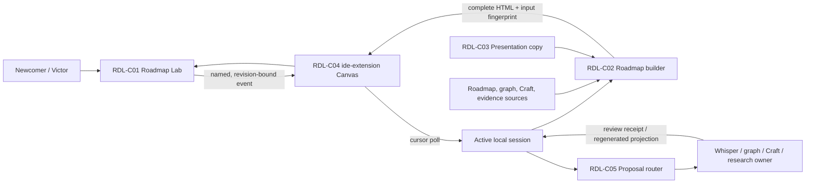
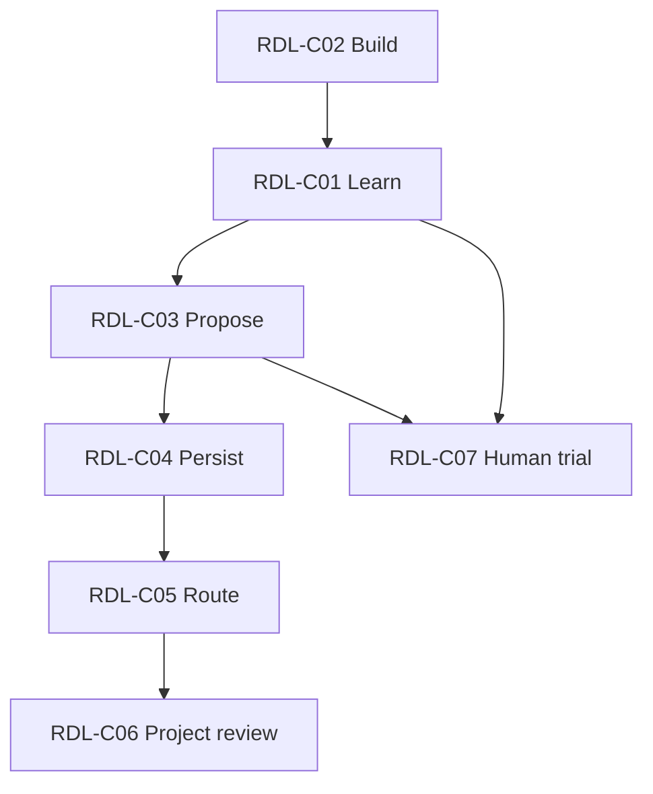
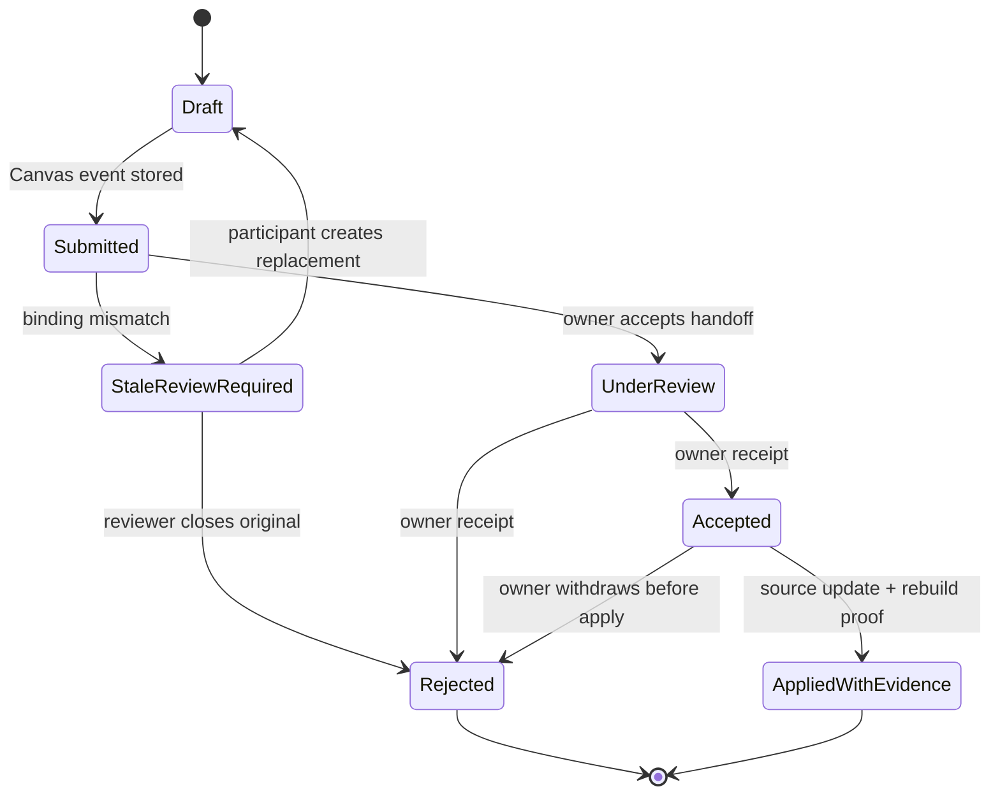

# Architecture Bundle: DomainSpec v2 Roadmap Lab

## Design Intent

Add a dedicated proposal-first learning surface to the existing trusted-local
ide-extension Canvas. The design makes a newcomer contribution reviewable by
binding it to what was displayed, while preserving DomainSpec, Craft, Whisper,
research, and promotion authority outside the browser.

The IDs below (`RDL-C*`, `RDL-O*`, `RDL-E*`) are local design handles, not
canonical DomainSpec Concept Registry IDs.

## View 1 — Context



Boundary: the browser can display, draft, and emit evidence. It cannot edit the
roadmap, close Craft state, rewrite authority text, accept claims, or promote a
proposal.

## View 2 — Capability

| Capability | Input | Output | Owner |
| --- | --- | --- | --- |
| RDL-C01 Guided learning | Published learning packet for one node | orientation acknowledgment, restatement | Roadmap Lab presentation |
| RDL-C02 Deterministic roadmap build | roadmap data, presentation copy, source refs | HTML, node/field coverage, input fingerprint | Roadmap presentation builder |
| RDL-C03 Targeted proposal capture | displayed bindings, observed value, participant input | `roadmap.improvement.proposed` | Roadmap Lab presentation |
| RDL-C04 Durable local interaction | valid named event and current Canvas bindings | append-only interaction and cursor result | ide-extension kernel |
| RDL-C05 Owner routing | persisted proposal and class | review handoff or unsupported result | active session / owning lifecycle |
| RDL-C06 Review projection | owner receipt plus original proposal | non-authoritative visible disposition | Roadmap Lab projection |
| RDL-C07 Human trial | published L0 surface and protocol | comprehension/usefulness report | real participant plus facilitator |



## View 3 — Concept And Type

| Concept | Local type | Key identity/bindings | Authority note |
| --- | --- | --- | --- |
| RDL-CN01 RoadmapNode | projection entity | `node_id` | Identity/meaning comes from roadmap inputs. |
| RDL-CN02 CopyField | presentation entity | `field_id`, `node_id`, value | Human-facing copy only. |
| RDL-CN03 LearningPacket | derived artifact | node, copy fields, sources, fingerprint | Rebuildable, non-authoritative explanation. |
| RDL-CN04 CanvasBinding | evidence reference | `surface_id`, `revision_id` | Owned by ide-extension Canvas. |
| RDL-CN05 InputBinding | evidence reference | `input_fingerprint` | Proves which roadmap inputs the build used, not their truth. |
| RDL-CN06 Restatement | submitted evidence | participant label, node, bindings, answers | Participant-authored evidence. |
| RDL-CN07 ImprovementProposal | submitted evidence | proposal id, class, target, original, proposed, reason, bindings | Request for review only. |
| RDL-CN08 ReviewReceipt | external evidence handle | proposal id, owner route, status, evidence refs | Status comes from owner-held review. |
| RDL-CN09 ProposalProjection | derived state | proposal plus latest valid receipt | Browser display; not lifecycle authority. |

Allowed relationships:

```text
RoadmapNode contains CopyField
RoadmapNode derives LearningPacket
LearningPacket binds CanvasBinding
LearningPacket binds InputBinding
Restatement concerns RoadmapNode
ImprovementProposal concerns RoadmapNode or CopyField
ImprovementProposal observes CanvasBinding and InputBinding
ReviewReceipt adjudicates ImprovementProposal
ProposalProjection summarizes ImprovementProposal and ReviewReceipt
```

Forbidden relationships include “CanvasBinding authorizes mutation,”
“ImprovementProposal closes Craft node,” and “ProposalProjection promotes
claim.” Any implementation that introduces those semantics fails the design.

## View 4 — Operations And Flows

### RDL-O01 Build and publish learning surface

```text
roadmap inputs + roadmap-copy.json + source refs
  -> validate identifiers, required copy fields, source shape, and coverage
  -> compute deterministic input_fingerprint
  -> render complete HTML with fingerprint and event adapter
  -> publish existing workspace HTML through /api/canvas/publish
  -> receive surface_id + revision_id
  -> display through existing current/content Canvas route
```

Postcondition: each interactive node/field rendered in HTML can be traced to its
projection input and copy field. The build does not modify source authority.

### RDL-O02 Submit restatement or proposal

```text
participant draft + current node/field + observed original value
  + surface_id + revision_id + input_fingerprint
  -> client validates required fields and payload size
  -> postMessage exact envelope {type, eventName, payload}
  -> existing workbench validates event name/object shape
  -> POST /api/canvas/events with current surface/revision
  -> append canvas.interaction_recorded
  -> show stored acknowledgment only after API success
```

Postcondition: a proposal is durably present in the local interaction stream; no
acceptance or mutation has occurred.

### RDL-O03 Route and review a proposal

```text
active session polls events by cursor
  -> verify Canvas bindings and compare input_fingerprint/original value
  -> classify proposal target
  -> if stale: retain proposal and mark stale-review-required
  -> else create owner-specific review handoff
  -> owner returns review evidence
  -> project disposition without granting browser authority
```

Target routes:

- presentation copy -> Whisper draft/review, then presentation owner;
- graph or claim -> DomainSpec graph/claim owner;
- continuation -> Craft owner;
- research evidence -> research owner;
- protected/unsupported -> fail closed with an explanatory route.

### RDL-O04 Apply one accepted presentation-copy change

```text
accepted review receipt
  -> owner edits roadmap-copy.json through its governed route
  -> validate and rebuild roadmap HTML
  -> publish new complete Canvas revision
  -> retain before/after, fingerprint, revision, and validation evidence
  -> mark applied-with-evidence
```

This is the only L3 round trip. Graph, Craft, and research mutation paths are
validated as handoffs, not executed by the Roadmap Lab work-pack.

## View 5 — State

### Proposal state machine



| Transition | Behavioral obligation |
| --- | --- |
| draft -> submitted | API success and stored event are required; a UI click is insufficient. |
| submitted -> stale-review-required | Any revision, fingerprint, target, or observed-value mismatch preserves the original proposal and blocks silent apply. |
| submitted -> under-review | The owner has accepted review work, not the proposal itself. |
| under-review -> accepted/rejected | Requires owner-held disposition evidence. |
| accepted -> applied-with-evidence | Requires validated source change, rebuilt projection, new revision, and before/after evidence. |

The learning surface also has an ephemeral UI state machine:
`orientation -> learning -> restatement-draft -> restatement-submitted ->
proposal-draft`. Drafts survive retryable event failure within the page, but V0
does not claim durable browser drafts across process restart.

## View 6 — Dependencies And Interfaces

| Interface | Existing/new | Contract |
| --- | --- | --- |
| roadmap projection builder | extend brownfield | Consume roadmap inputs plus validated copy fields; emit deterministic HTML, coverage report, and fingerprint. |
| `POST /api/canvas/publish` | existing | Publish a normalized workspace-relative complete `.html` file; return current surface/revision metadata. |
| Canvas current/content/notifications | existing | Display only complete committed revisions and retain manual refresh fallback. |
| browser `postMessage` adapter | existing | Exact keys `eventName`, `payload`, `type`; type `ide-extension.canvas.event`; bounded valid event name and object payload. |
| `POST /api/canvas/events` | existing | Require current `surface_id`, `revision_id`, event name, object payload; complete request max 16 KiB. |
| `GET /api/canvas/events` / CLI poll | existing | Cursor-based retrieval by active local session. |
| `roadmap-copy.json` | new presentation contract | Stable field IDs, node association, human text, and schema/build coverage. |
| Roadmap event payload contracts | new presentation contracts | Event-specific payload validation layered before the generic Canvas request. |
| proposal review handoff | new manual/governed bridge | Original proposal plus bindings, classification, owner route, and expected receipt; no direct target mutation. |
| trial report | new manual evidence | Participant label, start/end, answers, proposal, confusion, facilitator help, outcome, and evidence refs. |

## Cross-cutting Rules

1. DomainSpec roadmap source stays private and outside `arcanum/`.
2. The current Canvas singleton is accepted only for the local one-participant
   proof.
3. The 16 KiB generic interaction boundary remains in force; event-specific
   payloads should be materially smaller.
4. Existing Canvas history, idempotency, replay, restart, and stale-revision
   behavior are regression obligations.
5. Proposal status is a projection of owner evidence. The browser cannot invent
   an acceptance receipt.
6. Source paths remain copyable text in L0 even if source request processing is
   unavailable.
7. The current dirty worktree requires a fresh ownership/diff review immediately
   before each mutation-capable SWU.

## Design Acceptance

The design is ready for planning when it can answer, without reopening product
strategy: what the newcomer does, what state is created, how it is bound to the
displayed material, how it reaches an owner, what cannot happen, and what one
real human trial must prove. Those questions are answered above.

