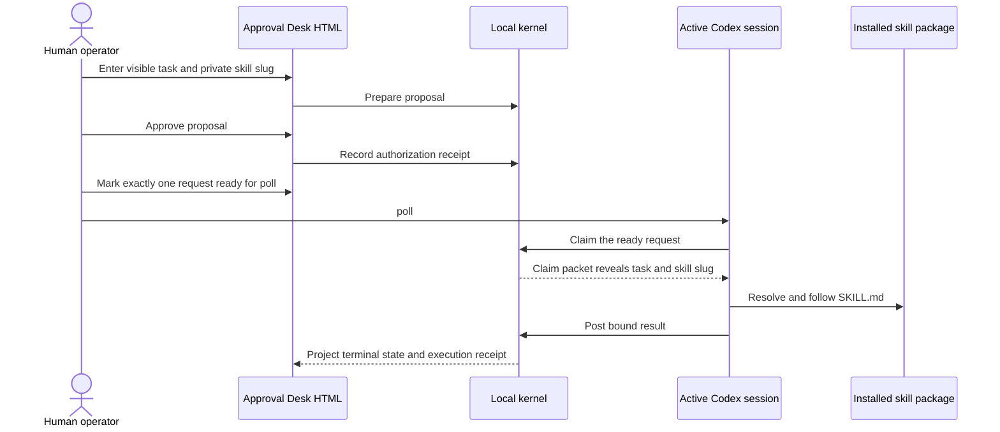

# Architecture Bundle: Manual Codex Session Bridge

## Design Intent

Add the smallest truthful bridge between the local Approval Desk and the
currently active Codex session. The operator remains the transport trigger:
after approving a proposal, the operator marks exactly one request ready in the
browser and says `poll` in chat; the session then claims that request, learns
the skill slug, runs within the approved read/preview boundary, and posts a
bound result back to the local kernel.

This design does not add a daemon, spawn Codex, authenticate the session, or
claim technical sandbox enforcement. It turns the manual experiment into an
auditable protocol while keeping those stronger guarantees explicit and
deferred.

## Inputs

| Source | Contract used |
| --- | --- |
| `projects/ide-extension/SPEC.md` | L0 envelope, approval, receipt, and no-autonomous-execution boundaries. |
| `projects/ide-extension/ARCHITECTURE.md` | Kernel authority, agent envelope strategy, evidence ownership, and layer order. |
| `projects/ide-extension/schemas/agent-envelope.schema.json` | Current task, skill slug, grants, approval, state, and receipt bindings. |
| `projects/ide-extension/schemas/receipt.schema.json` | Current receipt shape and its approval-stage limitation. |
| `projects/ide-extension/src/envelopes/dry-run-envelope.mjs` | Current approval transition directly to `passed`. |
| `projects/ide-extension/src/server.mjs` | Current prepare, state, proposal detail, run, approve, reject, and evidence APIs. |
| `projects/ide-extension/public/demo/l0.html` | Existing task/skill preparation surface and manual-poll status copy. |
| `projects/ide-extension/tests/l0-workbench-ui.test.mjs` | Current UI/API lifecycle and receipt evidence assertions. |
| `projects/ide-extension/tests/l0-runtime-schema-enforcement.test.mjs` | Runtime rejection of malformed skill slugs and invalid payloads. |
| [EXPERIMENT-EVIDENCE.md](EXPERIMENT-EVIDENCE.md) | Blind-poll feasibility evidence and missing proof boundaries. |
| [DECISIONS.md](DECISIONS.md) | Passed decision gate for effects, receipts, recovery, session assurance, and multiple-request targeting. |
| Operator decision, 2026-07-12 | Manual current-session polling is the first bridge; persistent worker is deferred. |

## Constraints

- The operator must explicitly say `poll`; browser approval alone never starts
  an agent invocation.
- The server validates a skill slug but never resolves or loads a skill.
- The active session must not learn the selected skill before it claims the
  approved request after the operator poll.
- Approval authorizes execution and mints a distinct authorization receipt; it
  does not itself prove execution.
- The first bridge supports only read/preview effects. A skill that needs file
  writes, shell mutation, network, publication, or other effects returns a
  blocked result.
- The local kernel owns durable events, claims, result bindings, and receipts.
- The Codex session owns skill resolution and skill-contract execution.
- The session identity is `unattested` in this slice. Loopback locality is not
  authentication.
- Exactly one approved request may be marked `ready_for_poll`; marking another
  fails closed until the current target is explicitly unmarked or resolved.
- A lost claim becomes visibly interrupted. Only the operator may release and
  requeue it in L0; automatic lease expiry and reclaim belong to L1.
- Full prompts, model transcripts, secrets, and provider credentials are not
  copied into the event ledger.

## 1. Context View



The human message is the bridge trigger. There is no server push and no
background polling process.

## 2. High-Level Structure View

| Component | Role | Authority |
| --- | --- | --- |
| Approval Desk prepare form | Captures required task, private skill slug, and declared effect profile. | Proposal only. |
| Approval queue/detail | Shows the exact task, grants, skill request, authorization receipt, and ready-target control. | Human authorization and poll-target surface. |
| Bridge request projection | Exposes at most one ready request without exposing its skill before claim. | Read model only. |
| Claim endpoint | Atomically binds one approved envelope to one unattested session claim and returns the execution packet. | Kernel claim authority. |
| Active Codex session | Calls claim only after the operator says `poll`, resolves the skill locally, and follows its contract. | Execution behavior; no approval authority. |
| Installed skill package | Supplies the selected `SKILL.md` contract. | Capability contract; no kernel receipt authority. |
| Result endpoint | Validates claim/envelope/approval/skill bindings and terminal result shape. | Kernel result-admission authority. |
| Projector/event log | Rebuilds request, claim, result, and receipt state. | Durable local state authority. |
| Evidence artifacts | Hold bounded execution summary, validation, and skill hash. | Evidence only; no promotion authority. |

## 3. Low-Level Components View

| Component | Proposed responsibility | Must reject or avoid |
| --- | --- | --- |
| `schemas/prepare-request.schema.json` | Require a non-empty task when `requested_skill` is present; preserve safe slug syntax. | Blank/default task and path-like skill values. |
| `schemas/agent-envelope.schema.json` | Add `approved`, `ready_for_poll`, `claimed`, `interrupted`, and explicit terminal semantics; bind claim/result refs. | Treating approval as execution `passed`. |
| Future `schemas/bridge-claim.schema.json` | Validate `claim_id`, `session_ref`, `assurance`, request bindings, and claim timestamp. | Caller-selected approval or envelope substitution. |
| Future `schemas/bridge-result.schema.json` | Validate claim-bound status, skill slug/hash, summary, validation, and evidence refs. | Raw transcripts, unknown status, mismatched skill, or unbound result. |
| Future `schemas/bridge-target.schema.json` | Validate operator ready/unready action against one approved envelope. | More than one ready target or caller-selected skill data. |
| Future `schemas/bridge-release.schema.json` | Validate operator release/requeue reason and active claim binding. | Session self-release or silent retry. |
| `src/kernel/projector.mjs` | Enforce `awaiting_approval -> approved -> ready_for_poll -> claimed -> terminal`, plus explicit `claimed -> interrupted -> approved` recovery. | Duplicate targets, claims, results, release, or state skipping. |
| `src/kernel/storage.mjs` | Commit claim and result events atomically through the existing append/reconcile path. | Side files that bypass the event ledger. |
| `src/server.mjs` | Add ready/unready, claim, result, interrupt, and operator release/requeue endpoints; keep loopback default. | Skill path lookup, skill execution, session self-release, or execution receipt before result. |
| `public/demo/l0.html` | Show a visible required task, skill slug, truthful receipt copy, one ready-target control, claim state, and operator recovery. | Hidden labels, generic default task, `Approve no-op`, or ambiguous poll target. |
| Session polling protocol | Tell Codex how to list, claim, resolve, execute, and return one request after explicit operator poll. | Background loop, pre-poll inspection, or silent retries. |
| Test claimant fixture | Simulate claim/result API behavior deterministically. | Claiming that fixture execution proves real Codex invocation. |

### Proposed Records

```json
{
  "claim_id": "claim-...",
  "envelope_id": "env-...",
  "run_id": "run-...",
  "approval_id": "approval-...",
  "agent_ref": "codex.current-session",
  "session_ref": "session-local-...",
  "assurance": "unattested",
  "state": "claimed",
  "claimed_at": "ISO-8601"
}
```

The claim response adds the late-disclosure execution packet:

```json
{
  "claim": { "claim_id": "claim-...", "state": "claimed" },
  "execution": {
    "task": "Review the bridge architecture for unresolved decisions",
    "requested_skill": "decision-gate",
    "requested_grants": ["skill.invoke", "preview.read"],
    "context_refs": ["projects/ide-extension/..." ]
  }
}
```

The pre-claim list returns envelope/request handles and approval time, but omits
`requested_skill`. The operator-triggered claim response is the first bridge API
response that reveals it to the session.

## 4. Workflow Process View

### Prepare

1. The operator enters a visible, empty-by-default Proposal task.
2. The operator enters a private safe skill slug.
3. The form sends `agent_ref: codex.current-session`, task, skill slug,
   `skill.invoke`, `preview.read`, and bounded context refs.
4. The kernel validates and appends `envelope.prepared`.
5. The envelope enters `awaiting_approval`.

### Approve Without Executing

1. The human reviews task, skill, grants, and context refs.
2. Approval appends `approval.granted`, mints an `authorization.receipt`, and
   changes the envelope to `approved`.
3. The authorization remains bound to the envelope through read-only claim
   attempts and is consumed by an admitted terminal result.
4. No `skill.execution` receipt is minted and the envelope is not marked
   execution `passed`.
5. The UI says `Approved - select as poll target`.

### Select Poll Target

1. The operator selects one approved proposal and chooses `Ready for poll`.
2. The kernel rejects the action if another proposal is already ready.
3. The kernel appends `bridge.target_selected` and changes the envelope to
   `ready_for_poll`.
4. The operator may explicitly unmark it before claim, returning it to
   `approved`.

### Explicit Poll And Atomic Claim

1. The operator says `poll` in the intended Codex session.
2. The session requests the single `ready_for_poll` target for
   `codex.current-session`; this pre-claim response does not reveal the skill.
3. The session atomically claims that target. Zero or multiple ready targets
   return a conflict and no execution packet.
4. The kernel appends `bridge.claimed` and returns task, skill slug, grants, and
   context refs. The authorization is not consumed until a terminal result is
   admitted.
5. A concurrent or repeated claim receives `409 already_claimed` and no packet.

### Resolve And Run

1. The session validates the revealed slug against installed skill roots.
2. The session reads only the selected `SKILL.md` and approved context refs.
3. Missing skills, ambiguous duplicate installations, or path escapes produce
   a bound `blocked` result.
4. The session follows the skill contract within `preview.read`.
5. Any required effect outside the grant set produces `blocked`; the session
   does not silently widen authority.

### Return Result

1. The session posts claim id, terminal status, selected skill slug, resolved
   skill path handle/hash, bounded summary, validation checks, and evidence refs.
2. The kernel verifies claim, envelope, run, approval, skill, and state bindings.
3. The kernel appends `bridge.result_recorded`, writes bounded result artifacts,
   consumes the authorization, and mints one `skill.execution` receipt.
4. The workbench shows the terminal result and distinguishes authorization
   evidence from execution evidence.

### Failure And Interruption

- Invalid task or slug: prepare rejects with no event.
- Poll before approval: no claimable request and no disclosure.
- Duplicate poll after claim: `already_claimed`; no second execution packet.
- Unknown skill: terminal `blocked` result with no fabricated skill output.
- Skill requests write/network effects: terminal `blocked` in L0.
- Session disappears after claim: the attempt becomes visibly `interrupted`;
  only the operator may release it and requeue the envelope to `approved` under
  the same read-only authorization. Every attempt/release stays in the ledger.
- Result binding mismatch: reject result and preserve the active claim for
  operator inspection.

## 5. Decision Flow View

| ID | Decision | Choice | Consequence |
| --- | --- | --- | --- |
| MSB-D001 | First bridge mode | Manual current-session poll. | No daemon, process spawning, or automatic dispatch in L0. |
| MSB-D002 | Skill disclosure point | Reveal only in successful claim response after operator poll. | Pre-claim queue omits skill; server never resolves it. |
| MSB-D003 | Approval evidence | Separate `authorization.receipt` and `skill.execution` receipts. | Approval is durable but cannot substitute for execution evidence. |
| MSB-D004 | Claim behavior | Atomic exclusive claim attempt. | Duplicate/replayed poll cannot execute concurrently; only operator release permits another attempt. |
| MSB-D005 | Initial effect boundary | `skill.invoke` plus `preview.read` only. | Useful read/review skills work; mutation-needing skills block honestly. |
| MSB-D006 | Session identity | Caller-generated local session ref with `unattested` assurance. | Evidence is useful locally but not an authentication claim. |
| MSB-D007 | Skill lookup owner | Active Codex session. | Kernel stores a slug and binding only; installed runtime owns resolution. |
| MSB-D008 | Completion evidence | Kernel-admitted execution result and `skill.execution` receipt. | Chat output alone is not terminal workbench evidence. |
| MSB-D009 | Proposal task UX | Visible label, empty default, required value. | The accidental generic dry-run task cannot recur. |
| MSB-D010 | Recovery | Explicit operator release and requeue. | No timer or silent retry; read-only authorization may survive recorded attempts. |
| MSB-D011 | Transcript custody | Bounded summary and artifact refs only. | Prompts, secrets, and full model transcripts stay outside the event log. |
| MSB-D012 | Multiple requests | Operator marks exactly one proposal `ready_for_poll` in the desk. | Poll never chooses oldest or asks the session to infer a target. |

## 6. Dependency Interface View

### Existing Interfaces Reused

| Method | Path | Bridge use |
| --- | --- | --- |
| `POST` | `/api/envelopes/prepare` | Prepare a valid task/skill request. |
| `POST` | `/api/approvals/:id/approve` | Grant authorization and mint its receipt without claiming execution completion. |
| `POST` | `/api/approvals/:id/reject` | Stop the request before disclosure or execution. |
| `GET` | `/api/proposals/:envelope_id` | Show human-readable task, grants, state, and evidence. |
| `GET` | `/api/state` | Workbench projection only; not the long-term agent claim API. |

### Proposed Bridge Interfaces

| Method | Path | Request | Response/contract |
| --- | --- | --- | --- |
| `POST` | `/api/bridge/requests/:envelope_id/ready` | Local operator action. | Mark the only ready poll target; reject when one already exists. |
| `POST` | `/api/bridge/requests/:envelope_id/unready` | Local operator action. | Return an unclaimed target to `approved`. |
| `GET` | `/api/bridge/requests/ready?agent_ref=codex.current-session` | No body. | Zero or one opaque ready handle; omits `requested_skill`. |
| `POST` | `/api/bridge/requests/:envelope_id/claim` | `session_ref`, `assurance: unattested`. | Atomic claim plus late-disclosure execution packet. |
| `POST` | `/api/bridge/claims/:claim_id/result` | Terminal status, skill binding/hash, summary, validation, evidence refs. | Bound terminal state and execution receipt handles. |
| `GET` | `/api/bridge/claims/:claim_id` | No body. | Claim/result status for operator/session reconciliation; no secret transcript. |
| `POST` | `/api/bridge/claims/:claim_id/interrupt` | Claimant reports interruption. | Mark attempt interrupted without requeueing. |
| `POST` | `/api/bridge/claims/:claim_id/release` | Local operator action and reason. | Release interrupted attempt and return envelope to `approved`. |

### Event Contracts

| Event | Required bindings | Projection effect |
| --- | --- | --- |
| `approval.granted` | envelope, run, approval, grants, actor, authorization receipt, timestamp. | `awaiting_approval -> approved`; append authorization receipt only. |
| `bridge.target_selected` | envelope, approval, operator actor, timestamp. | `approved -> ready_for_poll`; enforce singleton target. |
| `bridge.claimed` | claim, envelope, run, approval, session ref, timestamp. | `ready_for_poll -> claimed`; authorization remains active. |
| `bridge.interrupted` | claim, envelope, session ref, reason, timestamp. | `claimed -> interrupted`; no automatic retry. |
| `bridge.claim_released` | interrupted claim, envelope, operator actor/reason, timestamp. | `interrupted -> approved`; preserve attempt history. |
| `bridge.result_recorded` | claim, envelope, run, approval, skill slug/hash, status, evidence refs. | `claimed -> terminal`; consume authorization and append execution receipt. |

### Authorization Receipt Contract

The `authorization.receipt` binds the envelope, run, approval, requested skill,
requested grants, human actor, approval timestamp, and authorization status. It
must not carry a skill execution status, result summary, or resolved skill hash.

### Execution Receipt Contract

The first `skill.execution` receipt should bind:

- receipt, run, envelope, approval, and claim ids;
- requested skill slug and resolved skill SHA-256;
- requested grants and enforced bridge profile (`preview.read`);
- terminal status: `passed`, `flagged`, `blocked`, or `failed`;
- bounded output summary and validation evidence refs;
- claim and result timestamps;
- `agent_ref`, `session_ref`, and `assurance: unattested`;
- before/after/result artifact refs.

It must not claim authenticated identity, technical sandbox enforcement, or
effects that are not evidenced by the current-session result.

## Safety And Trust Model

The bridge is a governance protocol around a trusted local operator and an
unattested active Codex session. Atomic kernel state prevents duplicate claims
and forged binding transitions inside the local event model. It does not stop a
different local process from calling the loopback API, and it cannot remove
tools from the already-running Codex session.

Therefore L0 only admits read/preview skill runs. Mutation-capable bridge
execution requires a later executor boundary with enforceable cwd, write scope,
tool policy, and credentials policy; human approval alone must not be described
as that enforcement.

## Risks And Gaps

| ID | Risk/gap | Effect | Owner/route |
| --- | --- | --- | --- |
| MSB-G001 | Current spec says L0 execution is no-op only. | Plan must not silently reinterpret L0. | ide-extension owner approves a spec delta before implementation. |
| MSB-G002 | Current approval path terminalizes the envelope and mints a passed receipt. | Authorization and execution are conflated. | `invoke plan` must make event/schema migration the first implementation slice. |
| MSB-G003 | Current session identity is unattested. | Any local process may impersonate the claimant. | Keep local/read-only; route stronger identity to later architecture. |
| MSB-G004 | Manual release can repeat a read-only attempt. | The same task may be observed more than once. | Record every attempt; prohibit this policy for mutation-capable layers. |
| MSB-G005 | No technical tool/effect sandbox. | Write/network approval would overclaim enforcement. | L2 executor adapter; block those effects before then. |
| MSB-G006 | Skill packages can change after proposal. | Same slug may resolve to different content. | Bind resolved skill path handle and SHA-256 in execution receipt. |
| MSB-G007 | Ready-target state adds operator coordination. | A stale ready target can block another. | Require explicit unready/release and show the singleton target clearly. |

## Distill Design-Unit Check

Smallest coherent unit:

> One human-approved, read/preview-only skill request moves from visible required
> task entry to explicit desk target selection, operator poll, one atomic claim,
> late skill disclosure, local skill resolution, and one kernel-bound terminal
> result, with operator-only release/requeue on interruption.

Recomposition proof:

- It extends the existing envelope/approval/event/receipt kernel rather than
  adding a second state authority.
- It preserves the HTML workbench as the operator surface.
- It preserves the server as receipt owner and the skill runtime as execution
  owner.
- It creates the missing result loop needed by later browser, IDE, MCP/chat,
  OpenRouter, OpenClaw, or Hermes adapters without implementing them now.

Split pressure explicitly deferred:

- mutation-capable effects and enforceable sandboxing;
- timed lease, automatic retry, and automatic crash recovery;
- persistent worker or server push;
- authenticated or remote sessions;
- VSCodium wrapper and browser control;
- provider routing and external agent runtimes.

Verdict: `pass`. The unit is independently demonstrable, recomposes into the
existing kernel architecture, and has no unresolved design blocker after the
passed decision gate in `DECISIONS.md`.

## Plan-Ready Handoff Notes

The next `invoke plan` should preserve these implementation slices without
executing them during plan authoring:

1. Authorization/ready/claim/recovery/result typestate and schema delta.
2. Separate authorization and execution receipt contracts.
3. Atomic target, claim, release/requeue, and result admission.
4. Visible required Proposal task and truthful ready/recovery/result language.
5. Deterministic claimant tests for singleton target, claim/replay, operator
   recovery, and result bindings.
6. One real manual Codex poll witness whose execution receipt is returned to the
   desk and whose output is bounded to read/preview.

The plan must route source mutation through `task-session`, one SWU at a time.
