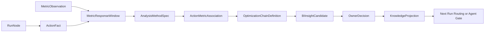

# Optimization Chain Method

General method for converting an ontology+DAG engagement into client-facing
business intelligence. This method was generalized from the GoldenQuill
grant-work optimization-chain work and belongs to `projects/ontologize`, not to
GoldenQuill.

## Purpose

An optimization chain explains how operational work becomes reusable BI:

```text
When [run node or action] happens,
measure [evidence-linked KPI] over [response window]
using [analysis method]
to produce [named BI optimization],
with [claim label, guardrail, and reuse boundary].
```

The chain is both a sentence and a contract. It lets CyberAlchemy explain the
competitive advantage in plain language while preserving the governance rule
that evidence, metrics, and candidates do not approve themselves.

## Position In The Ontologize Method



The optimization chain sits after measurement and before governed reuse. It
turns analysis into decision language without granting authority.

## Competitive Advantage Statement

CyberAlchemy's advantage is not "better dashboards." The advantage is a
governed optimization loop:

1. client work is captured as source-backed run nodes;
2. each meaningful action can become an analysis-ready fact;
3. each KPI carries source evidence, denominator semantics, and interpretation
   limits;
4. analysis methods emit bounded claims instead of false certainty;
5. BI optimizations are expressed as reusable sentence contracts;
6. owner decisions decide which insights may guide future runs or agents.

In client language: CyberAlchemy learns which operational actions actually move
the metric, proves the path from source evidence to recommendation, and feeds
approved intelligence back into future workflows.

## General Contract

| Field | Meaning |
| --- | --- |
| `chain_id` | Stable id, scoped to the client or vertical. |
| `chain_name` | Human-readable BI optimization name. |
| `vertical` | Client domain, such as logistics, manufacturing, grant intelligence, healthcare ops, or sales ops. |
| `status` | Candidate, validated, approved, rejected, retired, contradicted, or residue. |
| `run_node_refs` | Execution DAG node kinds or concrete run-node refs. |
| `action_fact_refs` | Analysis-ready action facts or action-query refs. |
| `metric_refs` | Evidence-linked KPIs or metric observations. |
| `response_window_refs` | Windows that join prior action to later metric movement. |
| `analysis_method_ref` | Registered method, such as descriptive cohort, funnel transition, time-to-event, regression, uplift, or anomaly analysis. |
| `association_refs` | Evidence outputs linking action pattern to metric movement. |
| `desired_bi_optimization` | Named optimization produced for BI. |
| `claim_label` | Maximum allowed claim; never stronger than the method output. |
| `confidence_class` | Plain uncertainty class. |
| `expression_set` | Multiple sentence forms for explanation and validation. |
| `governance_route` | Candidate, privacy, owner-decision, and knowledge-projection route. |
| `reuse_target` | Future run, dashboard, agent gate, routing rule, or ontology card the insight may improve if approved. |
| `interpretation_limits` | What the chain does not prove. |
| `privacy_scope` | Client/local/workspace/generalization boundary. |

## Required Sentence Forms

Every optimization chain must express the same idea in these forms.

| Form | Template | Use |
| --- | --- | --- |
| `plain_language` | `When we do [action], we watch [metric] with [method] so we can improve [BI optimization].` | Buyer and operator explanation. |
| `operator` | `For [run node], compare [metric] across [response window] using [method]; emit [optimization] only as [claim label].` | Implementation and delivery. |
| `executive` | `Our advantage is learning which actions reliably improve [metric] while preserving evidence, privacy, and owner approval.` | Competitive-advantage story. |
| `contract` | `OptimizationChainDefinition(chain_id, run_node_refs, metric_refs, analysis_method_ref, desired_bi_optimization, claim_label, governance_route).` | Schema and validators. |
| `causal_careful` | `This chain says [method-specific claim], not proof of causation unless causal gates pass.` | Prevents overclaiming. |
| `dashboard_label` | `[BI optimization]: [metric] movement after [action], [claim label].` | BI surface label. |
| `ontology` | `[action pattern] -> measured_by -> [metric window] -> evaluated_with -> [method] -> proposes -> [BI optimization].` | Ontology graph projection. |

## Method Families

| Method Family | Use | Maximum Default Claim |
| --- | --- | --- |
| `descriptive_cohort` | Compare observed cohorts and summaries. | `descriptive_pattern` |
| `funnel_transition` | Measure stage-to-stage conversion. | `correlation_candidate` |
| `sequence_mining` | Find repeated action sequences before metric movement. | `descriptive_pattern` |
| `time_to_event` | Measure delay or acceleration to an event. | `correlation_candidate` |
| `regression_glm` | Estimate association with covariates. | `controlled_association` |
| `hierarchical_model` | Compare repeated groups, clients, lanes, SKUs, teams, or sites. | `controlled_association` |
| `difference_in_differences` | Compare treated and untreated before/after movement. | `quasi_causal_candidate` |
| `propensity_matching` | Compare matched treated/untreated examples. | `quasi_causal_candidate` |
| `uplift_model` | Estimate which future cases benefit from an action. | `decision_support_only` |
| `anomaly_residual` | Find outliers or unexplained residues. | `blocked_or_residue` or `decision_support_only` |

## Vertical Examples

| Chain ID | Vertical | Run Nodes | Metric | Method | Desired BI Optimization | Plain Sentence |
| --- | --- | --- | --- | --- | --- | --- |
| `optchain.logistics.exception-resolution` | logistics | `delivery_exception`, `exception_response` | `exception_resolution_time`, `on_time_delivery_rate` | `time_to_event` | Exception Resolution Acceleration | When delivery exceptions occur, measure response time and on-time recovery so the client learns which response patterns reduce delay. |
| `optchain.logistics.carrier-reliability` | logistics | `carrier_selected`, `shipment_delivered` | `on_time_delivery_rate`, `cost_per_lane` | `hierarchical_model` | Carrier Reliability Optimization | When carriers are selected for lanes, compare delivery reliability and cost by lane so routing decisions improve over time. |
| `optchain.factory.rework-reduction` | cap-factory | `defect_logged`, `rework_logged`, `lot_completed` | `defect_rate`, `rework_hours_per_lot` | `descriptive_cohort` | Rework Reduction Insight | When defects are logged, measure rework burden by lot so the factory learns which process patterns create preventable rework. |
| `optchain.factory.on-time-fulfillment` | cap-factory | `order_scheduled`, `order_shipped`, `order_accepted` | `on_time_fulfillment_rate` | `funnel_transition` | Fulfillment Reliability Optimization | When orders move through scheduling and shipping, measure on-time acceptance so the factory can improve scheduling gates. |
| `optchain.generic.agent-gate-quality` | cross-vertical | `agent_action`, `deterministic_gate_result`, `owner_review` | `gate_pass_rate`, `manual_rework_rate` | `funnel_transition` | Agent Gate Quality Insight | When an agent acts and a deterministic gate reviews it, measure pass rate and rework so agent routing improves without relaxing governance. |

## Contract Rules

| Rule ID | Rule | Failure |
| --- | --- | --- |
| OCM-001 | Every chain must name at least one run node or action pattern. | Reject chain. |
| OCM-002 | Every metric must be evidence-linked and define denominator semantics when rate/ratio based. | Reject chain. |
| OCM-003 | Every chain must define a response window from prior action to later metric movement. | Reject chain. |
| OCM-004 | Every analysis method must state its maximum claim label. | Reject chain. |
| OCM-005 | Chain claim label may not exceed the source association or method family. | Downgrade or reject chain. |
| OCM-006 | Causal wording requires quasi-causal evidence gates. | Downgrade expression. |
| OCM-007 | No chain may contain approved reuse unless an owner decision approved it. | Reject chain. |
| OCM-008 | Cross-client learning requires privacy scope, generalization status, and owner route. | Block reuse projection. |
| OCM-009 | All seven sentence forms are required for client-facing use. | Reject deliverable. |
| OCM-010 | Each chain must state how future evidence can contradict or retire it. | Reject candidate. |

## Client Deliverable Use

In a client-sendable package, use optimization chains as the BI-led spine:

1. name the operational action being measured;
2. show the evidence-linked metric and denominator;
3. state the analysis method and claim boundary;
4. name the BI optimization;
5. show the approved or candidate reuse target;
6. list interpretation limits and privacy scope.

This turns the engagement into a repeatable method: ontology defines what the
work means, the DAG proves what happened, metrics show what moved, and
optimization chains explain what can safely improve next.

## Schema And Examples

- JSON Schema: [schemas/optimization-chain-method.schema.json](schemas/optimization-chain-method.schema.json)
- Logistics example: [examples/optimization-chain.logistics-exception-resolution.json](examples/optimization-chain.logistics-exception-resolution.json)
