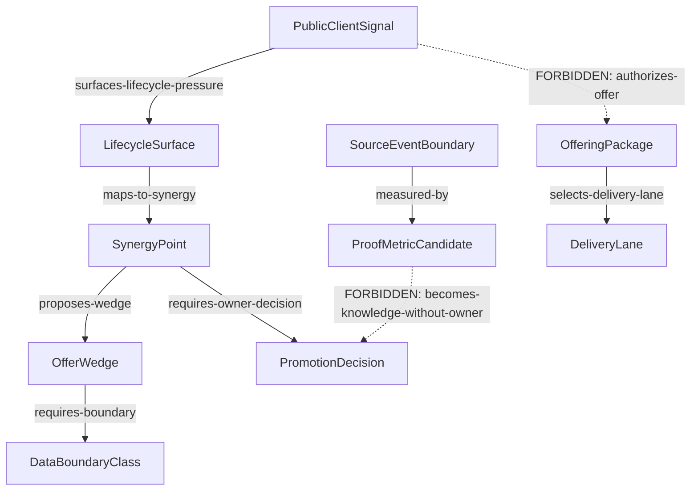

# Ontology-view - Hellbender client research

This is the typed node and edge layer for the Hellbender account research. It defines the concepts
used by [system-view.md](system-view.md) and [engineer-view.md](engineer-view.md), but it does not
decide the offer verdicts.

## Objective

This ontology makes the account research explicit as public evidence, candidate fit, offer wedges,
proof metrics, boundaries, owner decisions, and delivery lanes. Relationships that would falsely
turn public evidence into client authorization, raw data into safe input, or candidate lessons into
reusable knowledge are recorded as forbidden and guarded.

Confidence note: the confidence-bearing material is kept in the fanout receipts, not as document
frontmatter here. The typed nodes below are project-local concepts and artifacts, not promoted
belief nodes.

## Governance posture

| Field | Value |
| --- | --- |
| Resolved constitution path | `implementation/domainspec/vault/ontology-conventions.md` |
| Version | `2.3.0` |
| Commit / dirty-state | working tree may be dirty; path verified on disk during this draft |
| Edge catalog reference | `implementation/domainspec/.claude/skills/custom/edge-catalog.md` |

Catalog-conformance check:

- Counting predicate used: counted live forward-edge rows under Appendix C `Epistemic edges`,
  `Provenance edges`, and `Reference edges`, excluding deprecated rows.
- Counted live-forward-edge total: 25.
- Appendix-C header value: 22.
- Prose value: 21.
- Mismatch flag: surfaced, not reconciled.

Coined-vs-canonical edge accounting:

| Accounting | Value |
| --- | --- |
| Canonical edges reused verbatim | 3 |
| Coined project-local edges | 7 |
| Version-skew edges | 0 |
| Total edge types used here | 10 |

Local label axis:

- Project-local kind axis: `hellbender_account_kind`.
- Scope axis: `account_scope`, used only to distinguish internal account research, future
  client-facing collateral, and possible pilot execution.

Amendment status: every coined edge is `PROPOSED-UNFILED` and remains local to this account research.

## Node types

### Source and evidence nodes

| Node | Definition | Type payload | Instances | Precedent |
| --- | --- | --- | --- | --- |
| `AccountResearchCorpus` | The local source corpus for this account section. | `node_type: discovery`; `hellbender_account_kind: source-corpus`; branch: mixed; `account_scope: internal`. | [RESEARCH-STRATEGY.md](RESEARCH-STRATEGY.md), [SUMMARY.md](SUMMARY.md), [sessions/hellbender-research-receipts.md](sessions/hellbender-research-receipts.md). | `SUMMARY.md` status line says internal candidate and public-source-only. |
| `PublicClientSignal` | A public signal about Hellbender's process, manufacturing, CVaaS, case studies, or funding posture. | `node_type: research`; `hellbender_account_kind: external-evidence`; branch: business. | Public URLs recorded in [hellbender-research.dispatch.json](hellbender-research.dispatch.json). | `RESEARCH-STRATEGY.md` source frame. |
| `FanoutReceipt` | A read-only lane result used as source evidence for synthesis. | `node_type: research`; `hellbender_account_kind: lane-receipt`; branch: mixed. | Four lane sections in [sessions/hellbender-research-receipts.md](sessions/hellbender-research-receipts.md). | receipt status records four completed lanes. |

### Account-shape nodes

| Node | Definition | Type payload | Instances | Precedent |
| --- | --- | --- | --- | --- |
| `LifecycleSurface` | A part of the Hellbender operating lifecycle that may create knowledge loss or metric ambiguity. | `node_type: conceptual`; `hellbender_account_kind: client-surface`; branch: business. | Architecture, prototype, productization, manufacturing, field, CVaaS surfaces in the strategy and summary. | `RESEARCH-STRATEGY.md` source frame and candidate synergy surface. |
| `SynergyPoint` | A candidate mapping between a Hellbender surface and a CyberAlchemy/Ontologize move. | `node_type: discovery`; `hellbender_account_kind: fit-candidate`; branch: bridge. | Ten synergy rows in [SUMMARY.md](SUMMARY.md). | `SUMMARY.md` all-synergy table. |
| `OfferWedge` | A buyer-facing entry path for a possible first offer. | `node_type: discovery`; `hellbender_account_kind: offer-wedge`; branch: business. | Production Truth Layer, DFM/DVT Learning Loop, Evolve Feedback Register, CVaaS Data Boundary and Trust Layer, Custom-to-Platform Knowledge Transfer. | `SUMMARY.md` offer wedges. |
| `ProofMetricCandidate` | A candidate priority number that could be rebuilt from source events and used as the pilot proof surface. | `node_type: discovery`; `hellbender_account_kind: proof-metric`; branch: bridge. | DVT pass rate, DFM closure time, calibration yield, EOL escape rate, field incident latency, retrain/deploy latency, uptime/downtime attribution. | `SUMMARY.md` candidate proof metrics. |
| `SourceEventBoundary` | The run, lot, device, fleet, deployment, or retrain window that gives a metric its denominator. | `node_type: conceptual`; `hellbender_account_kind: event-boundary`; branch: bridge. | Discovery questions about real-world event, denominator, and source systems. | `SUMMARY.md` discovery questions. |
| `DataBoundaryClass` | A classification for what data may be used, shared, reused, or blocked. | `node_type: conceptual`; `hellbender_account_kind: boundary-class`; branch: system. | restricted, private-client, internal, shareable-redacted, public as candidate classes. | Fit lane and risk lane receipts. |
| `PromotionDecision` | A human owner decision that determines whether a lesson is reusable, rejected, private residue, or retired. | `node_type: conceptual`; `hellbender_account_kind: reuse-decision`; branch: bridge. | Owner-decision questions and pitch shape. | `SUMMARY.md` discovery questions and wedge rationale. |
| `DeliveryLane` | The delivery posture for where data, dashboards, governance receipts, and promotion logic live. | `node_type: conceptual`; `hellbender_account_kind: delivery-posture`; branch: system. | Lane A, Lane B, Hybrid; Hybrid is the candidate default. | [DELIVERY-LANES.md](../../DELIVERY-LANES.md) selection rule. |
| `HardStop` | A condition that blocks offer work or pilot execution. | `node_type: discovery`; `hellbender_account_kind: guardrail`; branch: mixed. | no sponsor, no approved data class, no run boundary, no priority metric, unsafe data request, compliance/autonomy overclaim. | `RESEARCH-STRATEGY.md` hard stops and `SUMMARY.md` risks. |
| `OfferingPackage` | The next artifact bundle to create after this account research. | `node_type: implementation-plan`; `hellbender_account_kind: next-package`; branch: mixed. | one-page offer, discovery script, questionnaire, metadata request, boundary template, acceptance criteria, risk appendix. | `SUMMARY.md` offering work to start next. |

Reflexive-guard inputs:

- `PromotionDecision` can approve one reusable lesson, but it must not approve its own evidence.
- `SynergyPoint` can derive from public signals, but a public signal must not become authorization for
  itself.

## Edge types

### Canonical reference and derivation edges

| Edge | From -> To | Dir. | Card. | Rule | Skew | Precedent |
| --- | --- | --- | --- | --- | --- | --- |
| `derives-from` canonical | view artifact -> `AccountResearchCorpus` | directed | N:M | The view draws intellectual basis from the corpus. Inverse: `derives`. | - | `edge-catalog.md` universal edge. |
| `cites` canonical | view artifact -> public/local source | directed | N:M | The view cites evidence without implying authorization. Inverse: `cited-by`. | - | `edge-catalog.md` universal edge. |
| `refines` canonical | `engineer-view.md` -> `system-view.md` | directed | N:1 | Engineer-view refines shape down to decisions and mechanics. Inverse: `refined-by`. | - | `edge-catalog.md` document-specific edge. |

### Project-local account edges

| Edge | From -> To | Dir. | Card. | Rule | Skew | Precedent |
| --- | --- | --- | --- | --- | --- | --- |
| `surfaces-lifecycle-pressure` COINED | `PublicClientSignal` -> `LifecycleSurface` | directed | N:M | A public signal suggests, but does not prove, a lifecycle pressure. Inverse: `pressured-by-signal`. | - | project-local overlay. |
| `maps-to-synergy` COINED | `LifecycleSurface` -> `SynergyPoint` | directed | N:M | A surface can map to multiple candidate synergy points. Inverse: `maps-from-surface`. | - | project-local overlay. |
| `proposes-wedge` COINED | `SynergyPoint` -> `OfferWedge` | directed | N:M | A synergy point may support a buyer-facing wedge. Inverse: `wedge-supported-by`. | - | project-local overlay. |
| `measured-by` COINED | `SourceEventBoundary` -> `ProofMetricCandidate` | directed | N:M | A metric candidate must name the event boundary that gives it denominator meaning. Inverse: `measures-boundary`. | - | project-local overlay. |
| `requires-boundary` COINED | `OfferWedge` -> `DataBoundaryClass` | directed | N:M | Any wedge touching client or customer data must declare data class before pilot use. Inverse: `boundary-required-by`. | - | project-local overlay. |
| `requires-owner-decision` COINED | `SynergyPoint` -> `PromotionDecision` | directed | N:M | Reusable lessons require a named owner decision before projection. Inverse: `decision-required-by`. | - | project-local overlay. |
| `selects-delivery-lane` COINED | `OfferingPackage` -> `DeliveryLane` | directed | 1:N | The package may recommend a lane but must preserve assessment override. Inverse: `lane-selected-by`. | - | project-local overlay. |

## The schema graph

Curated subset only. This diagram omits many proof metric candidates and individual public signals;
the node and edge tables above carry the full local vocabulary.

## Forbidden edges and guards

1. **Public signal to client authorization.** A `PublicClientSignal` must not construct an
   `authorizes-offer` edge to `OfferingPackage`. Guard: every client-facing derivative requires owner
   review and, later, client discovery.
2. **Raw sensitive data to pilot input before boundary.** A raw image, model artifact, design file,
   CUI/FCI artifact, or customer IP signal must not enter pilot work before a `DataBoundaryClass`
   and owner route exist. Guard: metadata-first and fail-closed boundary register.
3. **Metric to reusable knowledge without owner.** A `ProofMetricCandidate` or observed movement must
   not become reusable knowledge unless a `PromotionDecision` exists. Guard: owner-reviewed
   promotion graph.
4. **Cross-client lesson to reusable account knowledge.** A customer-specific lesson must not become
   cross-product or cross-client knowledge without explicit reuse rights and owner approval. Guard:
   tenant/customer boundary plus promotion decision.
5. **Offer summary to client-facing proposal.** `SUMMARY.md` must not become external collateral by
   rename or copy alone. Guard: future invoke route and owner review.

## Open questions

- **OQ-1** - Which event boundary is the first proof surface? Recommendation: decide in discovery
  call before writing client-facing collateral. Owner: account owner.
- **OQ-2** - Which data classes can be used in a metadata-first sample? Recommendation: require a
  data boundary register before any sample request. Owner: security/data owner.
- **OQ-3** - Which owner can approve reusable lessons? Recommendation: name quality/manufacturing,
  product, or sustaining engineering owner before pilot acceptance criteria. Owner: client sponsor.
- **OQ-4** - Are coined account edges worth promoting into a reusable CyberAlchemy account-research
  pattern? Recommendation: keep local until a second client account reuses them. Owner:
  Ontologize owner.

## Residue ledger

| # | Claim | Status | Surviving residue | Citation |
| --- | --- | --- | --- | --- |
| R1 | Hellbender is a strong strategic fit. | open | Strategic fit is public-source-only and still needs client validation. | [SUMMARY.md](SUMMARY.md) |
| R2 | EOL QA/calibration to field performance is the best first wedge. | open | First metric and owner are not yet known. | [sessions/hellbender-research-receipts.md](sessions/hellbender-research-receipts.md) |
| R3 | Hybrid is the likely delivery lane. | open | Assessment may choose Lane A or Lane B after data residency and adoption facts are known. | [DELIVERY-LANES.md](../../DELIVERY-LANES.md) |
| R4 | Client-facing collateral is next. | open | Requires owner-reviewed invoke route. | [RESEARCH-STRATEGY.md](RESEARCH-STRATEGY.md) |

## Cross-reference map

| Ontology node or edge | Relationship | Owner | What is owned there |
| --- | --- | --- | --- |
| `SynergyPoint`, `OfferWedge`, `ProofMetricCandidate` | shape-used-by | [system-view.md](system-view.md) | Stakeholder shape and stance naming. |
| `offer-status`, `first-wedge`, `proof-metric`, `boundary-first`, `delivery-lane`, `owner-reuse` | decided-by | [engineer-view.md](engineer-view.md) | Verdict rows and mechanics. |
| `derives-from`, `cites`, `refines` | governed-by | `implementation/domainspec/.claude/skills/custom/edge-catalog.md` | Canonical edge legality. |

## Connections

| Document | Type | Description |
| --- | --- | --- |
| [SUMMARY.md](SUMMARY.md) | derives-from | Source corpus for account concepts. |
| [RESEARCH-STRATEGY.md](RESEARCH-STRATEGY.md) | derives-from | Source for research route, hard stops, and next route. |
| [sessions/hellbender-research-receipts.md](sessions/hellbender-research-receipts.md) | derives-from | Source for fanout confidence, risks, and fit mapping. |
| [system-view.md](system-view.md) | cited-by | System-view uses the terms typed here. |
| [engineer-view.md](engineer-view.md) | cited-by | Engineer-view uses the terms typed here and decides the stances. |
