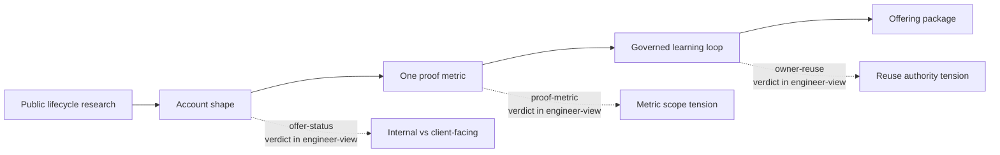

# System-view - Hellbender client research

This is the stakeholder-altitude shape view for the Hellbender account research. It names the
load-bearing stances in the offer shape, decides none of them, and points each stance to one
owning row in [engineer-view.md](engineer-view.md). Term meaning lives in
[ontology-view.md](ontology-view.md).

## Objective

The Hellbender account shape is a candidate path from public-source lifecycle research to a narrow
physical AI lifecycle intelligence pilot. This view explains the shape one layer at a time, names
the tensions that matter for an offering, and leaves verdicts to the engineer-view.

### Executive gloss

- Hellbender already presents a lifecycle-heavy operating surface; the shape question is how to read
  that surface as an intelligence loop without treating public pages as client authorization
  (surface, `stance:offer-status`).
- The opportunity is not a generic AI transformation story; the live tension is which lifecycle
  break should become the first inspected slice (Layer 1, `stance:first-wedge`).
- The smallest convincing sale appears to be one defensible operational number, but the broad
  platform story remains tempting enough to require an explicit stance (Layer 2,
  `stance:proof-metric`).
- The learning loop only matters if a field or manufacturing observation can move through review
  before it becomes reusable knowledge (Layer 3, `stance:owner-reuse`).
- The data envelope is not a later implementation detail; customer IP, raw vision data, regulated
  context, and security review shape the offer from the first call (Layer 4,
  `stance:boundary-first`).
- Delivery has a real control tension: keep client data and dashboards where they are, or ask the
  client to adopt more of the Arcanum/Ontologize substrate (Layer 4, `stance:delivery-lane`).
- The biggest open decision is not the pitch wording; it is whether a sponsor can name one metric,
  one run boundary, one safe data class, and one owner for reuse decisions (closing map,
  `engineer-view.md` D2-D6).

## What this is

This is an internal candidate account-shape for turning Hellbender's public physical AI lifecycle
into a first CyberAlchemy/Ontologize offer. It treats the prior research strategy, fanout receipts,
and offering-start summary as source material, then rearranges them into a view triad.

The **offer-status** stance - internal account research versus a client-facing proposal, a real
tension because the source corpus is public and not authorized by Hellbender - is named here and
decided nowhere in this view (`stance:offer-status -> engineer-view#D1`).

### Alternative framings we considered

| Framing | Why set aside |
| --- | --- |
| Treat the research as a finished sales proposal | It collapses the distinction between public-source inference and client-validated need. |
| Treat the research as only a reading memo | It hides the offering tension the user asked the account research to surface. |

## 1. Lifecycle pressure - the account has many places to lose knowledge

Hellbender's public process describes a physical AI journey with engineering, productization,
manufacturing, service, and field feedback all touching the same product reality. That creates a
shape where useful knowledge can be lost at handoffs: design choices can lose their later outcome,
manufacturing quality can lose its field consequence, and service signals can lose their path back
to product decisions.

The **first-wedge** stance - EOL QA/calibration to field performance versus a broader lifecycle
assessment, a real tension because both would change the discovery call and pilot evidence - is
named here and decided nowhere in this view (`stance:first-wedge -> engineer-view#D2`).

### Alternative framings we considered

| Framing | Why set aside |
| --- | --- |
| Lead with the whole lifecycle | It makes the scope feel strategic before a concrete pain has been validated. |
| Lead only with manufacturing analytics | It risks dropping the field-to-factory loop that makes the account strategically interesting. |

## 2. Metric proof - the offer narrows to one inspectable number

The shape becomes sellable when it stops being "better knowledge management" and becomes one number
that a sponsor already uses but cannot fully defend. The number is only a doorway: it exposes source
events, denominator questions, confidence, interpretation limits, and the decision it is supposed to
improve.

The **proof-metric** stance - one defensible metric versus a multi-metric dashboard surface, a real
tension because each path implies different evidence and delivery mechanics - is named here and
decided nowhere in this view (`stance:proof-metric -> engineer-view#D3`).

### Alternative framings we considered

| Framing | Why set aside |
| --- | --- |
| Sell a new dashboard | It keeps the conversation at the display layer instead of the evidence and reuse layer. |
| Sell a broad KPI ontology | It asks the buyer to buy the map before proving one critical route through it. |

## 3. Governed reuse - the value is learning that does not jump the gate

The pilot shape is not complete when a metric becomes explainable. The business value appears when
an operational observation can become a candidate lesson, be reviewed by the right owner, and then
either become reusable knowledge, remain private residue, be rejected, or be retired.

The **owner-reuse** stance - owner-reviewed reuse versus automatic cross-product or cross-client
reuse, a real tension because reuse is the value and also the leakage risk - is named here and
decided nowhere in this view (`stance:owner-reuse -> engineer-view#D6`).

### Alternative framings we considered

| Framing | Why set aside |
| --- | --- |
| Treat every field lesson as reusable | It erases customer/IP boundaries and turns evidence into authority too early. |
| Treat every lesson as local only | It prevents the custom-to-platform learning that makes the account interesting. |

## 4. Boundary and delivery envelope - the pilot must fit their tools and risks

The account shape must respect that Hellbender works around proprietary hardware, customer systems,
secure manufacturing, raw vision/model artifacts, and likely regulated contexts. The delivery shape
therefore has two separate but coupled questions: what data is allowed into the pilot, and where the
governed knowledge layer should live.

The **boundary-first** stance - metadata-first fail-closed work versus raw operational or vision data
up front, a real tension because speed and safety pull in different directions - is named here and
decided nowhere in this view (`stance:boundary-first -> engineer-view#D4`).

The **delivery-lane** stance - Hybrid delivery versus pure existing-tools or pure Arcanum substrate,
a real tension because adoption, data residency, and governance strength pull differently - is named
here and decided nowhere in this view (`stance:delivery-lane -> engineer-view#D5`).

### Alternative framings we considered

| Framing | Why set aside |
| --- | --- |
| Make data access an implementation detail | It ignores the risks that decide whether the offer can be sold at all. |
| Make Arcanum adoption the first sale | It may overfit our substrate before proving a client-owned metric problem. |

## Given vs optimized - the layering that makes it an offer

- **Hellbender public source context - GIVEN.** The research starts from public pages, prior fanout
  receipts, and local Ontologize artifacts; it does not manufacture a private client mandate.
- **Security and IP caution - GIVEN.** The offer shape must obey data boundaries and owner review
  rather than tune them away.
- **One proof metric - OPTIMIZED TOWARD.** The offering work should find the narrowest metric that
  reveals a real lifecycle learning problem.
- **Reusable account knowledge - ACCUMULATES.** Each discovery call, sample metadata review, and
  owner decision can add to the account map without automatically becoming reusable product truth.

### Alternative framings we considered

| Framing | Why set aside |
| --- | --- |
| Everything is a knob to optimize | It treats security, authorization, and client data rights as negotiable tuning parameters. |
| Everything is fixed until the client signs | It blocks useful internal preparation and keeps the account team from naming the live offer tensions. |

## Shape diagram

## What this view does not cover

This view stops at the shape. It names stances; it states no final client verdicts; it redefines no
terms.

For mechanics, use [engineer-view.md](engineer-view.md), which owns:

- the decision inventory for `offer-status`, `first-wedge`, `proof-metric`, `boundary-first`,
  `delivery-lane`, `owner-reuse`, and next-package scope;
- the pilot contracts and acceptance surfaces;
- the runtime route from public-source research to discovery call to offering package.

For term meaning, use [ontology-view.md](ontology-view.md), which owns the typed nodes and edges:
client signal, lifecycle surface, synergy point, offer wedge, proof metric candidate, data boundary,
promotion decision, delivery lane, and guardrail.

Settled upstream, out of scope as stances:

- The broad CyberAlchemy pilot pattern is narrow by design, settled by
  [PUBLIC-OFFERING.md](../../PUBLIC-OFFERING.md), which frames the first pilot as one business slice,
  one priority metric, and one governed learning loop.
- The prior Hellbender dispatch is a validated research route, settled by
  [hellbender-research.dispatch.json](hellbender-research.dispatch.json), which passed
  `dispatch-spec` validation.

Each stance named here has one owning verdict in engineer-view. Nothing is decided twice.

## Stance-to-verdict cross-reference table

| Stance | Tension named here | Owning verdict |
| --- | --- | --- |
| `offer-status` | Internal account research versus client-facing proposal | [engineer-view.md](engineer-view.md) row D1 |
| `first-wedge` | EOL QA/calibration to field loop versus broader lifecycle assessment | [engineer-view.md](engineer-view.md) row D2 |
| `proof-metric` | One defensible metric versus multi-metric dashboard surface | [engineer-view.md](engineer-view.md) row D3 |
| `boundary-first` | Metadata-first fail-closed work versus raw operational or vision data up front | [engineer-view.md](engineer-view.md) row D4 |
| `delivery-lane` | Hybrid delivery versus pure existing-tools or pure Arcanum substrate | [engineer-view.md](engineer-view.md) row D5 |
| `owner-reuse` | Owner-reviewed reuse versus automatic cross-product or cross-client reuse | [engineer-view.md](engineer-view.md) row D6 |

## Maturity and known limitations

This view is a draft project-local overlay. Its practical limitation is that it is built from public
source research and internal Ontologize evidence, so it can structure a discovery conversation but
cannot yet claim client pain, data access, sponsor fit, or pilot ROI.

## Connections

| Document | Type | Description |
| --- | --- | --- |
| [SUMMARY.md](SUMMARY.md) | derives-from | Reconciled from the offering-start summary as the current source corpus. |
| [RESEARCH-STRATEGY.md](RESEARCH-STRATEGY.md) | derives-from | Uses the fanout research strategy and hard stops as source context. |
| [sessions/hellbender-research-receipts.md](sessions/hellbender-research-receipts.md) | derives-from | Uses the four lane receipts as evidence of the account-shape tensions. |
| [ontology-view.md](ontology-view.md) | uses-terms-of | Uses typed terms from the ontology view. |
| [engineer-view.md](engineer-view.md) | complements | Names stances whose verdicts live in engineer-view. |
