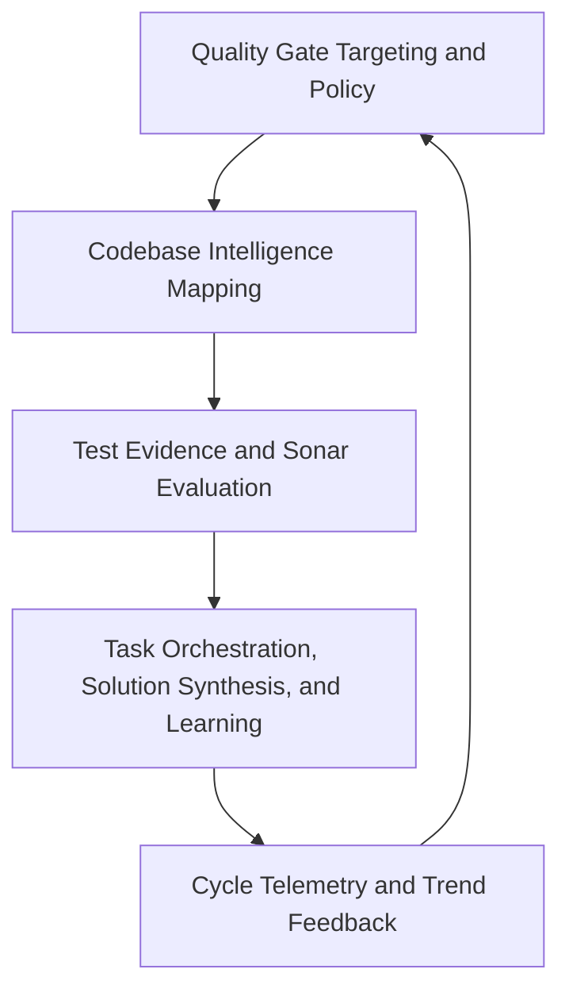

# Sonar Loop

## What This Module Owns

Sonar Loop owns a hybrid loop model with one parent cycle identifier and ordered child pass identifiers, where mode control is the authoritative completion decision source. It defines resumable `halted` checkpoint-hold behavior, explicit first-class `pause` outcomes, stop compliance proof (`stopRequestedAt`, `haltedAt`, checkpoint correlation), and an explicit runtime mode model (`sandcastle`, `vscode-copilot`, `claude-code`) with default fallback order `sandcastle -> vscode-copilot -> claude-code`, approved per-project order override support, deterministic auditable fallback evidence requirements across every runtime-invoking stage, and a reuse-first agnostic skill-bundle contract that only recomposes on deterministic trigger conditions. It keeps evidence-first Sonar preconditions with one bounded remediation-evidenced retry, API-first task export with explicit retry and both-exported terminal states, detailed fallback telemetry fields (`fallbackFrom`, `fallbackTo`, `fallbackReasonCode`, `fallbackDecisionId`, `fallbackResolverStage`, `fallbackEvaluatedAt`), and balanced completion gating under export degradation that only permits completion with a valid governed risk-acceptance override artifact using enum-governed role/scope bindings plus manual lifecycle semantics (no default expiry and deterministic revocation invalidation).

## Module Map

## Capabilities

| Capability                                                                                                                 | What                                                                                 | Key Aspects                                                                                  | Detail                                                                                                                                                                                                                                                                                                      |
| -------------------------------------------------------------------------------------------------------------------------- | ------------------------------------------------------------------------------------ | -------------------------------------------------------------------------------------------- | ----------------------------------------------------------------------------------------------------------------------------------------------------------------------------------------------------------------------------------------------------------------------------------------------------------- |
| [Quality Gate Targeting and Policy](capabilities/quality-gate-targeting-and-policy.md)                                     | Selects and validates target quality gates with mode-aware controls                  | [operations.md](operations.md), [rules.md](rules.md), [workflows.md](workflows.md)           | Hybrid parent-cycle/child-pass model, explicit pause outcome, resumable halted checkpoint-hold, and authoritative mode-control completion                                                                                                                                                                   |
| [Codebase Intelligence Mapping](capabilities/codebase-intelligence-mapping.md)                                             | Builds a dependency, rule, and architecture map for guided remediation               | [domain.md](domain.md), [operations.md](operations.md), [interfaces.md](interfaces.md)       | Mapping of dependencies, use-cases, rules, patterns, modules, APIs, architecture, and libraries with explicit runtime-mode selection, default deterministic fallback order, approved per-project order override support, and reuse-first agnostic skill-bundle composition with trigger-gated recomposition |
| [Test Evidence and Sonar Evaluation](capabilities/test-evidence-and-sonar-evaluation.md)                                   | Improves evidence-first test suite and evaluates against selected Sonar gate         | [operations.md](operations.md), [rules.md](rules.md), [observability.md](observability.md)   | Sonar precondition requires integration+e2e+functional evidence, fallback governance and strong fallback evidence parity across runtime-invoking stages, and one bounded remediation-evidenced Sonar retry                                                                                                  |
| [Task Orchestration, Solution Synthesis, and Learning](capabilities/task-orchestration-solution-synthesis-and-learning.md) | Converts findings into tasks and learns from operator-selected solutions over cycles | [operations.md](operations.md), [interfaces.md](interfaces.md), [workflows.md](workflows.md) | GitHub/Jira API-first export with retry model, balanced completion gate under export degradation with enum-governed override role/scope and manual lifecycle requirements, GitHub epic-as-issue metadata conventions, scored abstraction synthesis, feedback learning                                       |

### Quality Gate Targeting and Policy

Defines how each parent [ExecutionCycle](domain.md#executioncycle) and active child pass choose a [QualityGateProfile](domain.md#qualitygateprofile), enforce progression limits, and keep mode control authoritative for completion.

- Full capability detail: [quality-gate-targeting-and-policy.md](capabilities/quality-gate-targeting-and-policy.md)
- Core operation: [DetermineTargetQualityGate](operations.md#determinetargetqualitygate)
- Core policies: [QualityGateProgressionPolicy](rules.md#qualitygateprogressionpolicy), [AutonomousCheckpointAndStopPolicy](rules.md#autonomouscheckpointandstoppolicy), [CompletionGateUnderExportDegradationPolicy](rules.md#completiongateunderexportdegradationpolicy)

### Codebase Intelligence Mapping

Builds an explorable [CodebaseKnowledgeMap](domain.md#codebaseknowledgemap), conditionally recomposes an agnostic [SkillBundleProfile](domain.md#skillbundleprofile) when deterministic triggers are present (otherwise reuses the latest valid bundle), and enforces explicit [ExecutionRuntimeMode](domain.md#executionruntimemode) selection with deterministic fallback governance that supports approved per-project order override artifacts.

- Full capability detail: [codebase-intelligence-mapping.md](capabilities/codebase-intelligence-mapping.md)
- Core operations: [MapCodebaseIntelligence](operations.md#mapcodebaseintelligence), [ComposeAgnosticSkillBundle](operations.md#composeagnosticskillbundle) (conditional recomposition vs reuse)
- Core interface: [Internal: SkillBundleInterface](interfaces.md#internal-skillbundleinterface)
- Core policy: [SkillBundleReusePolicy](rules.md#skillbundlereusepolicy)

### Test Evidence and Sonar Evaluation

Creates and improves a test evidence baseline, enforces integration/e2e/functional Sonar preconditions, groups findings into controlled context-taxonomy bundles, and keeps runtime fallback governance and evidence depth consistent across runtime-invoking stages.

- Full capability detail: [test-evidence-and-sonar-evaluation.md](capabilities/test-evidence-and-sonar-evaluation.md)
- Core operations: [BuildAndImproveTestEvidence](operations.md#buildandimprovetestevidence), [EvaluateWithSonarQualityGate](operations.md#evaluatewithsonarqualitygate), [BundleFindingsByContext](operations.md#bundlefindingsbycontext)
- Core policies: [TestScopePolicy](rules.md#testscopepolicy), [ExecutionProviderFallbackPolicy](rules.md#executionproviderfallbackpolicy), [SonarRetryPolicy](rules.md#sonarretrypolicy)

### Task Orchestration, Solution Synthesis, and Learning

Converts finding bundles into repository tasks and GitHub/Jira work items with explicit export state transitions, proposes three candidate solutions per task, applies scored/tie-broken cross-smell abstraction selection, enforces valid [RiskAcceptanceOverride](domain.md#riskacceptanceoverride) checks for degraded completion requests, and updates [LearningMemory](domain.md#learningmemory) from operator choices.

- Full capability detail: [task-orchestration-solution-synthesis-and-learning.md](capabilities/task-orchestration-solution-synthesis-and-learning.md)
- Core operations: [CreateAndExportRemediationTasks](operations.md#createandexportremediationtasks), [GenerateThreeCandidateSolutions](operations.md#generatethreecandidatesolutions), [SynthesizeCrossSmellAbstractions](operations.md#synthesizecrosssmellabstractions), [ApplyOperatorSelectionLearning](operations.md#applyoperatorselectionlearning)
- Core policies: [ApiFirstTaskIntegrationPolicy](rules.md#apifirsttaskintegrationpolicy), [ThreeCandidateSolutionRule](rules.md#threecandidatesolutionrule), [NonRedundantAbstractionRule](rules.md#nonredundantabstractionrule), [LearningFeedbackRule](rules.md#learningfeedbackrule)

## Domain Concepts

| Concept                                                    | Type         | Key Constraints                                                                                                                                                                       |
| ---------------------------------------------------------- | ------------ | ------------------------------------------------------------------------------------------------------------------------------------------------------------------------------------- |
| [ExecutionCycle](domain.md#executioncycle)                 | Entity       | One parent cycle owns one or more ordered child pass IDs; `halted` is resumable checkpoint-hold; completion is mode-control authoritative                                             |
| [ExecutionRuntimeMode](domain.md#executionruntimemode)     | Enum         | Runtime modes are explicitly governed as `sandcastle`, `vscode-copilot`, `claude-code`; default deterministic order applies with approved per-project order override policy support   |
| [QualityGateProfile](domain.md#qualitygateprofile)         | Entity       | Target gate cannot skip progression policy bounds                                                                                                                                     |
| [CodebaseKnowledgeMap](domain.md#codebaseknowledgemap)     | Entity       | Must include dependencies, use-cases, rules, patterns, modules, APIs, architecture, libraries                                                                                         |
| [FindingBundle](domain.md#findingbundle)                   | Entity       | Context tag must use controlled taxonomy with deterministic precedence                                                                                                                |
| [RemediationTask](domain.md#remediationtask)               | Entity       | Export lifecycle includes retry transitions and explicit `both-exported` terminal status                                                                                              |
| [LearningMemory](domain.md#learningmemory)                 | Entity       | Stores operator-selected solutions and cross-cycle effectiveness                                                                                                                      |
| [SkillBundleProfile](domain.md#skillbundleprofile)         | Entity       | Skills remain framework-agnostic and capability-scoped; recomposition is trigger-gated and otherwise reuses latest valid baseline                                                     |
| [RiskAcceptanceOverride](domain.md#riskacceptanceoverride) | Entity       | Must include enum-governed approver role and scope type, required scope-binding fields, approval/evidence/audit data, manual lifecycle fields, and deterministic revocation semantics |
| [CheckpointControl](domain.md#checkpointcontrol)           | Value Object | Authoritative stop signal source with explicit stop/halt timestamp proof, completion gate inputs, and validated override references                                                   |
| [TelemetryEnvelope](domain.md#telemetryenvelope)           | Value Object | Stage telemetry must include fallback evidence and fallback decision metadata when runtime fallback is used                                                                           |

## Concept Registry

| Concept                                                                                                   | ID                                                    | Type          | Source                                                                          |
| --------------------------------------------------------------------------------------------------------- | ----------------------------------------------------- | ------------- | ------------------------------------------------------------------------------- |
| [ExecutionCycle](domain.md#executioncycle)                                                                | sonar-loop.ExecutionCycle                             | Entity        | [domain.md](domain.md#executioncycle)                                           |
| [ExecutionRuntimeMode](domain.md#executionruntimemode)                                                    | sonar-loop.ExecutionRuntimeMode                       | Enum          | [domain.md](domain.md#executionruntimemode)                                     |
| [RuntimeInvokingStage](domain.md#runtimeinvokingstage)                                                    | sonar-loop.RuntimeInvokingStage                       | Enum          | [domain.md](domain.md#runtimeinvokingstage)                                     |
| [RuntimeFallbackReasonCode](domain.md#runtimefallbackreasoncode)                                          | sonar-loop.RuntimeFallbackReasonCode                  | Enum          | [domain.md](domain.md#runtimefallbackreasoncode)                                |
| [QualityGateProfile](domain.md#qualitygateprofile)                                                        | sonar-loop.QualityGateProfile                         | Entity        | [domain.md](domain.md#qualitygateprofile)                                       |
| [CodebaseKnowledgeMap](domain.md#codebaseknowledgemap)                                                    | sonar-loop.CodebaseKnowledgeMap                       | Entity        | [domain.md](domain.md#codebaseknowledgemap)                                     |
| [FindingBundle](domain.md#findingbundle)                                                                  | sonar-loop.FindingBundle                              | Entity        | [domain.md](domain.md#findingbundle)                                            |
| [RemediationTask](domain.md#remediationtask)                                                              | sonar-loop.RemediationTask                            | Entity        | [domain.md](domain.md#remediationtask)                                          |
| [LearningMemory](domain.md#learningmemory)                                                                | sonar-loop.LearningMemory                             | Entity        | [domain.md](domain.md#learningmemory)                                           |
| [SkillBundleProfile](domain.md#skillbundleprofile)                                                        | sonar-loop.SkillBundleProfile                         | Entity        | [domain.md](domain.md#skillbundleprofile)                                       |
| [RiskAcceptanceOverride](domain.md#riskacceptanceoverride)                                                | sonar-loop.RiskAcceptanceOverride                     | Entity        | [domain.md](domain.md#riskacceptanceoverride)                                   |
| [SolutionCandidate](domain.md#solutioncandidate)                                                          | sonar-loop.SolutionCandidate                          | Value Object  | [domain.md](domain.md#solutioncandidate)                                        |
| [CheckpointControl](domain.md#checkpointcontrol)                                                          | sonar-loop.CheckpointControl                          | Value Object  | [domain.md](domain.md#checkpointcontrol)                                        |
| [TelemetryEnvelope](domain.md#telemetryenvelope)                                                          | sonar-loop.TelemetryEnvelope                          | Value Object  | [domain.md](domain.md#telemetryenvelope)                                        |
| [FindingContextTag](domain.md#findingcontexttag)                                                          | sonar-loop.FindingContextTag                          | Enum          | [domain.md](domain.md#findingcontexttag)                                        |
| [ModeControlOutcome](domain.md#modecontroloutcome)                                                        | sonar-loop.ModeControlOutcome                         | Enum          | [domain.md](domain.md#modecontroloutcome)                                       |
| [RiskAcceptanceOverrideStatus](domain.md#riskacceptanceoverridestatus)                                    | sonar-loop.RiskAcceptanceOverrideStatus               | Enum          | [domain.md](domain.md#riskacceptanceoverridestatus)                             |
| [RiskAcceptanceApproverRole](domain.md#riskacceptanceapproverrole)                                        | sonar-loop.RiskAcceptanceApproverRole                 | Enum          | [domain.md](domain.md#riskacceptanceapproverrole)                               |
| [RiskAcceptanceOverrideScopeType](domain.md#riskacceptanceoverridescopetype)                              | sonar-loop.RiskAcceptanceOverrideScopeType            | Enum          | [domain.md](domain.md#riskacceptanceoverridescopetype)                          |
| [QualityGateConditionFamily](domain.md#qualitygateconditionfamily)                                        | sonar-loop.QualityGateConditionFamily                 | Enum          | [domain.md](domain.md#qualitygateconditionfamily)                               |
| [RiskAcceptanceRevocationReasonCode](domain.md#riskacceptancerevocationreasoncode)                        | sonar-loop.RiskAcceptanceRevocationReasonCode         | Enum          | [domain.md](domain.md#riskacceptancerevocationreasoncode)                       |
| [CompletionDecisionSource](domain.md#completiondecisionsource)                                            | sonar-loop.CompletionDecisionSource                   | Enum          | [domain.md](domain.md#completiondecisionsource)                                 |
| [DetermineTargetQualityGate](operations.md#determinetargetqualitygate)                                    | sonar-loop.DetermineTargetQualityGate                 | Operation     | [operations.md](operations.md#determinetargetqualitygate)                       |
| [MapCodebaseIntelligence](operations.md#mapcodebaseintelligence)                                          | sonar-loop.MapCodebaseIntelligence                    | Operation     | [operations.md](operations.md#mapcodebaseintelligence)                          |
| [ComposeAgnosticSkillBundle](operations.md#composeagnosticskillbundle)                                    | sonar-loop.ComposeAgnosticSkillBundle                 | Operation     | [operations.md](operations.md#composeagnosticskillbundle)                       |
| [BuildAndImproveTestEvidence](operations.md#buildandimprovetestevidence)                                  | sonar-loop.BuildAndImproveTestEvidence                | Operation     | [operations.md](operations.md#buildandimprovetestevidence)                      |
| [EvaluateWithSonarQualityGate](operations.md#evaluatewithsonarqualitygate)                                | sonar-loop.EvaluateWithSonarQualityGate               | Operation     | [operations.md](operations.md#evaluatewithsonarqualitygate)                     |
| [BundleFindingsByContext](operations.md#bundlefindingsbycontext)                                          | sonar-loop.BundleFindingsByContext                    | Operation     | [operations.md](operations.md#bundlefindingsbycontext)                          |
| [CreateAndExportRemediationTasks](operations.md#createandexportremediationtasks)                          | sonar-loop.CreateAndExportRemediationTasks            | Operation     | [operations.md](operations.md#createandexportremediationtasks)                  |
| [GenerateThreeCandidateSolutions](operations.md#generatethreecandidatesolutions)                          | sonar-loop.GenerateThreeCandidateSolutions            | Operation     | [operations.md](operations.md#generatethreecandidatesolutions)                  |
| [SynthesizeCrossSmellAbstractions](operations.md#synthesizecrosssmellabstractions)                        | sonar-loop.SynthesizeCrossSmellAbstractions           | Operation     | [operations.md](operations.md#synthesizecrosssmellabstractions)                 |
| [ApplyOperatorSelectionLearning](operations.md#applyoperatorselectionlearning)                            | sonar-loop.ApplyOperatorSelectionLearning             | Operation     | [operations.md](operations.md#applyoperatorselectionlearning)                   |
| [RecordCycleTelemetryTrend](operations.md#recordcycletelemetrytrend)                                      | sonar-loop.RecordCycleTelemetryTrend                  | Operation     | [operations.md](operations.md#recordcycletelemetrytrend)                        |
| [ApplyModeControlCheckpoint](operations.md#applymodecontrolcheckpoint)                                    | sonar-loop.ApplyModeControlCheckpoint                 | Operation     | [operations.md](operations.md#applymodecontrolcheckpoint)                       |
| [ProgressiveQualityLoopWorkflow](workflows.md#progressivequalityloopworkflow)                             | sonar-loop.ProgressiveQualityLoopWorkflow             | Workflow      | [workflows.md](workflows.md#progressivequalityloopworkflow)                     |
| [AutonomousCheckpointWorkflow](workflows.md#autonomouscheckpointworkflow)                                 | sonar-loop.AutonomousCheckpointWorkflow               | Workflow      | [workflows.md](workflows.md#autonomouscheckpointworkflow)                       |
| [AssistedDecisionWorkflow](workflows.md#assisteddecisionworkflow)                                         | sonar-loop.AssistedDecisionWorkflow                   | Workflow      | [workflows.md](workflows.md#assisteddecisionworkflow)                           |
| [CycleStateMachine](rules.md#cyclestatemachine)                                                           | sonar-loop.CycleStateMachine                          | State Machine | [rules.md](rules.md#cyclestatemachine)                                          |
| [QualityGateProgressionPolicy](rules.md#qualitygateprogressionpolicy)                                     | sonar-loop.QualityGateProgressionPolicy               | Policy        | [rules.md](rules.md#qualitygateprogressionpolicy)                               |
| [ExecutionProviderFallbackPolicy](rules.md#executionproviderfallbackpolicy)                               | sonar-loop.ExecutionProviderFallbackPolicy            | Policy        | [rules.md](rules.md#executionproviderfallbackpolicy)                            |
| [SkillBundleReusePolicy](rules.md#skillbundlereusepolicy)                                                 | sonar-loop.SkillBundleReusePolicy                     | Policy        | [rules.md](rules.md#skillbundlereusepolicy)                                     |
| [SonarRetryPolicy](rules.md#sonarretrypolicy)                                                             | sonar-loop.SonarRetryPolicy                           | Policy        | [rules.md](rules.md#sonarretrypolicy)                                           |
| [ApiFirstTaskIntegrationPolicy](rules.md#apifirsttaskintegrationpolicy)                                   | sonar-loop.ApiFirstTaskIntegrationPolicy              | Policy        | [rules.md](rules.md#apifirsttaskintegrationpolicy)                              |
| [CompletionGateUnderExportDegradationPolicy](rules.md#completiongateunderexportdegradationpolicy)         | sonar-loop.CompletionGateUnderExportDegradationPolicy | Policy        | [rules.md](rules.md#completiongateunderexportdegradationpolicy)                 |
| [RiskAcceptanceOverrideValidityPolicy](rules.md#riskacceptanceoverridevaliditypolicy)                     | sonar-loop.RiskAcceptanceOverrideValidityPolicy       | Policy        | [rules.md](rules.md#riskacceptanceoverridevaliditypolicy)                       |
| [ThreeCandidateSolutionRule](rules.md#threecandidatesolutionrule)                                         | sonar-loop.ThreeCandidateSolutionRule                 | Rule          | [rules.md](rules.md#threecandidatesolutionrule)                                 |
| [NonRedundantAbstractionRule](rules.md#nonredundantabstractionrule)                                       | sonar-loop.NonRedundantAbstractionRule                | Rule          | [rules.md](rules.md#nonredundantabstractionrule)                                |
| [FindingContextTagPolicy](rules.md#findingcontexttagpolicy)                                               | sonar-loop.FindingContextTagPolicy                    | Policy        | [rules.md](rules.md#findingcontexttagpolicy)                                    |
| [LearningFeedbackRule](rules.md#learningfeedbackrule)                                                     | sonar-loop.LearningFeedbackRule                       | Rule          | [rules.md](rules.md#learningfeedbackrule)                                       |
| [AutonomousCheckpointAndStopPolicy](rules.md#autonomouscheckpointandstoppolicy)                           | sonar-loop.AutonomousCheckpointAndStopPolicy          | Policy        | [rules.md](rules.md#autonomouscheckpointandstoppolicy)                          |
| [TestScopePolicy](rules.md#testscopepolicy)                                                               | sonar-loop.TestScopePolicy                            | Policy        | [rules.md](rules.md#testscopepolicy)                                            |
| [TelemetryCompletenessRule](rules.md#telemetrycompletenessrule)                                           | sonar-loop.TelemetryCompletenessRule                  | Rule          | [rules.md](rules.md#telemetrycompletenessrule)                                  |
| [SandcastleAgentExecutionInterface](interfaces.md#internal-sandcastleagentexecutioninterface)             | sonar-loop.SandcastleAgentExecutionInterface          | Interface     | [interfaces.md](interfaces.md#internal-sandcastleagentexecutioninterface)       |
| [GitHubWorkApiInterface](interfaces.md#external-githubworkapiinterface-rest)                              | sonar-loop.GitHubWorkApiInterface                     | Interface     | [interfaces.md](interfaces.md#external-githubworkapiinterface-rest)             |
| [JiraWorkApiInterface](interfaces.md#external-jiraworkapiinterface-rest)                                  | sonar-loop.JiraWorkApiInterface                       | Interface     | [interfaces.md](interfaces.md#external-jiraworkapiinterface-rest)               |
| [SkillBundleInterface](interfaces.md#internal-skillbundleinterface)                                       | sonar-loop.SkillBundleInterface                       | Interface     | [interfaces.md](interfaces.md#internal-skillbundleinterface)                    |
| [RiskAcceptanceOverrideRegistryInterface](interfaces.md#internal-riskacceptanceoverrideregistryinterface) | sonar-loop.RiskAcceptanceOverrideRegistryInterface    | Interface     | [interfaces.md](interfaces.md#internal-riskacceptanceoverrideregistryinterface) |
| [QualityTrendMapping](observability.md#qualitytrendmapping)                                               | sonar-loop.QualityTrendMapping                        | Mapping       | [observability.md](observability.md#qualitytrendmapping)                        |
| [CycleTelemetryEvent](observability.md#cycletelemetryevent)                                               | sonar-loop.CycleTelemetryEvent                        | Event         | [observability.md](observability.md#cycletelemetryevent)                        |
| [TerminalCycleSummary](observability.md#terminalcyclesummary)                                             | sonar-loop.TerminalCycleSummary                       | Event         | [observability.md](observability.md#terminalcyclesummary)                       |

## Feature Concept Graph

| From                                                  | Edge         | To                                         | Evidence                                            | Notes                                                                                                                                                         |
| ----------------------------------------------------- | ------------ | ------------------------------------------ | --------------------------------------------------- | ------------------------------------------------------------------------------------------------------------------------------------------------------------- |
| sonar-loop.QualityGateProgressionPolicy               | applies      | sonar-loop.DetermineTargetQualityGate      | rules.md#qualitygateprogressionpolicy               | Prevents unsupported gate jumps                                                                                                                               |
| sonar-loop.DetermineTargetQualityGate                 | sets         | sonar-loop.ExecutionRuntimeMode            | operations.md#determinetargetqualitygate            | Selects runtime mode with Sandcastle default                                                                                                                  |
| sonar-loop.ExecutionProviderFallbackPolicy            | constrains   | sonar-loop.ExecutionRuntimeMode            | rules.md#executionproviderfallbackpolicy            | Enforces default deterministic fallback order `sandcastle -> vscode-copilot -> claude-code` with approved per-project order override support                  |
| sonar-loop.ExecutionProviderFallbackPolicy            | applies      | sonar-loop.MapCodebaseIntelligence         | rules.md#executionproviderfallbackpolicy            | Mapping stage must use governed runtime mode plus strong fallback evidence when fallback occurs                                                               |
| sonar-loop.ExecutionProviderFallbackPolicy            | applies      | sonar-loop.BuildAndImproveTestEvidence     | rules.md#executionproviderfallbackpolicy            | Test-evidence stage shares the same strong fallback contract and deterministic selection                                                                      |
| sonar-loop.ExecutionProviderFallbackPolicy            | applies      | sonar-loop.GenerateThreeCandidateSolutions | rules.md#executionproviderfallbackpolicy            | Solution-synthesis stage is runtime-invoking and must satisfy the same strong fallback contract                                                               |
| sonar-loop.MapCodebaseIntelligence                    | produces     | sonar-loop.CodebaseKnowledgeMap            | operations.md#mapcodebaseintelligence               | Creates dependency/use-case/rule/pattern map                                                                                                                  |
| sonar-loop.ComposeAgnosticSkillBundle                 | produces     | sonar-loop.SkillBundleProfile              | operations.md#composeagnosticskillbundle            | Agent skill bundle is recomposed only when triggers are present; otherwise latest valid bundle is reused                                                      |
| sonar-loop.SkillBundleReusePolicy                     | applies      | sonar-loop.ComposeAgnosticSkillBundle      | rules.md#skillbundlereusepolicy                     | Enforces deterministic trigger evaluation and latest-valid baseline reuse requirements                                                                        |
| sonar-loop.BuildAndImproveTestEvidence                | enforces     | sonar-loop.TestScopePolicy                 | operations.md#buildandimprovetestevidence           | Requires integration/e2e/functional baseline and explicit optional-scope request artifact                                                                     |
| sonar-loop.EvaluateWithSonarQualityGate               | queries      | sonar-loop.QualityGateProfile              | operations.md#evaluatewithsonarqualitygate          | Reads selected gate and threshold profile                                                                                                                     |
| sonar-loop.SonarRetryPolicy                           | applies      | sonar-loop.EvaluateWithSonarQualityGate    | rules.md#sonarretrypolicy                           | One bounded retry with remediation evidence and deterministic terminal failure on retry exhaustion                                                            |
| sonar-loop.EvaluateWithSonarQualityGate               | produces     | sonar-loop.FindingBundle                   | operations.md#evaluatewithsonarqualitygate          | Creates raw findings feed                                                                                                                                     |
| sonar-loop.BundleFindingsByContext                    | enforces     | sonar-loop.FindingContextTagPolicy         | operations.md#bundlefindingsbycontext               | Uses controlled taxonomy with deterministic precedence                                                                                                        |
| sonar-loop.CreateAndExportRemediationTasks            | produces     | sonar-loop.RemediationTask                 | operations.md#createandexportremediationtasks       | Produces local tasks plus GitHub/Jira exports                                                                                                                 |
| sonar-loop.CreateAndExportRemediationTasks            | enforces     | sonar-loop.ApiFirstTaskIntegrationPolicy   | operations.md#createandexportremediationtasks       | API-first integration with explicit retry and both-exported terminal status                                                                                   |
| sonar-loop.RiskAcceptanceOverrideValidityPolicy       | applies      | sonar-loop.ApplyModeControlCheckpoint      | rules.md#riskacceptanceoverridevaliditypolicy       | Validates enum-governed role/scope bindings plus manual lifecycle state (active/non-expired or non-expiring)                                                  |
| sonar-loop.ApplyModeControlCheckpoint                 | queries      | sonar-loop.RiskAcceptanceOverride          | operations.md#applymodecontrolcheckpoint            | Resolves and validates governed override artifacts for degraded completion requests                                                                           |
| sonar-loop.CompletionGateUnderExportDegradationPolicy | applies      | sonar-loop.ApplyModeControlCheckpoint      | rules.md#completiongateunderexportdegradationpolicy | Blocks completion while active retries or degradation breach exist unless explicit valid override is present                                                  |
| sonar-loop.GenerateThreeCandidateSolutions            | enforces     | sonar-loop.ThreeCandidateSolutionRule      | operations.md#generatethreecandidatesolutions       | Exactly three candidates per task                                                                                                                             |
| sonar-loop.SynthesizeCrossSmellAbstractions           | enforces     | sonar-loop.NonRedundantAbstractionRule     | operations.md#synthesizecrosssmellabstractions      | Applies scoring formula, threshold, and deterministic tie-breaks                                                                                              |
| sonar-loop.ApplyOperatorSelectionLearning             | updates      | sonar-loop.LearningMemory                  | operations.md#applyoperatorselectionlearning        | Learns from operator-selected candidates                                                                                                                      |
| sonar-loop.RecordCycleTelemetryTrend                  | produces     | sonar-loop.CycleTelemetryEvent             | operations.md#recordcycletelemetrytrend             | Emits pass stage telemetry events including runtime mode, skill-bundle branch decision evidence, fallback decision evidence, and override validation evidence |
| sonar-loop.RecordCycleTelemetryTrend                  | produces     | sonar-loop.TerminalCycleSummary            | operations.md#recordcycletelemetrytrend             | Emits parent-cycle terminal summary when completion candidate is accepted                                                                                     |
| sonar-loop.AutonomousCheckpointAndStopPolicy          | applies      | sonar-loop.ApplyModeControlCheckpoint      | rules.md#autonomouscheckpointandstoppolicy          | Mode control owns continue/pause/halt/complete decisions                                                                                                      |
| sonar-loop.ProgressiveQualityLoopWorkflow             | orchestrates | sonar-loop.ApplyModeControlCheckpoint      | workflows.md#progressivequalityloopworkflow         | Completion decisions remain mode-control authoritative                                                                                                        |

## Aspect Docs

| Aspect                                | Contains                                                                                     | Key Concepts                                                                                                     |
| ------------------------------------- | -------------------------------------------------------------------------------------------- | ---------------------------------------------------------------------------------------------------------------- |
| [Domain](domain.md)                   | Entities, value objects, enums                                                               | ExecutionCycle, ExecutionRuntimeMode, RiskAcceptanceOverride                                                     |
| [Operations](operations.md)           | Stage operations and deterministic outputs                                                   | DetermineTargetQualityGate, EvaluateWithSonarQualityGate, ApplyModeControlCheckpoint                             |
| [Workflows](workflows.md)             | End-to-end loop and mode-aware orchestration                                                 | ProgressiveQualityLoopWorkflow, AutonomousCheckpointWorkflow                                                     |
| [Rules](rules.md)                     | State machine, mode controls, policy and invariants                                          | CycleStateMachine, ExecutionProviderFallbackPolicy, SkillBundleReusePolicy, RiskAcceptanceOverrideValidityPolicy |
| [Interfaces](interfaces.md)           | Runtime-mode execution, Sonar, GitHub, Jira, skill bundle, and override-governance contracts | SandcastleAgentExecutionInterface, RiskAcceptanceOverrideRegistryInterface, ModeControlInterface                 |
| [Observability](observability.md)     | Metrics, telemetry event schema, cycle trend mapping                                         | QualityTrendMapping, CycleTelemetryEvent, TerminalCycleSummary                                                   |
| [User Journey](userjourney/README.md) | Evaluator, pilot, scale, packaging/pricing, and growth narrative decisions                   | Wave 1-4 decision set (`Q1-Q16`) with commercialization constraints                                              |

## Cross-Feature Dependencies

| Capability                                           | Depends On                      | Via | Why                                                              |
| ---------------------------------------------------- | ------------------------------- | --- | ---------------------------------------------------------------- |
| Quality Gate Targeting and Policy                    | None (initial project baseline) | N/A | The feature is self-contained for first iteration                |
| Codebase Intelligence Mapping                        | None (initial project baseline) | N/A | Mapping relies on local repository analysis and configured tools |
| Test Evidence and Sonar Evaluation                   | None (initial project baseline) | N/A | Sonar and test execution are encapsulated in this feature        |
| Task Orchestration, Solution Synthesis, and Learning | None (initial project baseline) | N/A | Task lifecycle and learning loop are internal to this capability |

## Produces For

| Consumer                         | Consumes Capability                                  | Via                                                                                                                                                                        | What                                                                                                                                             |
| -------------------------------- | ---------------------------------------------------- | -------------------------------------------------------------------------------------------------------------------------------------------------------------------------- | ------------------------------------------------------------------------------------------------------------------------------------------------ |
| Repository maintainers           | Quality Gate Targeting and Policy                    | [ApplyModeControlCheckpoint](operations.md#applymodecontrolcheckpoint)                                                                                                     | Gate targets, runtime mode selection, checkpoints, explicit pause/halt/resume control, and authoritative completion decisions                    |
| Coding agents                    | Codebase Intelligence Mapping                        | [SkillBundleInterface](interfaces.md#internal-skillbundleinterface)                                                                                                        | Agnostic skill bundle (recomposed on trigger or reused from latest valid baseline) and codebase context map                                      |
| Quality platform                 | Test Evidence and Sonar Evaluation                   | [External: SonarAnalysisInterface](interfaces.md#external-sonaranalysisinterface-restcli)                                                                                  | Gate verdicts and grouped findings                                                                                                               |
| Delivery systems                 | Task Orchestration, Solution Synthesis, and Learning | [External: GitHubWorkApiInterface](interfaces.md#external-githubworkapiinterface-rest), [External: JiraWorkApiInterface](interfaces.md#external-jiraworkapiinterface-rest) | Epics/projects/stories exported from remediation tasks                                                                                           |
| Operators and governance reports | Task Orchestration, Solution Synthesis, and Learning | [RecordCycleTelemetryTrend](operations.md#recordcycletelemetrytrend)                                                                                                       | Interaction logs, runtime-mode/fallback evidence (policy/probe/decision metadata), valid override usage, outcomes, and quality trend over cycles |

## Stories

See [STORIES.md](STORIES.md) for capability-scoped user journeys and coverage matrix.

## User Journey

Commercialization and operator journey decisions are tracked in [userjourney/README.md](userjourney/README.md).

- Evaluator day 0-day 1: [evaluator-day0-day1.md](userjourney/evaluator-day0-day1.md)
- Pilot week 1: [pilot-week1.md](userjourney/pilot-week1.md)
- Scale month 1: [scale-month1.md](userjourney/scale-month1.md)
- Packaging, pricing, and growth: [packaging-pricing-and-growth.md](userjourney/packaging-pricing-and-growth.md)

## Implementation Layering

See [implementation-layering.md](implementation-layering.md) for POC-first rollout layers from minimum concept proof through governance and scale hardening.

## Glossary

See [glossary.md](glossary.md) for feature language and source-linked formal concept definitions.

## Change History

See [CHANGELOG.md](CHANGELOG.md) for domain-level changes to this feature.

## References

- [Sandcastle](https://github.com/mattpocock/sandcastle)
- [VS Code Copilot](https://code.visualstudio.com/docs/copilot/overview)
- [Claude Code](https://docs.anthropic.com/en/docs/claude-code/overview)
- [SonarQube Web API](https://docs.sonarsource.com/sonarqube-server/latest/extension-guide/web-api/)
- [GitHub REST Issues API](https://docs.github.com/en/rest/issues/issues)
- [Jira Cloud Platform REST API](https://developer.atlassian.com/cloud/jira/platform/rest/v3/)
