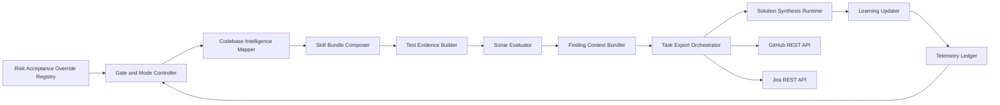
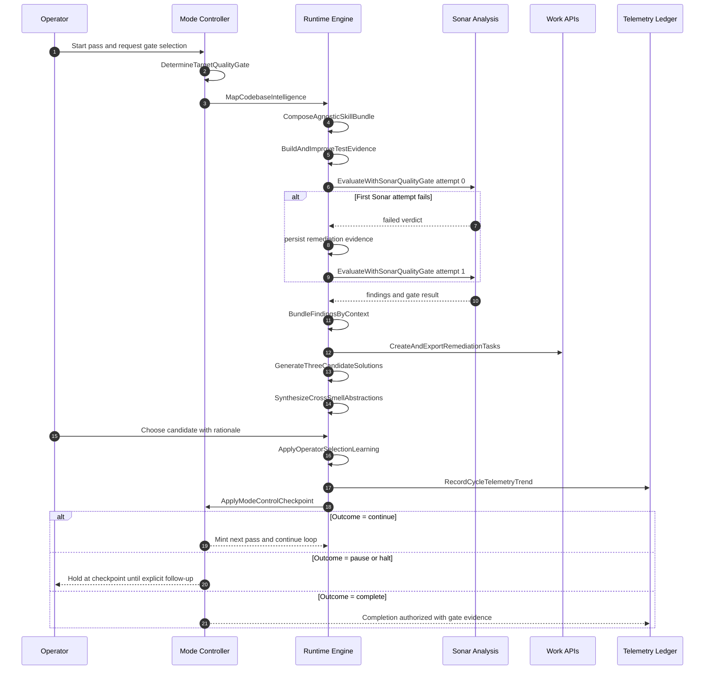
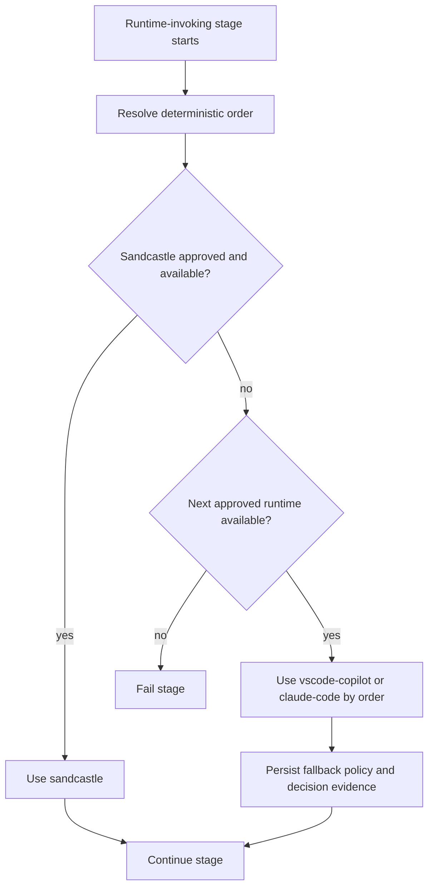
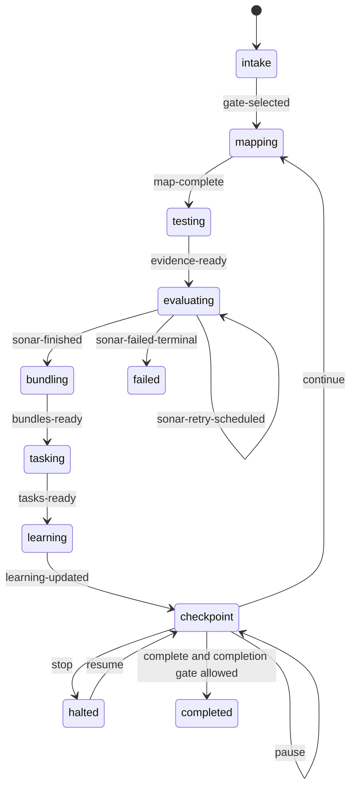

# Sonar Loop Architecture

This document is an architecture-level explanation of the Sonar Loop feature specification.

Scope note: this is a docs-first design document aligned to current feature contracts. It does not claim implementation completeness beyond what is defined in [SPEC.md](SPEC.md).

## User Journey Architecture Fit

The approved user-journey decisions are reflected as architectural positioning constraints:

- Evaluator day 0-day 1 (Wave 1): architecture must surface day-1 actionable task output while preserving governance evidence.
- Pilot week 1 (Wave 2): assisted-first operation and dual-repo pilot robustness are supported by explicit checkpoint authority and deterministic fallback evidence.
- Scale month 1 (Wave 3): initial scale claim is single-team multi-repo replication with governance proof package and GitHub-first integration posture.
- Packaging/pricing/growth (Wave 4): repository-scoped commercialization and one-time non-SaaS framing rely on repeatable repo-level loop artifacts.

Journey detail references: [userjourney/README.md](userjourney/README.md), [packaging-pricing-and-growth.md](userjourney/packaging-pricing-and-growth.md).

## Architecture Overview (consumer-readable)

Sonar Loop is organized as a governed progressive loop. Each parent cycle runs one or more ordered child passes, and each pass follows the same deterministic stage order from gate targeting through remediation learning and checkpoint control.

The architecture is designed to keep three qualities in balance:

- quality progression that is repeatable across passes
- governance decisions that are explicit, auditable, and bounded
- delivery handoff that can be inspected through evidence artifacts and telemetry

The architecture authority for completion is [ApplyModeControlCheckpoint](operations.md#applymodecontrolcheckpoint), not any downstream export tool.

## Design Goals and Non-Goals

| Type     | Item                                          | Why                                                                                                                            |
| -------- | --------------------------------------------- | ------------------------------------------------------------------------------------------------------------------------------ |
| Goal     | Deterministic pass progression                | Keeps [ExecutionCycle](domain.md#executioncycle) behavior stable and comparable over time                                      |
| Goal     | Evidence-first Sonar evaluation               | Enforces [TestScopePolicy](rules.md#testscopepolicy) and [SonarRetryPolicy](rules.md#sonarretrypolicy) before gate conclusions |
| Goal     | Runtime fallback governance                   | Applies [ExecutionProviderFallbackPolicy](rules.md#executionproviderfallbackpolicy) with explicit evidence fields              |
| Goal     | Authoritative checkpoint decisions            | Keeps completion and halt authority in [ModeControlInterface](interfaces.md#internal-modecontrolinterface)                     |
| Goal     | Observable and auditable outcomes             | Requires [TelemetryEnvelope](domain.md#telemetryenvelope) and [TerminalCycleSummary](observability.md#terminalcyclesummary)    |
| Non-goal | Defining concrete deployment topology         | Infrastructure/runtime hosting choices are outside this feature spec                                                           |
| Non-goal | Supporting unrestricted language ecosystems   | Scope is TypeScript codebase quality loops                                                                                     |
| Non-goal | Allowing implicit retries or hidden overrides | Retry and risk acceptance are explicit policy-governed decisions                                                               |

## Logical Architecture (components and responsibilities)

| Component                         | Primary contracts                                                                                                                                                                                | Responsibility                                                                     |
| --------------------------------- | ------------------------------------------------------------------------------------------------------------------------------------------------------------------------------------------------ | ---------------------------------------------------------------------------------- |
| Gate and Mode Controller          | [DetermineTargetQualityGate](operations.md#determinetargetqualitygate), [ApplyModeControlCheckpoint](operations.md#applymodecontrolcheckpoint)                                                   | Selects gate, enforces checkpoint decisions, controls continue/pause/halt/complete |
| Codebase Intelligence Mapper      | [MapCodebaseIntelligence](operations.md#mapcodebaseintelligence), [CodebaseKnowledgeMap](domain.md#codebaseknowledgemap)                                                                         | Produces structured repository intelligence required by downstream stages          |
| Skill Bundle Composer             | [ComposeAgnosticSkillBundle](operations.md#composeagnosticskillbundle), [SkillBundleInterface](interfaces.md#internal-skillbundleinterface)                                                      | Publishes capability-scoped, agent-agnostic bundle contracts                       |
| Test Evidence Builder             | [BuildAndImproveTestEvidence](operations.md#buildandimprovetestevidence), [TestScopePolicy](rules.md#testscopepolicy)                                                                            | Produces required integration/e2e/functional evidence for Sonar preconditions      |
| Sonar Evaluator                   | [EvaluateWithSonarQualityGate](operations.md#evaluatewithsonarqualitygate), [SonarAnalysisInterface](interfaces.md#external-sonaranalysisinterface-restcli)                                      | Runs gate evaluation with one bounded remediation-evidenced retry                  |
| Finding Context Bundler           | [BundleFindingsByContext](operations.md#bundlefindingsbycontext), [FindingContextTagPolicy](rules.md#findingcontexttagpolicy)                                                                    | Groups findings into deterministic context-tagged bundles                          |
| Task Export Orchestrator          | [CreateAndExportRemediationTasks](operations.md#createandexportremediationtasks), [ApiFirstTaskIntegrationPolicy](rules.md#apifirsttaskintegrationpolicy)                                        | Creates repository tasks and drives explicit GitHub/Jira export states             |
| Solution Synthesis Runtime        | [GenerateThreeCandidateSolutions](operations.md#generatethreecandidatesolutions), [SynthesizeCrossSmellAbstractions](operations.md#synthesizecrosssmellabstractions)                             | Produces three candidates per task and non-redundant abstraction proposals         |
| Learning Updater                  | [ApplyOperatorSelectionLearning](operations.md#applyoperatorselectionlearning), [LearningMemory](domain.md#learningmemory)                                                                       | Captures operator rationale and observed outcomes as ranking feedback              |
| Telemetry Ledger                  | [RecordCycleTelemetryTrend](operations.md#recordcycletelemetrytrend), [TelemetryCompletenessRule](rules.md#telemetrycompletenessrule)                                                            | Persists stage events, completion evidence, and cycle trend signals                |
| Risk Acceptance Override Registry | [RiskAcceptanceOverrideRegistryInterface](interfaces.md#internal-riskacceptanceoverrideregistryinterface), [RiskAcceptanceOverrideValidityPolicy](rules.md#riskacceptanceoverridevaliditypolicy) | Resolves and validates governed override artifacts for degraded completion paths   |

## End-to-End Flow Architecture

Flow authority is defined by [ProgressiveQualityLoopWorkflow](workflows.md#progressivequalityloopworkflow), with explicit checkpoint control in [AutonomousCheckpointWorkflow](workflows.md#autonomouscheckpointworkflow) and [AssistedDecisionWorkflow](workflows.md#assisteddecisionworkflow).

## Runtime Selection and Fallback Design

Runtime selection applies to runtime-invoking stages defined by [RuntimeInvokingStage](domain.md#runtimeinvokingstage): mapping, testing, and solution-synthesis.

Runtime governance constraints are enforced by [ExecutionProviderFallbackPolicy](rules.md#executionproviderfallbackpolicy):

- default deterministic order is `sandcastle -> vscode-copilot -> claude-code`
- per-project order override is allowed only through approved `fallbackOrderPolicyRef` artifact
- non-default runtime use requires explicit fallback evidence fields before stage continuation

| Evidence field group                                                                                                | Required when                                                              | Source of truth                                                             |
| ------------------------------------------------------------------------------------------------------------------- | -------------------------------------------------------------------------- | --------------------------------------------------------------------------- |
| Policy and probe evidence (`fallbackPolicyRef`, `availabilityProbeRefs`)                                            | [ExecutionRuntimeMode](domain.md#executionruntimemode) is not `sandcastle` | [ExecutionProviderFallbackPolicy](rules.md#executionproviderfallbackpolicy) |
| Decision evidence (`fallbackDecisionId`, `fallbackApprovedAt`, `fallbackExpiresAt` or `fallbackNonExpiring`)        | [ExecutionRuntimeMode](domain.md#executionruntimemode) is not `sandcastle` | [ExecutionProviderFallbackPolicy](rules.md#executionproviderfallbackpolicy) |
| Stage metadata (`fallbackFrom`, `fallbackTo`, `fallbackReasonCode`, `fallbackResolverStage`, `fallbackEvaluatedAt`) | [ExecutionRuntimeMode](domain.md#executionruntimemode) is not `sandcastle` | [TelemetryCompletenessRule](rules.md#telemetrycompletenessrule)             |

## Completion and Risk-Governance Design

Completion and halt governance is controlled by [CycleStateMachine](rules.md#cyclestatemachine), [AutonomousCheckpointAndStopPolicy](rules.md#autonomouscheckpointandstoppolicy), and [CompletionGateUnderExportDegradationPolicy](rules.md#completiongateunderexportdegradationpolicy).

| Decision input at checkpoint                                         | Required decision behavior                                   |
| -------------------------------------------------------------------- | ------------------------------------------------------------ |
| `activeExportRetryCount > 0` and no valid override                   | block completion and remain in checkpoint hold               |
| `exportDegradationThresholdBreached=true` and no valid override      | block completion and remain in checkpoint hold               |
| Degradation present and override artifact is invalid/revoked/expired | block completion and record invalidation reason              |
| Degradation present and valid override exists                        | allow completion with persisted override validation evidence |
| No active retries and no degradation breach                          | allow completion when mode control selects complete          |

When override-based completion is evaluated, [RiskAcceptanceOverrideValidityPolicy](rules.md#riskacceptanceoverridevaliditypolicy) governs artifact validity, role/scope constraints, lifecycle status, and revocation semantics.

## Data and Evidence Artifacts

| Artifact                                                      | Produced by                                                                                               | Used for                                                                |
| ------------------------------------------------------------- | --------------------------------------------------------------------------------------------------------- | ----------------------------------------------------------------------- |
| [QualityGateProfile](domain.md#qualitygateprofile)            | [DetermineTargetQualityGate](operations.md#determinetargetqualitygate)                                    | Pass-level quality target selection and progression control             |
| [CodebaseKnowledgeMap](domain.md#codebaseknowledgemap)        | [MapCodebaseIntelligence](operations.md#mapcodebaseintelligence)                                          | Context for test evidence planning, finding bundling, and synthesis     |
| [SkillBundleProfile](domain.md#skillbundleprofile)            | [ComposeAgnosticSkillBundle](operations.md#composeagnosticskillbundle)                                    | Agent-agnostic execution contract for loop stages                       |
| Test evidence refs                                            | [BuildAndImproveTestEvidence](operations.md#buildandimprovetestevidence)                                  | Sonar precondition for integration/e2e/functional coverage              |
| [FindingBundle](domain.md#findingbundle)                      | [BundleFindingsByContext](operations.md#bundlefindingsbycontext)                                          | Context-structured remediation planning                                 |
| [RemediationTask](domain.md#remediationtask)                  | [CreateAndExportRemediationTasks](operations.md#createandexportremediationtasks)                          | Repository and API-first export lifecycle with explicit states          |
| [LearningMemory](domain.md#learningmemory)                    | [ApplyOperatorSelectionLearning](operations.md#applyoperatorselectionlearning)                            | Cross-cycle candidate ranking feedback                                  |
| [TelemetryEnvelope](domain.md#telemetryenvelope)              | [RecordCycleTelemetryTrend](operations.md#recordcycletelemetrytrend)                                      | Stage evidence completeness, trend metrics, and governance auditability |
| [TerminalCycleSummary](observability.md#terminalcyclesummary) | [RecordCycleTelemetryTrend](operations.md#recordcycletelemetrytrend)                                      | Required completion evidence for terminal parent-cycle decisions        |
| [RiskAcceptanceOverride](domain.md#riskacceptanceoverride)    | [RiskAcceptanceOverrideRegistryInterface](interfaces.md#internal-riskacceptanceoverrideregistryinterface) | Governed completion authorization under export degradation              |

## Extension Points

- Runtime-invoking stage extension is allowed through [RuntimeInvokingStage](domain.md#runtimeinvokingstage) (`custom-runtime-stage`) when fallback and telemetry policies are fully satisfied.
- Per-project fallback order variation is allowed only via approved `fallbackOrderPolicyRef` under [ExecutionProviderFallbackPolicy](rules.md#executionproviderfallbackpolicy).
- Completion override scope can be bounded by cycle, pass, or gate-condition-family through [RiskAcceptanceOverrideScopeType](domain.md#riskacceptanceoverridescopetype).
- Finding context taxonomy can evolve only through controlled enum and precedence updates governed by [FindingContextTagPolicy](rules.md#findingcontexttagpolicy).

## Trade-offs and Guardrails

| Trade-off                                  | Benefit                                                           | Cost                                                     |
| ------------------------------------------ | ----------------------------------------------------------------- | -------------------------------------------------------- |
| One bounded Sonar retry                    | Prevents retry loops and preserves deterministic failure behavior | May terminate before additional speculative fixes        |
| Deterministic runtime fallback order       | Improves repeatability and auditability                           | Reduces ad-hoc runtime flexibility                       |
| Completion gate under export degradation   | Prevents silent completion with unresolved delivery risk          | Can delay closure until override governance is satisfied |
| Exactly three candidate solutions per task | Keeps decision set comparable and structured                      | Excludes larger exploratory option sets in one pass      |

Guardrails that must remain true:

- [CycleStateMachine](rules.md#cyclestatemachine) ordering and terminal state constraints are not bypassed.
- [TelemetryCompletenessRule](rules.md#telemetrycompletenessrule) fields are required for completion-authority decisions.
- [ApiFirstTaskIntegrationPolicy](rules.md#apifirsttaskintegrationpolicy) remains authoritative for GitHub and Jira export semantics.
- [AutonomousCheckpointAndStopPolicy](rules.md#autonomouscheckpointandstoppolicy) keeps stop and halt compliance explicit and resumable.
- [CompletionGateUnderExportDegradationPolicy](rules.md#completiongateunderexportdegradationpolicy) blocks completion unless degradation risk is explicitly and validly accepted.
