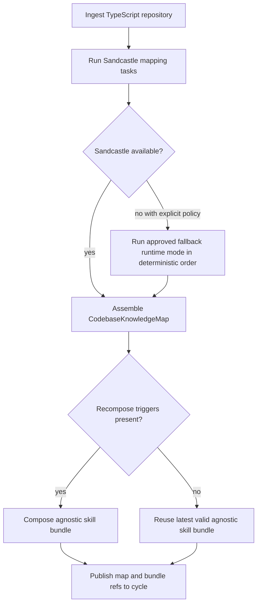

# Codebase Intelligence Mapping

## Capability Backlink

- [Sonar Loop SPEC](../SPEC.md#codebase-intelligence-mapping)

## Plain-Language Explanation

This capability builds the structured codebase context required for high-quality remediation decisions. It maps dependencies, use-cases, rules, patterns, modules, APIs, architecture, and libraries, then evaluates deterministic trigger conditions to either recompose an agnostic skill bundle or reuse the latest valid baseline bundle that coding agents can use consistently. Runtime mode is explicit (`sandcastle`, `vscode-copilot`, `claude-code`), with Sandcastle as default and deterministic fallback governance (`sandcastle -> vscode-copilot -> claude-code`) unless an approved per-project order override artifact is supplied.

## How It Works

## Inputs

| Input                                                                                                                                      | Source                                                                                           | Description                                                                            |
| ------------------------------------------------------------------------------------------------------------------------------------------ | ------------------------------------------------------------------------------------------------ | -------------------------------------------------------------------------------------- |
| `repositoryRef` and `scanScope`                                                                                                            | [MapCodebaseIntelligence](../operations.md#mapcodebaseintelligence)                              | Codebase target and scan boundaries                                                    |
| Runtime mode selection                                                                                                                     | [DetermineTargetQualityGate](../operations.md#determinetargetqualitygate)                        | Explicit [ExecutionRuntimeMode](../domain.md#executionruntimemode) for this cycle/pass |
| Sandcastle execution context                                                                                                               | [SandcastleAgentExecutionInterface](../interfaces.md#internal-sandcastleagentexecutioninterface) | Runtime interface baseline for map extraction                                          |
| `fallbackPolicyRef`                                                                                                                        | [ExecutionProviderFallbackPolicy](../rules.md#executionproviderfallbackpolicy)                   | Required artifact for any non-`sandcastle` runtime mode choice                         |
| `fallbackOrderPolicyRef`                                                                                                                   | [ExecutionProviderFallbackPolicy](../rules.md#executionproviderfallbackpolicy)                   | Optional approved per-project fallback-order policy artifact                           |
| Fallback evidence minimum (`availabilityProbeRefs`, `fallbackDecisionId`, `fallbackApprovedAt`, `fallbackExpiresAt`/`fallbackNonExpiring`) | [ExecutionProviderFallbackPolicy](../rules.md#executionproviderfallbackpolicy)                   | Required when runtime mode falls back from `sandcastle`                                |
| Fallback decision metadata (`fallbackFrom`, `fallbackTo`, `fallbackReasonCode`, `fallbackResolverStage`, `fallbackEvaluatedAt`)            | [ExecutionProviderFallbackPolicy](../rules.md#executionproviderfallbackpolicy)                   | Required for deterministic and auditable fallback decisions                            |
| Capability scope list                                                                                                                      | [ComposeAgnosticSkillBundle](../operations.md#composeagnosticskillbundle)                        | Capability boundaries for bundle composition                                           |
| `previousBundleRef`                                                                                                                        | [ComposeAgnosticSkillBundle](../operations.md#composeagnosticskillbundle)                        | Latest valid baseline candidate for reuse path                                         |
| `capabilityChangeSet`, `runtimePolicyChangeMarkers`, `mapDriftIndicators`                                                                  | [SkillBundleReusePolicy](../rules.md#skillbundlereusepolicy)                                     | Deterministic trigger set for recomposition vs reuse decision                          |
| `forceRecompose`                                                                                                                           | [ComposeAgnosticSkillBundle](../operations.md#composeagnosticskillbundle)                        | Explicit policy override for recomposition                                             |

## Outputs

| Output                                                    | Produced By                                                                      | Description                                                                             |
| --------------------------------------------------------- | -------------------------------------------------------------------------------- | --------------------------------------------------------------------------------------- |
| [CodebaseKnowledgeMap](../domain.md#codebaseknowledgemap) | [MapCodebaseIntelligence](../operations.md#mapcodebaseintelligence)              | Full dimension map for downstream stages                                                |
| [SkillBundleProfile](../domain.md#skillbundleprofile)     | [ComposeAgnosticSkillBundle](../operations.md#composeagnosticskillbundle)        | Agent-agnostic bundle is recomposed when triggered or reused from latest valid baseline |
| Cycle linkage refs                                        | [ProgressiveQualityLoopWorkflow](../workflows.md#progressivequalityloopworkflow) | References used by test and solution stages                                             |

## Concept and Aspect Linkage

| Aspect     | Linked concepts and contracts                                                                                                                                                                    | Why this capability depends on it                                                                                          |
| ---------- | ------------------------------------------------------------------------------------------------------------------------------------------------------------------------------------------------ | -------------------------------------------------------------------------------------------------------------------------- |
| Domain     | [CodebaseKnowledgeMap](../domain.md#codebaseknowledgemap), [SkillBundleProfile](../domain.md#skillbundleprofile)                                                                                 | Core context artifacts for loop execution                                                                                  |
| Operations | [MapCodebaseIntelligence](../operations.md#mapcodebaseintelligence), [ComposeAgnosticSkillBundle](../operations.md#composeagnosticskillbundle)                                                   | Mapping and skill-bundle generation behavior                                                                               |
| Rules      | [CycleStateMachine](../rules.md#cyclestatemachine), [ExecutionProviderFallbackPolicy](../rules.md#executionproviderfallbackpolicy), [SkillBundleReusePolicy](../rules.md#skillbundlereusepolicy) | Ensures map stage precedes testing/evaluation, runtime fallback stays deterministic, and bundle branching is deterministic |
| Interfaces | [SandcastleAgentExecutionInterface](../interfaces.md#internal-sandcastleagentexecutioninterface), [SkillBundleInterface](../interfaces.md#internal-skillbundleinterface)                         | Defines execution and publication contracts                                                                                |
| Workflows  | [ProgressiveQualityLoopWorkflow](../workflows.md#progressivequalityloopworkflow)                                                                                                                 | Places mapping and conditional bundle compose/reuse in deterministic order                                                 |

## Operationalization Notes

- Mapping must fail fast when any required dimension is missing.
- Runtime mode is explicit and Sandcastle-default; fallback is valid only with explicit strong policy evidence.
- Default fallback selection order is deterministic: `sandcastle -> vscode-copilot -> claude-code`.
- Per-project order override is allowed only through an approved deterministic and auditable `fallbackOrderPolicyRef` artifact.
- Skill-bundle branch decision is reuse-first: recompose only when deterministic triggers are present.
- Reuse is permitted only when `previousBundleRef` is the latest valid agnostic baseline with complete capability coverage.
- Skill bundles remain implementation-agnostic and versioned per cycle context, including reused baseline references.
- Map snapshots should be reused for closely spaced cycles when repository hash is unchanged.
