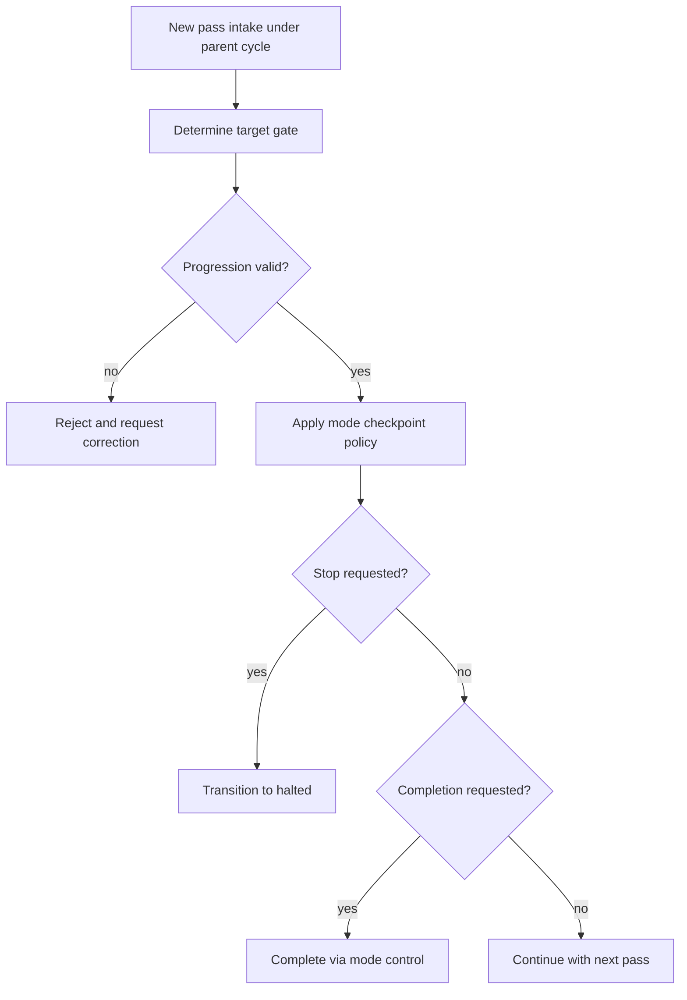

# Quality Gate Targeting and Policy

## Capability Backlink

- [Sonar Loop SPEC](../SPEC.md#quality-gate-targeting-and-policy)

## Plain-Language Explanation

This capability decides the quality gate target for each child pass in a parent cycle and enforces safe progression over time. It keeps gate changes deterministic, requires persisted rollback reasons for downgrades, binds mode-specific checkpoint behavior, and keeps mode control authoritative for completion decisions.

## How It Works

## Inputs

| Input                          | Source                                                                    | Description                                                                                                                                                            |
| ------------------------------ | ------------------------------------------------------------------------- | ---------------------------------------------------------------------------------------------------------------------------------------------------------------------- |
| `cycleId`                      | [DetermineTargetQualityGate](../operations.md#determinetargetqualitygate) | Current [ExecutionCycle](../domain.md#executioncycle)                                                                                                                  |
| `passId`                       | [DetermineTargetQualityGate](../operations.md#determinetargetqualitygate) | Active child pass identifier                                                                                                                                           |
| `requestedLevel`               | [DetermineTargetQualityGate](../operations.md#determinetargetqualitygate) | Target [QualityGateLevel](../domain.md#qualitygatelevel) candidate                                                                                                     |
| `previousGateLevel`            | [QualityGateProgressionPolicy](../rules.md#qualitygateprogressionpolicy)  | Last successful gate level                                                                                                                                             |
| `rollbackReason`               | [DetermineTargetQualityGate](../operations.md#determinetargetqualitygate) | Mandatory persisted reason when gate is downgraded                                                                                                                     |
| `runtimeMode`                  | [DetermineTargetQualityGate](../operations.md#determinetargetqualitygate) | Selected [ExecutionRuntimeMode](../domain.md#executionruntimemode) (`sandcastle` default)                                                                              |
| `mode` and `checkpointControl` | [ApplyModeControlCheckpoint](../operations.md#applymodecontrolcheckpoint) | Operation mode and stop/checkpoint state                                                                                                                               |
| `riskAcceptedOverrideRef`      | [ApplyModeControlCheckpoint](../operations.md#applymodecontrolcheckpoint) | Governed [RiskAcceptanceOverride](../domain.md#riskacceptanceoverride) reference for degraded completion requests (enum-governed role/scope with scope-binding fields) |

## Outputs

| Output                                                         | Produced By                                                                        | Description                                                      |
| -------------------------------------------------------------- | ---------------------------------------------------------------------------------- | ---------------------------------------------------------------- |
| Selected [QualityGateProfile](../domain.md#qualitygateprofile) | [DetermineTargetQualityGate](../operations.md#determinetargetqualitygate)          | Validated gate profile for this cycle                            |
| Checkpoint decision                                            | [ApplyModeControlCheckpoint](../operations.md#applymodecontrolcheckpoint)          | Continue/halt/pause result based on mode and stop control        |
| Completion decision                                            | [ApplyModeControlCheckpoint](../operations.md#applymodecontrolcheckpoint)          | Authoritative complete/continue decision source                  |
| Policy evidence                                                | [AutonomousCheckpointAndStopPolicy](../rules.md#autonomouscheckpointandstoppolicy) | Trace that autonomous checkpoints and stop controls were honored |

## Concept and Aspect Linkage

| Aspect        | Linked concepts and contracts                                                                                                                                                                                                                                                                                                                                | Why this capability depends on it                                                              |
| ------------- | ------------------------------------------------------------------------------------------------------------------------------------------------------------------------------------------------------------------------------------------------------------------------------------------------------------------------------------------------------------ | ---------------------------------------------------------------------------------------------- |
| Domain        | [ExecutionCycle](../domain.md#executioncycle), [QualityGateProfile](../domain.md#qualitygateprofile), [CheckpointControl](../domain.md#checkpointcontrol)                                                                                                                                                                                                    | Gate and mode-control decisions are stored in cycle state                                      |
| Operations    | [DetermineTargetQualityGate](../operations.md#determinetargetqualitygate), [ApplyModeControlCheckpoint](../operations.md#applymodecontrolcheckpoint)                                                                                                                                                                                                         | Performs gate selection and mode enforcement                                                   |
| Rules         | [QualityGateProgressionPolicy](../rules.md#qualitygateprogressionpolicy), [AutonomousCheckpointAndStopPolicy](../rules.md#autonomouscheckpointandstoppolicy), [CompletionGateUnderExportDegradationPolicy](../rules.md#completiongateunderexportdegradationpolicy), [RiskAcceptanceOverrideValidityPolicy](../rules.md#riskacceptanceoverridevaliditypolicy) | Prevents unsafe gate jumps, stop-control violations, and invalid degraded-completion overrides |
| Workflows     | [ProgressiveQualityLoopWorkflow](../workflows.md#progressivequalityloopworkflow), [AutonomousCheckpointWorkflow](../workflows.md#autonomouscheckpointworkflow)                                                                                                                                                                                               | Defines where gate and checkpoint controls occur in the loop                                   |
| Observability | [QualityTrendMapping](../observability.md#qualitytrendmapping)                                                                                                                                                                                                                                                                                               | Connects gate choices to quality trend metrics                                                 |

## Operationalization Notes

- Default upward progression is one gate level per completed cycle.
- Gate downgrades require persisted `rollbackReason` evidence.
- Runtime mode is explicit and defaults to `sandcastle` unless deterministic fallback policy selects `vscode-copilot` or `claude-code`.
- Autonomous mode always evaluates stop control at checkpoint boundaries.
- [CheckpointControl](../domain.md#checkpointcontrol) is the authoritative stop signal source.
- Assisted mode pauses at decision gates for operator confirmation.
- Completion under export degradation requires a valid [RiskAcceptanceOverride](../domain.md#riskacceptanceoverride) (active and non-expired unless explicitly non-expiring) with enum-governed approver role and scope type plus required scope-binding fields.
- Override lifecycle has no default expiry duration; expiry/non-expiring and revocation are manual governance actions.
- Parent cycles continue through child pass IDs until mode control authorizes completion.
