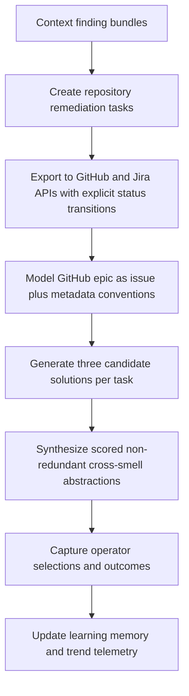

# Task Orchestration, Solution Synthesis, and Learning

## Capability Backlink

- [Sonar Loop SPEC](../SPEC.md#task-orchestration-solution-synthesis-and-learning)

## Plain-Language Explanation

This capability turns context-grouped findings into executable remediation work, exports work to GitHub and Jira through API-first integrations, generates three solution options per task, identifies abstractions that solve multiple smells with explicit scoring governance, enforces valid risk-acceptance overrides for degraded completion requests using enum-governed role/scope and manual lifecycle semantics, and learns from operator-selected solutions over cycles.

## How It Works

## Inputs

| Input                                                                                                                                                                                                                                                                                                    | Source                                                                              | Description                                                                                                         |
| -------------------------------------------------------------------------------------------------------------------------------------------------------------------------------------------------------------------------------------------------------------------------------------------------------- | ----------------------------------------------------------------------------------- | ------------------------------------------------------------------------------------------------------------------- |
| `bundleIds`                                                                                                                                                                                                                                                                                              | [CreateAndExportRemediationTasks](../operations.md#createandexportremediationtasks) | Source [FindingBundle](../domain.md#findingbundle) set                                                              |
| `githubConfigRef` and `jiraConfigRef`                                                                                                                                                                                                                                                                    | [CreateAndExportRemediationTasks](../operations.md#createandexportremediationtasks) | API integration context                                                                                             |
| `riskAcceptedOverrideRef`                                                                                                                                                                                                                                                                                | [ApplyModeControlCheckpoint](../operations.md#applymodecontrolcheckpoint)           | Optional [RiskAcceptanceOverride](../domain.md#riskacceptanceoverride) id required for degraded completion requests |
| `taskId`, `bundleRefs`, `patternCatalogRef`, `runtimeMode`                                                                                                                                                                                                                                               | [GenerateThreeCandidateSolutions](../operations.md#generatethreecandidatesolutions) | Candidate generation context                                                                                        |
| Solution-synthesis fallback evidence (`fallbackPolicyRef`, `fallbackOrderPolicyRef`, `availabilityProbeRefs`, `fallbackDecisionId`, `fallbackApprovedAt`, `fallbackExpiresAt`/`fallbackNonExpiring`, `fallbackFrom`, `fallbackTo`, `fallbackReasonCode`, `fallbackResolverStage`, `fallbackEvaluatedAt`) | [ExecutionProviderFallbackPolicy](../rules.md#executionproviderfallbackpolicy)      | Required when solution synthesis falls back from `sandcastle`                                                       |
| `selectedCandidateId`, `selectionReason`, `observedOutcome`                                                                                                                                                                                                                                              | [ApplyOperatorSelectionLearning](../operations.md#applyoperatorselectionlearning)   | Learning feedback payload                                                                                           |

## Outputs

| Output                                                                    | Produced By                                                                           | Description                                                                        |
| ------------------------------------------------------------------------- | ------------------------------------------------------------------------------------- | ---------------------------------------------------------------------------------- |
| [RemediationTask](../domain.md#remediationtask) set                       | [CreateAndExportRemediationTasks](../operations.md#createandexportremediationtasks)   | Repository and externally linked tasks                                             |
| GitHub/Jira export refs                                                   | [CreateAndExportRemediationTasks](../operations.md#createandexportremediationtasks)   | Epic/project/story linkage                                                         |
| Explicit export status progression                                        | [CreateAndExportRemediationTasks](../operations.md#createandexportremediationtasks)   | Includes `retry-pending`, `retrying`, `export-partial`, and `both-exported` states |
| Three [SolutionCandidate](../domain.md#solutioncandidate) values per task | [GenerateThreeCandidateSolutions](../operations.md#generatethreecandidatesolutions)   | Established, hybrid, and new-pattern options                                       |
| Cross-smell abstraction refs                                              | [SynthesizeCrossSmellAbstractions](../operations.md#synthesizecrosssmellabstractions) | Reduced-duplication remediation patterns                                           |
| [LearningMemory](../domain.md#learningmemory) updates                     | [ApplyOperatorSelectionLearning](../operations.md#applyoperatorselectionlearning)     | Feedback loop for future cycles                                                    |

## Concept and Aspect Linkage

| Aspect        | Linked concepts and contracts                                                                                                                                                                                                                                                                                                                                                                                                                                                      | Why this capability depends on it                                                                        |
| ------------- | ---------------------------------------------------------------------------------------------------------------------------------------------------------------------------------------------------------------------------------------------------------------------------------------------------------------------------------------------------------------------------------------------------------------------------------------------------------------------------------- | -------------------------------------------------------------------------------------------------------- |
| Domain        | [RemediationTask](../domain.md#remediationtask), [SolutionCandidate](../domain.md#solutioncandidate), [LearningMemory](../domain.md#learningmemory), [TaskExportStatus](../domain.md#taskexportstatus), [RiskAcceptanceOverride](../domain.md#riskacceptanceoverride)                                                                                                                                                                                                              | Defines work items, options, feedback memory, and governed completion overrides                          |
| Operations    | [CreateAndExportRemediationTasks](../operations.md#createandexportremediationtasks), [GenerateThreeCandidateSolutions](../operations.md#generatethreecandidatesolutions), [SynthesizeCrossSmellAbstractions](../operations.md#synthesizecrosssmellabstractions), [ApplyOperatorSelectionLearning](../operations.md#applyoperatorselectionlearning)                                                                                                                                 | Implements orchestration, synthesis, and learning                                                        |
| Rules         | [ApiFirstTaskIntegrationPolicy](../rules.md#apifirsttaskintegrationpolicy), [CompletionGateUnderExportDegradationPolicy](../rules.md#completiongateunderexportdegradationpolicy), [RiskAcceptanceOverrideValidityPolicy](../rules.md#riskacceptanceoverridevaliditypolicy), [ThreeCandidateSolutionRule](../rules.md#threecandidatesolutionrule), [NonRedundantAbstractionRule](../rules.md#nonredundantabstractionrule), [LearningFeedbackRule](../rules.md#learningfeedbackrule) | Enforces API-first integration, valid completion overrides, and candidate/abstraction/learning integrity |
| Interfaces    | [GitHubWorkApiInterface](../interfaces.md#external-githubworkapiinterface-rest), [JiraWorkApiInterface](../interfaces.md#external-jiraworkapiinterface-rest), [RiskAcceptanceOverrideRegistryInterface](../interfaces.md#internal-riskacceptanceoverrideregistryinterface)                                                                                                                                                                                                         | Defines external task export and override-governance contracts                                           |
| Workflows     | [AssistedDecisionWorkflow](../workflows.md#assisteddecisionworkflow), [ProgressiveQualityLoopWorkflow](../workflows.md#progressivequalityloopworkflow)                                                                                                                                                                                                                                                                                                                             | Places operator selection and learning in loop progression                                               |
| Observability | [CycleTelemetryEvent](../observability.md#cycletelemetryevent), [QualityTrendMapping](../observability.md#qualitytrendmapping)                                                                                                                                                                                                                                                                                                                                                     | Captures export and learning impact on quality trends                                                    |

## Operationalization Notes

- GitHub and Jira export is API-first and auditable per task.
- GitHub epic representation follows issue-plus-metadata conventions.
- Export lifecycle must remain in explicit [TaskExportStatus](../domain.md#taskexportstatus) transitions.
- Completion under export degradation requires a valid [RiskAcceptanceOverride](../domain.md#riskacceptanceoverride) artifact with enum-governed approver role and scope type plus required scope-binding fields.
- Override lifecycle has no default expiry duration; expiry/non-expiring and revocation are explicit manual lifecycle actions.
- Revocation invalidation semantics are deterministic and require `revokedAt`, `revokedByPrincipal`, and `revocationReasonCode`.
- Candidate generation always returns exactly three options.
- Solution-synthesis runtime fallback follows the same deterministic fallback policy and strong fallback evidence contract as mapping/testing.
- Accepted abstractions must satisfy the explicit scoring formula and threshold before tie-break selection.
- Learning updates are cycle-linked and feed next-cycle candidate ranking.
