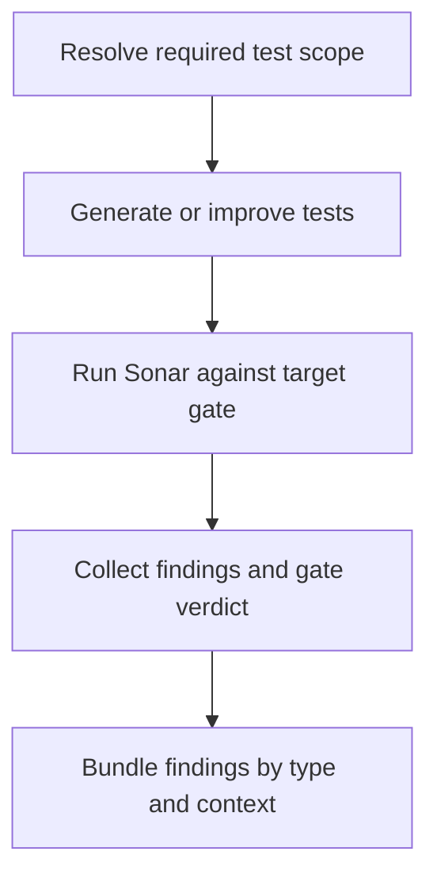

# Test Evidence and Sonar Evaluation

## Capability Backlink

- [Sonar Loop SPEC](../SPEC.md#test-evidence-and-sonar-evaluation)

## Plain-Language Explanation

This capability strengthens the test evidence baseline and runs Sonar against the selected gate so quality decisions are grounded in verified behavior. It requires integration/e2e/functional scope as a hard precondition for Sonar, allows perf/load only with explicit request artifacts, groups findings into actionable context bundles, and enforces explicit runtime mode selection with deterministic fallback governance and strong fallback evidence requirements aligned to every runtime-invoking stage.

## How It Works

## Inputs

| Input                                                                                                                                      | Source                                                                         | Description                                                                           |
| ------------------------------------------------------------------------------------------------------------------------------------------ | ------------------------------------------------------------------------------ | ------------------------------------------------------------------------------------- |
| `testScope`, `includePerf`, `includeLoad`                                                                                                  | [BuildAndImproveTestEvidence](../operations.md#buildandimprovetestevidence)    | Test scope controls                                                                   |
| `optionalScopeRequestRef`                                                                                                                  | [BuildAndImproveTestEvidence](../operations.md#buildandimprovetestevidence)    | Required when perf/load scope is requested                                            |
| `runtimeMode`                                                                                                                              | [BuildAndImproveTestEvidence](../operations.md#buildandimprovetestevidence)    | Selected [ExecutionRuntimeMode](../domain.md#executionruntimemode) for test execution |
| `fallbackPolicyRef`, `fallbackOrderPolicyRef`                                                                                              | [ExecutionProviderFallbackPolicy](../rules.md#executionproviderfallbackpolicy) | Fallback policy artifacts when runtime mode falls back from `sandcastle`              |
| Fallback evidence minimum (`availabilityProbeRefs`, `fallbackDecisionId`, `fallbackApprovedAt`, `fallbackExpiresAt`/`fallbackNonExpiring`) | [ExecutionProviderFallbackPolicy](../rules.md#executionproviderfallbackpolicy) | Required when runtime mode falls back from `sandcastle`                               |
| Fallback decision metadata (`fallbackFrom`, `fallbackTo`, `fallbackReasonCode`, `fallbackResolverStage`, `fallbackEvaluatedAt`)            | [ExecutionProviderFallbackPolicy](../rules.md#executionproviderfallbackpolicy) | Required for deterministic and auditable fallback decisions                           |
| `gateProfileId`                                                                                                                            | [EvaluateWithSonarQualityGate](../operations.md#evaluatewithsonarqualitygate)  | Selected gate profile                                                                 |
| `findingRefs` and `contextMapRef`                                                                                                          | [BundleFindingsByContext](../operations.md#bundlefindingsbycontext)            | Raw findings and map context                                                          |

## Outputs

| Output                                          | Produced By                                                                   | Description                                              |
| ----------------------------------------------- | ----------------------------------------------------------------------------- | -------------------------------------------------------- |
| Test evidence artifacts                         | [BuildAndImproveTestEvidence](../operations.md#buildandimprovetestevidence)   | Integration/e2e/functional baseline plus optional slices |
| Sonar gate verdict + findings                   | [EvaluateWithSonarQualityGate](../operations.md#evaluatewithsonarqualitygate) | Gate result and finding list                             |
| [FindingBundle](../domain.md#findingbundle) set | [BundleFindingsByContext](../operations.md#bundlefindingsbycontext)           | Context-grouped findings for task orchestration          |

## Concept and Aspect Linkage

| Aspect        | Linked concepts and contracts                                                                                                                                                                                                   | Why this capability depends on it                                                    |
| ------------- | ------------------------------------------------------------------------------------------------------------------------------------------------------------------------------------------------------------------------------- | ------------------------------------------------------------------------------------ |
| Domain        | [FindingBundle](../domain.md#findingbundle), [QualityGateProfile](../domain.md#qualitygateprofile), [TestScopeLevel](../domain.md#testscopelevel)                                                                               | Defines evaluation targets and grouped outputs                                       |
| Operations    | [BuildAndImproveTestEvidence](../operations.md#buildandimprovetestevidence), [EvaluateWithSonarQualityGate](../operations.md#evaluatewithsonarqualitygate), [BundleFindingsByContext](../operations.md#bundlefindingsbycontext) | Implements evidence-first evaluation flow                                            |
| Rules         | [TestScopePolicy](../rules.md#testscopepolicy), [ExecutionProviderFallbackPolicy](../rules.md#executionproviderfallbackpolicy)                                                                                                  | Enforces mandatory/optional test scope boundaries and deterministic runtime fallback |
| Interfaces    | [SandcastleAgentExecutionInterface](../interfaces.md#internal-sandcastleagentexecutioninterface), [SonarAnalysisInterface](../interfaces.md#external-sonaranalysisinterface-restcli)                                            | Binds test/runtime execution and Sonar evaluation contracts                          |
| Observability | [QualityTrendMapping](../observability.md#qualitytrendmapping), [CycleTelemetryEvent](../observability.md#cycletelemetryevent)                                                                                                  | Provides trend and finding distribution telemetry                                    |

## Operationalization Notes

- Never run gate evaluation before required test evidence is ready.
- Sonar precondition requires integration, e2e, and functional evidence slices.
- Optional perf/load slices are valid only with explicit request artifact.
- Runtime mode is explicit and Sandcastle-default with deterministic fallback order: `sandcastle -> vscode-copilot -> claude-code`.
- Per-project fallback-order override is valid only through an approved deterministic and auditable `fallbackOrderPolicyRef` artifact.
- Fallback evidence must include policy ref, availability probes, decision id, approval timestamp, explicit expiry/non-expiring lifecycle field, and fallback decision metadata.
- Finding bundles should preserve source references for downstream task generation and auditing.
