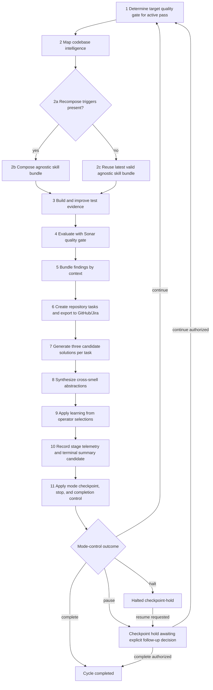
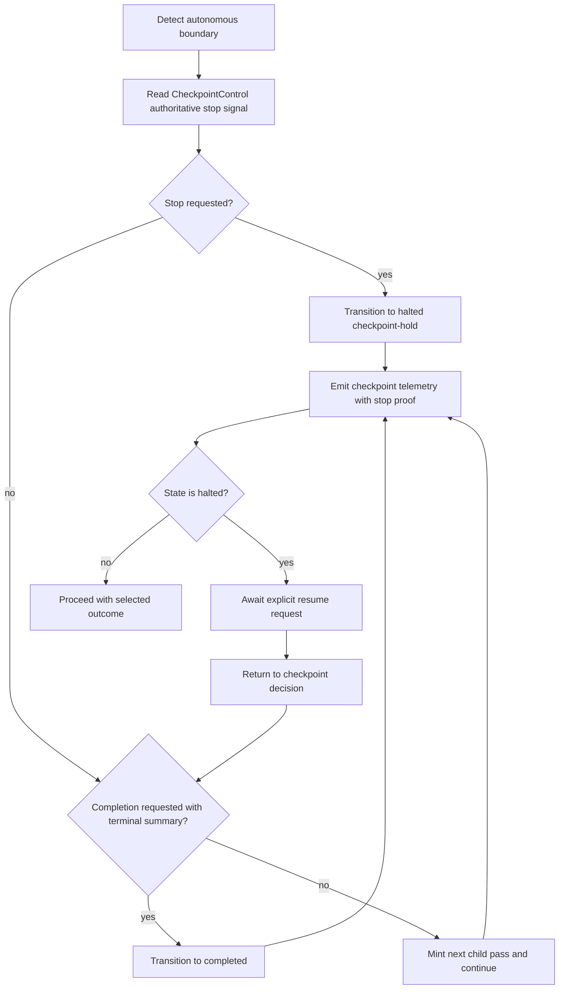
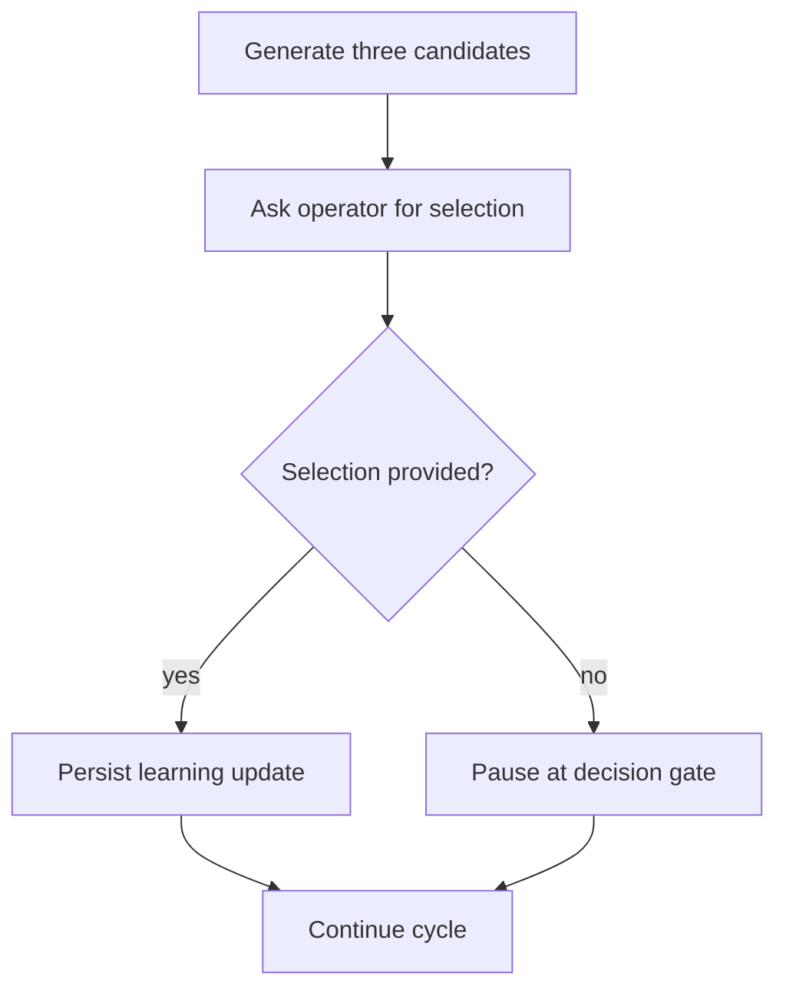

# Workflows: Sonar Loop

## Capability Backlinks

- [Quality Gate Targeting and Policy](SPEC.md#quality-gate-targeting-and-policy)
- [Codebase Intelligence Mapping](SPEC.md#codebase-intelligence-mapping)
- [Test Evidence and Sonar Evaluation](SPEC.md#test-evidence-and-sonar-evaluation)
- [Task Orchestration, Solution Synthesis, and Learning](SPEC.md#task-orchestration-solution-synthesis-and-learning)

## User Journey Alignment

| Journey stage                    | Workflow implications                                                                                                                                                              |
| -------------------------------- | ---------------------------------------------------------------------------------------------------------------------------------------------------------------------------------- |
| Evaluator day 0-day 1            | Early loop must expose actionable bundles/tasks quickly while preserving governance signals                                                                                        |
| Pilot week 1                     | Dual-repo pilot posture and assisted-first decision flow emphasize [AssistedDecisionWorkflow](#assisteddecisionworkflow)                                                           |
| Scale month 1                    | Single-team multi-repo replication and governance proof package are carried by [ProgressiveQualityLoopWorkflow](#progressivequalityloopworkflow) telemetry and checkpoint evidence |
| Ongoing operations and expansion | Weekly governed cadence with low intervention and explicit checkpoint outcomes supports repo-by-repo team expansion                                                                |

Detailed journey docs: [userjourney/README.md](userjourney/README.md).

## ProgressiveQualityLoopWorkflow

**Type:** Workflow
**Triggers:** Operator starts a new progressive cycle for a TypeScript codebase
**Orchestrates:** [DetermineTargetQualityGate](operations.md#determinetargetqualitygate), [MapCodebaseIntelligence](operations.md#mapcodebaseintelligence), [ComposeAgnosticSkillBundle](operations.md#composeagnosticskillbundle), [BuildAndImproveTestEvidence](operations.md#buildandimprovetestevidence), [EvaluateWithSonarQualityGate](operations.md#evaluatewithsonarqualitygate), [BundleFindingsByContext](operations.md#bundlefindingsbycontext), [CreateAndExportRemediationTasks](operations.md#createandexportremediationtasks), [GenerateThreeCandidateSolutions](operations.md#generatethreecandidatesolutions), [SynthesizeCrossSmellAbstractions](operations.md#synthesizecrosssmellabstractions), [ApplyOperatorSelectionLearning](operations.md#applyoperatorselectionlearning), [RecordCycleTelemetryTrend](operations.md#recordcycletelemetrytrend), [ApplyModeControlCheckpoint](operations.md#applymodecontrolcheckpoint)
**Compensation Strategy:** checkpoint-and-halt with corrective rerun
**Idempotency:** conditional (idempotent for same parent cycle/pass input set and unchanged repository state)

### Steps

### Step Table

| #   | Step                                                   | Actor            | Operation                                                                          | On Success                                                                                                                            | On Failure                                                    | Compensation                                                                                          |
| --- | ------------------------------------------------------ | ---------------- | ---------------------------------------------------------------------------------- | ------------------------------------------------------------------------------------------------------------------------------------- | ------------------------------------------------------------- | ----------------------------------------------------------------------------------------------------- |
| 1   | Determine target quality gate                          | Operator/Runtime | [DetermineTargetQualityGate](operations.md#determinetargetqualitygate)             | Gate profile selected for active pass                                                                                                 | Gate unresolved                                               | Hold cycle in `intake`                                                                                |
| 2   | Build codebase intelligence map                        | Runtime          | [MapCodebaseIntelligence](operations.md#mapcodebaseintelligence)                   | Map artifact ready with governed runtime fallback evidence when fallback occurs                                                       | Map incomplete                                                | Re-scan with narrowed scope                                                                           |
| 2b  | Compose agnostic skill bundle (conditional)            | Runtime          | [ComposeAgnosticSkillBundle](operations.md#composeagnosticskillbundle)             | Recomposition branch publishes updated bundle version when triggers are present                                                       | Coverage gap or agnosticity violation in recomposition branch | Recompose with corrected capability inputs                                                            |
| 2c  | Reuse latest valid agnostic skill bundle (conditional) | Runtime          | [ComposeAgnosticSkillBundle](operations.md#composeagnosticskillbundle)             | Reuse branch attaches latest valid bundle when no trigger is present                                                                  | Reuse baseline missing or invalid                             | Force deterministic recomposition path with explicit trigger evidence                                 |
| 3   | Improve test evidence                                  | Runtime          | [BuildAndImproveTestEvidence](operations.md#buildandimprovetestevidence)           | Required test evidence ready with governed runtime fallback evidence when fallback occurs and composed/reused bundle context attached | Mandatory scope missing                                       | Stop before Sonar evaluation                                                                          |
| 4   | Run Sonar evaluation                                   | Runtime          | [EvaluateWithSonarQualityGate](operations.md#evaluatewithsonarqualitygate)         | Gate verdict and findings recorded                                                                                                    | Sonar failed                                                  | Run exactly one remediation-evidenced retry; if retry fails, transition deterministically to `failed` |
| 5   | Bundle findings                                        | Runtime          | [BundleFindingsByContext](operations.md#bundlefindingsbycontext)                   | Context bundles produced                                                                                                              | Unclassified findings                                         | Emit bundle-gap and halt tasking                                                                      |
| 6   | Create and export remediation tasks                    | Runtime          | [CreateAndExportRemediationTasks](operations.md#createandexportremediationtasks)   | Tasks reach explicit export state model                                                                                               | Export partial/failed                                         | Keep repository task and schedule retry transitions                                                   |
| 7   | Generate three solution candidates                     | Runtime          | [GenerateThreeCandidateSolutions](operations.md#generatethreecandidatesolutions)   | Three options per task with governed runtime fallback evidence when fallback occurs                                                   | Candidate count invalid                                       | Block learning stage                                                                                  |
| 8   | Synthesize abstractions                                | Runtime          | [SynthesizeCrossSmellAbstractions](operations.md#synthesizecrosssmellabstractions) | Scored abstractions above threshold attached                                                                                          | Redundancy/score violation                                    | Keep per-task candidates only                                                                         |
| 9   | Apply operator-selection learning                      | Operator/Runtime | [ApplyOperatorSelectionLearning](operations.md#applyoperatorselectionlearning)     | Learning memory updated                                                                                                               | Missing selection rationale                                   | Request assisted clarification                                                                        |
| 10  | Record telemetry trend                                 | Runtime          | [RecordCycleTelemetryTrend](operations.md#recordcycletelemetrytrend)               | Stage events and optional terminal summary captured                                                                                   | Telemetry incomplete                                          | Block mode-control completion decision                                                                |
| 11  | Enforce mode controls                                  | Runtime          | [ApplyModeControlCheckpoint](operations.md#applymodecontrolcheckpoint)             | Continue, pause, halt, or complete with completion gate enforcement                                                                   | Stop/completion policy violation                              | Force checkpoint hold (`pause`) or `halted` and emit policy signal                                    |

### Invariants

| ID      | Invariant                                                                                           | Formal                                                                                                                                                                                                                                                                                                    |
| ------- | --------------------------------------------------------------------------------------------------- | --------------------------------------------------------------------------------------------------------------------------------------------------------------------------------------------------------------------------------------------------------------------------------------------------------- |
| I-WF-1  | Stage order is deterministic per child pass with explicit compose/reuse branch                      | `recomposeRequired=true -> executedSteps(passId)=[1,2,2b,3,4,5,6,7,8,9,10,11]; recomposeRequired=false -> executedSteps(passId)=[1,2,2c,3,4,5,6,7,8,9,10,11]`                                                                                                                                             |
| I-WF-2  | Sonar evaluation requires test evidence                                                             | `step4 -> completed(step3)`                                                                                                                                                                                                                                                                               |
| I-WF-3  | Every remediation task has exactly three candidates                                                 | `forall task, count(task.candidateSolutions)=3`                                                                                                                                                                                                                                                           |
| I-WF-4  | Autonomous checkpoints are never skipped                                                            | `mode=autonomous -> checkpoint at every configured boundary`                                                                                                                                                                                                                                              |
| I-WF-5  | Completion is authorized by mode control                                                            | `state=completed -> decidedBy=ApplyModeControlCheckpoint`                                                                                                                                                                                                                                                 |
| I-WF-6  | Completed cycle contains stage events and terminal summary                                          | `state=completed -> stageEventRefs!=empty and terminalCycleSummaryRef!=null`                                                                                                                                                                                                                              |
| I-WF-7  | Halted is a resumable checkpoint-hold, not terminal                                                 | `state=halted -> terminal=false`                                                                                                                                                                                                                                                                          |
| I-WF-8  | Completion blocks under export degradation unless explicit valid override exists                    | `completionRequested and (activeExportRetryCount > 0 or exportDegradationThresholdBreached=true) -> state!=completed unless validRiskAcceptanceOverride(riskAcceptedOverrideRef,checkpointEvaluatedAt)=true`                                                                                              |
| I-WF-9  | Every runtime-invoking stage uses the same fallback governance boundary and strong evidence minimum | `stage in {mapping,testing,solution-synthesis,custom-runtime-stage} and runtimeMode!=sandcastle -> fallbackPolicyRef != null and fallbackDecisionId != null and count(availabilityProbeRefs)>=1 and fallbackApprovedAt != null and (fallbackNonExpiring=true or fallbackExpiresAt > fallbackEvaluatedAt)` |
| I-WF-10 | Exactly one skill-bundle branch is executed per pass                                                | `completed(step2) -> xor(completed(step2b),completed(step2c))`                                                                                                                                                                                                                                            |
| I-WF-11 | Reuse branch requires latest valid baseline bundle                                                  | `completed(step2c) -> reusedBundleRef != null and reusedBundleValid=true`                                                                                                                                                                                                                                 |

---

## AutonomousCheckpointWorkflow

**Type:** Workflow
**Triggers:** [ExecutionCycle](domain.md#executioncycle).mode is `autonomous`
**Orchestrates:** [ApplyModeControlCheckpoint](operations.md#applymodecontrolcheckpoint), [RecordCycleTelemetryTrend](operations.md#recordcycletelemetrytrend)
**Compensation Strategy:** stop-and-preserve-state
**Idempotency:** yes for repeated checkpoint evaluations with unchanged control state

### Steps

### Step Table

| #   | Step                                 | Actor   | Operation                                                              | On Success                                                            | On Failure                                            | Compensation                          |
| --- | ------------------------------------ | ------- | ---------------------------------------------------------------------- | --------------------------------------------------------------------- | ----------------------------------------------------- | ------------------------------------- |
| 1   | Detect checkpoint boundary           | Runtime | [ApplyModeControlCheckpoint](operations.md#applymodecontrolcheckpoint) | Boundary recognized                                                   | Boundary missing                                      | Force boundary by policy              |
| 2   | Evaluate stop and completion control | Runtime | [ApplyModeControlCheckpoint](operations.md#applymodecontrolcheckpoint) | Continue, pause, halt, or complete chosen                             | Stop/completion ambiguity or missing compliance proof | Default to pause-safe checkpoint-hold |
| 3   | Emit checkpoint telemetry            | Runtime | [RecordCycleTelemetryTrend](operations.md#recordcycletelemetrytrend)   | Stage event, stop proof fields, and completion-gate evidence appended | Envelope incomplete                                   | Hold run at checkpoint                |

### Invariants

| ID      | Invariant                                                  | Formal                                                                                                       |
| ------- | ---------------------------------------------------------- | ------------------------------------------------------------------------------------------------------------ |
| I-AUT-1 | Stop request takes precedence                              | `stopRequested=true -> nextState=halted`                                                                     |
| I-AUT-2 | Completion remains mode-control authoritative              | `nextState=completed -> decidedBy=ApplyModeControlCheckpoint`                                                |
| I-AUT-3 | Halted state preserves artifacts                           | `state=halted -> no artifact loss`                                                                           |
| I-AUT-4 | Halted state is resumable                                  | `state=halted and resumeRequested=true and stopRequested=false -> nextState=checkpoint`                      |
| I-AUT-5 | Halted transition requires stop compliance timestamp proof | `nextState=halted -> stopRequestedAt != null and haltedAt != null and haltedCheckpointIndex=checkpointIndex` |

---

## AssistedDecisionWorkflow

**Type:** Workflow
**Triggers:** [ExecutionCycle](domain.md#executioncycle).mode is `assisted`
**Orchestrates:** [GenerateThreeCandidateSolutions](operations.md#generatethreecandidatesolutions), [ApplyOperatorSelectionLearning](operations.md#applyoperatorselectionlearning), [ApplyModeControlCheckpoint](operations.md#applymodecontrolcheckpoint)
**Compensation Strategy:** decision-gate pause
**Idempotency:** yes for repeated prompts on unresolved decisions

### Steps

### Step Table

| #   | Step                       | Actor    | Operation                                                                        | On Success                                                       | On Failure                | Compensation                   |
| --- | -------------------------- | -------- | -------------------------------------------------------------------------------- | ---------------------------------------------------------------- | ------------------------- | ------------------------------ |
| 1   | Generate candidate set     | Runtime  | [GenerateThreeCandidateSolutions](operations.md#generatethreecandidatesolutions) | Three options prepared                                           | Candidate rule failure    | Block gate                     |
| 2   | Capture operator selection | Operator | [ApplyOperatorSelectionLearning](operations.md#applyoperatorselectionlearning)   | Learning update ready                                            | Missing rationale/outcome | Keep cycle in checkpoint state |
| 3   | Resolve checkpoint gate    | Runtime  | [ApplyModeControlCheckpoint](operations.md#applymodecontrolcheckpoint)           | Continue, pause, halt, or complete (with completion gate checks) | Missing decision evidence | Hold decision gate             |

### Invariants

| ID      | Invariant                                                        | Formal                                                              |
| ------- | ---------------------------------------------------------------- | ------------------------------------------------------------------- |
| I-AST-1 | Assisted mode requires explicit operator input at decision gates | `mode=assisted and decisionGate=true -> operatorInputRequired=true` |
| I-AST-2 | Learning update is tied to selected candidate                    | `learning.selectedCandidateId in task.candidateSolutions`           |
| I-AST-3 | Pause is a first-class mode-control outcome                      | `mode=assisted and unresolved=true -> modeControlOutcome=pause`     |
