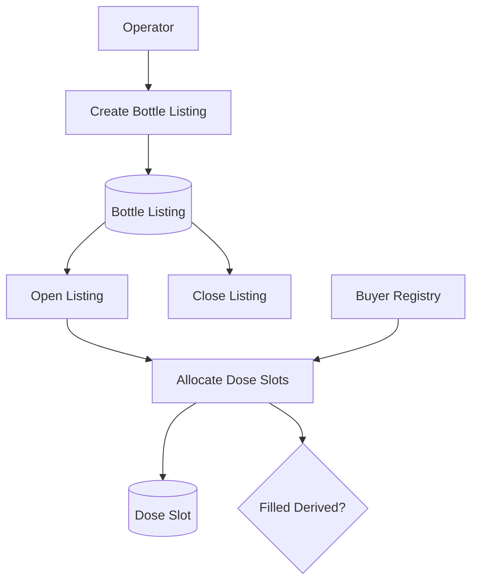

# Bottle Listing And Dose Allocation

## What This Module Owns

Bottle Listing And Dose Allocation owns the bottle offer, numbered dose slots, buyer dose requests, allocation rules, and listing lifecycle. It lets the [group operator](../../PROJECT-OVERVIEW.md#actors-and-stakeholders) create listings, open them for reservations, assign slots to eligible buyers from [Buyer Registry](../buyer-registry/SPEC.md), and close listings without owning payment truth, payment links, shipment batching, Excel import, or WhatsApp posting.

## Module Map

## Capabilities

| Capability           | What                                                                    | Key Aspects                                                                                                                                                                                                                                                        | Detail                                                       |
| -------------------- | ----------------------------------------------------------------------- | ------------------------------------------------------------------------------------------------------------------------------------------------------------------------------------------------------------------------------------------------------------------ | ------------------------------------------------------------ |
| Listing Management   | Create, update draft details, open, and close bottle listings           | [Bottle Listing](domain.md#bottle-listing), [CreateBottleListing](operations.md#createbottlelisting), [OpenBottleListing](operations.md#openbottlelisting), [CloseBottleListing](operations.md#closebottlelisting), [ListingLifecycle](states.md#listinglifecycle) | V1 lifecycle is `draft`, `open`, `closed`; filled is derived |
| Dose Slot Allocation | Assign numbered dose slots to eligible buyers without overselling       | [Dose Slot](domain.md#dose-slot), [AllocateDoseSlots](operations.md#allocatedoseslots), [ReleaseDoseSlots](operations.md#releasedoseslots), [SlotAvailabilityRule](rules.md#r1-slot-availability-rule)                                                             | Requires buyer reservation eligibility from Buyer Registry   |
| Allocation Integrity | Enforce availability, open-listing, and optional per-person limit rules | [ListingOpenRule](rules.md#r2-listing-open-rule), [PerPersonDoseLimitRule](rules.md#r3-per-person-dose-limit-rule), [ActiveAllocationUniquenessRule](rules.md#r4-active-allocation-uniqueness-rule)                                                                | Prevents duplicate assignment and oversold listings          |
| Listing Read Models  | Expose allocation state for payment, rendering, and shipment consumers  | [GetBottleListing](queries.md#getbottlelisting), [ListOpenListings](queries.md#listopenlistings), [GetListingAllocationSummary](queries.md#getlistingallocationsummary), [BottleListingModule](interfaces.md#internal-bottlelistingmodule-interface)               | Produces current slot and fill information                   |

## Domain Concepts

| Concept                                        | Type         | Key Constraints                                                                                                            |
| ---------------------------------------------- | ------------ | -------------------------------------------------------------------------------------------------------------------------- |
| [Bottle Listing](domain.md#bottle-listing)     | Entity       | Has lifecycle, bottle details, dose size, price per dose, total slots, optional per-person limit, and payment policy hints |
| [Dose Slot](domain.md#dose-slot)               | Entity       | Belongs to one listing; has a unique slot number within that listing                                                       |
| [Dose Allocation](domain.md#dose-allocation)   | Entity       | Assigns one or more slots to one buyer in one listing                                                                      |
| [Listing Status](domain.md#listing-status)     | Enum / Type  | `draft`, `open`, `closed`                                                                                                  |
| [Dose Slot Status](domain.md#dose-slot-status) | Enum / Type  | `open`, `allocated`, `released`                                                                                            |
| [Dose Quantity](domain.md#dose-quantity)       | Value Object | Positive integer bounded by available slots and optional per-person limit                                                  |
| [Money Amount](domain.md#money-amount)         | Value Object | Non-negative BRL amount used for price per dose                                                                            |

## Concept Registry

| Concept                                                                         | ID                                                                  | Type          |
| ------------------------------------------------------------------------------- | ------------------------------------------------------------------- | ------------- |
| [Bottle Listing](domain.md#bottle-listing)                                      | `bottle-listing-and-dose-allocation.BottleListing`                  | Entity        |
| [Dose Slot](domain.md#dose-slot)                                                | `bottle-listing-and-dose-allocation.DoseSlot`                       | Entity        |
| [Dose Allocation](domain.md#dose-allocation)                                    | `bottle-listing-and-dose-allocation.DoseAllocation`                 | Entity        |
| [Listing Status](domain.md#listing-status)                                      | `bottle-listing-and-dose-allocation.ListingStatus`                  | Enum / Type   |
| [Dose Slot Status](domain.md#dose-slot-status)                                  | `bottle-listing-and-dose-allocation.DoseSlotStatus`                 | Enum / Type   |
| [ListingLifecycle](states.md#listinglifecycle)                                  | `bottle-listing-and-dose-allocation.ListingLifecycle`               | State Machine |
| [CreateBottleListing](operations.md#createbottlelisting)                        | `bottle-listing-and-dose-allocation.CreateBottleListing`            | Operation     |
| [OpenBottleListing](operations.md#openbottlelisting)                            | `bottle-listing-and-dose-allocation.OpenBottleListing`              | Operation     |
| [CloseBottleListing](operations.md#closebottlelisting)                          | `bottle-listing-and-dose-allocation.CloseBottleListing`             | Operation     |
| [AllocateDoseSlots](operations.md#allocatedoseslots)                            | `bottle-listing-and-dose-allocation.AllocateDoseSlots`              | Operation     |
| [ReleaseDoseSlots](operations.md#releasedoseslots)                              | `bottle-listing-and-dose-allocation.ReleaseDoseSlots`               | Operation     |
| [SlotAvailabilityRule](rules.md#r1-slot-availability-rule)                      | `bottle-listing-and-dose-allocation.SlotAvailabilityRule`           | Rule          |
| [ListingOpenRule](rules.md#r2-listing-open-rule)                                | `bottle-listing-and-dose-allocation.ListingOpenRule`                | Rule          |
| [PerPersonDoseLimitRule](rules.md#r3-per-person-dose-limit-rule)                | `bottle-listing-and-dose-allocation.PerPersonDoseLimitRule`         | Rule          |
| [ActiveAllocationUniquenessRule](rules.md#r4-active-allocation-uniqueness-rule) | `bottle-listing-and-dose-allocation.ActiveAllocationUniquenessRule` | Rule          |
| [FilledListingDerivation](rules.md#c1-filled-listing-derivation)                | `bottle-listing-and-dose-allocation.FilledListingDerivation`        | Calculation   |
| [GetBottleListing](queries.md#getbottlelisting)                                 | `bottle-listing-and-dose-allocation.GetBottleListing`               | Query         |
| [ListOpenListings](queries.md#listopenlistings)                                 | `bottle-listing-and-dose-allocation.ListOpenListings`               | Query         |
| [GetListingAllocationSummary](queries.md#getlistingallocationsummary)           | `bottle-listing-and-dose-allocation.GetListingAllocationSummary`    | Query         |
| [BottleListingAPI](interfaces.md#external-bottlelistingapi-rest)                | `bottle-listing-and-dose-allocation.BottleListingAPI`               | Interface     |
| [BottleListingModule](interfaces.md#internal-bottlelistingmodule-interface)     | `bottle-listing-and-dose-allocation.BottleListingModule`            | Interface     |
| [BottleListingCreated](events.md#bottlelistingcreated)                          | `bottle-listing-and-dose-allocation.BottleListingCreated`           | Event         |
| [BottleListingOpened](events.md#bottlelistingopened)                            | `bottle-listing-and-dose-allocation.BottleListingOpened`            | Event         |
| [DoseSlotsAllocated](events.md#doseslotsallocated)                              | `bottle-listing-and-dose-allocation.DoseSlotsAllocated`             | Event         |
| [DoseSlotsReleased](events.md#doseslotsreleased)                                | `bottle-listing-and-dose-allocation.DoseSlotsReleased`              | Event         |
| [BottleListingClosed](events.md#bottlelistingclosed)                            | `bottle-listing-and-dose-allocation.BottleListingClosed`            | Event         |

## Feature Concept Graph

| From                                                                | Edge           | To                                                               | Evidence                                                                                                                   | Notes                                             |
| ------------------------------------------------------------------- | -------------- | ---------------------------------------------------------------- | -------------------------------------------------------------------------------------------------------------------------- | ------------------------------------------------- |
| `bottle-listing-and-dose-allocation.BottleListing`                  | performs       | `bottle-listing-and-dose-allocation.CreateBottleListing`         | [operations.md#createbottlelisting](operations.md#createbottlelisting)                                                     | Operator creates the listing record               |
| `bottle-listing-and-dose-allocation.CreateBottleListing`            | produces       | `bottle-listing-and-dose-allocation.BottleListingCreated`        | [events.md#bottlelistingcreated](events.md#bottlelistingcreated)                                                           | Listing starts as draft                           |
| `bottle-listing-and-dose-allocation.OpenBottleListing`              | produces       | `bottle-listing-and-dose-allocation.BottleListingOpened`         | [events.md#bottlelistingopened](events.md#bottlelistingopened)                                                             | Opens reservations                                |
| `bottle-listing-and-dose-allocation.CloseBottleListing`             | produces       | `bottle-listing-and-dose-allocation.BottleListingClosed`         | [events.md#bottlelistingclosed](events.md#bottlelistingclosed)                                                             | Stops normal allocation changes                   |
| `bottle-listing-and-dose-allocation.AllocateDoseSlots`              | produces       | `bottle-listing-and-dose-allocation.DoseSlotsAllocated`          | [events.md#doseslotsallocated](events.md#doseslotsallocated)                                                               | Assigns numbered slots to a buyer                 |
| `bottle-listing-and-dose-allocation.ReleaseDoseSlots`               | produces       | `bottle-listing-and-dose-allocation.DoseSlotsReleased`           | [events.md#doseslotsreleased](events.md#doseslotsreleased)                                                                 | Makes slots available again while listing is open |
| `bottle-listing-and-dose-allocation.BottleListingOpened`            | transitions    | `bottle-listing-and-dose-allocation.ListingLifecycle`            | [states.md#listinglifecycle](states.md#listinglifecycle)                                                                   | Draft to open                                     |
| `bottle-listing-and-dose-allocation.BottleListingClosed`            | transitions    | `bottle-listing-and-dose-allocation.ListingLifecycle`            | [states.md#listinglifecycle](states.md#listinglifecycle)                                                                   | Open or draft to closed                           |
| `bottle-listing-and-dose-allocation.SlotAvailabilityRule`           | enforces       | `bottle-listing-and-dose-allocation.AllocateDoseSlots`           | [rules.md#r1-slot-availability-rule](rules.md#r1-slot-availability-rule)                                                   | Prevents overselling                              |
| `bottle-listing-and-dose-allocation.ListingOpenRule`                | enforces       | `bottle-listing-and-dose-allocation.AllocateDoseSlots`           | [rules.md#r2-listing-open-rule](rules.md#r2-listing-open-rule)                                                             | Allocation only while open                        |
| `bottle-listing-and-dose-allocation.PerPersonDoseLimitRule`         | enforces       | `bottle-listing-and-dose-allocation.AllocateDoseSlots`           | [rules.md#r3-per-person-dose-limit-rule](rules.md#r3-per-person-dose-limit-rule)                                           | Optional listing-level cap                        |
| `bottle-listing-and-dose-allocation.ActiveAllocationUniquenessRule` | enforces       | `bottle-listing-and-dose-allocation.AllocateDoseSlots`           | [rules.md#r4-active-allocation-uniqueness-rule](rules.md#r4-active-allocation-uniqueness-rule)                             | Prevents duplicate active slot assignment         |
| `bottle-listing-and-dose-allocation.FilledListingDerivation`        | calculates     | `bottle-listing-and-dose-allocation.GetListingAllocationSummary` | [rules.md#c1-filled-listing-derivation](rules.md#c1-filled-listing-derivation)                                             | Filled is derived, not a status                   |
| `bottle-listing-and-dose-allocation.GetBottleListing`               | queries        | `bottle-listing-and-dose-allocation.BottleListing`               | [queries.md#getbottlelisting](queries.md#getbottlelisting)                                                                 | Reads one listing                                 |
| `bottle-listing-and-dose-allocation.GetListingAllocationSummary`    | queries        | `bottle-listing-and-dose-allocation.DoseSlot`                    | [queries.md#getlistingallocationsummary](queries.md#getlistingallocationsummary)                                           | Reads slot occupancy                              |
| `bottle-listing-and-dose-allocation.BottleListingAPI`               | exposes        | `bottle-listing-and-dose-allocation.AllocateDoseSlots`           | [interfaces.md#external-bottlelistingapi-rest](interfaces.md#external-bottlelistingapi-rest)                               | Operator mutation surface                         |
| `bottle-listing-and-dose-allocation.BottleListingModule`            | exposes        | `bottle-listing-and-dose-allocation.GetListingAllocationSummary` | [interfaces.md#internal-bottlelistingmodule-interface](interfaces.md#internal-bottlelistingmodule-interface)               | Downstream read contract                          |
| `buyer-registry.ReservationIdentityRule`                            | enforces-cross | `bottle-listing-and-dose-allocation.AllocateDoseSlots`           | [../buyer-registry/rules.md#r1-reservation-identity-required](../buyer-registry/rules.md#r1-reservation-identity-required) | Buyer must be reservation eligible                |

## Aspect Docs

| Aspect                          | Contains                                      | Key Concepts                                                          |
| ------------------------------- | --------------------------------------------- | --------------------------------------------------------------------- |
| [Architecture](architecture.md) | Six-view feature architecture and gate result | BottleListingAPI, BottleListingModule, BuyerRegistryModule dependency |
| [Glossary](glossary.md)         | Distilled definitions for feature concepts    | Bottle Listing, Dose Slot, Allocation                                 |
| [Domain](domain.md)             | Entities, value objects, and enums            | Bottle Listing, Dose Slot, Dose Allocation                            |
| [Operations](operations.md)     | Operator mutations and postconditions         | Create, open, allocate, release, close                                |
| [Queries](queries.md)           | Read models and allocation summaries          | Get listing, list open, summary                                       |
| [Interfaces](interfaces.md)     | REST and internal module contracts            | BottleListingAPI, BottleListingModule                                 |
| [Rules](rules.md)               | Formal constraints and derivations            | Slot availability, open listing, per-person limit                     |
| [States](states.md)             | Listing and slot state transitions            | ListingLifecycle, DoseSlotStatus                                      |
| [Workflows](workflows.md)       | Multi-step allocation flows                   | Listing publication, dose allocation                                  |
| [Events](events.md)             | Domain events and consumers                   | Listing opened, slots allocated                                       |

## Cross-Feature Dependencies

| Capability           | Depends On                                  | Via                                                                                           | Why                                                                         |
| -------------------- | ------------------------------------------- | --------------------------------------------------------------------------------------------- | --------------------------------------------------------------------------- |
| Dose Slot Allocation | [Buyer Registry](../buyer-registry/SPEC.md) | [BuyerRegistryModule](../buyer-registry/interfaces.md#internal-buyerregistrymodule-interface) | Reservation requires name, WhatsApp mention, and CPF before slot assignment |

## Produces For

| Consumer                       | Consumes Capability | Via                                                                         | What                                                                      |
| ------------------------------ | ------------------- | --------------------------------------------------------------------------- | ------------------------------------------------------------------------- |
| Public WhatsApp List Rendering | Listing Read Models | [BottleListingModule](interfaces.md#internal-bottlelistingmodule-interface) | Listing details, slot numbers, buyer mentions, open/closed/fill state     |
| Dose Payment Tracking          | Listing Read Models | [GetPaymentEligibleAllocations](queries.md#getpaymenteligibleallocations)   | Selected listing allocations and buyer totals for payment runs            |
| Freight And Shipment Batching  | Listing Read Models | [GetBuyerAllocatedDoses](queries.md#getbuyerallocateddoses)                 | Buyer-owned allocated doses after payment is satisfied by payment feature |

## Stories

User stories are maintained in [STORIES.md](STORIES.md).

## Change History

Initial feature spec created from project-level discovery and decisions on 2026-05-21.

## References

- Project overview: [../../PROJECT-OVERVIEW.md](../../PROJECT-OVERVIEW.md)
- Project decisions: [../../PROJECT-DECISIONS.md](../../PROJECT-DECISIONS.md)
- Initial definitions: [../../INITIAL-DEFINITIONS.md](../../INITIAL-DEFINITIONS.md)
- Buyer Registry: [../buyer-registry/SPEC.md](../buyer-registry/SPEC.md)
