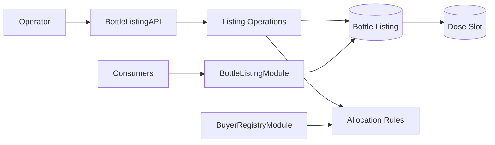
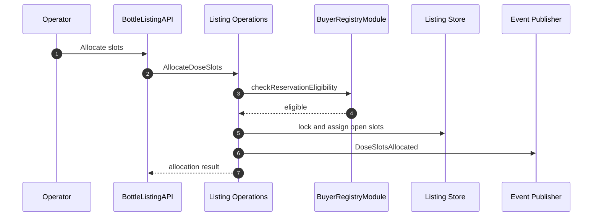

# Bottle Listing And Dose Allocation Architecture

This document is the feature-level architecture companion to [SPEC.md](SPEC.md). It explains the architecture implied by the current DomainSpec contracts and does not claim implementation completeness beyond those contracts.

## Architecture Intent

Bottle Listing And Dose Allocation must provide the authoritative listing and slot allocation boundary that downstream rendering, payment, and shipment features can trust. It keeps lifecycle and allocation rules local while consuming buyer eligibility from Buyer Registry through an explicit interface.

## Scope Boundary

Owned behavior: listing creation, opening, closing, numbered slot generation, slot allocation, release/correction, slot availability, per-person limit enforcement, and derived fill state.

Excluded behavior: buyer identity ownership, payment opening execution, payment links, paid/unpaid truth, WhatsApp posting, freight calculation, shipment packaging, and Excel migration/import.

## Source Contracts

| Contract ID | Source | Required | Notes |
| --- | --- | --- | --- |
| SC-001 | [SPEC.md](SPEC.md) | yes | Feature capability and concept source of truth |
| SC-002 | [domain.md](domain.md) | yes | Listing, slot, allocation, and enum definitions |
| SC-003 | [rules.md](rules.md) | yes | Allocation guards and fill derivation |
| SC-004 | [operations.md](operations.md) | yes | Operator mutation contracts |
| SC-005 | [queries.md](queries.md) | yes | Listing read models and downstream query contracts |
| SC-006 | [interfaces.md](interfaces.md) | yes | REST, internal module, and Buyer Registry dependency |
| SC-007 | [states.md](states.md) | yes | Listing and slot state transitions |
| SC-008 | [events.md](events.md) | yes | Domain events produced by mutations |
| SC-009 | [../buyer-registry/SPEC.md](../buyer-registry/SPEC.md) | yes | Buyer reservation eligibility prerequisite |
| SC-010 | [../../PROJECT-DECISIONS.md](../../PROJECT-DECISIONS.md#decision-register) | yes | Project-level selected decisions for lifecycle, ordering, and Excel scope |

## Design Goals and Non-Goals

| Type | Item | Why |
| --- | --- | --- |
| Goal | Deterministic allocation | Prevent overselling, duplicate slots, and ineligible buyer reservations |
| Goal | Simple lifecycle | V1 listing state is `draft`, `open`, `closed`; filled is derived |
| Goal | Explicit downstream read contracts | Rendering and payment need current listing and allocation state |
| Non-goal | Own payment truth | Payment Tracking owns payment runs and reconciliation |
| Non-goal | Own buyer identity | Buyer Registry owns CPF, mention, and address rules |
| Non-goal | Import Excel | Excel migration/import is out of scope |

## View 1: Context View

| Actor or System | Relationship to Feature | Contract Source |
| --- | --- | --- |
| Group operator | Creates, opens, allocates, releases, and closes listings | [operations.md](operations.md) |
| Buyer Registry | Provides buyer reservation eligibility | [interfaces.md#dependency-buyerregistrymodule-interface](interfaces.md#dependency-buyerregistrymodule-interface) |
| Public WhatsApp List Rendering | Consumes listing and slot read models | [interfaces.md#internal-bottlelistingmodule-interface](interfaces.md#internal-bottlelistingmodule-interface) |
| Dose Payment Tracking | Consumes selected listing allocations for payment runs | [queries.md#getpaymenteligibleallocations](queries.md#getpaymenteligibleallocations) |
| Freight And Shipment Batching | Later consumes buyer allocated dose records after payment truth | [queries.md#getbuyerallocateddoses](queries.md#getbuyerallocateddoses) |

## View 2: High-Level Structure View

| Component | Primary Contracts | Responsibility |
| --- | --- | --- |
| BottleListingAPI | [interfaces.md#external-bottlelistingapi-rest](interfaces.md#external-bottlelistingapi-rest) | Exposes operator-facing mutations and reads |
| Listing Operations | [operations.md](operations.md), [rules.md](rules.md) | Applies lifecycle and allocation rules |
| Listing Store | [domain.md](domain.md), [states.md](states.md) | Persists listings, slots, allocations, and lifecycle state |
| BottleListingModule | [interfaces.md#internal-bottlelistingmodule-interface](interfaces.md#internal-bottlelistingmodule-interface) | Provides cross-feature read contracts |
| Event Publisher | [events.md](events.md) | Emits listing and allocation events |

## View 3: Low-Level Components View

| Component | Owns | Consumes | Collaboration Rule |
| --- | --- | --- | --- |
| Listing Command Handler | Create, open, close operations | ListingLifecycle | Must transition only through allowed v1 states |
| Allocation Command Handler | Allocate and release operations | Slot rules, BuyerRegistryModule | Must call buyer eligibility before allocation |
| Slot Selection Service | Slot availability and next-slot selection | DoseSlot records | Must return only open slots from the target listing |
| Allocation Summary Service | Fill derivation and allocation summaries | Listing and slot records | Must derive `filled` instead of persisting it as status |
| Read Model Adapter | Consumer query shapes | Listing Store | Must not expose mutation ownership to consumers |

## View 4: Workflow Process View

| Flow | Happy Path | Failure or Compensation | Contract Source |
| --- | --- | --- | --- |
| Listing publication | Create draft, generate slots, open listing | Reject invalid listing details; operator corrects draft | [workflows.md#listing-publication](workflows.md#listing-publication) |
| Dose allocation | Verify buyer, listing, slots, limit, then allocate | Reject without partial mutation; operator retries with valid set | [workflows.md#dose-allocation](workflows.md#dose-allocation) |
| Listing closure | Operator closes draft or open listing | Reject already closed listing | [workflows.md#listing-closure](workflows.md#listing-closure) |

## View 5: Decision Flow View

| Decision Point | Options or Branches | Selection Rule | Outcome |
| --- | --- | --- | --- |
| Can listing accept allocation? | yes / no | [ListingOpenRule](rules.md#r2-listing-open-rule) | Continue or reject |
| Can buyer receive slots? | eligible / ineligible | Buyer Registry reservation eligibility | Continue or reject |
| Which slots are assigned? | explicit slot numbers / next available | [Allocation Selection Policy](workflows.md#allocation-selection-policy) | Valid open slots assigned |
| Is listing filled? | true / false | [FilledListingDerivation](rules.md#c1-filled-listing-derivation) | Downstream read model value |

## View 6: Dependency Interface View

| Dependency or Interface | Direction | Contract | Boundary Rule |
| --- | --- | --- | --- |
| BottleListingAPI | inbound | [interfaces.md#external-bottlelistingapi-rest](interfaces.md#external-bottlelistingapi-rest) | Operator mutations only |
| BuyerRegistryModule | inbound dependency | [interfaces.md#dependency-buyerregistrymodule-interface](interfaces.md#dependency-buyerregistrymodule-interface) | Allocation cannot duplicate buyer identity rules |
| BottleListingModule | outbound internal | [interfaces.md#internal-bottlelistingmodule-interface](interfaces.md#internal-bottlelistingmodule-interface) | Consumers read allocation state but cannot mutate it |
| Event stream | outbound | [events.md](events.md) | Events notify consumers; they do not transfer ownership |

## Constraints

| Constraint | Source | Impact |
| --- | --- | --- |
| Buyer identity before reservation | [PROJECT-DECISIONS.md](../../PROJECT-DECISIONS.md#decision-register) | Allocation must depend on Buyer Registry |
| Filled is derived | [PROJECT-DECISIONS.md](../../PROJECT-DECISIONS.md#decision-register) | No `filled` lifecycle status |
| No Excel migration/import | [PROJECT-DECISIONS.md](../../PROJECT-DECISIONS.md#decision-register) | Feature starts from system-created listings |

## Dependency And Interface Rules

| Rule ID | Rule | Applies To | Enforcement |
| --- | --- | --- | --- |
| AIR-001 | Allocation must call Buyer Registry eligibility before assigning slots | AllocateDoseSlots | Application service precondition |
| AIR-002 | Downstream features must use read interfaces rather than mutating listing state | BottleListingModule consumers | Interface boundary |
| AIR-003 | Payment truth is never stored in this feature | Queries and events | Payment status comes from Dose Payment Tracking |

## Data and Evidence Artifacts

| Artifact | Produced By | Used For | Contract Source |
| --- | --- | --- | --- |
| Listing allocation summary | GetListingAllocationSummary | Rendering and payment planning | [queries.md#getlistingallocationsummary](queries.md#getlistingallocationsummary) |
| Payment eligible allocations | GetPaymentEligibleAllocations | Payment run creation | [queries.md#getpaymenteligibleallocations](queries.md#getpaymenteligibleallocations) |
| DoseSlotsAllocated event | AllocateDoseSlots | Consumer refresh | [events.md#doseslotsallocated](events.md#doseslotsallocated) |

## Extension Points

| Extension Point | Allowed Variation | Guardrail |
| --- | --- | --- |
| Slot selection | explicit slot numbers or next available | Must satisfy slot availability and uniqueness rules |
| Per-person limits | absent or positive integer cap | Must be enforced when present |
| Payment opening mode | `on_fill` or `manual` as listing metadata | Payment feature owns opening execution |

## Trade-offs and Guardrails

| Trade-off | Benefit | Cost | Guardrail |
| --- | --- | --- | --- |
| Filled derived, not persisted | Avoids lifecycle confusion | Consumers must calculate from slots | Use allocation summary query |
| Buyer Registry dependency | Prevents anonymous reservations | Listing allocation cannot stand alone | Keep eligibility interface narrow |
| No Excel import | Keeps v1 focused | Historical data not bootstrapped | Reopen scope only by explicit decision |

## Decision Log

| Decision ID | Decision | Options Considered | Reason |
| --- | --- | --- | --- |
| D-001 | V1 listing lifecycle is `draft`, `open`, `closed` | include `filled`, `cancelled`, `reopened`; keep simple lifecycle | Project decision selected simple operator-controlled lifecycle |
| D-002 | Buyer eligibility required before allocation | mention-only allocation; full buyer identity first | Project decision requires name, mention, and CPF before reservation |
| D-003 | Excel migration/import excluded | import current spreadsheet; start system-native | User explicitly does not want Excel migration |

## Risks

| Risk ID | Risk | Mitigation | Owner |
| --- | --- | --- | --- |
| RK-001 | Public rendering shows stale slot state | Rendering must consume authoritative listing read models | group operator |
| RK-002 | Allocation races oversell slots | Implementation must lock slots or enforce uniqueness transactionally | implementation |
| RK-003 | Buyer eligibility changes after allocation | Later features should treat allocation as historical fact and handle buyer status changes explicitly | group operator |

## Downstream Planning Notes

- Implementation-plan inputs: Buyer Registry read interface, listing persistence, slot uniqueness strategy.
- Test implications: cover lifecycle transitions, oversell prevention, per-person limits, buyer eligibility rejection, release behavior, and derived filled state.
- Observability implications: allocation error count, fill time, slot release count.
- Documentation implications: generate stories and test specs before implementation.

## Design Transport Notes

Carry the Buyer Registry dependency, slot transaction invariants, and derived fill contract into stories, tests, implementation tasks, and future rendering/payment feature specs.

## Gate Result

- Status: pass
- Reason: Source contracts are present, six architecture views are populated, dependency/interface rules are recorded, decisions and risks are explicit, and architecture-to-aspect references are defined.
- Required follow-up: generate `STORIES.md` and `TEST-SPEC.md` before implementation.
