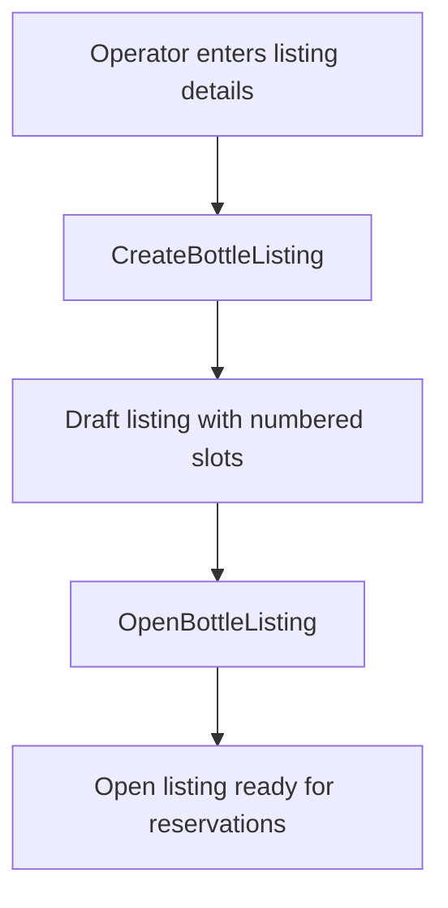
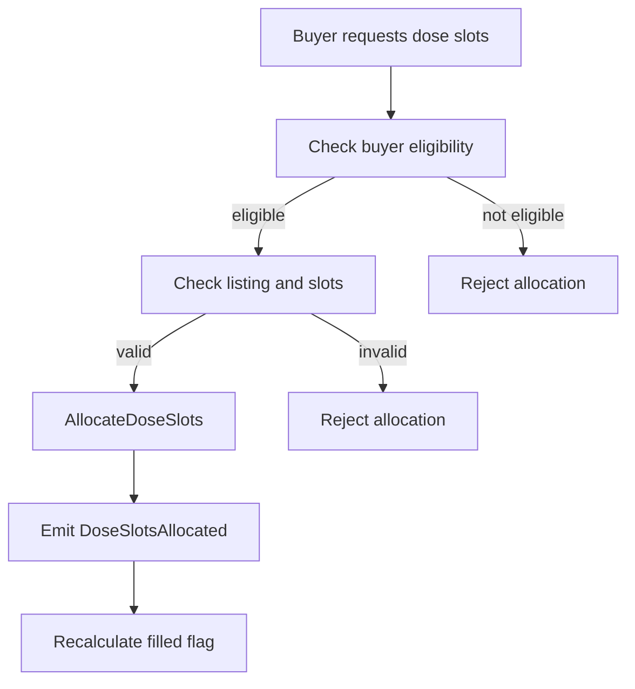

# Bottle Listing And Dose Allocation Workflows

## Listing Publication

| Step | Operation | Success | Failure |
| --- | --- | --- | --- |
| Create draft | [CreateBottleListing](operations.md#createbottlelisting) | Listing and slots exist | Reject invalid dose count, price, or payment mode |
| Open listing | [OpenBottleListing](operations.md#openbottlelisting) | Listing status `open` | Reject missing details or non-draft listing |

## Dose Allocation

| Step | Contract | Success | Failure |
| --- | --- | --- | --- |
| Check buyer | [BuyerRegistryModule](../buyer-registry/interfaces.md#internal-buyerregistrymodule-interface) | Buyer eligible for reservation | Missing name, mention, CPF, inactive, or terminal buyer |
| Check listing | [ListingOpenRule](rules.md#r2-listing-open-rule) | Listing accepts allocation | Listing draft or closed |
| Check slots | [SlotAvailabilityRule](rules.md#r1-slot-availability-rule) | Requested slots are open | Oversold or duplicate slot |
| Allocate | [AllocateDoseSlots](operations.md#allocatedoseslots) | Allocation active and slots allocated | No partial allocation unless operator retries with valid set |

## Listing Closure

| Step | Operation | Success | Failure |
| --- | --- | --- | --- |
| Close listing | [CloseBottleListing](operations.md#closebottlelisting) | Listing status `closed` | Listing already closed |
| Downstream awareness | [BottleListingClosed](events.md#bottlelistingclosed) | Consumers can refresh read models | Payment feature owns payment opening decisions |

## Policies

### Allocation Selection Policy

The operator may select explicit slot numbers or request the next available slots. In either case, the resulting allocation must satisfy all slot availability and buyer eligibility rules.

### Filled Handling Policy

When all slots are allocated, the listing is considered filled by derivation. V1 does not automatically close the listing solely because it is filled.
