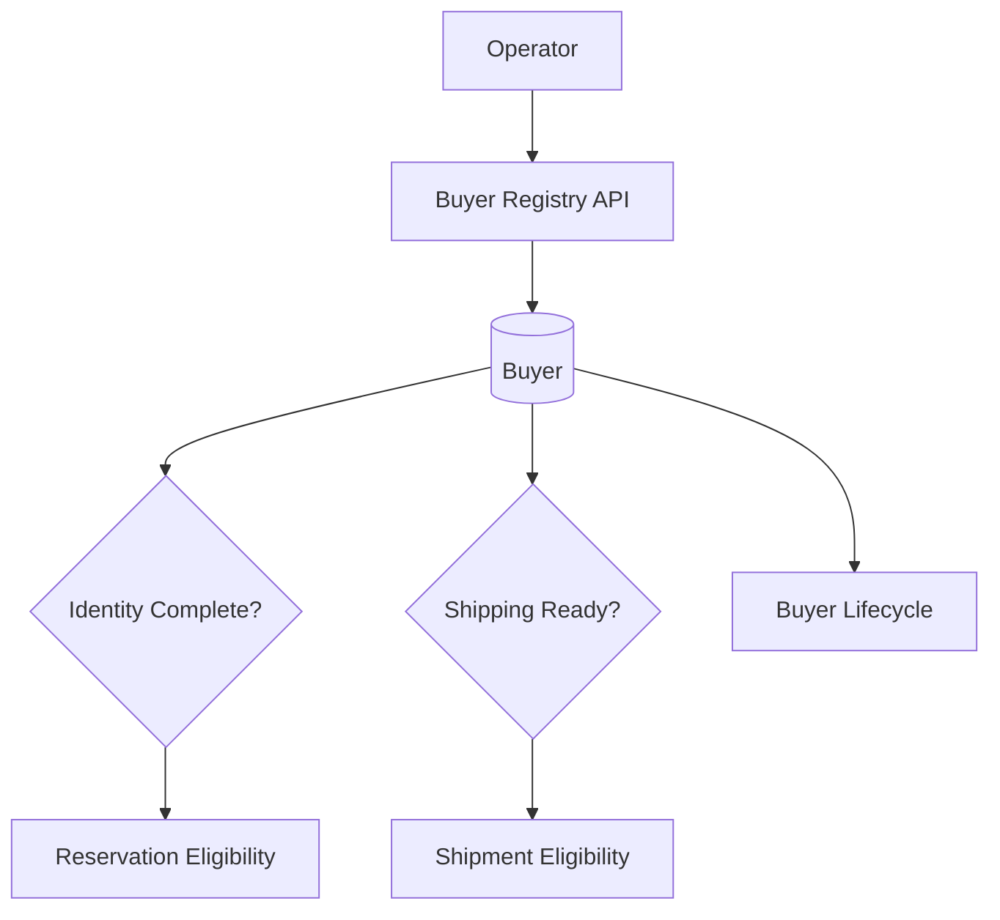

# Buyer Registry

## What This Module Owns

Buyer Registry owns the buyer identity and shipping data required by Whisky Dose Group Operations. It lets the [group operator](../../PROJECT-OVERVIEW.md#actors-and-stakeholders) create and maintain a [Buyer](domain.md#buyer), enforce the minimum identity required before reservations, and record a [Shipping Address](domain.md#shipping-address) before the buyer's first shipment.

This feature does not allocate dose slots, track payment truth, calculate freight, manage shipment contents, import Excel data, or provide buyer self-service in v1.

## Module Map

## Capabilities

| Capability                | What                                                                           | Key Aspects                                                                                                                                                                                                                         | Detail                                                   |
| ------------------------- | ------------------------------------------------------------------------------ | ----------------------------------------------------------------------------------------------------------------------------------------------------------------------------------------------------------------------------------- | -------------------------------------------------------- |
| Buyer Identity Management | Maintain buyer name, WhatsApp mention, CPF, and lifecycle status               | [Buyer](domain.md#buyer), [RegisterBuyer](operations.md#registerbuyer), [UpdateBuyerIdentity](operations.md#updatebuyeridentity), [BuyerLifecycle](states.md#buyerlifecycle)                                                        | Operator-only v1 CRUD boundary with duplicate prevention |
| Reservation Eligibility   | Expose whether a buyer has the identity required before allocation             | [ReservationIdentityRule](rules.md#r1-reservation-identity-required), [CheckBuyerReservationEligibility](queries.md#checkbuyerreservationeligibility), [BuyerRegistryModule](interfaces.md#internal-buyerregistrymodule-interface)  | Required by Bottle Listing And Dose Allocation           |
| Shipping Readiness        | Capture address before first shipment and expose readiness                     | [ShippingAddressRequiredRule](rules.md#r2-shipping-address-required-before-first-shipment), [SetBuyerShippingAddress](operations.md#setbuyershippingaddress), [CheckBuyerShippingReadiness](queries.md#checkbuyershippingreadiness) | Required by Freight And Shipment Batching                |
| Retention Handling        | Mark inactive buyers and delete or anonymize retained PII by operator decision | [BuyerRetentionPolicy](rules.md#p1-buyer-retention-policy), [MarkBuyerInactive](operations.md#markbuyerinactive), [DeleteOrAnonymizeBuyer](operations.md#deleteoranonymizebuyer)                                                    | Buyer self-service deferred                              |

## Domain Concepts

| Concept                                        | Type         | Key Constraints                                                                                                                                                                                    |
| ---------------------------------------------- | ------------ | -------------------------------------------------------------------------------------------------------------------------------------------------------------------------------------------------- |
| [Buyer](domain.md#buyer)                       | Entity       | [Buyer](domain.md#buyer).[name](domain.md#buyer), [Buyer](domain.md#buyer).[whatsAppMention](domain.md#buyer), and [Buyer](domain.md#buyer).[cpf](domain.md#buyer) are required before reservation |
| [CPF](domain.md#cpf)                           | Value Object | Required, normalized, and unique for active buyers                                                                                                                                                 |
| [WhatsApp Mention](domain.md#whatsapp-mention) | Value Object | Required before reservation and unique among active buyers                                                                                                                                         |
| [Shipping Address](domain.md#shipping-address) | Value Object | Required before first shipment, not before reservation                                                                                                                                             |
| [Buyer Status](domain.md#buyer-status)         | Enum / Type  | `active`, `inactive`, `anonymized`, or `deleted`                                                                                                                                                   |

## Concept Registry

| Concept                                                                                    | ID                                                | Type          |
| ------------------------------------------------------------------------------------------ | ------------------------------------------------- | ------------- |
| [Buyer](domain.md#buyer)                                                                   | `buyer-registry.Buyer`                            | Entity        |
| [CPF](domain.md#cpf)                                                                       | `buyer-registry.CPF`                              | Value Object  |
| [WhatsApp Mention](domain.md#whatsapp-mention)                                             | `buyer-registry.WhatsAppMention`                  | Value Object  |
| [Shipping Address](domain.md#shipping-address)                                             | `buyer-registry.ShippingAddress`                  | Value Object  |
| [Buyer Status](domain.md#buyer-status)                                                     | `buyer-registry.BuyerStatus`                      | Enum / Type   |
| [Retention Action](domain.md#retention-action)                                             | `buyer-registry.RetentionAction`                  | Enum / Type   |
| [BuyerLifecycle](states.md#buyerlifecycle)                                                 | `buyer-registry.BuyerLifecycle`                   | State Machine |
| [ReservationIdentityRule](rules.md#r1-reservation-identity-required)                       | `buyer-registry.ReservationIdentityRule`          | Rule          |
| [ShippingAddressRequiredRule](rules.md#r2-shipping-address-required-before-first-shipment) | `buyer-registry.ShippingAddressRequiredRule`      | Rule          |
| [ActiveBuyerUniquenessRule](rules.md#r3-active-buyer-uniqueness)                           | `buyer-registry.ActiveBuyerUniquenessRule`        | Rule          |
| [OperatorManagementRule](rules.md#r4-operator-management-only-in-v1)                       | `buyer-registry.OperatorManagementRule`           | Rule          |
| [BuyerRetentionPolicy](rules.md#p1-buyer-retention-policy)                                 | `buyer-registry.BuyerRetentionPolicy`             | Policy        |
| [RegisterBuyer](operations.md#registerbuyer)                                               | `buyer-registry.RegisterBuyer`                    | Operation     |
| [UpdateBuyerIdentity](operations.md#updatebuyeridentity)                                   | `buyer-registry.UpdateBuyerIdentity`              | Operation     |
| [SetBuyerShippingAddress](operations.md#setbuyershippingaddress)                           | `buyer-registry.SetBuyerShippingAddress`          | Operation     |
| [MarkBuyerInactive](operations.md#markbuyerinactive)                                       | `buyer-registry.MarkBuyerInactive`                | Operation     |
| [DeleteOrAnonymizeBuyer](operations.md#deleteoranonymizebuyer)                             | `buyer-registry.DeleteOrAnonymizeBuyer`           | Operation     |
| [GetBuyer](queries.md#getbuyer)                                                            | `buyer-registry.GetBuyer`                         | Query         |
| [SearchBuyers](queries.md#searchbuyers)                                                    | `buyer-registry.SearchBuyers`                     | Query         |
| [CheckBuyerReservationEligibility](queries.md#checkbuyerreservationeligibility)            | `buyer-registry.CheckBuyerReservationEligibility` | Query         |
| [CheckBuyerShippingReadiness](queries.md#checkbuyershippingreadiness)                      | `buyer-registry.CheckBuyerShippingReadiness`      | Query         |
| [BuyerRegistryAPI](interfaces.md#external-buyerregistryapi-rest)                           | `buyer-registry.BuyerRegistryAPI`                 | Interface     |
| [BuyerRegistryModule](interfaces.md#internal-buyerregistrymodule-interface)                | `buyer-registry.BuyerRegistryModule`              | Interface     |
| [BuyerRegistered](events.md#buyerregistered)                                               | `buyer-registry.BuyerRegistered`                  | Event         |
| [BuyerIdentityUpdated](events.md#buyeridentityupdated)                                     | `buyer-registry.BuyerIdentityUpdated`             | Event         |
| [BuyerShippingAddressSet](events.md#buyershippingaddressset)                               | `buyer-registry.BuyerShippingAddressSet`          | Event         |
| [BuyerMarkedInactive](events.md#buyermarkedinactive)                                       | `buyer-registry.BuyerMarkedInactive`              | Event         |
| [BuyerDataRemoved](events.md#buyerdataremoved)                                             | `buyer-registry.BuyerDataRemoved`                 | Event         |

## Feature Concept Graph

| From                                         | Edge        | To                                                | Evidence                                                                                                                   | Notes                                                 |
| -------------------------------------------- | ----------- | ------------------------------------------------- | -------------------------------------------------------------------------------------------------------------------------- | ----------------------------------------------------- |
| `buyer-registry.Buyer`                       | performs    | `buyer-registry.RegisterBuyer`                    | [operations.md#registerbuyer](operations.md#registerbuyer)                                                                 | Performed through operator action on the buyer record |
| `buyer-registry.RegisterBuyer`               | produces    | `buyer-registry.BuyerRegistered`                  | [events.md#buyerregistered](events.md#buyerregistered)                                                                     | Announces new buyer identity                          |
| `buyer-registry.UpdateBuyerIdentity`         | produces    | `buyer-registry.BuyerIdentityUpdated`             | [events.md#buyeridentityupdated](events.md#buyeridentityupdated)                                                           | Announces identity field changes                      |
| `buyer-registry.SetBuyerShippingAddress`     | produces    | `buyer-registry.BuyerShippingAddressSet`          | [events.md#buyershippingaddressset](events.md#buyershippingaddressset)                                                     | Announces shipping readiness changes                  |
| `buyer-registry.MarkBuyerInactive`           | produces    | `buyer-registry.BuyerMarkedInactive`              | [events.md#buyermarkedinactive](events.md#buyermarkedinactive)                                                             | Starts retention handling                             |
| `buyer-registry.DeleteOrAnonymizeBuyer`      | produces    | `buyer-registry.BuyerDataRemoved`                 | [events.md#buyerdataremoved](events.md#buyerdataremoved)                                                                   | Announces deletion or anonymization outcome           |
| `buyer-registry.BuyerRegistered`             | transitions | `buyer-registry.BuyerLifecycle`                   | [states.md#buyerlifecycle](states.md#buyerlifecycle)                                                                       | Creates active lifecycle state                        |
| `buyer-registry.BuyerMarkedInactive`         | transitions | `buyer-registry.BuyerLifecycle`                   | [states.md#buyerlifecycle](states.md#buyerlifecycle)                                                                       | Active to inactive                                    |
| `buyer-registry.BuyerDataRemoved`            | transitions | `buyer-registry.BuyerLifecycle`                   | [states.md#buyerlifecycle](states.md#buyerlifecycle)                                                                       | Inactive to anonymized or deleted                     |
| `buyer-registry.ReservationIdentityRule`     | enforces    | `buyer-registry.RegisterBuyer`                    | [rules.md#r1-reservation-identity-required](rules.md#r1-reservation-identity-required)                                     | Reservation eligibility requires identity fields      |
| `buyer-registry.ShippingAddressRequiredRule` | enforces    | `buyer-registry.SetBuyerShippingAddress`          | [rules.md#r2-shipping-address-required-before-first-shipment](rules.md#r2-shipping-address-required-before-first-shipment) | Shipment readiness requires address                   |
| `buyer-registry.BuyerRegistryAPI`            | exposes     | `buyer-registry.RegisterBuyer`                    | [interfaces.md#external-buyerregistryapi-rest](interfaces.md#external-buyerregistryapi-rest)                               | Operator-facing mutation surface                      |
| `buyer-registry.BuyerRegistryModule`         | exposes     | `buyer-registry.CheckBuyerReservationEligibility` | [interfaces.md#internal-buyerregistrymodule-interface](interfaces.md#internal-buyerregistrymodule-interface)               | Cross-feature read contract                           |
| `buyer-registry.GetBuyer`                    | queries     | `buyer-registry.Buyer`                            | [queries.md#getbuyer](queries.md#getbuyer)                                                                                 | Reads one buyer profile                               |
| `buyer-registry.SearchBuyers`                | queries     | `buyer-registry.Buyer`                            | [queries.md#searchbuyers](queries.md#searchbuyers)                                                                         | Reads buyer lookup set                                |
| `buyer-registry.Buyer`                       | contains    | `buyer-registry.CPF`                              | [domain.md#buyer](domain.md#buyer)                                                                                         | Required before reservation                           |
| `buyer-registry.Buyer`                       | contains    | `buyer-registry.WhatsAppMention`                  | [domain.md#buyer](domain.md#buyer)                                                                                         | Required before reservation                           |
| `buyer-registry.Buyer`                       | contains    | `buyer-registry.ShippingAddress`                  | [domain.md#buyer](domain.md#buyer)                                                                                         | Required before shipment                              |

## Aspect Docs

| Aspect                          | Contains                                      | Key Concepts                                                   |
| ------------------------------- | --------------------------------------------- | -------------------------------------------------------------- |
| [Architecture](architecture.md) | Six-view feature architecture and gate result | BuyerRegistryAPI, BuyerRegistryModule, source contracts        |
| [Glossary](glossary.md)         | Distilled definitions for feature concepts    | Buyer, CPF, Shipping Address, retention                        |
| [Domain](domain.md)             | Entities, value objects, and lifecycle enum   | Buyer, CPF, WhatsApp Mention, Shipping Address                 |
| [Operations](operations.md)     | Operator mutations and postconditions         | RegisterBuyer, SetBuyerShippingAddress, DeleteOrAnonymizeBuyer |
| [Queries](queries.md)           | Read models and eligibility checks            | GetBuyer, SearchBuyers, CheckBuyerReservationEligibility       |
| [Interfaces](interfaces.md)     | REST and internal module contracts            | BuyerRegistryAPI, BuyerRegistryModule                          |
| [Rules](rules.md)               | Formal business constraints and policies      | ReservationIdentityRule, BuyerRetentionPolicy                  |
| [States](states.md)             | Buyer lifecycle transitions                   | BuyerLifecycle                                                 |
| [Workflows](workflows.md)       | Multi-step onboarding and retention handling  | BuyerOnboarding, BuyerRetentionHandling                        |
| [Events](events.md)             | Domain events emitted by buyer operations     | BuyerRegistered, BuyerDataRemoved                              |

## Cross-Feature Dependencies

| Capability                | Depends On                                                                                | Via             | Why                                                               |
| ------------------------- | ----------------------------------------------------------------------------------------- | --------------- | ----------------------------------------------------------------- |
| Buyer Identity Management | Project decisions in [PROJECT-DECISIONS.md](../../PROJECT-DECISIONS.md#decision-register) | Source contract | Buyer identity and retention policy are selected at project level |

## Produces For

| Consumer                            | Consumes Capability       | Via                                                                                                                   | What                                                                                                          |
| ----------------------------------- | ------------------------- | --------------------------------------------------------------------------------------------------------------------- | ------------------------------------------------------------------------------------------------------------- |
| Bottle Listing And Dose Allocation  | Reservation Eligibility   | [BuyerRegistryModule](interfaces.md#internal-buyerregistrymodule-interface)                                           | Whether a [Buyer](domain.md#buyer) can reserve dose slots                                                     |
| Freight And Shipment Batching       | Shipping Readiness        | [BuyerRegistryModule](interfaces.md#internal-buyerregistrymodule-interface)                                           | Whether a [Buyer](domain.md#buyer) has a [Shipping Address](domain.md#shipping-address) before first shipment |
| Payment Link And Reminder Messaging | Buyer Identity Management | [SearchBuyers](queries.md#searchbuyers) / [BuyerRegistryModule](interfaces.md#internal-buyerregistrymodule-interface) | Buyer name and WhatsApp mention for operator-selected recipients                                              |

## Rules And Invariants

| ID  | Rule or Invariant                                                                                                                                                                                                      | Source                                                                                                                     |
| --- | ---------------------------------------------------------------------------------------------------------------------------------------------------------------------------------------------------------------------- | -------------------------------------------------------------------------------------------------------------------------- |
| R1  | [Buyer](domain.md#buyer).[name](domain.md#buyer), [Buyer](domain.md#buyer).[whatsAppMention](domain.md#buyer), and [Buyer](domain.md#buyer).[cpf](domain.md#buyer) are required before reservation eligibility is true | [rules.md#r1-reservation-identity-required](rules.md#r1-reservation-identity-required)                                     |
| R2  | [Shipping Address](domain.md#shipping-address) is required before first shipment readiness is true                                                                                                                     | [rules.md#r2-shipping-address-required-before-first-shipment](rules.md#r2-shipping-address-required-before-first-shipment) |
| R3  | Active buyers must not share the same [CPF](domain.md#cpf) or [WhatsApp Mention](domain.md#whatsapp-mention)                                                                                                           | [rules.md#r3-active-buyer-uniqueness](rules.md#r3-active-buyer-uniqueness)                                                 |
| I1  | Inactive buyer data remains retained until the operator chooses delete or anonymize                                                                                                                                    | [states.md#invariants](states.md#invariants)                                                                               |

## Deferred Obligations

| Obligation                              | Deferred To                                            | Reason                                                                                                                 |
| --------------------------------------- | ------------------------------------------------------ | ---------------------------------------------------------------------------------------------------------------------- |
| Buyer self-service profile editing      | Future buyer-facing feature                            | [PROJECT-DECISIONS.md#decision-register](../../PROJECT-DECISIONS.md#decision-register) selects operator-managed v1     |
| Direct WhatsApp posting                 | Public WhatsApp List Rendering / messaging integration | v1 uses copy/paste output, not WhatsApp API posting                                                                    |
| Freight calculation and freight payment | Freight And Shipment Batching                          | Freight calculation/payment is outside v1                                                                              |
| Excel migration/import                  | No v1 feature                                          | [PROJECT-DECISIONS.md#decision-register](../../PROJECT-DECISIONS.md#decision-register) excludes Excel migration/import |

## Stories

User stories are maintained in [STORIES.md](STORIES.md).

## References

- Project overview: [PROJECT-OVERVIEW.md](../../PROJECT-OVERVIEW.md)
- Project decisions: [PROJECT-DECISIONS.md](../../PROJECT-DECISIONS.md)
- Initial definitions: [INITIAL-DEFINITIONS.md](../../INITIAL-DEFINITIONS.md)
- Framework taxonomy: [TAXONOMY.md](../../../domainspec/TAXONOMY.md)
- Relationship guidance: [RELATIONSHIPS.md](../../../domainspec/RELATIONSHIPS.md)
