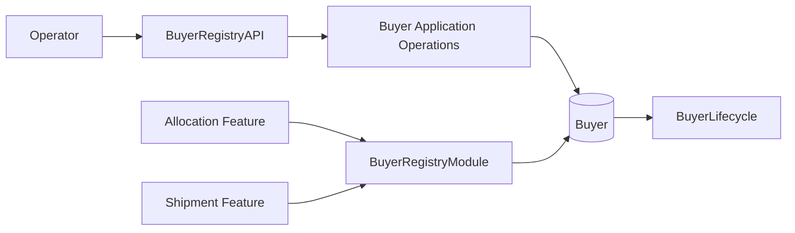
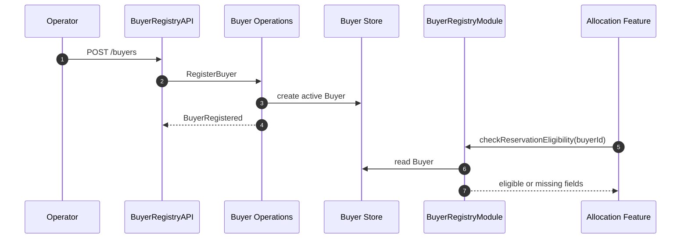

# Buyer Registry Architecture

This document is the feature-level architecture companion to [SPEC.md](SPEC.md). It explains the architecture implied by the current DomainSpec contracts and does not claim implementation completeness beyond those contracts.

## Architecture Intent

Buyer Registry must provide a small, authoritative identity boundary that downstream allocation, messaging, and shipment features can trust. The architecture separates operator-managed buyer data from later business contexts so that reservation and shipment readiness are consumed through explicit queries instead of copied rules.

## Scope Boundary

Owned behavior: buyer identity creation and correction, WhatsApp mention and CPF requirements, shipping address capture before first shipment, active/inactive lifecycle, and manual deletion/anonymization handling.

Excluded behavior: dose slot allocation, listing lifecycle, payment links, payment truth, reminder scheduling, freight calculation, shipment contents, Excel import, direct WhatsApp posting, and buyer self-service.

Neighboring features consume this boundary through [BuyerRegistryModule](interfaces.md#internal-buyerregistrymodule-interface); they do not own buyer PII rules.

## Source Contracts

| Contract ID | Source                                                               | Required | Notes                                                                     |
| ----------- | -------------------------------------------------------------------- | -------- | ------------------------------------------------------------------------- |
| SC-001      | [SPEC.md](SPEC.md)                                                   | yes      | Feature capability, concept graph, dependencies, and deferred obligations |
| SC-002      | [domain.md](domain.md)                                               | yes      | Buyer entity, value objects, and lifecycle enum                           |
| SC-003      | [rules.md](rules.md)                                                 | yes      | Identity, shipping, uniqueness, access, and retention rules               |
| SC-004      | [operations.md](operations.md)                                       | yes      | Operator mutation contracts                                               |
| SC-005      | [queries.md](queries.md)                                             | yes      | Read and eligibility contracts                                            |
| SC-006      | [interfaces.md](interfaces.md)                                       | yes      | REST and internal module boundaries                                       |
| SC-007      | [states.md](states.md)                                               | yes      | BuyerLifecycle transitions and invariants                                 |
| SC-008      | [events.md](events.md)                                               | yes      | Events produced by mutations                                              |
| SC-009      | [PROJECT-DECISIONS.md](../../PROJECT-DECISIONS.md#decision-register) | yes      | Project-level selected decisions for buyer identity, retention, and stack |
| SC-010      | [PROJECT-OVERVIEW.md](../../PROJECT-OVERVIEW.md)                     | yes      | Project scope, actors, constraints, and feature split                     |

## Design Goals and Non-Goals

| Type     | Item                                              | Why                                                                                       |
| -------- | ------------------------------------------------- | ----------------------------------------------------------------------------------------- |
| Goal     | Make reservation eligibility deterministic        | Allocation must know whether name, WhatsApp mention, and CPF exist before assigning slots |
| Goal     | Delay address collection until shipment readiness | Project decisions require staged PII collection                                           |
| Goal     | Keep buyer mutations operator-only in v1          | Buyer self-service is deferred by project decision                                        |
| Goal     | Preserve explicit retention lifecycle             | Inactive buyer data is retained until operator chooses delete or anonymize                |
| Non-goal | Allocate dose slots                               | Allocation belongs to Bottle Listing And Dose Allocation                                  |
| Non-goal | Calculate freight or build packages               | Freight and shipment batching owns package composition                                    |
| Non-goal | Import or sync Excel                              | Excel migration/import is out of v1 scope                                                 |
| Non-goal | Provide buyer-facing account management           | Buyer self-service is deferred                                                            |

## View 1: Context View

| Actor or System                                                     | Relationship to Feature                                                                          | Contract Source                                                             |
| ------------------------------------------------------------------- | ------------------------------------------------------------------------------------------------ | --------------------------------------------------------------------------- |
| [Group operator](../../PROJECT-OVERVIEW.md#actors-and-stakeholders) | Performs buyer registration, correction, address update, inactive marking, and retention actions | [operations.md](operations.md)                                              |
| Bottle Listing And Dose Allocation                                  | Consumes reservation eligibility before slot reservation                                         | [BuyerRegistryModule](interfaces.md#internal-buyerregistrymodule-interface) |
| Freight And Shipment Batching                                       | Consumes shipping readiness before first shipment                                                | [BuyerRegistryModule](interfaces.md#internal-buyerregistrymodule-interface) |
| Payment Link And Reminder Messaging                                 | Consumes buyer name and WhatsApp mention for recipient selection                                 | [SearchBuyers](queries.md#searchbuyers)                                     |
| Buyer                                                               | Data subject whose self-service access is deferred                                               | [PROJECT-DECISIONS.md](../../PROJECT-DECISIONS.md#decision-register)        |

## View 2: High-Level Structure View

| Component                    | Primary Contracts                                                                                                                      | Responsibility                                                   |
| ---------------------------- | -------------------------------------------------------------------------------------------------------------------------------------- | ---------------------------------------------------------------- |
| BuyerRegistryAPI             | [interfaces.md#external-buyerregistryapi-rest](interfaces.md#external-buyerregistryapi-rest)                                           | Exposes operator-facing REST mutations and reads                 |
| Buyer Application Operations | [operations.md](operations.md), [rules.md](rules.md)                                                                                   | Applies rules and changes buyer state                            |
| Buyer Store                  | [domain.md#buyer](domain.md#buyer), [states.md#buyerlifecycle](states.md#buyerlifecycle)                                               | Persists buyer identity, address, lifecycle, and retention state |
| BuyerRegistryModule          | [interfaces.md#internal-buyerregistrymodule-interface](interfaces.md#internal-buyerregistrymodule-interface), [queries.md](queries.md) | Provides read-only cross-feature contracts                       |
| Event Publisher              | [events.md](events.md)                                                                                                                 | Emits buyer lifecycle and data-change events                     |

## View 3: Low-Level Components View

| Component                 | Owns                                                                                            | Consumes                                                                                                                                     | Collaboration Rule                                                           |
| ------------------------- | ----------------------------------------------------------------------------------------------- | -------------------------------------------------------------------------------------------------------------------------------------------- | ---------------------------------------------------------------------------- |
| Identity Command Handler  | `buyer-registry.RegisterBuyer`, `buyer-registry.UpdateBuyerIdentity`                            | [R1](rules.md#r1-reservation-identity-required), [R3](rules.md#r3-active-buyer-uniqueness), [R4](rules.md#r4-operator-management-only-in-v1) | Must not create or update active buyers that fail reservation identity rules |
| Shipping Address Handler  | `buyer-registry.SetBuyerShippingAddress`                                                        | [R2](rules.md#r2-shipping-address-required-before-first-shipment), [R4](rules.md#r4-operator-management-only-in-v1)                          | Must keep shipping readiness derived from address completeness               |
| Retention Handler         | `buyer-registry.MarkBuyerInactive`, `buyer-registry.DeleteOrAnonymizeBuyer`                     | [P1](rules.md#p1-buyer-retention-policy), [BuyerLifecycle](states.md#buyerlifecycle)                                                         | Must require inactive state before deletion or anonymization                 |
| Eligibility Query Service | `buyer-registry.CheckBuyerReservationEligibility`, `buyer-registry.CheckBuyerShippingReadiness` | [Buyer](domain.md#buyer), [rules.md](rules.md)                                                                                               | Must return derived readiness, not persisted duplicated flags                |
| Buyer Lookup Service      | `buyer-registry.GetBuyer`, `buyer-registry.SearchBuyers`                                        | [Buyer](domain.md#buyer)                                                                                                                     | Must respect terminal retention states when exposing PII                     |

## View 4: Workflow Process View

| Flow                          | Happy Path                                                                                             | Failure or Compensation                                                                | Contract Source                                                                            |
| ----------------------------- | ------------------------------------------------------------------------------------------------------ | -------------------------------------------------------------------------------------- | ------------------------------------------------------------------------------------------ |
| Buyer onboarding              | Register buyer identity, optionally set shipping address, expose eligibility/readiness                 | Reject missing/duplicate identity or incomplete address; operator corrects and retries | [workflows.md#buyeronboarding](workflows.md#buyeronboarding)                               |
| Reservation eligibility check | Downstream feature calls module, module derives [R1](rules.md#r1-reservation-identity-required) result | Returns false with missing fields; no downstream mutation happens in this feature      | [queries.md#checkbuyerreservationeligibility](queries.md#checkbuyerreservationeligibility) |
| Retention handling            | Mark active buyer inactive, then delete or anonymize retained PII                                      | No automatic compensation; terminal action is not reversible here                      | [workflows.md#buyerretentionhandling](workflows.md#buyerretentionhandling)                 |

## View 5: Decision Flow View

| Decision Point                       | Options or Branches                                              | Selection Rule                                                               | Outcome                                                    |
| ------------------------------------ | ---------------------------------------------------------------- | ---------------------------------------------------------------------------- | ---------------------------------------------------------- |
| Can buyer reserve?                   | eligible / missing identity / inactive / terminal                | [R1](rules.md#r1-reservation-identity-required)                              | Allocation feature receives deterministic eligibility      |
| Can buyer ship?                      | ready / missing address / missing identity / inactive / terminal | [R2](rules.md#r2-shipping-address-required-before-first-shipment)            | Shipment feature receives deterministic readiness          |
| How is buyer managed in v1?          | operator-only / buyer self-service                               | [R4](rules.md#r4-operator-management-only-in-v1) and project decision PD-019 | Operator-only API surface                                  |
| What happens after inactive marking? | retain temporarily / delete / anonymize                          | [P1](rules.md#p1-buyer-retention-policy)                                     | Lifecycle moves to inactive, then terminal retention state |

## View 6: Dependency Interface View

| Dependency or Interface | Direction                       | Contract                                                                                                     | Boundary Rule                                                                  |
| ----------------------- | ------------------------------- | ------------------------------------------------------------------------------------------------------------ | ------------------------------------------------------------------------------ |
| BuyerRegistryAPI        | inbound                         | [interfaces.md#external-buyerregistryapi-rest](interfaces.md#external-buyerregistryapi-rest)                 | Operator-only mutations; no public buyer self-service                          |
| BuyerRegistryModule     | inbound internal consumer calls | [interfaces.md#internal-buyerregistrymodule-interface](interfaces.md#internal-buyerregistrymodule-interface) | Consumers receive derived eligibility/readiness, not raw rule ownership        |
| Project decisions       | upstream source                 | [PROJECT-DECISIONS.md](../../PROJECT-DECISIONS.md#decision-register)                                         | Feature docs must preserve selected buyer PII and retention decisions          |
| Event stream            | outbound                        | [events.md](events.md)                                                                                       | Events announce buyer changes but do not mutate foreign feature state directly |

## Constraints

| Constraint                                                          | Source                                                               | Impact                                                                               |
| ------------------------------------------------------------------- | -------------------------------------------------------------------- | ------------------------------------------------------------------------------------ |
| Name, WhatsApp mention, and CPF required before reservation         | [PROJECT-DECISIONS.md](../../PROJECT-DECISIONS.md#decision-register) | [R1](rules.md#r1-reservation-identity-required) gates downstream allocation          |
| Shipping address required before first shipment                     | [PROJECT-DECISIONS.md](../../PROJECT-DECISIONS.md#decision-register) | Address is optional at registration but mandatory for shipment readiness             |
| Operator manages buyer data in v1                                   | [PROJECT-DECISIONS.md](../../PROJECT-DECISIONS.md#decision-register) | API excludes buyer self-service                                                      |
| Buyer data retained while active and manually removed when inactive | [PROJECT-DECISIONS.md](../../PROJECT-DECISIONS.md#decision-register) | Lifecycle includes inactive retention decision point                                 |
| DomainSpec base TypeScript stack selected                           | [PROJECT-DECISIONS.md](../../PROJECT-DECISIONS.md#decision-register) | Implementation planning should use project-standard TypeScript verification baseline |

## Dependency And Interface Rules

| Rule ID | Rule                                                                                                                                                                                                         | Applies To                            | Enforcement                                      |
| ------- | ------------------------------------------------------------------------------------------------------------------------------------------------------------------------------------------------------------ | ------------------------------------- | ------------------------------------------------ |
| AR-001  | Downstream features must call [BuyerRegistryModule](interfaces.md#internal-buyerregistrymodule-interface) for reservation eligibility instead of duplicating [R1](rules.md#r1-reservation-identity-required) | Bottle Listing And Dose Allocation    | Interface contract review and generated tests    |
| AR-002  | Downstream shipment features must call [CheckBuyerShippingReadiness](queries.md#checkbuyershippingreadiness) before first shipment                                                                           | Freight And Shipment Batching         | Interface contract review and generated tests    |
| AR-003  | Buyer PII must not be exposed after `deleted` or original-value `anonymized` terminal states                                                                                                                 | BuyerRegistryAPI, BuyerRegistryModule | Query output tests and retention invariant tests |
| AR-004  | Buyer Registry events must not directly allocate, charge, remind, or ship                                                                                                                                    | Event consumers                       | Cross-feature composition review                 |

## Data and Evidence Artifacts

| Artifact                       | Produced By                                                                                            | Used For                                   | Contract Source                                                                                                            |
| ------------------------------ | ------------------------------------------------------------------------------------------------------ | ------------------------------------------ | -------------------------------------------------------------------------------------------------------------------------- |
| Buyer profile                  | [RegisterBuyer](operations.md#registerbuyer), [UpdateBuyerIdentity](operations.md#updatebuyeridentity) | Operator lookup and downstream eligibility | [domain.md#buyer](domain.md#buyer)                                                                                         |
| Reservation eligibility result | [CheckBuyerReservationEligibility](queries.md#checkbuyerreservationeligibility)                        | Dose allocation prerequisite               | [rules.md#r1-reservation-identity-required](rules.md#r1-reservation-identity-required)                                     |
| Shipping readiness result      | [CheckBuyerShippingReadiness](queries.md#checkbuyershippingreadiness)                                  | Shipment prerequisite                      | [rules.md#r2-shipping-address-required-before-first-shipment](rules.md#r2-shipping-address-required-before-first-shipment) |
| Retention event                | [DeleteOrAnonymizeBuyer](operations.md#deleteoranonymizebuyer)                                         | PII lifecycle audit trail                  | [events.md#buyerdataremoved](events.md#buyerdataremoved)                                                                   |

## Extension Points

| Extension Point    | Allowed Variation                                              | Guardrail                                                                                                                                                 |
| ------------------ | -------------------------------------------------------------- | --------------------------------------------------------------------------------------------------------------------------------------------------------- |
| Buyer self-service | Future buyer-facing profile update flow                        | Must preserve [R1](rules.md#r1-reservation-identity-required), [R2](rules.md#r2-shipping-address-required-before-first-shipment), and operator visibility |
| Retention method   | Delete or anonymize inactive buyer data                        | Must require inactive state first and hide original PII after terminal action                                                                             |
| Consumer features  | Allocation, messaging, and shipment can consume read contracts | Consumers cannot own buyer PII lifecycle rules                                                                                                            |

## Trade-offs and Guardrails

| Trade-off                        | Benefit                                            | Cost                                         | Guardrail                                                                         |
| -------------------------------- | -------------------------------------------------- | -------------------------------------------- | --------------------------------------------------------------------------------- |
| Collect CPF before reservation   | Prevents anonymous or ambiguous slot reservations  | Introduces sensitive PII early               | Operator-only access and explicit retention lifecycle                             |
| Delay address until shipment     | Reduces unnecessary PII collection                 | Shipment features must check readiness later | [CheckBuyerShippingReadiness](queries.md#checkbuyershippingreadiness) is explicit |
| Operator-only v1 management      | Simplifies first implementation and access control | Buyers cannot self-correct data              | Self-service listed as extension point, not hidden scope                          |
| Manual inactive retention action | Aligns with selected operator decision             | Requires operator follow-through             | Inactive state blocks eligibility until terminal action                           |

## Decision Log

| Decision ID | Decision                                            | Options Considered                                     | Reason                                                                                      |
| ----------- | --------------------------------------------------- | ------------------------------------------------------ | ------------------------------------------------------------------------------------------- |
| D-001       | Use project-level discovery waiver for feature spec | Feature discovery first; waiver with project decisions | Command supplied `--skip-discovery` and project decisions are sufficient for this boundary  |
| D-002       | Keep buyer data mutations operator-only in v1       | Operator-only; buyer self-service                      | PD-019 selected operator management and deferred buyer self-service                         |
| D-003       | Model reservation and shipment checks as queries    | Persist flags; derive checks from buyer fields         | Derived queries keep identity/address rules centralized and auditable                       |
| D-004       | Include events for buyer changes                    | Operations only; operation-produced events             | Events support future cross-feature transparency without creating cross-feature write stubs |

## Risks

| Risk ID | Risk                                                                                   | Mitigation                                                                                                                   | Owner               |
| ------- | -------------------------------------------------------------------------------------- | ---------------------------------------------------------------------------------------------------------------------------- | ------------------- |
| RK-001  | CPF and address introduce PII obligations before core listing automation               | Keep v1 operator-only, staged address collection, and explicit retention lifecycle                                           | Group operator      |
| RK-002  | Downstream features may duplicate buyer readiness rules                                | Require [BuyerRegistryModule](interfaces.md#internal-buyerregistrymodule-interface) consumption and test generated contracts | Feature implementer |
| RK-003  | Manual inactive retention action may leave inactive data retained longer than intended | Surface inactive records for operator follow-up in implementation planning                                                   | Group operator      |

## Downstream Planning Notes

- Implementation-plan inputs: [domain.md](domain.md), [operations.md](operations.md), [interfaces.md](interfaces.md), and [rules.md](rules.md).
- Test implications: generate tests for [R1](rules.md#r1-reservation-identity-required), [R2](rules.md#r2-shipping-address-required-before-first-shipment), [R3](rules.md#r3-active-buyer-uniqueness), [R4](rules.md#r4-operator-management-only-in-v1), [P1](rules.md#p1-buyer-retention-policy), and [BuyerLifecycle](states.md#buyerlifecycle) invalid transitions.
- Observability implications: track buyer registrations, reservation-ineligible lookup count, shipping-not-ready lookup count, inactive buyers awaiting retention action, retention actions applied.
- Documentation implications: downstream feature specs must link to [BuyerRegistryModule](interfaces.md#internal-buyerregistrymodule-interface) instead of redefining buyer identity rules.

## Design Transport Notes

Story generation should cover operator registration, identity correction, address collection, inactive marking, and delete/anonymize flows. Test generation should treat eligibility and readiness as derived rules and include cross-feature contract tests for allocation and shipment consumers. UI specs should keep PII-heavy fields in operator-only surfaces and make inactive retention decisions explicit.

## Gate Result

- Status: pass
- Reason: Source contracts are present, all six required architecture views are populated, dependency/interface rules are recorded, decision log is populated, risks are identified, and architecture-to-aspect references resolve within the authored feature package.
- Required follow-up: Generate story and test specifications before implementation.
