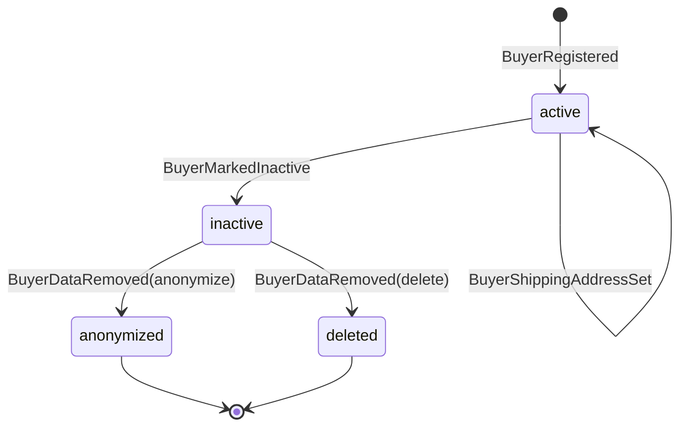

# State Machines: Buyer Registry

## BuyerLifecycle

### Transition Table

| From     | Event                                                           | To         | Guard                                                                                                                             | Effect                                                                                                        |
| -------- | --------------------------------------------------------------- | ---------- | --------------------------------------------------------------------------------------------------------------------------------- | ------------------------------------------------------------------------------------------------------------- |
| none     | [BuyerRegistered](events.md#buyerregistered)                    | active     | [RegisterBuyer](operations.md#registerbuyer) succeeds                                                                             | New [Buyer](domain.md#buyer) becomes usable when [R1](rules.md#r1-reservation-identity-required) is satisfied |
| active   | [BuyerIdentityUpdated](events.md#buyeridentityupdated)          | active     | [UpdateBuyerIdentity](operations.md#updatebuyeridentity) satisfies [R3](rules.md#r3-active-buyer-uniqueness)                      | Identity fields change                                                                                        |
| active   | [BuyerShippingAddressSet](events.md#buyershippingaddressset)    | active     | [SetBuyerShippingAddress](operations.md#setbuyershippingaddress) supplies complete [Shipping Address](domain.md#shipping-address) | Shipment readiness may become true                                                                            |
| active   | [BuyerMarkedInactive](events.md#buyermarkedinactive)            | inactive   | [MarkBuyerInactive](operations.md#markbuyerinactive) succeeds                                                                     | Reservation and shipment eligibility become false                                                             |
| inactive | [BuyerDataRemoved](events.md#buyerdataremoved) with `anonymize` | anonymized | [DeleteOrAnonymizeBuyer](operations.md#deleteoranonymizebuyer) selects anonymize                                                  | Original PII is no longer readable                                                                            |
| inactive | [BuyerDataRemoved](events.md#buyerdataremoved) with `delete`    | deleted    | [DeleteOrAnonymizeBuyer](operations.md#deleteoranonymizebuyer) selects delete                                                     | Retained PII is removed                                                                                       |

### Invariants

| ID  | Invariant                                                                  | Formal                                                            |
| --- | -------------------------------------------------------------------------- | ----------------------------------------------------------------- |
| I1  | Only `active` [Buyer](domain.md#buyer) records can be reservation eligible | `reservationEligible(buyer) -> buyer.status == active`            |
| I2  | Only `active` [Buyer](domain.md#buyer) records can be shipment ready       | `shippingReady(buyer) -> buyer.status == active`                  |
| I3  | `anonymized` and `deleted` are terminal states                             | `buyer.status in {anonymized, deleted} -> no outgoing transition` |
