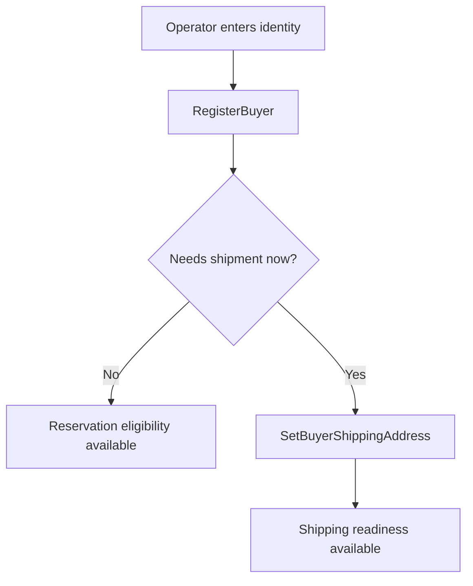
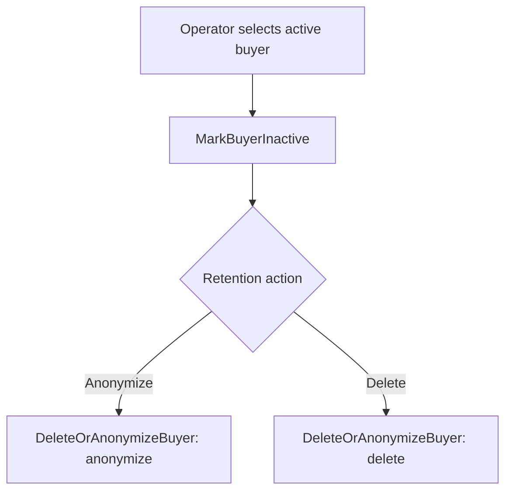

# Workflows: Buyer Registry

This file describes multi-step buyer onboarding and retention flows.

## BuyerOnboarding

**Type:** Workflow
**Triggers:** Operator needs a buyer to reserve doses or receive future shipment.
**Orchestrates:** [RegisterBuyer](operations.md#registerbuyer), [SetBuyerShippingAddress](operations.md#setbuyershippingaddress).
**Compensation Strategy:** Operator correction through [UpdateBuyerIdentity](operations.md#updatebuyeridentity); no automatic rollback.
**Idempotency:** Conditional: repeated registration with the same active [CPF](domain.md#cpf) or [WhatsApp Mention](domain.md#whatsapp-mention) is rejected by [R3](rules.md#r3-active-buyer-uniqueness).

### Steps

### Step Table

| #   | Step                                | Actor    | Operation                                                        | On Success                                    | On Failure                                  | Compensation              |
| --- | ----------------------------------- | -------- | ---------------------------------------------------------------- | --------------------------------------------- | ------------------------------------------- | ------------------------- |
| 1   | Register buyer identity             | Operator | [RegisterBuyer](operations.md#registerbuyer)                     | Buyer becomes active and reservation eligible | Reject with missing/duplicate identity rule | Correct input and retry   |
| 2   | Optionally collect shipping address | Operator | [SetBuyerShippingAddress](operations.md#setbuyershippingaddress) | Buyer becomes shipment ready                  | Reject incomplete address                   | Correct address and retry |

### Invariants

| ID  | Invariant                                                               | Formal                                                                       |
| --- | ----------------------------------------------------------------------- | ---------------------------------------------------------------------------- |
| I1  | Registration cannot create a reservation-ineligible active buyer        | `registered(buyer) -> reservationEligible(buyer)`                            |
| I2  | Shipping address collection is not required for reservation eligibility | `reservationEligible(buyer) does not require present(buyer.shippingAddress)` |

## BuyerRetentionHandling

**Type:** Workflow
**Triggers:** Operator manually decides an active buyer should become inactive.
**Orchestrates:** [MarkBuyerInactive](operations.md#markbuyerinactive), [DeleteOrAnonymizeBuyer](operations.md#deleteoranonymizebuyer).
**Compensation Strategy:** No automatic compensation; terminal retention actions are not reversible by this feature.
**Idempotency:** Conditional: repeat terminal retention action after `deleted` or `anonymized` is rejected.

### Steps

### Step Table

| #   | Step                    | Actor    | Operation                                                      | On Success                                     | On Failure                      | Compensation |
| --- | ----------------------- | -------- | -------------------------------------------------------------- | ---------------------------------------------- | ------------------------------- | ------------ |
| 1   | Mark inactive           | Operator | [MarkBuyerInactive](operations.md#markbuyerinactive)           | Buyer status becomes `inactive`                | Reject if buyer is not active   | None         |
| 2   | Choose retention action | Operator | [DeleteOrAnonymizeBuyer](operations.md#deleteoranonymizebuyer) | Buyer status becomes `deleted` or `anonymized` | Reject if buyer is not inactive | None         |

### Invariants

| ID  | Invariant                                                            | Formal                                                                                             |
| --- | -------------------------------------------------------------------- | -------------------------------------------------------------------------------------------------- |
| I1  | Inactive buyers cannot be used for reservation or shipment readiness | `buyer.status == inactive -> reservationEligible(buyer) == false && shippingReady(buyer) == false` |
| I2  | Terminal retention states do not expose original PII                 | `buyer.status in {deleted, anonymized} -> originalPIIReadable(buyer) == false`                     |
