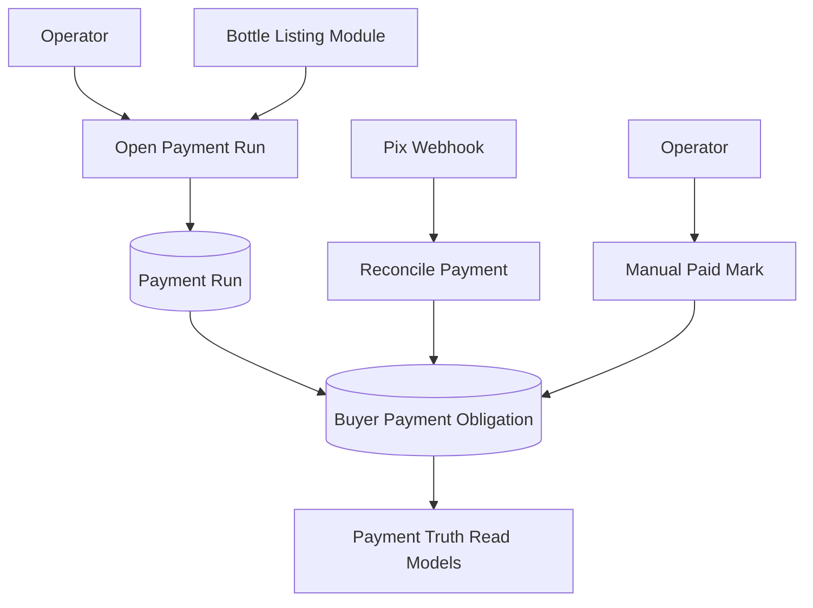

# Dose Payment Tracking

## What This Module Owns

Dose Payment Tracking owns dose payment readiness, payment runs, buyer payment obligations, payment deadlines, Pix/provider reconciliation truth, and operator fallback confirmation. It consumes selected listing allocations from [Bottle Listing And Dose Allocation](../bottle-listing-and-dose-allocation/SPEC.md), creates combined buyer obligations across selected listings, and exposes paid/unpaid/payment exception truth to rendering, reminder, and shipment consumers.

This feature does not generate or deliver buyer-facing payment-link text, schedule reminder messages, allocate dose slots, manage buyer PII, calculate freight, or post to WhatsApp.

## Module Map

## Capabilities

| Capability                | What                                                                                   | Key Aspects                                                                                                                                                                              | Detail                                                                                       |
| ------------------------- | -------------------------------------------------------------------------------------- | ---------------------------------------------------------------------------------------------------------------------------------------------------------------------------------------- | -------------------------------------------------------------------------------------------- |
| Payment Run Opening       | Open payment for one or more selected listings                                         | [Payment Run](domain.md#payment-run), [OpenPaymentRun](operations.md#openpaymentrun), [PaymentOpeningPolicy](rules.md#p1-payment-opening-policy)                                         | Supports on-fill and manual opening                                                          |
| Buyer Obligation Tracking | Create and track one combined buyer obligation across selected listings                | [Buyer Payment Obligation](domain.md#buyer-payment-obligation), [Payment Line Item](domain.md#payment-line-item), [CalculateBuyerPaymentTotal](operations.md#calculatebuyerpaymenttotal) | Line items preserve listing/dose traceability                                                |
| Pix Reconciliation        | Apply provider callbacks idempotently using a provider correlation key                 | [PaymentReconciliationSaga](workflows.md#paymentreconciliationsaga), [ApplyPixWebhook](operations.md#applypixwebhook)                                                                    | States include `pending`, `processing`, `paid`, `partial`, `overpaid`, `unmatched`, `failed` |
| Manual Fallback           | Allow operator paid marking when webhook matching is absent or exceptional             | [ManualMarkPaid](operations.md#manualmarkpaid), [ManualFallbackPolicy](rules.md#p3-manual-fallback-policy)                                                                               | Simple fallback with audit reason                                                            |
| Payment Truth Read Models | Expose paid/unpaid and exception state to rendering, reminders, and shipment readiness | [GetPaymentRun](queries.md#getpaymentrun), [GetBuyerPaymentStatus](queries.md#getbuyerpaymentstatus), [PaymentTrackingModule](interfaces.md#internal-paymenttrackingmodule-interface)    | Rendering can show buyer-level paid/unpaid                                                   |

## Domain Concepts

| Concept                                                        | Type         | Key Constraints                                                                 |
| -------------------------------------------------------------- | ------------ | ------------------------------------------------------------------------------- |
| [Payment Run](domain.md#payment-run)                           | Entity       | Selects one or more listings and creates buyer obligations                      |
| [Buyer Payment Obligation](domain.md#buyer-payment-obligation) | Entity       | One buyer's combined amount across selected listing allocations                 |
| [Payment Line Item](domain.md#payment-line-item)               | Value Object | Traceable listing/allocation/slot contribution to an obligation                 |
| [Provider Correlation Key](domain.md#provider-correlation-key) | Value Object | Required for Pix webhook matching; Pix implementation uses `txid` or equivalent |
| [Payment Status](domain.md#payment-status)                     | Enum / Type  | `pending`, `processing`, `paid`, `partial`, `overpaid`, `unmatched`, `failed`   |
| [Money Amount](domain.md#money-amount)                         | Value Object | BRL amount derived from listing price and allocated doses                       |

## Concept Registry

| Concept                                                                         | ID                                                   | Type          |
| ------------------------------------------------------------------------------- | ---------------------------------------------------- | ------------- |
| [Payment Run](domain.md#payment-run)                                            | `dose-payment-tracking.PaymentRun`                   | Entity        |
| [Buyer Payment Obligation](domain.md#buyer-payment-obligation)                  | `dose-payment-tracking.BuyerPaymentObligation`       | Entity        |
| [Payment Line Item](domain.md#payment-line-item)                                | `dose-payment-tracking.PaymentLineItem`              | Value Object  |
| [Provider Correlation Key](domain.md#provider-correlation-key)                  | `dose-payment-tracking.ProviderCorrelationKey`       | Value Object  |
| [Payment Status](domain.md#payment-status)                                      | `dose-payment-tracking.PaymentStatus`                | Enum / Type   |
| [PaymentStatusLifecycle](states.md#paymentstatuslifecycle)                      | `dose-payment-tracking.PaymentStatusLifecycle`       | State Machine |
| [OpenPaymentRun](operations.md#openpaymentrun)                                  | `dose-payment-tracking.OpenPaymentRun`               | Operation     |
| [CalculateBuyerPaymentTotal](operations.md#calculatebuyerpaymenttotal)          | `dose-payment-tracking.CalculateBuyerPaymentTotal`   | Calculation   |
| [AttachProviderCorrelationKey](operations.md#attachprovidercorrelationkey)      | `dose-payment-tracking.AttachProviderCorrelationKey` | Operation     |
| [ApplyPixWebhook](operations.md#applypixwebhook)                                | `dose-payment-tracking.ApplyPixWebhook`              | Operation     |
| [RetryReconciliation](operations.md#retryreconciliation)                        | `dose-payment-tracking.RetryReconciliation`          | Operation     |
| [ManualMarkPaid](operations.md#manualmarkpaid)                                  | `dose-payment-tracking.ManualMarkPaid`               | Operation     |
| [PaymentOpeningPolicy](rules.md#p1-payment-opening-policy)                      | `dose-payment-tracking.PaymentOpeningPolicy`         | Policy        |
| [CorrelationIdempotencyRule](rules.md#r2-correlation-idempotency-rule)          | `dose-payment-tracking.CorrelationIdempotencyRule`   | Rule          |
| [AmountMatchRule](rules.md#r3-amount-match-rule)                                | `dose-payment-tracking.AmountMatchRule`              | Rule          |
| [ManualFallbackPolicy](rules.md#p3-manual-fallback-policy)                      | `dose-payment-tracking.ManualFallbackPolicy`         | Policy        |
| [PaymentReconciliationSaga](workflows.md#paymentreconciliationsaga)             | `dose-payment-tracking.PaymentReconciliationSaga`    | Saga          |
| [GetPaymentRun](queries.md#getpaymentrun)                                       | `dose-payment-tracking.GetPaymentRun`                | Query         |
| [GetBuyerPaymentStatus](queries.md#getbuyerpaymentstatus)                       | `dose-payment-tracking.GetBuyerPaymentStatus`        | Query         |
| [GetListingPaymentSummary](queries.md#getlistingpaymentsummary)                 | `dose-payment-tracking.GetListingPaymentSummary`     | Query         |
| [PaymentTrackingAPI](interfaces.md#external-paymenttrackingapi-rest)            | `dose-payment-tracking.PaymentTrackingAPI`           | Interface     |
| [PaymentTrackingModule](interfaces.md#internal-paymenttrackingmodule-interface) | `dose-payment-tracking.PaymentTrackingModule`        | Interface     |
| [PaymentRunOpened](events.md#paymentrunopened)                                  | `dose-payment-tracking.PaymentRunOpened`             | Event         |
| [PaymentObligationCreated](events.md#paymentobligationcreated)                  | `dose-payment-tracking.PaymentObligationCreated`     | Event         |
| [PaymentWebhookReceived](events.md#paymentwebhookreceived)                      | `dose-payment-tracking.PaymentWebhookReceived`       | Event         |
| [PaymentReconciled](events.md#paymentreconciled)                                | `dose-payment-tracking.PaymentReconciled`            | Event         |
| [PaymentExceptionRaised](events.md#paymentexceptionraised)                      | `dose-payment-tracking.PaymentExceptionRaised`       | Event         |

## Feature Concept Graph

| From                                                     | Edge         | To                                                                 | Evidence                                                                                                                                                                                 | Notes                                                                 |
| -------------------------------------------------------- | ------------ | ------------------------------------------------------------------ | ---------------------------------------------------------------------------------------------------------------------------------------------------------------------------------------- | --------------------------------------------------------------------- |
| `dose-payment-tracking.OpenPaymentRun`                   | produces     | `dose-payment-tracking.PaymentRunOpened`                           | [operations.md#openpaymentrun](operations.md#openpaymentrun)                                                                                                                             | Payment run begins                                                    |
| `dose-payment-tracking.OpenPaymentRun`                   | produces     | `dose-payment-tracking.PaymentObligationCreated`                   | [events.md#paymentobligationcreated](events.md#paymentobligationcreated)                                                                                                                 | One per buyer with allocations in selected listings                   |
| `dose-payment-tracking.CalculateBuyerPaymentTotal`       | calculates   | `dose-payment-tracking.OpenPaymentRun`                             | [operations.md#calculatebuyerpaymenttotal](operations.md#calculatebuyerpaymenttotal)                                                                                                     | Derives buyer totals from listing line items                          |
| `dose-payment-tracking.PaymentOpeningPolicy`             | applies      | `dose-payment-tracking.OpenPaymentRun`                             | [rules.md#p1-payment-opening-policy](rules.md#p1-payment-opening-policy)                                                                                                                 | On-fill or manual opening                                             |
| `dose-payment-tracking.ApplyPixWebhook`                  | produces     | `dose-payment-tracking.PaymentWebhookReceived`                     | [operations.md#applypixwebhook](operations.md#applypixwebhook)                                                                                                                           | Captures provider callback                                            |
| `dose-payment-tracking.CorrelationIdempotencyRule`       | enforces     | `dose-payment-tracking.ApplyPixWebhook`                            | [rules.md#r2-correlation-idempotency-rule](rules.md#r2-correlation-idempotency-rule)                                                                                                     | Duplicate callbacks do not double-apply                               |
| `dose-payment-tracking.AmountMatchRule`                  | enforces     | `dose-payment-tracking.ApplyPixWebhook`                            | [rules.md#r3-amount-match-rule](rules.md#r3-amount-match-rule)                                                                                                                           | Classifies paid, partial, overpaid, or exception                      |
| `dose-payment-tracking.PaymentReconciliationSaga`        | orchestrates | `dose-payment-tracking.ApplyPixWebhook`                            | [workflows.md#paymentreconciliationsaga](workflows.md#paymentreconciliationsaga)                                                                                                         | Retryable reconciliation process                                      |
| `dose-payment-tracking.RetryReconciliation`              | produces     | `dose-payment-tracking.PaymentExceptionRaised`                     | [operations.md#retryreconciliation](operations.md#retryreconciliation)                                                                                                                   | Raises UI-visible exceptions after retries fail                       |
| `dose-payment-tracking.ManualMarkPaid`                   | produces     | `dose-payment-tracking.PaymentReconciled`                          | [operations.md#manualmarkpaid](operations.md#manualmarkpaid)                                                                                                                             | Operator fallback                                                     |
| `dose-payment-tracking.PaymentReconciled`                | transitions  | `dose-payment-tracking.PaymentStatusLifecycle`                     | [states.md#paymentstatuslifecycle](states.md#paymentstatuslifecycle)                                                                                                                     | Moves obligation to paid/partial/overpaid                             |
| `dose-payment-tracking.PaymentExceptionRaised`           | transitions  | `dose-payment-tracking.PaymentStatusLifecycle`                     | [states.md#paymentstatuslifecycle](states.md#paymentstatuslifecycle)                                                                                                                     | Moves obligation to unmatched or failed                               |
| `dose-payment-tracking.GetBuyerPaymentStatus`            | queries      | `dose-payment-tracking.BuyerPaymentObligation`                     | [queries.md#getbuyerpaymentstatus](queries.md#getbuyerpaymentstatus)                                                                                                                     | Reads buyer-level truth                                               |
| `dose-payment-tracking.PaymentTrackingAPI`               | exposes      | `dose-payment-tracking.OpenPaymentRun`                             | [interfaces.md#external-paymenttrackingapi-rest](interfaces.md#external-paymenttrackingapi-rest)                                                                                         | Operator mutation surface                                             |
| `dose-payment-tracking.PaymentTrackingModule`            | exposes      | `dose-payment-tracking.GetListingPaymentSummary`                   | [interfaces.md#internal-paymenttrackingmodule-interface](interfaces.md#internal-paymenttrackingmodule-interface)                                                                         | Rendering/reminder read contract                                      |
| `bottle-listing-and-dose-allocation.BottleListingModule` | exposes      | `bottle-listing-and-dose-allocation.GetPaymentEligibleAllocations` | [../bottle-listing-and-dose-allocation/interfaces.md#internal-bottlelistingmodule-interface](../bottle-listing-and-dose-allocation/interfaces.md#internal-bottlelistingmodule-interface) | Supplies selected listing allocations consumed by payment run opening |

## Aspect Docs

| Aspect                          | Contains                                        | Key Concepts                                           |
| ------------------------------- | ----------------------------------------------- | ------------------------------------------------------ |
| [Architecture](architecture.md) | Six-view feature architecture and gate result   | PaymentRun, PaymentTrackingModule, reconciliation saga |
| [Glossary](glossary.md)         | Distilled definitions for feature concepts      | Payment Run, obligation, status                        |
| [Domain](domain.md)             | Entities, value objects, and enums              | Payment Run, Buyer Payment Obligation                  |
| [Operations](operations.md)     | Mutations, calculations, reconciliation actions | Open, attach key, webhook, retry, manual mark          |
| [Queries](queries.md)           | Payment read models and summaries               | Buyer status, listing summary, exceptions              |
| [Interfaces](interfaces.md)     | REST, webhook, and internal module contracts    | PaymentTrackingAPI, PixWebhook, PaymentTrackingModule  |
| [Rules](rules.md)               | Policies, rules, and formulas                   | opening, idempotency, amount matching                  |
| [States](states.md)             | Payment status transitions                      | PaymentStatusLifecycle                                 |
| [Workflows](workflows.md)       | Payment opening and reconciliation saga         | PaymentRunOpening, PaymentReconciliationSaga           |
| [Events](events.md)             | Domain events and consumers                     | PaymentRunOpened, PaymentReconciled                    |

## Cross-Feature Dependencies

| Capability                | Depends On                                                                          | Via                                                                                                             | Why                                                                           |
| ------------------------- | ----------------------------------------------------------------------------------- | --------------------------------------------------------------------------------------------------------------- | ----------------------------------------------------------------------------- |
| Payment Run Opening       | [Bottle Listing And Dose Allocation](../bottle-listing-and-dose-allocation/SPEC.md) | [GetPaymentEligibleAllocations](../bottle-listing-and-dose-allocation/queries.md#getpaymenteligibleallocations) | Selected listings and allocations define buyer obligations                    |
| Payment Truth Read Models | [Buyer Registry](../buyer-registry/SPEC.md)                                         | buyer IDs from allocation records                                                                               | Buyer identity is not owned here but is referenced for recipient/status joins |

## Produces For

| Consumer                            | Consumes Capability                            | Via                                                                             | What                                                                     |
| ----------------------------------- | ---------------------------------------------- | ------------------------------------------------------------------------------- | ------------------------------------------------------------------------ |
| Payment Link And Reminder Messaging | Payment Run Opening, Payment Truth Read Models | [PaymentTrackingModule](interfaces.md#internal-paymenttrackingmodule-interface) | Buyer obligations, amounts, deadlines, status, provider correlation keys |
| Public WhatsApp List Rendering      | Payment Truth Read Models                      | [GetListingPaymentSummary](queries.md#getlistingpaymentsummary)                 | Buyer-level paid/unpaid snippets                                         |
| Freight And Shipment Batching       | Payment Truth Read Models                      | [GetBuyerPaymentStatus](queries.md#getbuyerpaymentstatus)                       | Whether dose payment is satisfied before shipment                        |

## Stories

User stories are maintained in [STORIES.md](STORIES.md).

## Change History

Initial feature spec created from project-level discovery and decisions on 2026-05-21.

## References

- Project overview: [../../PROJECT-OVERVIEW.md](../../PROJECT-OVERVIEW.md)
- Project decisions: [../../PROJECT-DECISIONS.md](../../PROJECT-DECISIONS.md)
- Initial definitions: [../../INITIAL-DEFINITIONS.md](../../INITIAL-DEFINITIONS.md)
- Bottle Listing And Dose Allocation: [../bottle-listing-and-dose-allocation/SPEC.md](../bottle-listing-and-dose-allocation/SPEC.md)
- Buyer Registry: [../buyer-registry/SPEC.md](../buyer-registry/SPEC.md)
