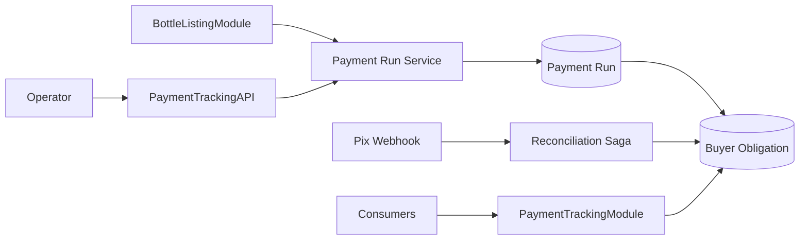
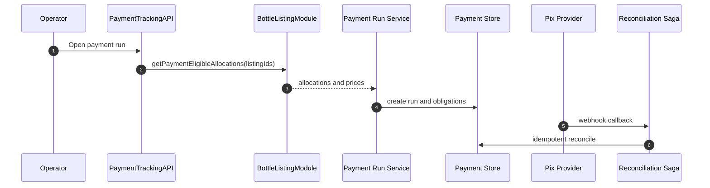

# Dose Payment Tracking Architecture

This document is the feature-level architecture companion to [SPEC.md](SPEC.md). It explains the architecture implied by the current DomainSpec contracts and does not claim implementation completeness beyond those contracts.

## Architecture Intent

Dose Payment Tracking must provide the authoritative money-truth boundary for dose payments. It transforms selected listing allocations into buyer obligations, processes Pix/provider callbacks through an idempotent saga, and exposes reliable status for rendering, reminders, and shipment readiness.

## Scope Boundary

Owned behavior: payment run opening, buyer obligation creation, expected amount calculation, provider correlation storage, webhook reconciliation, retry handling, exception exposure, and manual paid fallback.

Excluded behavior: payment link generation/delivery, reminder scheduling/delivery, buyer identity ownership, listing allocation, freight calculation/payment, shipment package composition, WhatsApp posting, and Excel migration/import.

## Source Contracts

| Contract ID | Source                                                                                         | Required | Notes                                                      |
| ----------- | ---------------------------------------------------------------------------------------------- | -------- | ---------------------------------------------------------- |
| SC-001      | [SPEC.md](SPEC.md)                                                                             | yes      | Feature capability and concept source of truth             |
| SC-002      | [domain.md](domain.md)                                                                         | yes      | Payment run, obligation, line item, status definitions     |
| SC-003      | [rules.md](rules.md)                                                                           | yes      | Opening, grouping, idempotency, amount, and fallback rules |
| SC-004      | [operations.md](operations.md)                                                                 | yes      | Payment run, webhook, retry, and manual operations         |
| SC-005      | [queries.md](queries.md)                                                                       | yes      | Payment truth read models                                  |
| SC-006      | [interfaces.md](interfaces.md)                                                                 | yes      | REST, webhook, and internal module boundaries              |
| SC-007      | [states.md](states.md)                                                                         | yes      | Payment status lifecycle                                   |
| SC-008      | [events.md](events.md)                                                                         | yes      | Payment events and consumers                               |
| SC-009      | [../bottle-listing-and-dose-allocation/SPEC.md](../bottle-listing-and-dose-allocation/SPEC.md) | yes      | Source of selected listing allocations                     |
| SC-010      | [../../PROJECT-DECISIONS.md](../../PROJECT-DECISIONS.md#decision-register)                     | yes      | Project decisions for payment run model and reconciliation |

## Design Goals and Non-Goals

| Type     | Item                                                 | Why                                                                  |
| -------- | ---------------------------------------------------- | -------------------------------------------------------------------- |
| Goal     | Create one buyer obligation across selected listings | Matches operator-selected listing payment run model                  |
| Goal     | Preserve line-item traceability                      | Payment amount must be explainable by listing/dose allocation        |
| Goal     | Make provider callbacks idempotent                   | Duplicate Pix callbacks must not double-apply                        |
| Goal     | Surface exceptions to UI                             | Saga failures must not disappear silently                            |
| Non-goal | Generate payment links                               | Payment Link And Reminder Messaging owns buyer-facing link artifacts |
| Non-goal | Own reminders                                        | Messaging feature owns cadence and delivery state                    |
| Non-goal | Own slot allocation                                  | Bottle Listing owns allocation truth                                 |

## View 1: Context View

| Actor or System                     | Relationship to Feature                                | Contract Source                                                                                                  |
| ----------------------------------- | ------------------------------------------------------ | ---------------------------------------------------------------------------------------------------------------- |
| Group operator                      | Opens payment runs and manually marks paid when needed | [operations.md](operations.md)                                                                                   |
| Bottle Listing And Dose Allocation  | Provides selected listing allocations and prices       | [interfaces.md#dependency-bottlelistingmodule-interface](interfaces.md#dependency-bottlelistingmodule-interface) |
| Pix provider                        | Sends webhook callbacks                                | [interfaces.md#external-pixwebhook-interface](interfaces.md#external-pixwebhook-interface)                       |
| Payment Link And Reminder Messaging | Consumes obligations and status for links/reminders    | [PaymentTrackingModule](interfaces.md#internal-paymenttrackingmodule-interface)                                  |
| Public WhatsApp List Rendering      | Consumes buyer-level payment snippets                  | [GetListingPaymentSummary](queries.md#getlistingpaymentsummary)                                                  |
| Freight And Shipment Batching       | Consumes dose payment satisfaction                     | [GetBuyerPaymentStatus](queries.md#getbuyerpaymentstatus)                                                        |

## View 2: High-Level Structure View

| Component             | Primary Contracts                                                                                                                                | Responsibility                                          |
| --------------------- | ------------------------------------------------------------------------------------------------------------------------------------------------ | ------------------------------------------------------- |
| PaymentTrackingAPI    | [interfaces.md#external-paymenttrackingapi-rest](interfaces.md#external-paymenttrackingapi-rest)                                                 | Operator payment run and fallback surface               |
| Payment Run Service   | [operations.md#openpaymentrun](operations.md#openpaymentrun), [rules.md#p2-payment-run-grouping-policy](rules.md#p2-payment-run-grouping-policy) | Creates obligations from listing allocations            |
| Reconciliation Saga   | [workflows.md#paymentreconciliationsaga](workflows.md#paymentreconciliationsaga)                                                                 | Processes callbacks, retries failures, emits exceptions |
| Payment Store         | [domain.md](domain.md), [states.md](states.md)                                                                                                   | Persists runs, obligations, statuses, callbacks         |
| PaymentTrackingModule | [interfaces.md#internal-paymenttrackingmodule-interface](interfaces.md#internal-paymenttrackingmodule-interface)                                 | Provides downstream payment truth                       |

## View 3: Low-Level Components View

| Component                   | Owns                         | Consumes                             | Collaboration Rule                                      |
| --------------------------- | ---------------------------- | ------------------------------------ | ------------------------------------------------------- |
| Payment Run Command Handler | OpenPaymentRun               | BottleListingModule allocation query | Must snapshot active allocations into line items        |
| Obligation Calculator       | CalculateBuyerPaymentTotal   | Payment line items                   | Must keep totals deterministic and traceable            |
| Correlation Adapter         | AttachProviderCorrelationKey | Payment link/provider output         | Must keep key unique per active obligation              |
| Webhook Handler             | ApplyPixWebhook              | Pix webhook payload                  | Must persist callback before mutating obligation status |
| Retry Worker                | RetryReconciliation          | failed attempts                      | Must convert exhausted retries into visible exceptions  |
| Payment Read Service        | payment queries              | Payment Store                        | Must expose authoritative payment status only           |

## View 4: Workflow Process View

| Flow                | Happy Path                                                            | Failure or Compensation                     | Contract Source                                                                  |
| ------------------- | --------------------------------------------------------------------- | ------------------------------------------- | -------------------------------------------------------------------------------- |
| Payment run opening | Select listings, read allocations, group by buyer, create obligations | Reject invalid/empty selection              | [workflows.md#payment-run-opening](workflows.md#payment-run-opening)             |
| Pix reconciliation  | Match correlation key, compare amount, update status                  | Duplicate ignored, unmatched/failed exposed | [workflows.md#paymentreconciliationsaga](workflows.md#paymentreconciliationsaga) |
| Manual fallback     | Operator reviews exception and marks paid                             | Reject missing audit reason                 | [workflows.md#manual-fallback](workflows.md#manual-fallback)                     |

## View 5: Decision Flow View

| Decision Point                         | Options or Branches                      | Selection Rule                                                                       | Outcome                           |
| -------------------------------------- | ---------------------------------------- | ------------------------------------------------------------------------------------ | --------------------------------- |
| Can payment open?                      | on-fill / manual / reject                | [PaymentOpeningPolicy](rules.md#p1-payment-opening-policy)                           | Payment run created or rejected   |
| How are buyer obligations grouped?     | one per listing / one combined per buyer | [Payment Run Grouping Policy](rules.md#p2-payment-run-grouping-policy)               | One combined obligation per buyer |
| Does callback match?                   | one obligation / none / multiple         | [Provider Correlation Required Rule](rules.md#r4-provider-correlation-required-rule) | Reconcile or unmatched/failed     |
| What status follows amount comparison? | paid / partial / overpaid                | [Amount Match Rule](rules.md#r3-amount-match-rule)                                   | Payment status update             |

## View 6: Dependency Interface View

| Dependency or Interface | Direction          | Contract                                                                                                         | Boundary Rule                                  |
| ----------------------- | ------------------ | ---------------------------------------------------------------------------------------------------------------- | ---------------------------------------------- |
| PaymentTrackingAPI      | inbound            | [interfaces.md#external-paymenttrackingapi-rest](interfaces.md#external-paymenttrackingapi-rest)                 | Operator-only payment mutations                |
| PixWebhook              | inbound external   | [interfaces.md#external-pixwebhook-interface](interfaces.md#external-pixwebhook-interface)                       | Idempotent by provider correlation key         |
| BottleListingModule     | inbound dependency | [interfaces.md#dependency-bottlelistingmodule-interface](interfaces.md#dependency-bottlelistingmodule-interface) | Payment cannot mutate allocation state         |
| PaymentTrackingModule   | outbound internal  | [interfaces.md#internal-paymenttrackingmodule-interface](interfaces.md#internal-paymenttrackingmodule-interface) | Consumers read payment truth but do not own it |

## Constraints

| Constraint                            | Source                                                               | Impact                                                      |
| ------------------------------------- | -------------------------------------------------------------------- | ----------------------------------------------------------- |
| Payment run selects listings          | [PROJECT-DECISIONS.md](../../PROJECT-DECISIONS.md#decision-register) | Obligations are grouped by buyer across selected listings   |
| Pix webhook primary reconciliation    | [PROJECT-DECISIONS.md](../../PROJECT-DECISIONS.md#decision-register) | Provider correlation key and idempotency are mandatory      |
| Buyer-level public paid/unpaid status | [PROJECT-DECISIONS.md](../../PROJECT-DECISIONS.md#decision-register) | Read models must expose buyer-level status accurately       |
| Payment link generation separate      | [PROJECT-DECISIONS.md](../../PROJECT-DECISIONS.md#decision-register) | This feature stores correlation and truth, not message text |

## Dependency And Interface Rules

| Rule ID | Rule                                                        | Applies To                            | Enforcement                                           |
| ------- | ----------------------------------------------------------- | ------------------------------------- | ----------------------------------------------------- |
| PIR-001 | Payment run opening must use Bottle Listing read contracts  | OpenPaymentRun                        | Application precondition                              |
| PIR-002 | Provider callbacks must be idempotent                       | ApplyPixWebhook                       | Correlation key uniqueness and processed callback log |
| PIR-003 | Payment truth must be exposed through PaymentTrackingModule | Rendering/reminder/shipment consumers | Interface boundary                                    |
| PIR-004 | Payment link text is not owned here                         | AttachProviderCorrelationKey          | Boundary with messaging feature                       |

## Data and Evidence Artifacts

| Artifact          | Produced By         | Used For                                 | Contract Source                                                          |
| ----------------- | ------------------- | ---------------------------------------- | ------------------------------------------------------------------------ |
| Buyer obligation  | OpenPaymentRun      | Payment links, rendering, reconciliation | [domain.md#buyer-payment-obligation](domain.md#buyer-payment-obligation) |
| Payment line item | OpenPaymentRun      | Amount traceability                      | [domain.md#payment-line-item](domain.md#payment-line-item)               |
| Callback record   | ApplyPixWebhook     | Idempotency and audit                    | [operations.md#applypixwebhook](operations.md#applypixwebhook)           |
| Payment exception | RetryReconciliation | UI notifications                         | [queries.md#getpaymentexceptions](queries.md#getpaymentexceptions)       |

## Extension Points

| Extension Point          | Allowed Variation                      | Guardrail                                  |
| ------------------------ | -------------------------------------- | ------------------------------------------ |
| Provider correlation key | Pix `txid` or provider equivalent      | Must uniquely identify one obligation      |
| Payment opening trigger  | on-fill or manual                      | Immediate-on-allocation remains outside v1 |
| Manual fallback          | mark paid/partial/overpaid with reason | Must preserve audit reason                 |

## Trade-offs and Guardrails

| Trade-off                     | Benefit                          | Cost                            | Guardrail                                |
| ----------------------------- | -------------------------------- | ------------------------------- | ---------------------------------------- |
| One combined buyer obligation | Simpler buyer payment experience | Requires line-item traceability | Store every listing/allocation line item |
| Saga-style reconciliation     | Recoverable technical failures   | More state surface              | Expose exception queue                   |
| Manual fallback               | Operator can handle reality      | Potential override risk         | Require audit reason                     |

## Decision Log

| Decision ID | Decision                                                           | Options Considered                                            | Reason                                                          |
| ----------- | ------------------------------------------------------------------ | ------------------------------------------------------------- | --------------------------------------------------------------- |
| D-001       | Payment run groups selected listings into one obligation per buyer | per-listing obligations, per-buyer combined, operator choice  | User selected combined per buyer across selected listings       |
| D-002       | Pix callbacks use provider correlation key                         | provider transaction only, buyer name/amount, txid/equivalent | Selected for reliable matching and idempotency                  |
| D-003       | Reconciliation states are detailed                                 | paid/unpaid only, exception state only, detailed states       | Selected to preserve partial, overpaid, unmatched, failed truth |

## Risks

| Risk ID | Risk                                        | Mitigation                                                     | Owner |
| ------- | ------------------------------------------- | -------------------------------------------------------------- | ----- |
| RK-001  | Wrong public paid/unpaid status harms trust | Rendering must consume PaymentTrackingModule, not infer status |
| RK-002  | Duplicate webhook double-applies payment    | Enforce idempotency by provider correlation key                |
| RK-003  | Manual fallback hides provider mismatch     | Require audit reason and preserve source                       |

## Downstream Planning Notes

- Implementation-plan inputs: BottleListingModule adapter, provider callback persistence, payment status store, retry worker.
- Test implications: payment run grouping, amount calculation, idempotent callback handling, partial/overpaid/unmatched/failed status, manual fallback audit.
- Observability implications: reconciliation accuracy, unmatched payment count, retry count, manual fallback count.
- Documentation implications: generate stories and test specs before implementation.

## Design Transport Notes

Carry the payment run grouping model, correlation-key idempotency, saga retries, exception queue, and PaymentTrackingModule read contract into stories, tests, implementation tasks, and the Payment Link And Reminder Messaging spec.

## Gate Result

- Status: pass
- Reason: Source contracts are present, six architecture views are populated, dependency/interface rules are recorded, decisions and risks are explicit, and architecture-to-aspect references are defined.
- Required follow-up: generate `STORIES.md` and `TEST-SPEC.md` before implementation.
