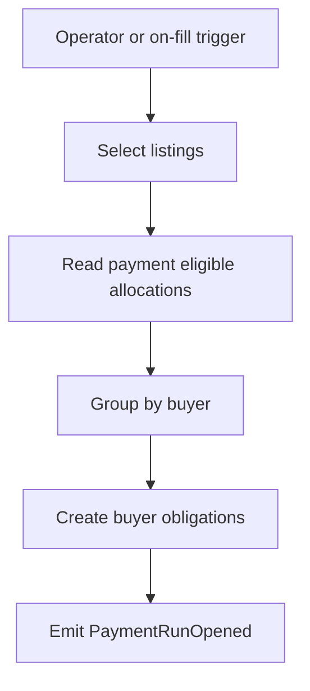
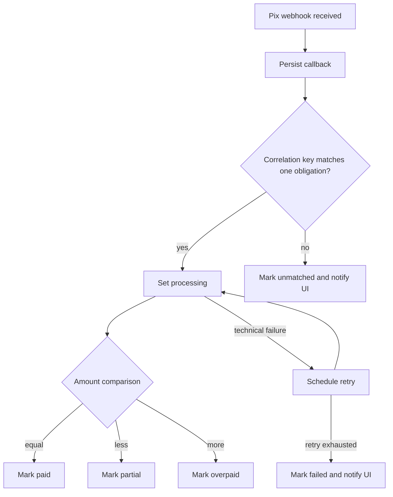

# Dose Payment Tracking Workflows

## Payment Run Opening

| Step              | Contract                                                                      | Success                       | Failure                            |
| ----------------- | ----------------------------------------------------------------------------- | ----------------------------- | ---------------------------------- |
| Select listings   | [PaymentOpeningPolicy](rules.md#p1-payment-opening-policy)                    | Listings accepted for opening | Reject unsupported opening mode    |
| Read allocations  | [BottleListingModule](interfaces.md#dependency-bottlelistingmodule-interface) | Active allocations returned   | Reject empty or invalid selection  |
| Group obligations | [Payment Run Grouping Policy](rules.md#p2-payment-run-grouping-policy)        | One obligation per buyer      | Reject inconsistent line item data |

## PaymentReconciliationSaga

Saga for provider callbacks and retryable reconciliation failures.

| Step             | Operation                                                                               | Success                          | Failure or Compensation                   |
| ---------------- | --------------------------------------------------------------------------------------- | -------------------------------- | ----------------------------------------- |
| Persist callback | [ApplyPixWebhook](operations.md#applypixwebhook)                                        | Callback recorded idempotently   | Duplicate callback exits without mutation |
| Match obligation | [R4 Provider Correlation Required Rule](rules.md#r4-provider-correlation-required-rule) | One obligation found             | `unmatched` exception                     |
| Compare amount   | [R3 Amount Match Rule](rules.md#r3-amount-match-rule)                                   | `paid`, `partial`, or `overpaid` | Technical failure schedules retry         |
| Retry            | [RetryReconciliation](operations.md#retryreconciliation)                                | Reconciliation resumes           | Retry exhaustion becomes `failed`         |

## Manual Fallback

| Step                       | Operation                                               | Success                          | Failure                                     |
| -------------------------- | ------------------------------------------------------- | -------------------------------- | ------------------------------------------- |
| Operator reviews exception | [GetPaymentExceptions](queries.md#getpaymentexceptions) | Obligation selected              | No mutation                                 |
| Operator marks paid        | [ManualMarkPaid](operations.md#manualmarkpaid)          | Status updated with audit reason | Reject missing reason or invalid obligation |

## Policies

### UI Notification Policy

Unmatched, failed, partial, and overpaid outcomes must be exposed through [GetPaymentExceptions](queries.md#getpaymentexceptions) so the operator can see reconciliation work that needs attention.
