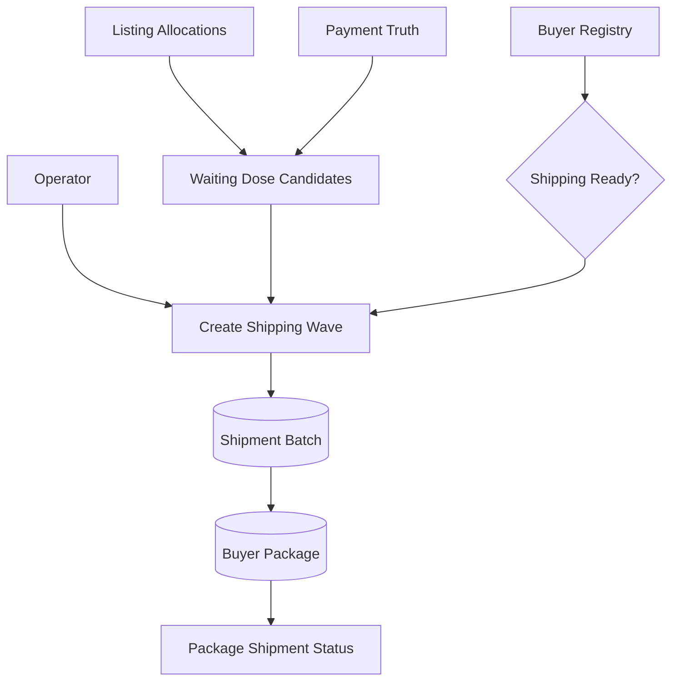

# Freight And Shipment Batching

## What This Module Owns

Freight And Shipment Batching owns the shipment planning boundary for paid waiting doses. It lets the operator gather paid buyer-owned doses across multiple bottle listings into a shipping wave, split the wave into per-buyer packages, verify buyer shipping readiness, and mark package/shipping progress.

This feature does not calculate freight amounts, collect freight payment, buy carrier labels, allocate dose slots, own buyer PII, reconcile dose payments, import Excel data, or post WhatsApp messages in v1.

## Module Map

## Capabilities

| Capability                   | What                                                           | Key Aspects                                                                                                                                                               | Detail                                           |
| ---------------------------- | -------------------------------------------------------------- | ------------------------------------------------------------------------------------------------------------------------------------------------------------------------- | ------------------------------------------------ |
| Waiting Dose Identification  | Identify paid allocated doses not yet shipped                  | [Waiting Dose](domain.md#waiting-dose), [GetWaitingDoseCandidates](queries.md#getwaitingdosecandidates), [ShipmentEligibilityRule](rules.md#r1-shipment-eligibility-rule) | Requires paid dose payment and active allocation |
| Shipping Wave Composition    | Create operator-managed shipment batches across listings       | [Shipment Batch](domain.md#shipment-batch), [CreateShipmentBatch](operations.md#createshipmentbatch), [BatchCompositionPolicy](rules.md#p1-batch-composition-policy)      | Batch contains per-buyer packages                |
| Per-Buyer Package Management | Group selected waiting doses by buyer inside a shipping wave   | [Buyer Package](domain.md#buyer-package), [AddWaitingDosesToPackage](operations.md#addwaitingdosestopackage), [PackageOwnershipRule](rules.md#r2-package-ownership-rule)  | One package belongs to one buyer                 |
| Shipping Readiness Gate      | Ensure buyer address exists before first shipment              | [Shipping Readiness Check](domain.md#shipping-readiness-check), [ValidateShipmentReadiness](operations.md#validateshipmentreadiness)                                      | Uses Buyer Registry, does not own address fields |
| Shipment Progress Tracking   | Track package/batch status from draft planning through shipped | [ShipmentBatchStatusLifecycle](states.md#shipmentbatchstatuslifecycle), [PackageShipmentStatusLifecycle](states.md#packageshipmentstatuslifecycle)                        | Freight amount/payment remains deferred          |

## Domain Concepts

| Concept                                                        | Type                | Key Constraints                                                      |
| -------------------------------------------------------------- | ------------------- | -------------------------------------------------------------------- |
| [Waiting Dose](domain.md#waiting-dose)                         | Entity / Projection | Paid allocated dose not yet shipped                                  |
| [Shipment Batch](domain.md#shipment-batch)                     | Entity              | Operator-managed shipping wave containing one or more buyer packages |
| [Buyer Package](domain.md#buyer-package)                       | Entity              | Package for one buyer, containing that buyer's waiting doses         |
| [Package Line Item](domain.md#package-line-item)               | Value Object        | Traceable listing/allocation/slot contribution to a package          |
| [Shipping Readiness Check](domain.md#shipping-readiness-check) | Value Object        | Result of buyer address and package eligibility validation           |
| [Shipment Batch Status](domain.md#shipment-batch-status)       | Enum / Type         | `draft`, `ready`, `shipped`, `cancelled`                             |
| [Package Shipment Status](domain.md#package-shipment-status)   | Enum / Type         | `planned`, `blocked`, `ready`, `shipped`, `cancelled`                |

## Concept Registry

| Concept                                                                           | ID                                                             | Type                |
| --------------------------------------------------------------------------------- | -------------------------------------------------------------- | ------------------- |
| [Waiting Dose](domain.md#waiting-dose)                                            | `freight-and-shipment-batching.WaitingDose`                    | Entity / Projection |
| [Shipment Batch](domain.md#shipment-batch)                                        | `freight-and-shipment-batching.ShipmentBatch`                  | Entity              |
| [Buyer Package](domain.md#buyer-package)                                          | `freight-and-shipment-batching.BuyerPackage`                   | Entity              |
| [Package Line Item](domain.md#package-line-item)                                  | `freight-and-shipment-batching.PackageLineItem`                | Value Object        |
| [Shipping Readiness Check](domain.md#shipping-readiness-check)                    | `freight-and-shipment-batching.ShippingReadinessCheck`         | Value Object        |
| [ShipmentBatchStatusLifecycle](states.md#shipmentbatchstatuslifecycle)            | `freight-and-shipment-batching.ShipmentBatchStatusLifecycle`   | State Machine       |
| [PackageShipmentStatusLifecycle](states.md#packageshipmentstatuslifecycle)        | `freight-and-shipment-batching.PackageShipmentStatusLifecycle` | State Machine       |
| [CreateShipmentBatch](operations.md#createshipmentbatch)                          | `freight-and-shipment-batching.CreateShipmentBatch`            | Operation           |
| [AddWaitingDosesToPackage](operations.md#addwaitingdosestopackage)                | `freight-and-shipment-batching.AddWaitingDosesToPackage`       | Operation           |
| [RemoveWaitingDoseFromPackage](operations.md#removewaitingdosefrompackage)        | `freight-and-shipment-batching.RemoveWaitingDoseFromPackage`   | Operation           |
| [ValidateShipmentReadiness](operations.md#validateshipmentreadiness)              | `freight-and-shipment-batching.ValidateShipmentReadiness`      | Operation           |
| [MarkPackageShipped](operations.md#markpackageshipped)                            | `freight-and-shipment-batching.MarkPackageShipped`             | Operation           |
| [CloseShipmentBatch](operations.md#closeshipmentbatch)                            | `freight-and-shipment-batching.CloseShipmentBatch`             | Operation           |
| [ShipmentEligibilityRule](rules.md#r1-shipment-eligibility-rule)                  | `freight-and-shipment-batching.ShipmentEligibilityRule`        | Rule                |
| [PackageOwnershipRule](rules.md#r2-package-ownership-rule)                        | `freight-and-shipment-batching.PackageOwnershipRule`           | Rule                |
| [ShippingAddressRequiredRule](rules.md#r3-shipping-address-required-rule)         | `freight-and-shipment-batching.ShippingAddressRequiredRule`    | Rule                |
| [FreightDeferredPolicy](rules.md#p2-freight-deferred-policy)                      | `freight-and-shipment-batching.FreightDeferredPolicy`          | Policy              |
| [GetWaitingDoseCandidates](queries.md#getwaitingdosecandidates)                   | `freight-and-shipment-batching.GetWaitingDoseCandidates`       | Query               |
| [GetShipmentBatch](queries.md#getshipmentbatch)                                   | `freight-and-shipment-batching.GetShipmentBatch`               | Query               |
| [GetBuyerPackage](queries.md#getbuyerpackage)                                     | `freight-and-shipment-batching.GetBuyerPackage`                | Query               |
| [ShipmentBatchingAPI](interfaces.md#external-shipmentbatchingapi-rest)            | `freight-and-shipment-batching.ShipmentBatchingAPI`            | Interface           |
| [ShipmentBatchingModule](interfaces.md#internal-shipmentbatchingmodule-interface) | `freight-and-shipment-batching.ShipmentBatchingModule`         | Interface           |
| [ShipmentBatchCreated](events.md#shipmentbatchcreated)                            | `freight-and-shipment-batching.ShipmentBatchCreated`           | Event               |
| [BuyerPackageCreated](events.md#buyerpackagecreated)                              | `freight-and-shipment-batching.BuyerPackageCreated`            | Event               |
| [WaitingDosePackaged](events.md#waitingdosepackaged)                              | `freight-and-shipment-batching.WaitingDosePackaged`            | Event               |
| [PackageMarkedShipped](events.md#packagemarkedshipped)                            | `freight-and-shipment-batching.PackageMarkedShipped`           | Event               |
| [ShipmentBatchClosed](events.md#shipmentbatchclosed)                              | `freight-and-shipment-batching.ShipmentBatchClosed`            | Event               |

## Feature Concept Graph

| From                                                        | Edge        | To                                                             | Evidence                                                                                 | Notes                                            |
| ----------------------------------------------------------- | ----------- | -------------------------------------------------------------- | ---------------------------------------------------------------------------------------- | ------------------------------------------------ |
| `bottle-listing-and-dose-allocation.GetBuyerAllocatedDoses` | supplies    | `freight-and-shipment-batching.GetWaitingDoseCandidates`       | [queries.md#getwaitingdosecandidates](queries.md#getwaitingdosecandidates)               | Candidate doses come from allocations            |
| `dose-payment-tracking.GetBuyerPaymentStatus`               | filters     | `freight-and-shipment-batching.GetWaitingDoseCandidates`       | [rules.md#r1-shipment-eligibility-rule](rules.md#r1-shipment-eligibility-rule)           | Only paid/satisfied dose payment may ship        |
| `buyer-registry.CheckBuyerShippingReadiness`                | gates       | `freight-and-shipment-batching.ValidateShipmentReadiness`      | [rules.md#r3-shipping-address-required-rule](rules.md#r3-shipping-address-required-rule) | Address required before first shipment           |
| `freight-and-shipment-batching.CreateShipmentBatch`         | produces    | `freight-and-shipment-batching.ShipmentBatchCreated`           | [events.md#shipmentbatchcreated](events.md#shipmentbatchcreated)                         | Creates shipping wave                            |
| `freight-and-shipment-batching.AddWaitingDosesToPackage`    | produces    | `freight-and-shipment-batching.WaitingDosePackaged`            | [events.md#waitingdosepackaged](events.md#waitingdosepackaged)                           | Adds traceable dose line items                   |
| `freight-and-shipment-batching.PackageOwnershipRule`        | enforces    | `freight-and-shipment-batching.AddWaitingDosesToPackage`       | [rules.md#r2-package-ownership-rule](rules.md#r2-package-ownership-rule)                 | Package contains one buyer's doses only          |
| `freight-and-shipment-batching.MarkPackageShipped`          | transitions | `freight-and-shipment-batching.PackageShipmentStatusLifecycle` | [states.md#packageshipmentstatuslifecycle](states.md#packageshipmentstatuslifecycle)     | Package becomes shipped                          |
| `freight-and-shipment-batching.CloseShipmentBatch`          | transitions | `freight-and-shipment-batching.ShipmentBatchStatusLifecycle`   | [states.md#shipmentbatchstatuslifecycle](states.md#shipmentbatchstatuslifecycle)         | Batch closes when packages are shipped/cancelled |
| `freight-and-shipment-batching.FreightDeferredPolicy`       | constrains  | `freight-and-shipment-batching.ShipmentBatchingAPI`            | [rules.md#p2-freight-deferred-policy](rules.md#p2-freight-deferred-policy)               | No freight calculation/payment in v1             |

## Aspect Docs

| Aspect                          | Contains                                                   | Key Concepts                                                  |
| ------------------------------- | ---------------------------------------------------------- | ------------------------------------------------------------- |
| [Architecture](architecture.md) | Six-view feature architecture and gate result              | ShipmentBatchingAPI, waiting dose candidates, readiness gates |
| [Glossary](glossary.md)         | Distilled definitions for feature concepts                 | Waiting Dose, Shipment Batch, Buyer Package                   |
| [Domain](domain.md)             | Entities, projections, value objects, and statuses         | Waiting Dose, Shipment Batch, Package                         |
| [Operations](operations.md)     | Batch/package creation and shipment progress actions       | Create, add, remove, validate, ship, close                    |
| [Queries](queries.md)           | Candidate and shipment read models                         | Waiting candidates, batch, package                            |
| [Interfaces](interfaces.md)     | REST and internal module contracts                         | ShipmentBatchingAPI, ShipmentBatchingModule                   |
| [Rules](rules.md)               | Shipment eligibility, ownership, address, freight deferral | Paid-only, per-buyer package, address required                |
| [States](states.md)             | Batch and package status transitions                       | ShipmentBatchStatusLifecycle, PackageShipmentStatusLifecycle  |
| [Workflows](workflows.md)       | Batch creation and package shipment flows                  | Compose wave, validate, ship                                  |
| [Events](events.md)             | Domain events and consumers                                | Batch created, package shipped                                |

## Cross-Feature Dependencies

| Capability                  | Depends On                                                                          | Via                                                                                                                  | Why                                                          |
| --------------------------- | ----------------------------------------------------------------------------------- | -------------------------------------------------------------------------------------------------------------------- | ------------------------------------------------------------ |
| Waiting Dose Identification | [Bottle Listing And Dose Allocation](../bottle-listing-and-dose-allocation/SPEC.md) | [getBuyerAllocatedDoses](../bottle-listing-and-dose-allocation/interfaces.md#internal-bottlelistingmodule-interface) | Reads allocated dose ownership and slot/listing traceability |
| Waiting Dose Identification | [Dose Payment Tracking](../dose-payment-tracking/SPEC.md)                           | [GetBuyerPaymentStatus](../dose-payment-tracking/queries.md#getbuyerpaymentstatus)                                   | Confirms dose payment is satisfied                           |
| Shipping Readiness Gate     | [Buyer Registry](../buyer-registry/SPEC.md)                                         | [CheckBuyerShippingReadiness](../buyer-registry/queries.md#checkbuyershippingreadiness)                              | Confirms buyer has address before first shipment             |

## Produces For

| Consumer                       | Consumes Capability               | Via                                                                               | What                                                               |
| ------------------------------ | --------------------------------- | --------------------------------------------------------------------------------- | ------------------------------------------------------------------ |
| Operator UI                    | Shipment batch/package management | [ShipmentBatchingAPI](interfaces.md#external-shipmentbatchingapi-rest)            | Shipping waves, buyer packages, blocked readiness, shipped state   |
| Public WhatsApp List Rendering | Shipment transparency snippets    | [ShipmentBatchingModule](interfaces.md#internal-shipmentbatchingmodule-interface) | Package or batch shipped status when needed                        |
| Future Freight Calculation     | Package composition               | [GetBuyerPackage](queries.md#getbuyerpackage)                                     | Package contents and buyer address readiness for freight quotation |

## Deferred Obligations

| Obligation                      | Deferred To                    | Reason                                          |
| ------------------------------- | ------------------------------ | ----------------------------------------------- |
| Freight calculation             | Future freight extension       | User selected freight calculation outside v1    |
| Freight payment tracking        | Future freight payment feature | Dose payment tracking covers dose payment only  |
| Carrier label purchase/tracking | Future carrier integration     | Out of v1 marketplace/shipping automation scope |
| Direct WhatsApp posting         | Future WhatsApp integration    | V1 uses copy/paste rendering elsewhere          |

## Stories

User stories are maintained in [STORIES.md](STORIES.md).

## Change History

Initial feature spec created from project-level discovery and decisions on 2026-05-21.

## References

- Project overview: [../../PROJECT-OVERVIEW.md](../../PROJECT-OVERVIEW.md)
- Project decisions: [../../PROJECT-DECISIONS.md](../../PROJECT-DECISIONS.md)
- Initial definitions: [../../INITIAL-DEFINITIONS.md](../../INITIAL-DEFINITIONS.md)
- Buyer Registry: [../buyer-registry/SPEC.md](../buyer-registry/SPEC.md)
- Bottle Listing And Dose Allocation: [../bottle-listing-and-dose-allocation/SPEC.md](../bottle-listing-and-dose-allocation/SPEC.md)
- Dose Payment Tracking: [../dose-payment-tracking/SPEC.md](../dose-payment-tracking/SPEC.md)
