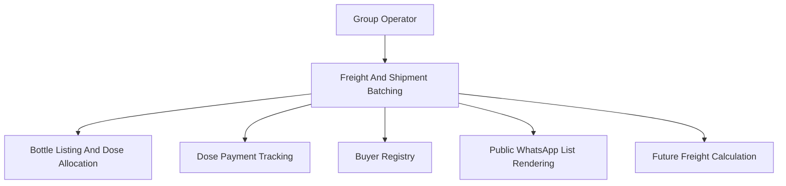
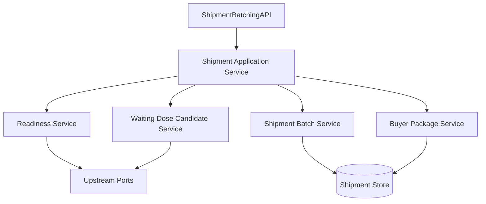
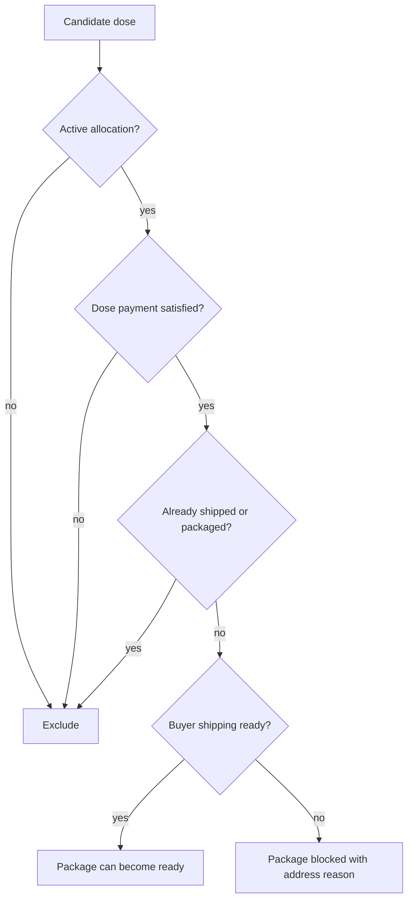

# Freight And Shipment Batching Architecture

## Architecture Intent

Provide a shipment planning boundary that turns paid waiting doses into operator-managed shipping waves and per-buyer packages, while keeping freight calculation/payment, carrier integration, buyer PII ownership, payment truth, and listing allocation ownership outside this feature.

## Scope Boundary

In scope:

- identify paid waiting dose candidates
- create shipment batches as shipping waves
- create per-buyer packages inside a batch
- validate buyer shipping readiness before shipment
- mark buyer packages and batches shipped/cancelled

Out of scope:

- freight amount calculation
- freight payment tracking
- carrier label automation
- buyer address ownership
- dose payment reconciliation
- dose allocation mutation
- direct WhatsApp posting

## Source Contracts

| Source                             | Contract Used                                                       | Evidence                                                                                       |
| ---------------------------------- | ------------------------------------------------------------------- | ---------------------------------------------------------------------------------------------- |
| Project decisions                  | shipment wave plus per-buyer package ownership; freight deferred    | [../../PROJECT-DECISIONS.md](../../PROJECT-DECISIONS.md)                                       |
| Initial definitions                | Waiting Dose, Shipment Batch, Package, Freight Calculation deferred | [../../INITIAL-DEFINITIONS.md](../../INITIAL-DEFINITIONS.md)                                   |
| Buyer Registry                     | shipping address readiness before first shipment                    | [../buyer-registry/SPEC.md](../buyer-registry/SPEC.md)                                         |
| Bottle Listing And Dose Allocation | allocated dose ownership and slot traceability                      | [../bottle-listing-and-dose-allocation/SPEC.md](../bottle-listing-and-dose-allocation/SPEC.md) |
| Dose Payment Tracking              | paid/satisfied dose payment status                                  | [../dose-payment-tracking/SPEC.md](../dose-payment-tracking/SPEC.md)                           |

## Design Goals and Non-Goals

Goals:

- make shipment composition explicit before implementation
- avoid shipping unpaid or unready doses
- preserve cross-listing package traceability
- show address blockers early to the operator

Non-goals:

- freight quote algorithms
- freight payment collection
- shipment carrier orchestration
- historical Excel migration

## View 1: Context View

## View 2: High-Level Structure View

Components:

- `ShipmentBatchingAPI`: operator-facing command/query surface
- `Waiting Dose Candidate Service`: joins allocation and payment truth into eligible candidates
- `Shipment Batch Service`: owns batch lifecycle
- `Buyer Package Service`: owns per-buyer package composition
- `Readiness Service`: checks buyer address readiness and dose eligibility
- `Shipment Store`: persists batch/package/shipped markers

## View 3: Low-Level Components View

| Component                      | Responsibility                                                        | Owns Data                        |
| ------------------------------ | --------------------------------------------------------------------- | -------------------------------- |
| Waiting Dose Candidate Service | Build candidate projection from listing allocation and payment status | no authoritative upstream data   |
| Shipment Batch Service         | Create, cancel, ready, and close batches                              | Shipment Batch                   |
| Buyer Package Service          | Add/remove waiting doses and mark package shipped                     | Buyer Package, Package Line Item |
| Readiness Service              | Evaluate address/payment/allocation blockers                          | Shipping Readiness Check         |
| Buyer Port                     | Query shipping readiness                                              | no                               |
| Listing Port                   | Query allocation/dose ownership                                       | no                               |
| Payment Port                   | Query paid/satisfied status                                           | no                               |

## View 4: Workflow Process View

Primary workflow:

1. Operator opens waiting dose candidates.
2. Shipment feature reads allocated doses from Bottle Listing And Dose Allocation.
3. Shipment feature filters candidates by satisfied dose payment from Dose Payment Tracking.
4. Shipment feature checks buyer shipping readiness from Buyer Registry.
5. Operator creates a shipment batch.
6. Operator selects waiting doses; the feature groups them into per-buyer packages.
7. Package readiness is validated.
8. Operator marks ready packages shipped.
9. Batch closes after all packages are shipped or cancelled.

## View 5: Decision Flow View

## View 6: Dependency Interface View

| Dependency                         | Direction           | Interface                | Rule                                                             |
| ---------------------------------- | ------------------- | ------------------------ | ---------------------------------------------------------------- |
| Buyer Registry                     | consumed            | `BuyerRegistryModule`    | source of shipping readiness and buyer display details           |
| Bottle Listing And Dose Allocation | consumed            | `BottleListingModule`    | source of allocated dose and slot/listing traceability           |
| Dose Payment Tracking              | consumed            | `PaymentTrackingModule`  | source of paid/satisfied dose payment status                     |
| Public WhatsApp List Rendering     | optional downstream | `ShipmentBatchingModule` | may display shipped/package status, but does not mutate shipment |
| Future Freight Calculation         | downstream          | `ShipmentBatchingModule` | may consume package composition later                            |

## Dependency And Interface Rules

- Shipment batching cannot mutate buyer identity, buyer address, dose allocation, listing lifecycle, or payment truth.
- Shipment batching must not include unpaid, unallocated, already shipped, or already packaged doses.
- Buyer package shipment requires a fresh shipping readiness check.
- Freight calculation and freight payment fields must remain absent or explicitly deferred in v1 APIs.

## Decision Log

| Decision                    | Outcome                               | Reason                                                  |
| --------------------------- | ------------------------------------- | ------------------------------------------------------- |
| Batch ownership             | Shipping wave with per-buyer packages | Selected during project interrogation                   |
| Freight calculation/payment | Deferred outside v1                   | User explicitly left freight outside v1                 |
| Shipping address gate       | Required before first shipment        | Buyer identity policy requires address by shipment time |
| Shipment source of truth    | New system for v1 work                | Excel migration/import is excluded                      |

## Risks

| Risk                               | Severity | Mitigation                                                           |
| ---------------------------------- | -------- | -------------------------------------------------------------------- |
| Package includes unpaid dose       | high     | Filter through Dose Payment Tracking at candidate and readiness time |
| Package ships without address      | high     | Block package readiness using Buyer Registry shipping readiness      |
| Dose appears in two packages       | high     | Enforce active package uniqueness for waiting dose IDs               |
| Freight deferral confuses operator | medium   | Label freight fields as deferred and keep them out of v1 readiness   |
| Cross-listing traceability lost    | medium   | Preserve package line items with listing/allocation/slot references  |

## Design Transport Notes

Use the DomainSpec base TypeScript stack. Implement waiting doses as a shipment-local projection/read model assembled from listing allocation and payment truth. Persist only shipment-owned batch/package/shipped markers in this feature.

## Gate Result

Status: PASS

Reason: Discovery is explicitly waived by user instruction, source contracts are present, all six architecture views are populated, dependency rules are stated, and deferred freight obligations are isolated from v1 shipment batching.
