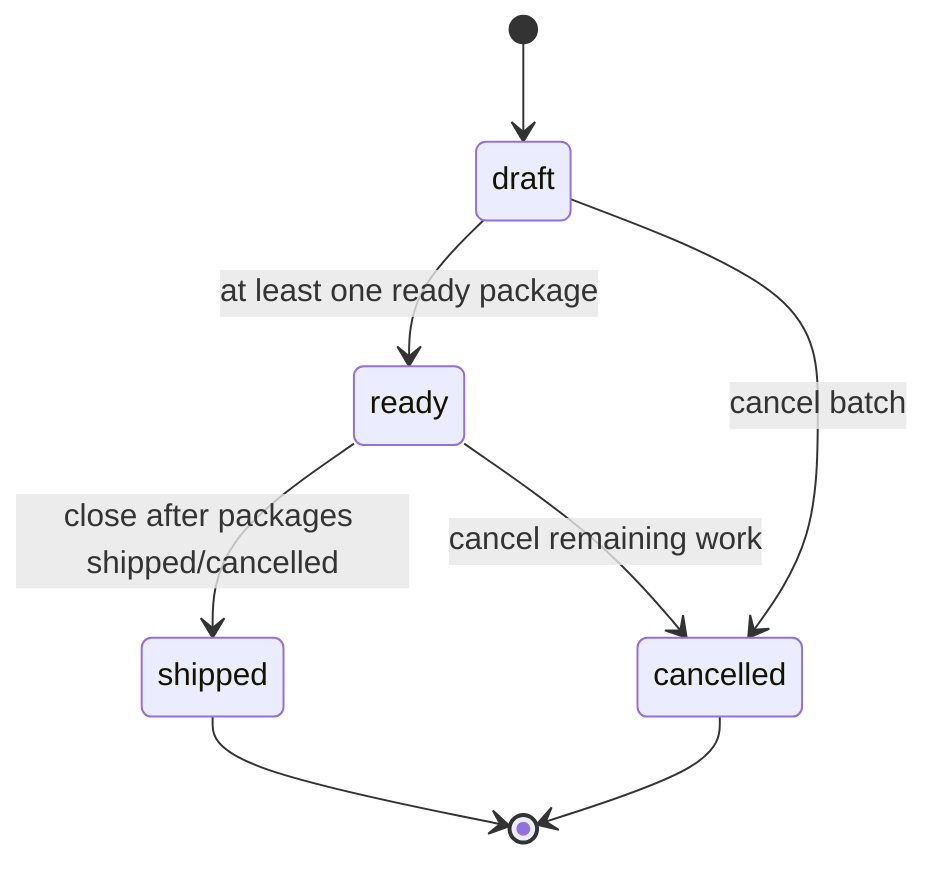
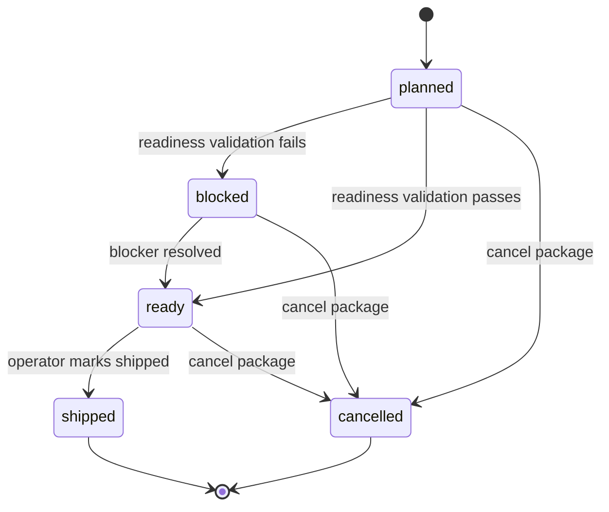

# Freight And Shipment Batching States

## ShipmentBatchStatusLifecycle

Allowed statuses:

- `draft`
- `ready`
- `shipped`
- `cancelled`

Invariants:

- a batch cannot become `shipped` while any package is `planned`, `blocked`, or `ready`
- a batch can span multiple listings
- cancelled batches do not mark waiting doses as shipped

## PackageShipmentStatusLifecycle

Allowed statuses:

- `planned`
- `blocked`
- `ready`
- `shipped`
- `cancelled`

Invariants:

- only `ready` packages can become `shipped`
- `blocked` packages must expose blocking reasons
- `shipped` package line items are no longer waiting dose candidates
