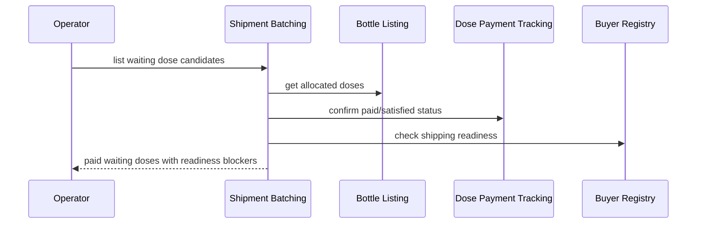
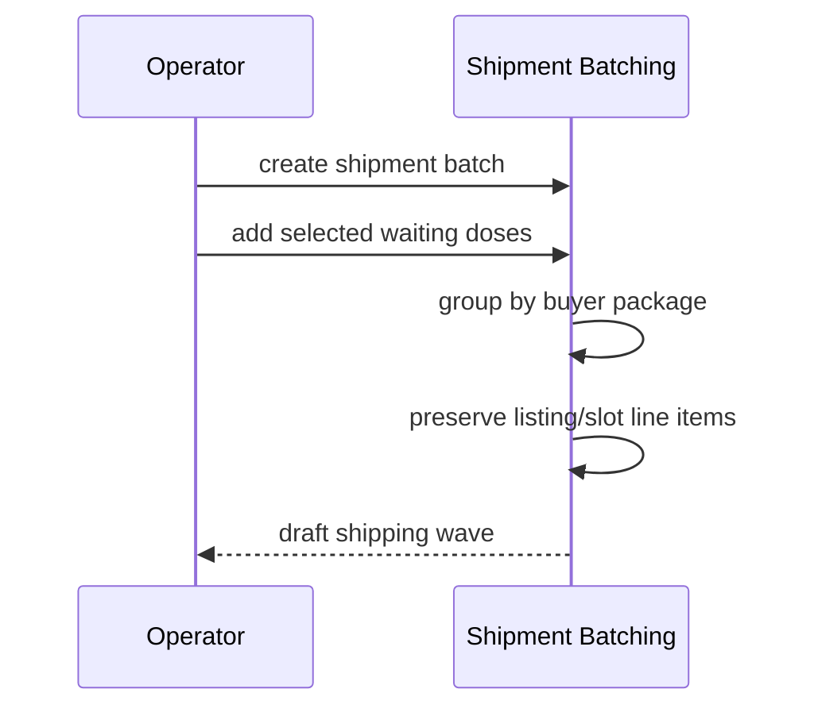
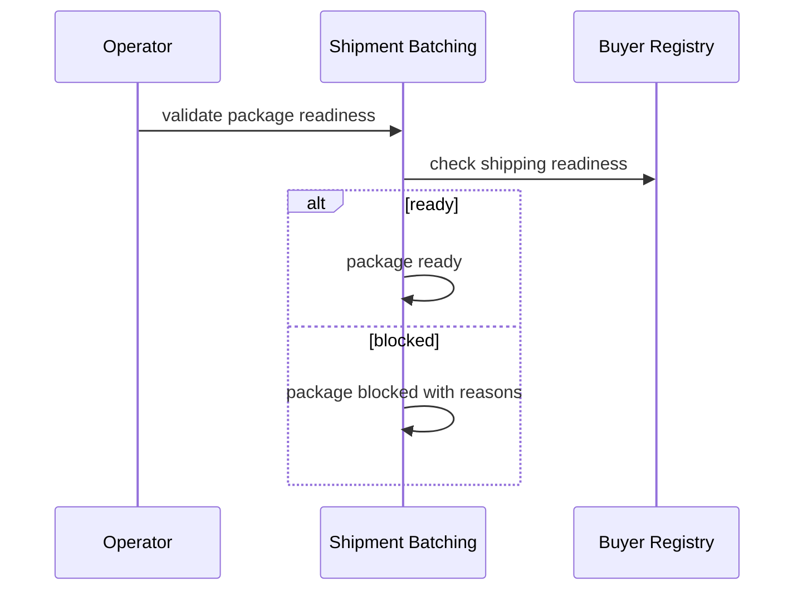
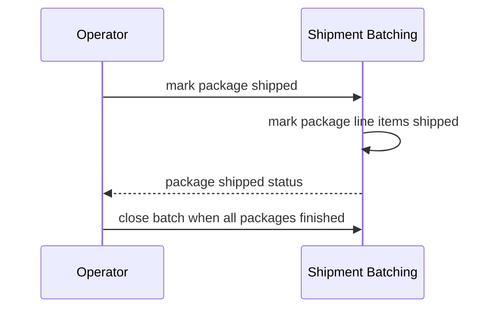

# Freight And Shipment Batching Workflows

## Waiting Dose Selection

Result:

- operator sees shippable and blocked waiting doses
- unpaid or already-shipped doses are excluded

## Shipment Batch Composition

Result:

- a shipping wave contains per-buyer packages
- packages can include doses from multiple listings

## Shipment Readiness Validation

Result:

- packages without buyer address are blocked
- freight calculation/payment is not evaluated in v1

## Package Shipment

Result:

- shipped packages leave the waiting dose pool
- batch closes when all packages are shipped or cancelled
