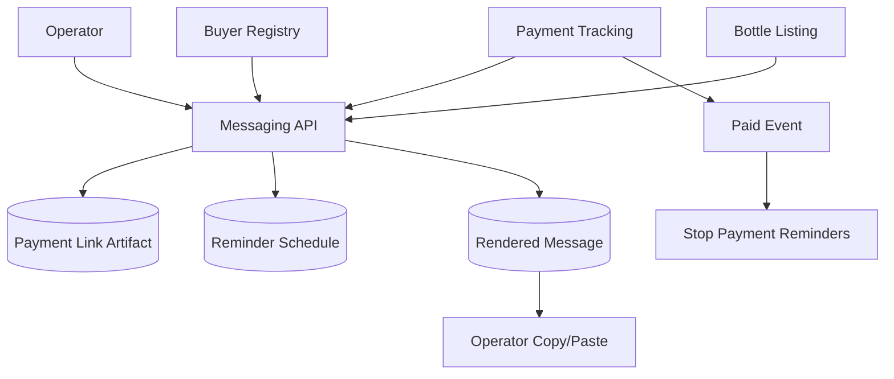

# Payment Link And Reminder Messaging

## What This Module Owns

Payment Link And Reminder Messaging owns buyer-facing payment link message generation, reminder scheduling decisions, reminder copy rendering, suppression state, and rendered-message audit state for WhatsApp copy/paste operation. It consumes payment obligations and payment truth from [Dose Payment Tracking](../dose-payment-tracking/SPEC.md), buyer names and WhatsApp mentions from [Buyer Registry](../buyer-registry/SPEC.md), and listing activity from [Bottle Listing And Dose Allocation](../bottle-listing-and-dose-allocation/SPEC.md).

This feature does not own payment truth, Pix reconciliation, amount calculation, slot allocation, buyer PII, freight calculation/payment, public listing transparency rendering, or direct WhatsApp posting in v1.

## Module Map

## Capabilities

| Capability                      | What                                                                                | Key Aspects                                                                                                                                                                                                         | Detail                                                                              |
| ------------------------------- | ----------------------------------------------------------------------------------- | ------------------------------------------------------------------------------------------------------------------------------------------------------------------------------------------------------------------- | ----------------------------------------------------------------------------------- |
| Payment Link Message Generation | Create copyable buyer-facing payment link messages for obligations in a payment run | [Payment Link Artifact](domain.md#payment-link-artifact), [GeneratePaymentLinkMessages](operations.md#generatepaymentlinkmessages), [PaymentLinkCustomizationPolicy](rules.md#p1-payment-link-customization-policy) | Defaults to all unpaid obligations in the selected run, with operator customization |
| Payment Reminder Rendering      | Render reminders for unpaid obligations at selected cadence points                  | [Reminder Schedule](domain.md#reminder-schedule), [RenderPaymentReminder](operations.md#renderpaymentreminder), [ReminderCadencePolicy](rules.md#p2-reminder-cadence-policy)                                        | Payment opens, 24h before deadline, deadline day, overdue                           |
| Listing Reminder Rendering      | Render listing availability/fill reminders from listing state                       | [Listing Reminder Trigger](domain.md#listing-reminder-trigger), [RenderListingReminder](operations.md#renderlistingreminder)                                                                                        | Covers listing availability and fill/close attention without owning listing state   |
| Reminder Suppression            | Stop stale or noisy reminders when payment is reconciled or operator suppresses     | [Reminder Delivery Status](states.md#reminderdeliverystatuslifecycle), [SuppressReminder](operations.md#suppressreminder), [StopReminderWhenPaidRule](rules.md#r2-stop-reminder-when-paid-rule)                     | Prevents reminders after paid status or manual suppression                          |
| Rendered Message Audit          | Preserve generated text state for operator review and repeat copy/paste             | [Rendered Message](domain.md#rendered-message), [RecordReminderRendered](operations.md#recordreminderrendered)                                                                                                      | Tracks rendered status, not external WhatsApp delivery                              |

## Domain Concepts

| Concept                                                        | Type         | Key Constraints                                                                    |
| -------------------------------------------------------------- | ------------ | ---------------------------------------------------------------------------------- |
| [Payment Link Artifact](domain.md#payment-link-artifact)       | Entity       | One active link/message artifact per buyer obligation unless replaced or cancelled |
| [Reminder Schedule](domain.md#reminder-schedule)               | Entity       | Determines eligible reminders from payment/listing triggers and suppression rules  |
| [Reminder Message](domain.md#reminder-message)                 | Value Object | Human-readable copy/paste message with recipient, trigger, and rendered text       |
| [Rendered Message](domain.md#rendered-message)                 | Entity       | Audit record for generated copy/paste output                                       |
| [Listing Reminder Trigger](domain.md#listing-reminder-trigger) | Enum / Type  | `listing_opened`, `listing_nearly_filled`, `listing_filled`, `listing_closed`      |
| [Payment Link Status](domain.md#payment-link-status)           | Enum / Type  | `draft`, `active`, `replaced`, `cancelled`, `expired`                              |
| [Reminder Delivery Status](domain.md#reminder-delivery-status) | Enum / Type  | `pending`, `rendered`, `skipped`, `failed`, `suppressed`                           |

## Concept Registry

| Concept                                                                         | ID                                                                    | Type          |
| ------------------------------------------------------------------------------- | --------------------------------------------------------------------- | ------------- |
| [Payment Link Artifact](domain.md#payment-link-artifact)                        | `payment-link-and-reminder-messaging.PaymentLinkArtifact`             | Entity        |
| [Reminder Schedule](domain.md#reminder-schedule)                                | `payment-link-and-reminder-messaging.ReminderSchedule`                | Entity        |
| [Reminder Message](domain.md#reminder-message)                                  | `payment-link-and-reminder-messaging.ReminderMessage`                 | Value Object  |
| [Rendered Message](domain.md#rendered-message)                                  | `payment-link-and-reminder-messaging.RenderedMessage`                 | Entity        |
| [Listing Reminder Trigger](domain.md#listing-reminder-trigger)                  | `payment-link-and-reminder-messaging.ListingReminderTrigger`          | Enum / Type   |
| [PaymentLinkStatusLifecycle](states.md#paymentlinkstatuslifecycle)              | `payment-link-and-reminder-messaging.PaymentLinkStatusLifecycle`      | State Machine |
| [ReminderDeliveryStatusLifecycle](states.md#reminderdeliverystatuslifecycle)    | `payment-link-and-reminder-messaging.ReminderDeliveryStatusLifecycle` | State Machine |
| [GeneratePaymentLinkMessages](operations.md#generatepaymentlinkmessages)        | `payment-link-and-reminder-messaging.GeneratePaymentLinkMessages`     | Operation     |
| [RenderPaymentReminder](operations.md#renderpaymentreminder)                    | `payment-link-and-reminder-messaging.RenderPaymentReminder`           | Operation     |
| [RenderListingReminder](operations.md#renderlistingreminder)                    | `payment-link-and-reminder-messaging.RenderListingReminder`           | Operation     |
| [ReplacePaymentLinkMessage](operations.md#replacepaymentlinkmessage)            | `payment-link-and-reminder-messaging.ReplacePaymentLinkMessage`       | Operation     |
| [SuppressReminder](operations.md#suppressreminder)                              | `payment-link-and-reminder-messaging.SuppressReminder`                | Operation     |
| [RecordReminderRendered](operations.md#recordreminderrendered)                  | `payment-link-and-reminder-messaging.RecordReminderRendered`          | Operation     |
| [PaymentLinkCustomizationPolicy](rules.md#p1-payment-link-customization-policy) | `payment-link-and-reminder-messaging.PaymentLinkCustomizationPolicy`  | Policy        |
| [ReminderCadencePolicy](rules.md#p2-reminder-cadence-policy)                    | `payment-link-and-reminder-messaging.ReminderCadencePolicy`           | Policy        |
| [UnpaidRecipientRule](rules.md#r1-unpaid-recipient-rule)                        | `payment-link-and-reminder-messaging.UnpaidRecipientRule`             | Rule          |
| [StopReminderWhenPaidRule](rules.md#r2-stop-reminder-when-paid-rule)            | `payment-link-and-reminder-messaging.StopReminderWhenPaidRule`        | Rule          |
| [DirectPostingDeferredRule](rules.md#r3-direct-posting-deferred-rule)           | `payment-link-and-reminder-messaging.DirectPostingDeferredRule`       | Rule          |
| [LinkRegenerationPolicy](rules.md#p3-link-regeneration-policy)                  | `payment-link-and-reminder-messaging.LinkRegenerationPolicy`          | Policy        |
| [GetPaymentLinkMessages](queries.md#getpaymentlinkmessages)                     | `payment-link-and-reminder-messaging.GetPaymentLinkMessages`          | Query         |
| [GetReminderQueue](queries.md#getreminderqueue)                                 | `payment-link-and-reminder-messaging.GetReminderQueue`                | Query         |
| [GetRenderedMessages](queries.md#getrenderedmessages)                           | `payment-link-and-reminder-messaging.GetRenderedMessages`             | Query         |
| [MessagingAPI](interfaces.md#external-messagingapi-rest)                        | `payment-link-and-reminder-messaging.MessagingAPI`                    | Interface     |
| [MessagingModule](interfaces.md#internal-messagingmodule-interface)             | `payment-link-and-reminder-messaging.MessagingModule`                 | Interface     |
| [PaymentLinkMessageRendered](events.md#paymentlinkmessagerendered)              | `payment-link-and-reminder-messaging.PaymentLinkMessageRendered`      | Event         |
| [PaymentReminderRendered](events.md#paymentreminderrendered)                    | `payment-link-and-reminder-messaging.PaymentReminderRendered`         | Event         |
| [ListingReminderRendered](events.md#listingreminderrendered)                    | `payment-link-and-reminder-messaging.ListingReminderRendered`         | Event         |
| [ReminderSuppressed](events.md#remindersuppressed)                              | `payment-link-and-reminder-messaging.ReminderSuppressed`              | Event         |
| [PaymentLinkMessageReplaced](events.md#paymentlinkmessagereplaced)              | `payment-link-and-reminder-messaging.PaymentLinkMessageReplaced`      | Event         |

## Feature Concept Graph

| From                                                                 | Edge        | To                                                                | Evidence                                                                                             | Notes                                                 |
| -------------------------------------------------------------------- | ----------- | ----------------------------------------------------------------- | ---------------------------------------------------------------------------------------------------- | ----------------------------------------------------- |
| `dose-payment-tracking.PaymentRunOpened`                             | triggers    | `payment-link-and-reminder-messaging.GeneratePaymentLinkMessages` | [operations.md#generatepaymentlinkmessages](operations.md#generatepaymentlinkmessages)               | Payment run is the source of obligations              |
| `payment-link-and-reminder-messaging.GeneratePaymentLinkMessages`    | produces    | `payment-link-and-reminder-messaging.PaymentLinkMessageRendered`  | [events.md#paymentlinkmessagerendered](events.md#paymentlinkmessagerendered)                         | One rendered message per selected obligation          |
| `payment-link-and-reminder-messaging.PaymentLinkCustomizationPolicy` | applies     | `payment-link-and-reminder-messaging.GeneratePaymentLinkMessages` | [rules.md#p1-payment-link-customization-policy](rules.md#p1-payment-link-customization-policy)       | Defaults reduce repeated selection work               |
| `payment-link-and-reminder-messaging.RenderPaymentReminder`          | produces    | `payment-link-and-reminder-messaging.PaymentReminderRendered`     | [events.md#paymentreminderrendered](events.md#paymentreminderrendered)                               | Rendered only for unpaid obligations                  |
| `payment-link-and-reminder-messaging.ReminderCadencePolicy`          | applies     | `payment-link-and-reminder-messaging.RenderPaymentReminder`       | [rules.md#p2-reminder-cadence-policy](rules.md#p2-reminder-cadence-policy)                           | Defines open, pre-deadline, deadline, overdue cadence |
| `payment-link-and-reminder-messaging.UnpaidRecipientRule`            | enforces    | `payment-link-and-reminder-messaging.RenderPaymentReminder`       | [rules.md#r1-unpaid-recipient-rule](rules.md#r1-unpaid-recipient-rule)                               | Excludes paid buyers                                  |
| `dose-payment-tracking.PaymentReconciled`                            | triggers    | `payment-link-and-reminder-messaging.SuppressReminder`            | [operations.md#suppressreminder](operations.md#suppressreminder)                                     | Stops reminders when payment truth is paid            |
| `payment-link-and-reminder-messaging.SuppressReminder`               | produces    | `payment-link-and-reminder-messaging.ReminderSuppressed`          | [events.md#remindersuppressed](events.md#remindersuppressed)                                         | Audit of stop/suppression                             |
| `bottle-listing-and-dose-allocation.BottleListingOpened`             | triggers    | `payment-link-and-reminder-messaging.RenderListingReminder`       | [operations.md#renderlistingreminder](operations.md#renderlistingreminder)                           | Listing availability reminder                         |
| `bottle-listing-and-dose-allocation.DoseSlotsAllocated`              | triggers    | `payment-link-and-reminder-messaging.RenderListingReminder`       | [operations.md#renderlistingreminder](operations.md#renderlistingreminder)                           | Fill/near-fill attention reminder                     |
| `payment-link-and-reminder-messaging.ReplacePaymentLinkMessage`      | transitions | `payment-link-and-reminder-messaging.PaymentLinkStatusLifecycle`  | [states.md#paymentlinkstatuslifecycle](states.md#paymentlinkstatuslifecycle)                         | Active link becomes replaced                          |
| `payment-link-and-reminder-messaging.MessagingAPI`                   | exposes     | `payment-link-and-reminder-messaging.GeneratePaymentLinkMessages` | [interfaces.md#external-messagingapi-rest](interfaces.md#external-messagingapi-rest)                 | Operator mutation surface                             |
| `payment-link-and-reminder-messaging.MessagingModule`                | exposes     | `payment-link-and-reminder-messaging.GetReminderQueue`            | [interfaces.md#internal-messagingmodule-interface](interfaces.md#internal-messagingmodule-interface) | Operator UI and rendering consumers                   |

## Aspect Docs

| Aspect                          | Contains                                                 | Key Concepts                                                |
| ------------------------------- | -------------------------------------------------------- | ----------------------------------------------------------- |
| [Architecture](architecture.md) | Six-view feature architecture and gate result            | MessagingAPI, MessagingModule, upstream contracts           |
| [Glossary](glossary.md)         | Distilled definitions for feature concepts               | Payment link artifact, reminder schedule, rendered message  |
| [Domain](domain.md)             | Entities, value objects, and enums                       | Payment Link Artifact, Reminder Schedule, Rendered Message  |
| [Operations](operations.md)     | Link generation, reminder rendering, suppression actions | Generate, render, replace, suppress                         |
| [Queries](queries.md)           | Read models for links, reminders, rendered text          | Link messages, reminder queue, audit                        |
| [Interfaces](interfaces.md)     | REST and internal module contracts                       | MessagingAPI, MessagingModule, upstream dependencies        |
| [Rules](rules.md)               | Policies, recipient rules, stop rules                    | Customization defaults, cadence, direct posting deferred    |
| [States](states.md)             | Link and reminder state transitions                      | PaymentLinkStatusLifecycle, ReminderDeliveryStatusLifecycle |
| [Workflows](workflows.md)       | Payment link, reminder, listing reminder flows           | PaymentLinkMessageRendering, PaymentReminderRendering       |
| [Events](events.md)             | Domain events and consumers                              | Link rendered, reminder rendered, suppression               |

## Cross-Feature Dependencies

| Capability                      | Depends On                                                                          | Via                                                                                                               | Why                                                                        |
| ------------------------------- | ----------------------------------------------------------------------------------- | ----------------------------------------------------------------------------------------------------------------- | -------------------------------------------------------------------------- |
| Payment Link Message Generation | [Dose Payment Tracking](../dose-payment-tracking/SPEC.md)                           | [getPaymentRun](../dose-payment-tracking/interfaces.md#internal-paymenttrackingmodule-interface)                  | Reads obligations, amounts, deadlines, statuses, and correlation-key state |
| Payment Link Message Generation | [Buyer Registry](../buyer-registry/SPEC.md)                                         | [SearchBuyers](../buyer-registry/queries.md#searchbuyers) / buyer lookup                                          | Reads buyer name and WhatsApp mention for recipient text                   |
| Payment Reminder Rendering      | [Dose Payment Tracking](../dose-payment-tracking/SPEC.md)                           | [GetBuyerPaymentStatus](../dose-payment-tracking/queries.md#getbuyerpaymentstatus)                                | Ensures only unpaid obligations are reminded                               |
| Listing Reminder Rendering      | [Bottle Listing And Dose Allocation](../bottle-listing-and-dose-allocation/SPEC.md) | [BottleListingModule](../bottle-listing-and-dose-allocation/interfaces.md#internal-bottlelistingmodule-interface) | Reads listing availability and fill state                                  |

## Produces For

| Consumer                       | Consumes Capability                            | Via                                                                                                      | What                                                                    |
| ------------------------------ | ---------------------------------------------- | -------------------------------------------------------------------------------------------------------- | ----------------------------------------------------------------------- |
| Operator UI                    | Payment link and reminder artifacts            | [MessagingAPI](interfaces.md#external-messagingapi-rest)                                                 | Copyable WhatsApp text and reminder queues                              |
| Public WhatsApp List Rendering | Rendered payment/reminder snippets when needed | [MessagingModule](interfaces.md#internal-messagingmodule-interface)                                      | Payment-link and reminder text fragments                                |
| Dose Payment Tracking          | Provider correlation key attachment request    | [PaymentTrackingModule](../dose-payment-tracking/interfaces.md#internal-paymenttrackingmodule-interface) | Link generation result can be attached to an obligation correlation key |

## Deferred Obligations

| Obligation                           | Deferred To                                                | Reason                                                                                                         |
| ------------------------------------ | ---------------------------------------------------------- | -------------------------------------------------------------------------------------------------------------- |
| Direct WhatsApp posting              | Future WhatsApp integration                                | V1 uses copy/paste output only                                                                                 |
| Freight payment reminders            | Freight And Shipment Batching / future messaging extension | Freight calculation and freight payment are outside v1                                                         |
| Payment reconciliation truth changes | Dose Payment Tracking                                      | This feature reacts to payment truth but does not change it except through defined payment-tracking interfaces |
| Public listing status formatting     | Public WhatsApp List Rendering                             | Public paid/unpaid list output is owned by the rendering feature                                               |

## Stories

User stories are maintained in [STORIES.md](STORIES.md).

## Change History

Initial feature spec created from project-level discovery and decisions on 2026-05-21.

## References

- Project overview: [../../PROJECT-OVERVIEW.md](../../PROJECT-OVERVIEW.md)
- Project decisions: [../../PROJECT-DECISIONS.md](../../PROJECT-DECISIONS.md)
- Initial definitions: [../../INITIAL-DEFINITIONS.md](../../INITIAL-DEFINITIONS.md)
- Dose Payment Tracking: [../dose-payment-tracking/SPEC.md](../dose-payment-tracking/SPEC.md)
- Buyer Registry: [../buyer-registry/SPEC.md](../buyer-registry/SPEC.md)
- Bottle Listing And Dose Allocation: [../bottle-listing-and-dose-allocation/SPEC.md](../bottle-listing-and-dose-allocation/SPEC.md)
