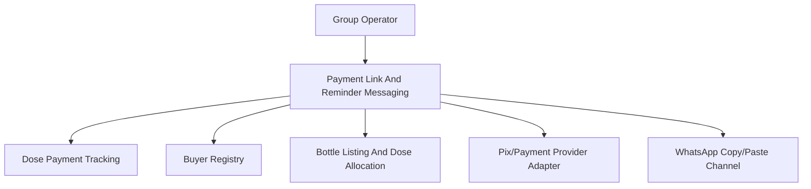
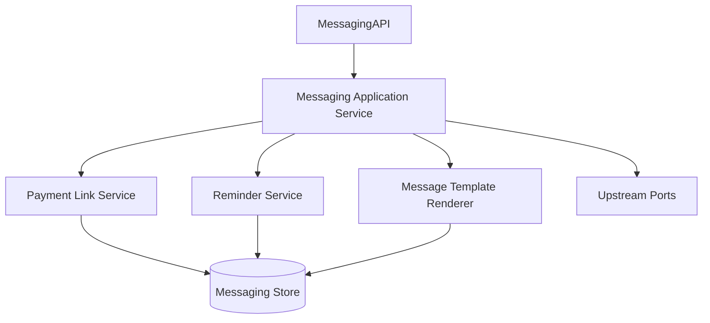
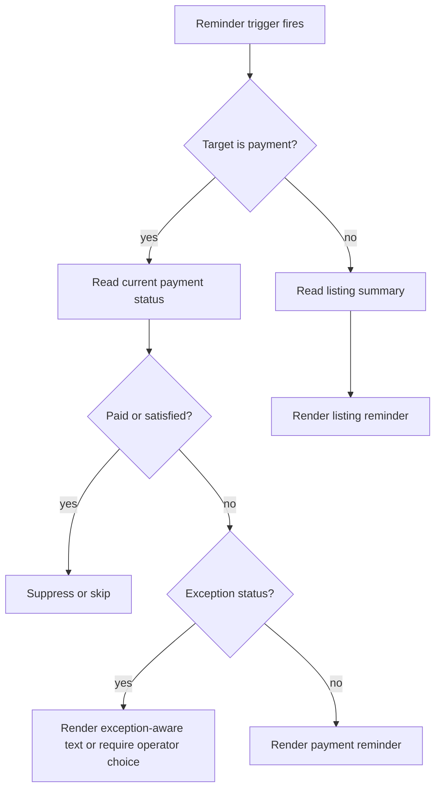

# Payment Link And Reminder Messaging Architecture

## Architecture Intent

Provide a bounded messaging layer that generates payment link artifacts, copyable reminder text, and reminder suppression state while leaving payment truth, buyer identity, listing state, and WhatsApp posting outside this feature.

## Scope Boundary

In scope:

- generate payment link messages for payment obligations
- render payment reminders and listing reminders
- track rendered/suppressed reminder state
- call provider/link adapter for link payload creation
- request provider correlation-key attachment in Dose Payment Tracking

Out of scope:

- payment amount calculation and reconciliation truth
- buyer identity management
- listing allocation and lifecycle
- public listing paid/unpaid formatting
- freight payment reminders in v1
- direct WhatsApp API posting

## Source Contracts

| Source                             | Contract Used                                                            | Evidence                                                                                       |
| ---------------------------------- | ------------------------------------------------------------------------ | ---------------------------------------------------------------------------------------------- |
| Project decisions                  | Payment link policy, reminder cadence, copy/paste WhatsApp depth         | [../../PROJECT-DECISIONS.md](../../PROJECT-DECISIONS.md)                                       |
| Initial definitions                | Payment Link, Reminder Schedule, Send Reminder, Reminder Delivery Status | [../../INITIAL-DEFINITIONS.md](../../INITIAL-DEFINITIONS.md)                                   |
| Dose Payment Tracking              | Payment run, obligation, status, reconciliation events                   | [../dose-payment-tracking/SPEC.md](../dose-payment-tracking/SPEC.md)                           |
| Buyer Registry                     | buyer names and WhatsApp mentions                                        | [../buyer-registry/SPEC.md](../buyer-registry/SPEC.md)                                         |
| Bottle Listing And Dose Allocation | listing open/fill state and allocation summary                           | [../bottle-listing-and-dose-allocation/SPEC.md](../bottle-listing-and-dose-allocation/SPEC.md) |

## Design Goals and Non-Goals

Goals:

- make payment link generation repeatable and auditable
- reduce stale or noisy reminders
- keep provider correlation compatible with Pix webhook reconciliation
- give the operator copyable text without taking on WhatsApp API risk

Non-goals:

- direct posting automation
- payment reconciliation engine
- freight collection
- template marketplace or marketing automation

## View 1: Context View

## View 2: High-Level Structure View

Components:

- `MessagingAPI`: operator-facing command/query surface
- `Payment Link Service`: generates/replaces artifacts and provider correlation-key candidates
- `Reminder Service`: evaluates cadence and suppression
- `Message Template Renderer`: creates WhatsApp-ready text
- `Messaging Store`: persists artifacts, schedules, and rendered message audit
- `Upstream Ports`: payment, buyer, listing, and provider adapter calls

## View 3: Low-Level Components View

| Component             | Responsibility                                                                             | Owns Data                  |
| --------------------- | ------------------------------------------------------------------------------------------ | -------------------------- |
| Payment Link Service  | Generate, replace, cancel, and expire payment link artifacts                               | Payment Link Artifact      |
| Reminder Service      | Create pending reminder opportunities, suppress paid/stale reminders, retry failed renders | Reminder Schedule          |
| Template Renderer     | Build copyable text from source data and customization                                     | Rendered Message text      |
| Messaging Store       | Persist artifact/schedule/render audit state                                               | Messaging-local state only |
| Payment Port          | Read payment run/status and request key attachment                                         | no                         |
| Provider Adapter Port | Create link or Pix payload                                                                 | no payment truth           |

## View 4: Workflow Process View

Primary workflow:

1. Payment run opens in Dose Payment Tracking.
2. Operator generates payment link messages for default unpaid obligations or a custom subset.
3. Messaging reads payment run, buyer mention, and provider link payloads.
4. Messaging stores active link artifacts and rendered payment-link messages.
5. Messaging requests provider correlation-key attachment in Dose Payment Tracking.
6. Reminder cadence creates pending opportunities.
7. Reminders are rendered only when payment truth remains unpaid.
8. Reconciled paid events suppress future reminders.

## View 5: Decision Flow View

## View 6: Dependency Interface View

| Dependency                         | Direction           | Interface                     | Rule                                                                                        |
| ---------------------------------- | ------------------- | ----------------------------- | ------------------------------------------------------------------------------------------- |
| Dose Payment Tracking              | consumed            | `PaymentTrackingModule`       | source of payment run, obligation, amount, status, deadline, and correlation-key attachment |
| Buyer Registry                     | consumed            | `BuyerRegistryModule`         | source of buyer name and WhatsApp mention                                                   |
| Bottle Listing And Dose Allocation | consumed            | `BottleListingModule`         | source of listing availability/fill context                                                 |
| Provider Adapter                   | consumed            | provider link generation port | returns payment URL/Pix payload and correlation-key candidate                               |
| Public WhatsApp List Rendering     | optional downstream | `MessagingModule`             | may consume rendered snippets but owns public listing composition                           |

## Dependency And Interface Rules

- Messaging cannot mutate payment status or listing allocation state.
- Messaging can request correlation-key attachment only through the Dose Payment Tracking interface.
- Messaging must re-read payment status before rendering payment reminders.
- Rendered text snapshots are audit artifacts and must not replace authoritative upstream data.
- Direct WhatsApp delivery is not represented by any v1 interface.

## Decision Log

| Decision                | Outcome                                        | Reason                                                             |
| ----------------------- | ---------------------------------------------- | ------------------------------------------------------------------ |
| Direct WhatsApp posting | Deferred                                       | V1 copy/paste rendering is selected project policy                 |
| Freight reminders       | Deferred                                       | Freight calculation/payment is outside v1                          |
| Reminder stop condition | Stop/suppress on paid status                   | Prevents stale reminders after reconciliation                      |
| Link defaults           | All unpaid obligations in selected payment run | Reduces repeated operator selection while preserving customization |

## Risks

| Risk                                                             | Severity | Mitigation                                                                                |
| ---------------------------------------------------------------- | -------- | ----------------------------------------------------------------------------------------- |
| Rendered reminder becomes stale after payment                    | high     | Re-read payment status before rendering and suppress after reconciliation events          |
| Provider link key is generated but not attached to payment truth | high     | Treat attachment failure as an operator-visible generation failure                        |
| Operator assumes rendered means delivered                        | medium   | Use `rendered` terminology and avoid delivery claims                                      |
| Reminder noise from exception statuses                           | medium   | Use exception-aware text or require operator choice for partial/overpaid/unmatched/failed |

## Design Transport Notes

Use the DomainSpec base TypeScript stack. Model messaging as an application service with explicit ports for payment, buyer, listing, and provider adapters. Persist link/reminder/rendered-message state in the messaging boundary, but keep source-of-truth reads at render time.

## Gate Result

Status: PASS

Reason: Discovery is explicitly waived by user instruction, source contracts are present, six architecture views are populated, dependency rules are stated, and v1 deferred obligations are isolated from this feature.
