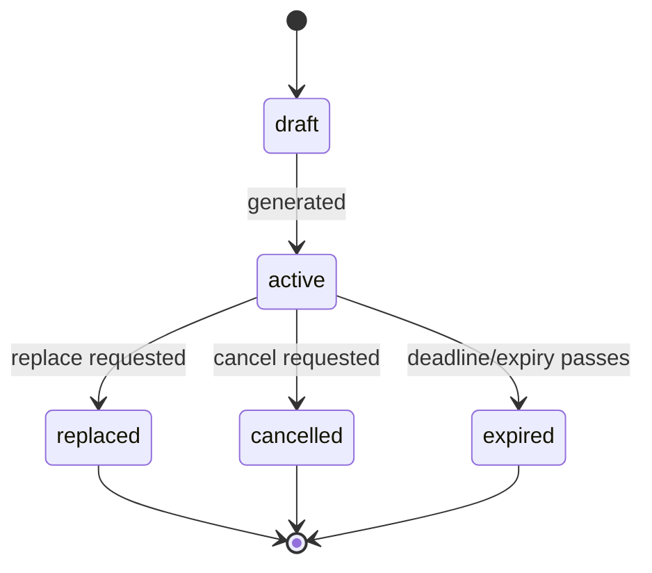
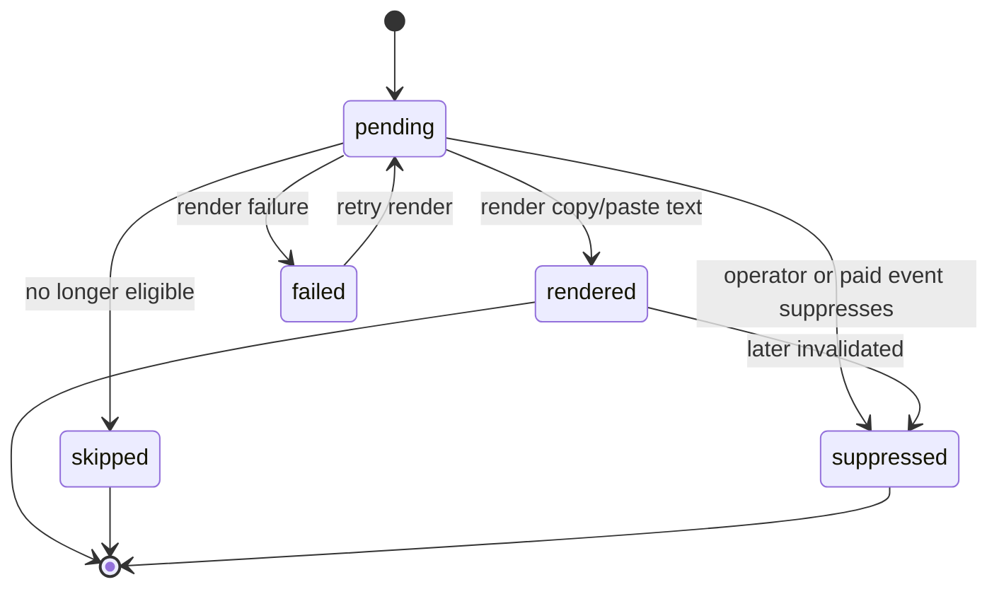

# Payment Link And Reminder Messaging States

## PaymentLinkStatusLifecycle

Allowed statuses:

- `draft`
- `active`
- `replaced`
- `cancelled`
- `expired`

Invariants:

- only one active artifact should exist for an obligation unless provider semantics require an explicit overlap window
- replaced, cancelled, and expired artifacts remain auditable
- paid obligations must not receive replacement links unless the operator explicitly records an exception workflow outside normal reminders

## ReminderDeliveryStatusLifecycle

Allowed statuses:

- `pending`
- `rendered`
- `skipped`
- `failed`
- `suppressed`

Invariants:

- `rendered` means generated for copy/paste, not delivered through WhatsApp
- payment reminders cannot remain pending after the obligation becomes paid
- suppressed reminders require a reason
