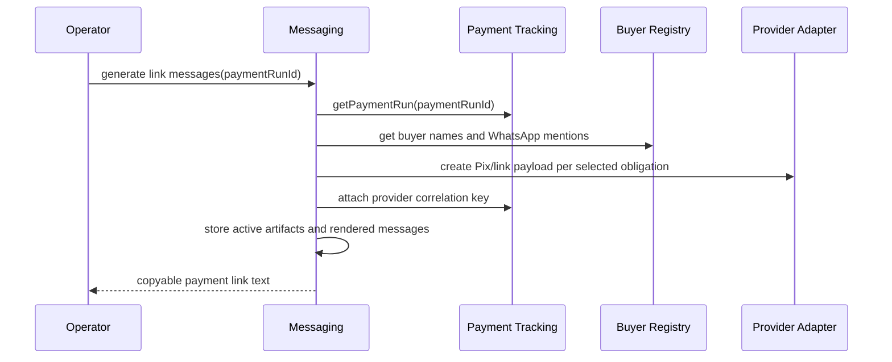
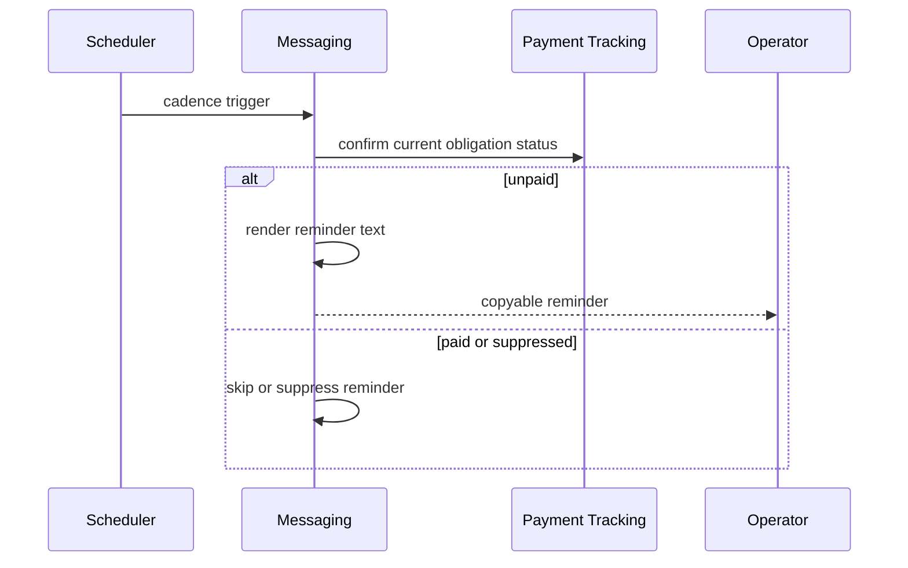
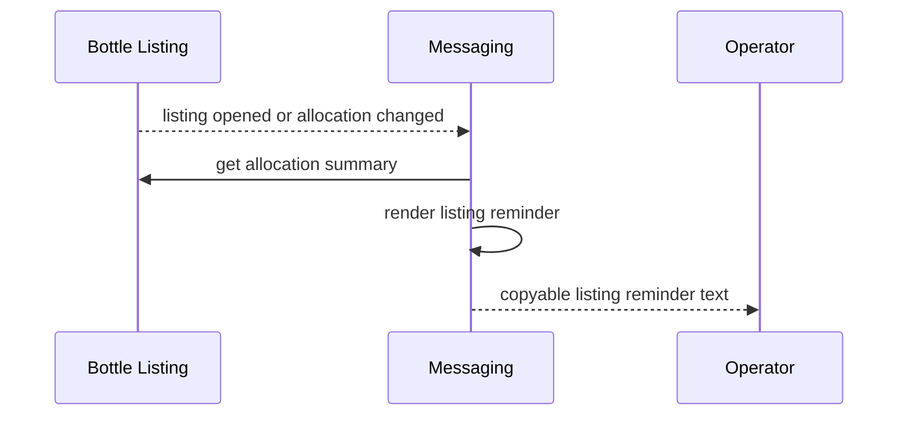
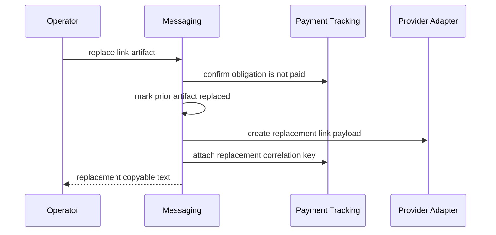

# Payment Link And Reminder Messaging Workflows

## Payment Link Message Rendering

Result:

- payment link artifacts are active
- rendered payment link text is available for copy/paste
- payment truth owns the attached provider correlation key

## Payment Reminder Rendering

Result:

- unpaid buyers receive rendered reminder text for operator use
- paid buyers are skipped or suppressed
- no direct WhatsApp delivery is inferred

## Listing Reminder Rendering

Result:

- listing reminders reflect availability or fill state
- listing lifecycle remains owned by Bottle Listing And Dose Allocation

## Link Replacement

Result:

- prior link remains auditable
- replacement link becomes active
- payment truth can reconcile against the active provider correlation key
