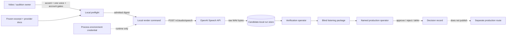
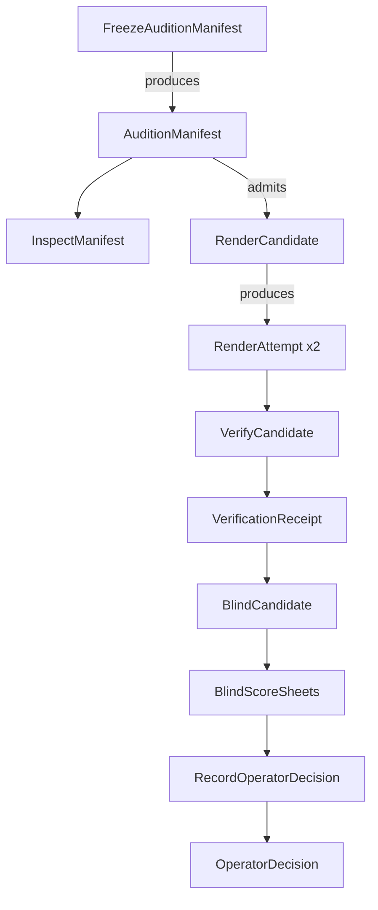
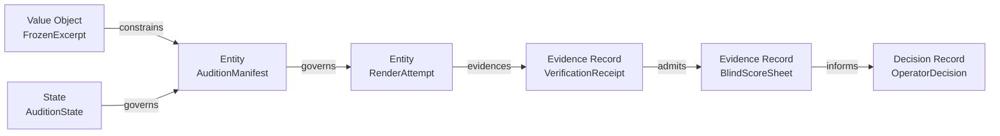
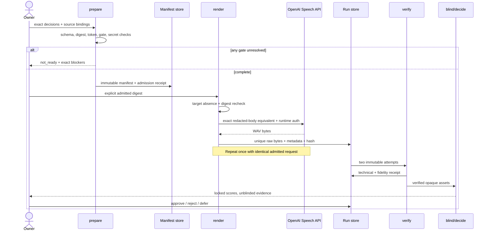
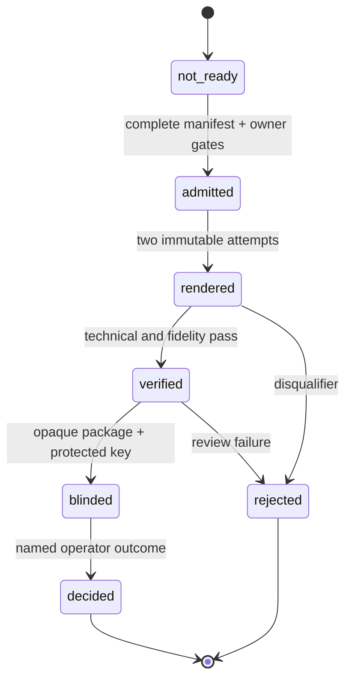

# Architecture Bundle: OpenAI Stock-Voice Audition

## Design intent

Create the smallest local workflow that can safely turn one explicitly admitted OpenAI stock-voice configuration into inspectable audition evidence. The architecture places every mutable or external effect behind digest-bound preflight, prevents credentials and undocumented controls from entering durable state, and preserves the production operator as the only terminal voice-choice owner.

## Inputs

- [SPEC.md](SPEC.md) and its aspect docs.
- [DESIGN-SCOPE-MANIFEST.json](DESIGN-SCOPE-MANIFEST.json), input digest `f941dde19822036beb8d47e0fe3a31feb2d7225f679b720b5763c279e5f8aefa`.
- [DESIGN-DENOMINATOR-RECEIPT.json](DESIGN-DENOMINATOR-RECEIPT.json), receipt digest `1308e01f9c5191bcaaabe7a4a8a1e4f573fa5a36e5a594b538a460e13621c3d3`.
- [DESIGN-SELECTION-RESULT.json](DESIGN-SELECTION-RESULT.json), fixed-point pass, result digest `718261811f1db0c1e41023029e098f885c0d09ea6d17fa422c1d24f9919d9329`.

## View 1 — Context

The owner decides the accent/locale posture, one stock voice, and account gates. OpenAI owns the live provider contract. The local runner owns request projection and evidence capture. Verification and listening own evidence. The production operator owns the terminal audition decision. A separate future route owns full narration and publication.

## View 2 — Capability

Every downstream capability consumes a named upstream artifact. No capability infers an owner decision, refreshes a stale source, retries a provider call, or advances a state implicitly.

## View 3 — Concept and type

Key semantic separations:

- A provider capability statement is not an admitted manifest.
- A rendered waveform is not a passing verification receipt.
- A passing verification receipt is not evidence of voice preference.
- A blind score is not a production decision.
- An audition decision is not public-use, release, or deployment authorization.

## View 4 — Operation and flow

Enforcement order is deliberate: source and owner gates are checked before credential access; target absence is checked before network activity; raw bytes are closed before hashing; timing evidence and word-fidelity evidence are independent; scores are locked before unblinding.

## View 5 — State

Forbidden transitions include `not_ready -> rendered`, `admitted -> verified`, `rendered -> blinded`, `verified -> decided`, and any transition out of `rejected` or `decided` for the same manifest digest. Changing voice, model, instruction, format, source, owner decision, or account gate creates a new manifest ID.

## View 6 — Dependency and interface

| Boundary | Input contract | Output contract | Owner | Failure behavior |
|---|---|---|---|---|
| Sources → preflight | Frozen excerpt + current provider docs + owner/account decisions | Digest-current candidate inputs | Source and decision owners | Stale/missing input blocks. |
| Preflight → manifest | Validated exact inputs | Immutable manifest, request preview, admission receipt | Local audition package | Any unknown or secret-shaped value blocks. |
| Manifest → provider | Exact admitted digest + runtime credential | One binary response or bounded failure metadata | Provider interface owner | No automatic retry; ambiguous response blocks. |
| Provider → run store | Raw byte stream + safe metadata | Unique append-only RenderAttempt | Local runner owner | Existing path or partial close blocks. |
| Run store → verification | Two attempts + pinned tools | VerificationReceipt | Verification operator | Any unresolved mismatch rejects. |
| Verification → listening | Accepted derivatives + opaque map | Locked score sheets | Listening experience owner | Bias/control breach invalidates listening evidence. |
| Listening → decision | Locked scores + unblinded hashes | `approve|reject|defer` | Named production operator | Missing owner keeps decision absent. |

Provider-doc refresh is an integration boundary: if the live model, voice, request fields, output, disclosure, or account posture differs from `OPENAI-SPEECH-CONTRACT.md`, admission returns to `not_ready` and a new manifest must be prepared.

## Significant behavior scenario

**Scenario:** an operator invokes future `render` with a manifest that lacks the owner accent/locale decision or an account public-use gate.

- Preconditions: frozen excerpt and request fields exist; a process may have `OPENAI_API_KEY`; no run directory exists.
- Stimulus: `render --manifest <path>`.
- Ordered response: parse → schema validate → bind source digests → evaluate every gate → detect unresolved field → stop.
- Forbidden behavior: reading/logging the credential, resolving DNS, opening a provider connection, creating an attempt file, or changing candidate state.
- Observable evidence: deterministic `not_ready` receipt naming the missing gate and manifest digest; network spy count zero; output path absent.
- Acceptance owner: audition owner, with independent validation by the package validator.

This scenario falsifies the design if external activity can occur before owner and account admission.

## Selected architecture extensions

### Authority and trust

| Decision | Authority | Non-authority evidence |
|---|---|---|
| Accent/locale and one voice | Audition owner | Official recommendations and demos |
| Account/legal/data admission | Applicable owner(s) for the actual account | Documentation snapshot and research notes |
| Technical/fidelity pass | Verification owner under the fixed protocol | Tool output alone |
| Voice fit | Human listeners under blinded conditions | Model reputation or provider copy |
| Terminal audition outcome | Named production operator | Weighted score alone |
| Full narration/publication | Separate production/release route | Audition approval |

Every receipt is scoped to one transition and one manifest digest. No child artifact can authorize its own predecessor or successor.

### Security and abuse

- The credential is referenced only by the standard runtime environment variable and is never enumerated, printed, persisted, hashed, copied into child processes unnecessarily, or included in errors.
- `prepare` is network-disabled by contract. `render` is the only network-capable command.
- Persisted request previews omit authorization headers and reject secret-shaped fields.
- The runner uses an allowlisted HTTPS origin and exact path; redirects and arbitrary base URLs are disabled by default.
- Provider error bodies are treated as untrusted and redacted before persistence.
- A dry-run/preflight receipt cannot be replayed as render authorization if its manifest or docs digest is stale.

### State and event

`STATES.md` is normative. One successful operation emits at most one declared lifecycle event. Failures create diagnostic evidence but do not emit the success event. State is derived from valid predecessor receipts for the same manifest digest, never from filenames alone.

### Persistence and concurrency

- Future runtime root: `openai-audition/runs/<manifest-id>/<run-id>/`.
- One lock per manifest prevents concurrent render attempts under the same candidate.
- Files are written to unique run-scoped temporary paths, closed, hashed, and then atomically bound.
- `O_EXCL`/equivalent no-clobber semantics are required; an existing path is a hard stop.
- Raw response bytes are immutable. Derivatives live under separate paths and cite parent hashes.
- No cleanup or retention action is implied; owner-set retention/deletion is a pre-render gate.

### Failure and compensation

The external submission cannot be undone. Therefore compensation means preserving exact failure evidence and refusing hidden retry—not pretending the submission did not happen. Timeouts, connection loss after write, ambiguous provider status, partial local writes, invalid WAV, or missing IDs all stop the candidate. Any retry requires a new attempt ID and explicit operator action; it never overwrites or silently replaces evidence.

### Integration and versioning

The request adapter accepts only the exact manifest schema version and allowlisted documented fields. Model alias drift, snapshot disappearance, voice availability change, voice-count inconsistency, output-format change, or disclosure change blocks admission and routes to documentation refresh. The local summary never substitutes for the live provider contract.

### Data lifecycle

| Data class | Purpose | Access | Retention/deletion owner |
|---|---|---|---|
| Frozen excerpt | Exact audition input | Package reviewers/operators | Video source owner |
| Raw audio | Provider-response evidence | Renderer/verifier | Audition owner; decision required before render |
| Derived audio | Comparable listening asset | Verifier/listeners | Audition owner |
| Provider metadata | Reproducibility/cost evidence | Renderer/reviewer | Audition owner |
| Scores/unblinding key | Bias-controlled human evidence | Listeners; key custodian | Production operator |
| Credential | Request authentication | Render process only | Account owner; never stored here |

Actual OpenAI training, abuse-monitoring, ZDR, deletion, region, and support-access configuration remain account gates. No local design claim closes them.

### Quality

Technical acceptance requires a lossless master, 75–120 second duration, no clipping/truncation/non-speech artifacts, exact word fidelity, monotonic timing, and required phrase review. Listening uses the frozen weighted rubric: warmth 20%, naturalness 20%, semantic arc 20%, time/confidence/authority distinction 15%, pacing/cadence 15%, pronunciation 10%. At least three listeners evaluate two repetitions under common playback conditions. A difference under 3 weighted points is a tie and requires a longer test; no score can override a hard gate.

## Concern-to-view trace

| Concern | Class | Disposition | Accountable owner | View/extension |
|---|---|---|---|---|
| concern:authority | authority | required | audition-owner | Authority and trust |
| concern:security | security | required | security-risk-owner | Security and abuse |
| concern:state-event | state-event | required | audition-workflow-owner | View 5 + state/event |
| concern:persistence | persistence | required | audition-runner-owner | Persistence and concurrency |
| concern:failure | failure | required | audition-workflow-owner | Failure and compensation |
| concern:reliability | reliability | required | audition-quality-owner | Quality |
| concern:integration | integration | required | provider-interface-owner | View 6 + integration/versioning |
| concern:migration | migration | not applicable with rationale | migration-owner | None; greenfield local package |
| concern:rollout | rollout | not applicable with rationale | release-owner | None; release excluded |
| concern:privacy-data | privacy-data | required | data-owner | Data lifecycle |
| concern:performance | performance | required | audition-quality-owner | Quality thresholds |
| concern:ux | ux | required | listening-experience-owner | [UX-PLAN.md](UX-PLAN.md) |
| concern:validation | validation | required | design-owner | [VALIDATION-CONTRACTS.md](VALIDATION-CONTRACTS.md) |

## Planned witness contracts

The machine-readable witness list is [DESIGN-PLANNED-WITNESSES.json](DESIGN-PLANNED-WITNESSES.json). Fixture and validator details are in [VALIDATION-CONTRACTS.md](VALIDATION-CONTRACTS.md). They are planned Design contracts, not executed evidence.
