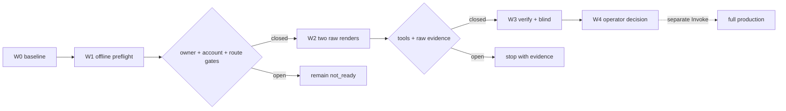

# Execution Pack: OpenAI Stock-Voice Audition

## Planning control

| Field | Value |
|---|---|
| planningGateStatus | pass for L0; blocked for L1–L3 until named gates close |
| complexity | medium |
| baselineWave | W0 |
| activePlanRef | `work-pack/waves/W0.md` |
| workPackManifest | `WORK-PACK.md` |
| layeringArtifact | `IMPLEMENTATION-LAYERING.md` |
| specRef | `SPEC.md` |
| activeLayerWindow | L0 |
| selectedSWU | none |
| readinessProfile | pilot |

## Choreography

## Wave table

| Wave | Layer question | Included SWUs | Entry gate | Exit evidence | Parallelization |
|---|---|---|---|---|---|
| [W0](work-pack/waves/W0.md) | Is the planning baseline current? | none | Design pass | Source/digest/runtime/blocker review | none |
| [W1](work-pack/waves/W1.md) | Does preflight fail closed offline? | 001 → 002 | W0 | Deterministic tests and zero-network negative fixtures | sequential; overlapping runtime core |
| [W2](work-pack/waves/W2.md) | Can one admitted configuration yield two immutable attempts? | 003 → 004 | W1 + B-001–B-005 closed + explicit authorization | Two raw hashes and request/attempt receipts | sequential; one external effect owner |
| [W3](work-pack/waves/W3.md) | Are words/format valid and listening unbiased? | 005 → 006 → 007 | W2 + B-006/B-007 closed | Verification receipt and locked blind scores | sequential evidence chain |
| [W4](work-pack/waves/W4.md) | What does the named operator decide? | 008 | W3 | Hash-bound `approve|reject|defer` | none |

## Closure obligations

- Every wave uses the same manifest digest or stops.
- Each SWU closes through its exact Work Pack sync row before a successor can be selected.
- No wave auto-continues, auto-retries, installs tools, uses credentials, or opens a later layer.
- W4 closes the audition only; full narration requires new scope and authority.
